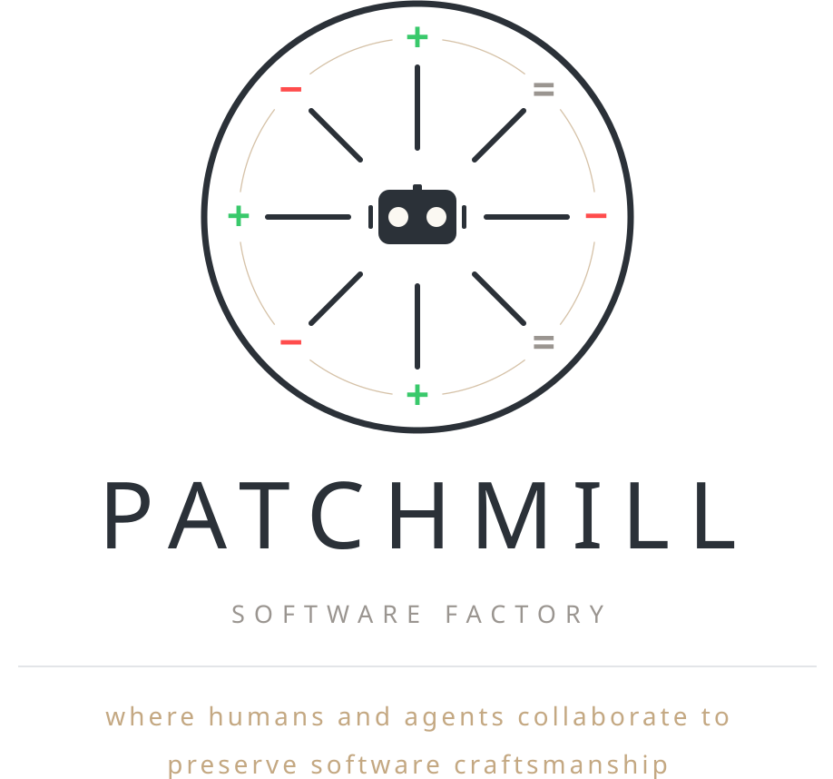

<p align="center">
  <picture>
    <source media="(prefers-color-scheme: dark)" srcset="docs/assets/logo-dark.svg">
    <source media="(prefers-color-scheme: light)" srcset="docs/assets/logo-light.svg">
    
  </picture>
</p>

Patchmill advances one issue through planning and implementation with Pi. A
small kernel handles process control and host facts. Skills hold the advice for
planning, coding, review, and evidence. GitHub uses `gh`. Forgejo and Gitea use
`tea`.

## The five kernel responsibilities

Process supervision starts a fresh Pi session for each phase. It sets the agent
directory and enforces `pi.timeoutMinutes`, which defaults to 90 minutes. On
timeout or cancellation, it sends `SIGTERM` to the process group, then `SIGKILL`
after five seconds if needed.

Claim and release prevent cooperating runs from owning the same issue in one
clone. The kernel holds an OS lock on a permanent file and swaps host labels. A
narrow race between separate clones remains possible. The lock file and its
parent directory must stay in place, even after a crash.

Phase derivation reads git and the issue host. Spec and plan gates are optional
and default off. Each required gate uses a separate planning pull request. Only
merging that pull request unlocks the next stage. Logs, result files, and
approval labels never decide what happens next.

Outcome verification checks facts after Pi finishes. Planning needs the pushed
branch and required documents. A gated stage also needs its planning pull
request. Implementation needs an open, non-draft pull request whose head matches
the branch and whose body closes the issue. `agent-done` means that this pull
request exists, not that it merged.

Stable names give humans and agents the same paths. Branches use
`agent/issue-N-<slug>` for implementation. Required gates use
`agent/issue-N--spec` and `agent/issue-N--plan`. Specs use
`docs/specs/YYYY-MM-DD-issue-N-<slug>-design.md`. Plans use
`docs/plans/YYYY-MM-DD-issue-N-<slug>-plan.md`. The slug comes from the issue
title and only describes the file. The issue number and the `-design` or `-plan`
suffix identify it, so a title edit never changes which file is the spec or the
plan. Plans from earlier versions have no `-plan` suffix. Rename them once, for
example `2026-10-01-issue-9-login.md` to `2026-10-01-issue-9-login-plan.md`.
Worktrees live under `.worktrees`, with branch slashes replaced by hyphens.

## Install and start

```sh
npm install -g patchmill
patchmill init --provider github-gh
patchmill auth
patchmill labels setup
patchmill doctor
patchmill triage --dry-run
patchmill triage
patchmill run-once
```

Run these commands in a repository with an `origin` remote and authenticated
host CLI. `auth` asks for an authentication method, provider, and model. It
saves credentials and the default model in the repository's Pi agent directory,
runs a real provider smoke prompt, and returns to your shell without opening Pi
chat. `doctor` includes a real model smoke prompt. Triage dry runs also call the
model.

By default, planning writes the spec and plan on the implementation branch and
continues to implementation. Set either workflow gate to `required: true` for a
separate planning pull request. Review and merge that pull request, then run
`patchmill run-once --issue N` again. Review approval alone does not unlock a
gate. The issue stays `in-progress` while waiting, and no Pi session runs then.

With both gates enabled, merge the spec PR, then the plan PR, before
implementation. Each later branch starts from the fetched base with the merged
documents. Ungated documents go into the next gated PR or the implementation PR.
The kernel never deletes these worktrees.

## Commands

| Command                                                    | Behaviour                                                                                                                                                     |
| ---------------------------------------------------------- | ------------------------------------------------------------------------------------------------------------------------------------------------------------- |
| `patchmill init`                                           | Write config when missing, install skills, provision the agent directory. Idempotent.                                                                         |
| `patchmill auth`                                           | Choose a subscription or API key, provider, and default model. Save them in the configured Pi agent directory, verify the provider, then return to the shell. |
| `patchmill doctor`                                         | Read-only checks: host CLI logged in, labels exist, worktree directory ignored, skills present, Pi answers a smoke prompt.                                    |
| `patchmill labels setup`                                   | Create missing labels.                                                                                                                                        |
| `patchmill triage [--dry-run]`                             | Run the triage skill per candidate issue. Dry run runs Pi and prints the labels and comment instead of applying them.                                         |
| `patchmill run-once [--issue N] [--dry-run] [--plan-only]` | Advance one issue. Dry run prints the selected issue and derived phase without claiming or running Pi.                                                        |
| `patchmill release --issue N`                              | Clear a stale claim after a hard crash.                                                                                                                       |
| `patchmill version`                                        | Print the version.                                                                                                                                            |
| `patchmill setup-test-repo`                                | Development tool for the end-to-end CI (#320). Outside the kernel.                                                                                            |

## Configuration

`patchmill.config.json` accepts only these keys. Each key has a default. Unknown
keys fail by name. `git.baseBranch: null` uses the remote default branch.

```json
{
  "host": { "provider": "github-gh", "login": "", "trustedAuthors": [] },
  "labels": {
    "ready": "agent-ready",
    "inProgress": "in-progress",
    "needsInfo": "needs-info",
    "done": "agent-done",
    "unsuitable": "agent-unsuitable",
    "blocked": "blocked"
  },
  "paths": {
    "specsDir": "docs/specs",
    "plansDir": "docs/plans",
    "worktreeDir": ".worktrees",
    "runsDir": ".patchmill/runs"
  },
  "git": { "baseBranch": null },
  "skills": {
    "triage": ".patchmill/skills/patchmill-issue-triage",
    "planning": ".patchmill/skills/patchmill-planning",
    "implementation": ".patchmill/skills/patchmill-implementation"
  },
  "pi": { "agentDir": ".patchmill/pi-agent", "timeoutMinutes": 90 },
  "workflow": {
    "specApproval": { "required": false },
    "planApproval": { "required": false }
  }
}
```

`init` leaves valid existing configuration unchanged and rejects invalid
configuration. Retired spec/plan review-label settings are accepted but ignored.
New configuration omits them. Other removed keys remain invalid. GitHub init can
seed `host.login` from the detected user. For Forgejo, an empty login selects
Tea's default profile. Only an explicit profile alias selects another profile.
The detected username is not that alias. The authenticated username and
`host.trustedAuthors` identify trusted comment authors. GitHub also trusts its
configured `host.login`. A Tea profile alias does not grant author trust.

## Label lifecycle

| Label         | Meaning                                               | Set by                    | Removed by              |
| ------------- | ----------------------------------------------------- | ------------------------- | ----------------------- |
| `agent-ready` | Eligible for a Run attempt.                           | Human or triage           | Kernel on claim         |
| `in-progress` | Work is active or waiting for a planning PR merge.    | Kernel on claim           | Kernel on final release |
| `needs-info`  | The agent asked questions, or the Run attempt failed. | Kernel                    | Kernel on next claim    |
| `agent-done`  | A ready pull request that closes the issue exists.    | Kernel after verification | Human                   |

Triage returns one of `agent-ready`, `agent-unsuitable`, `blocked`, or
`needs-info` by default. The kernel applies labels and comments. Agents own git
and the pull request. They do not change issue labels or post issue comments.

After a hard crash, `patchmill release --issue N` acquires the same OS lock and
resets a stale `in-progress` label to `agent-ready`. Contention prevents label
changes. Do not delete the permanent lock or its parent directory.

## Branch protection

Direct landing is a host control, not a Patchmill feature. The skills forbid
pushing the base branch and force-pushing. Shell access cannot enforce that
advice. Use branch protection on the host to prevent direct pushes.

## Documentation and roadmap

Read [patchmill.dev](https://patchmill.dev) for the
[quickstart](https://patchmill.dev/getting-started/quickstart/) and
[Run-once guide](https://patchmill.dev/using-patchmill/run-once/). The
[roadmap](docs/roadmap.md) describes future work, not current capabilities.
Patchmill installs pinned [Superpowers](https://github.com/obra/superpowers) and
SimpleEnglish skills alongside its own skills.

## Frontend design and review

The recommended local pack adds conditional frontend guidance. For meaningful
browser-visible changes, planning includes a linked, offline full-page HTML
mockup. Implementation completes normal code review and validation, then runs
fresh independent frontend review. The parent repairs valid findings and
refreshes review and evidence after frontend changes.

Backend, documentation, and non-material copy work skip these additions. Pack
`2026.10.2` uses pinned local guidance and needs no configuration change. Custom
and global workflows opt in through their own wrappers. See
[Skills configuration](https://patchmill.dev/guides/skills-configuration/) and
[Workflow artifacts](https://patchmill.dev/using-patchmill/workflow-artifacts/).

## License

Apache-2.0. See [LICENSE](LICENSE).
