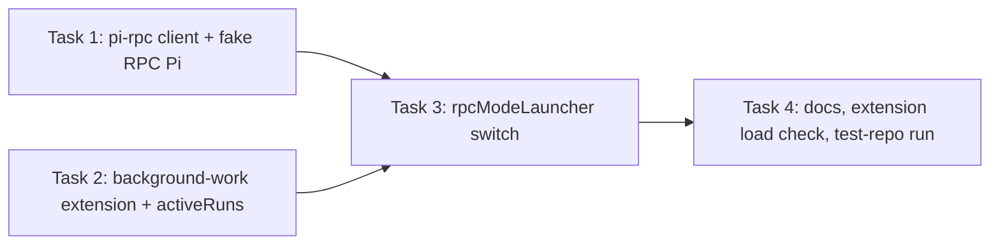

# Run Pi in RPC Mode in the Run-once Workflow Implementation Plan

> **For agentic workers:** REQUIRED SUB-SKILL: Use the sibling `executing-plans`
> skill to implement this plan inline, task by task. Steps use checkbox
> (`- [ ]`) syntax for tracking.

**Goal:** Run-once phase sessions run `pi --mode rpc` through a small Patchmill
RPC client, with the same results, logs, and failure handling as `pi -p`.

**Architecture:** A new deep module, `src/kernel/pi-rpc.ts`, takes the same
`PiSessionOptions` and returns the same `PiSession` as `supervisePi`. It hides
the JSONL protocol, dialog answers, the finish rule, exit-code parity, logs, and
process-group shutdown. A small background-work extension,
`src/kernel/pi-rpc-extension.ts`, reports outstanding `pi-subagents` runs at
each `agent_settled` and stops them at shutdown. `printModeLauncher` becomes
`rpcModeLauncher`. Triage and the doctor smoke check keep print mode.

**Tech Stack:** TypeScript on Node (type stripping), `node:test`, Pi 1.5.2 RPC
mode, `pi-subagents` 0.80.0 in-process RPC.

**Spec:**
[docs/specs/2026-11-16-issue-305-run-pi-in-rpc-mode-in-the-run-once-workflow-design.md](../specs/2026-11-16-issue-305-run-pi-in-rpc-mode-in-the-run-once-workflow-design.md).
Parent spec: `docs/specs/2026-10-14-issue-225-interactive-issue-runs-design.md`
on `origin/main` (read-only). The spec has no mockup. Frontend design does not
apply. The spec and this plan explain themselves with inline Mermaid; there is
no HTML companion.

## Global Constraints

- Pi argv for a phase:
  `--mode rpc --session-dir <dir> [--skill <path>] -e <ext>... -e <background-work extension>`.
  No `@<prompt>` argument. The prompt file contents go in one `prompt` command.
- `PiSessionOptions` and `PiSession` do not change. `stdout` holds the final
  assistant text that `parseAgentResult` reads.
- Status key: `patchmill-background-work`. Value: `"<settle>:<count>"`, where
  `<settle>` is the 1-based `agent_settled` number in the process.
- Report wait: 15 s after each `agent_settled`, then count `0` with a log
  warning. `pi-subagents` reply timeout inside the extension: 10 s, then `0`.
- Dialog answer: `{"type":"extension_ui_response","id":<id>,"cancelled":true}`
  for `select`, `confirm`, `input`, and `editor`.
- Exit-code parity with print mode: last assistant `stopReason` `error` or
  `aborted` → `stdout` `""`, log `errorMessage` (or `Request <stopReason>`),
  `exitCode` `1`. `length` → `stdout` is the text, log
  `Response was truncated: the model reached its output token limit.`,
  `exitCode` `1`. A non-zero exit or a signal from Pi always wins.
- Abort and timeout: send `abort`, wait at most `graceMs` for its response,
  close stdin, `SIGTERM` the process group, `SIGKILL` after `graceMs`.
- JSONL framing: split stdout only on `\n`, strip one trailing `\r`. Do not use
  `node:readline`.
- No npm dependency changes. If any occur, rerun the Nix build.
- Triage, the doctor smoke check, and `src/cli/commands/auth/pi-smoke-test.ts`
  keep `-p`.

## Review Focus

1. **Pi dies while a command is outstanding.** `get_last_assistant_text` or
   `abort` gets no response because Pi exited. Expect: `done` resolves from the
   process exit, never hangs. Test in Task 1 (`crash before settle`).
2. **Writes to stdin after Pi exits.** An `EPIPE` on stdin must not throw out of
   `done` or crash Patchmill. Test in Task 1 (`abort after exit`).
3. **A stdout record split across chunks, or one with U+2028 in a string.**
   Expect: one record, parsed once. Test in Task 1 (`framing`).
4. **The background-work extension does not load.** No report arrives. Expect:
   the session ends 15 s after settle with a warning in the log, not at the
   phase timeout. Test in Task 1 (`missing report`), with the report wait
   injectable as an internal option.
5. **A background run finishes after a settle reported 1.** Its delivery turn
   ends with a new settle that reports 0. Expect: `stdout` is the text of that
   later turn. Test in Task 1 (`background work`) and the count rules in Task 2.

---

## File structure

```text
src/kernel/
├── pi-rpc.ts               # new: RPC phase session (process, finish rule, logs)
├── pi-rpc-protocol.ts      # new: JSONL framing and record types
├── pi-rpc.test.ts          # new: runner against the fake RPC Pi
├── pi-rpc-extension.ts     # new: background-work extension
├── pi-rpc-extension.test.ts
├── pi-supervisor.ts        # export signalGroup only
├── launch.ts               # printModeLauncher -> rpcModeLauncher
└── interactive-loop.ts     # uses rpcModeLauncher
src/console/subagents-client.ts   # add activeRuns()
test-support/fake-pi.mjs          # learns --mode rpc
test-support/fake-human.ts        # uses rpcModeLauncher
docs/mockups/web/run-once-workflow.md  # answers to the two questions
```

---

### Task 1: RPC phase session and fake RPC Pi

**Files:**

- Create: `src/kernel/pi-rpc-protocol.ts`, `src/kernel/pi-rpc.ts`,
  `src/kernel/pi-rpc.test.ts`
- Modify: `src/kernel/pi-supervisor.ts` (export `signalGroup`),
  `test-support/fake-pi.mjs`

**Interfaces:**

- Consumes: `PiSessionOptions`, `PiSession`, `signalGroup` from
  `pi-supervisor.ts`; `piCommandArgs` from `src/cli/pi-cli.ts`.
- Produces:

  ```ts
  // pi-rpc-protocol.ts
  export function jsonlRecords(
    onRecord: (record: unknown) => void,
    onText: (line: string) => void,
  ): (chunk: string) => void; // per-chunk feeder
  // pi-rpc.ts
  export const BACKGROUND_WORK_STATUS = "patchmill-background-work";
  export type PiRpcSession = {
    steer(message: string): Promise<void>;
    followUp(message: string): Promise<void>;
    abort(): Promise<void>;
    done: Promise<PiSession>;
  };
  export function piRpcArgs(options: PiSessionOptions): string[];
  export function startPiRpc(
    options: PiSessionOptions & { reportWaitMs?: number },
  ): PiRpcSession;
  export function runPiRpc(options: PiSessionOptions): Promise<PiSession>;
  ```

  `reportWaitMs` defaults to `15_000` and exists so tests can shorten it.
  `abort()` acts like the `AbortSignal`: it sets `aborted`.

**Fake RPC Pi.** When `process.argv` contains `--mode rpc`, `fake-pi.mjs` keeps
all current step side effects (session file, `writeFiles`, `commit`, `push`,
`pullRequest`, `issuePatch`, `stderr`, `ignoreSigterm`) and changes only how it
talks:

1. Read JSONL commands from stdin. Answer `get_last_assistant_text`, `abort`,
   `steer`, `follow_up` with `success: true` (`steer`/`follow_up` append
   `steer:<message>` to a `rpc-commands.log` next to the script, for the test).
2. On `prompt`, answer `{disposition:"started"}`, run side effects, then emit a
   `message_end` with an assistant message. Its text is the `stdout` lines, the
   `printEnv` lines, and the fenced result block, joined with `\n`. Its
   `stopReason` is `step.stopReason ?? "stop"`, with `step.errorMessage`.
3. If `step.dialog` is set (`"select"` etc.), emit one `extension_ui_request`
   with that method, wait for the response, and append `dialog:<json response>`
   to the text before the `message_end`.
4. Sleep `sleepMs`. If `exitCode` is non-zero, exit with it now (crash before
   settle).
5. For each entry of `step.backgroundCounts ?? [0]` (index `i`): emit
   `agent_settled`, then (unless `step.noReport`) a `setStatus` request with
   `statusKey: "patchmill-background-work"` and `statusText: "<i+1>:<count>"`.
   If the count is above 0, wait 50 ms and emit another assistant `message_end`
   with text `background turn <i+2>` before the next settle.
6. On stdin end, exit 0 unless `ignoreSigterm`.

Print mode in the fake is unchanged.

- [ ] **Step 1: Write the failing tests** in `src/kernel/pi-rpc.test.ts`, with a
      `fake(t, steps)` helper like the one in `pi-supervisor.test.ts`:
  - `piRpcArgs` returns exactly
    `["--mode","rpc","--session-dir","/s","--skill","/k","-e","/one","-e","/two"]`
    for the same input as the existing `piArgs` test, and omits `--skill` when
    there is no skill.
  - `normal result`: step `{stdout:"ok", stderr:"warning", result:done}` →
    `exitCode 0`, `signal null`, `parseAgentResult(stdout)` deep-equals `done`,
    log contains `ok`, `warning`, and the result JSON.
  - `pi error`: step
    `{stopReason:"error", errorMessage:"overloaded", stdout:"x"}` → `stdout ""`,
    `exitCode 1`, log contains `overloaded`.
  - `truncated`: `stopReason:"length"` → `stdout` contains the text,
    `exitCode 1`, log contains `Response was truncated`.
  - `dialog`: for each of `select`, `confirm`, `input`, `editor`, `stdout`
    contains
    `dialog:{"type":"extension_ui_response","id":"<id>","cancelled":true}`
    (match on `"cancelled":true`).
  - `crash before settle`: `{result:done, exitCode:7}` → `exitCode 7`,
    `parseAgentResult(stdout)` deep-equals `done`, and `done` resolves.
  - `abort`: `{result:done, sleepMs:5000}`, abort the signal after the result is
    in the log → `aborted true`; `signalGroup(pid, 0)` is `false` after `done`
    (no process left). Read the pid from the fixture's `pi.pid` file.
  - `abort after exit`: call `session.abort()` after `done` resolved → no throw.
  - `timeout` for `ignoreSigterm` `false` and `true` → `timedOut true`, `signal`
    `SIGTERM` or `SIGKILL`.
  - `background work`: `backgroundCounts:[1,0]` → `stdout` is
    `background turn 2`.
  - `missing report`: `noReport:true`, `reportWaitMs:100` → session ends,
    `exitCode 0`, log contains `background-work report`.
  - `framing`: feed `jsonlRecords` the chunks `'{"a":"x
y"}\r'` and
    `'\n{"b":1}\nnot json\n'` → records `[{a:"x
y"},{b:1}]`, text
    `["not json"]`.
  - `steer and follow_up`: call both before settle on a `sleepMs` step → the
    fake's `rpc-commands.log` holds both messages; after `done`, `steer`
    rejects.
- [ ] **Step 2: Run** `node --test src/kernel/pi-rpc.test.ts`. Expected: FAIL,
      module not found.
- [ ] **Step 3: Implement `jsonlRecords`** in `pi-rpc-protocol.ts`. Non-JSON
      lines go to `onText`. Keep record type unions here.
- [ ] **Step 4: Implement `startPiRpc`** in `pi-rpc.ts`. Spawn as `supervisePi`
      does (`detached`, `PI_CODING_AGENT_DIR`, `stdio: ["pipe","pipe","pipe"]`).
      Log writes, `onOutput`, and sink error handling follow `supervisePi`.
      Assistant `message_end` text and non-JSON stdout lines go to the logs when
      they arrive; stderr as it arrives; `extension_error` as
      `Extension error (<path>): <error>`. Keep the last assistant message for
      parity and the crash fallback. After a normal exit, if
      `signalGroup(pid, 0)` is `true`, run the same `SIGTERM`/`SIGKILL`
      escalation. Catch stdin `error` events.
- [ ] **Step 5: Run**
      `node --test src/kernel/pi-rpc.test.ts src/kernel/pi-supervisor.test.ts`.
      Expected: PASS.
- [ ] **Step 6: Commit**
      `git commit -m "feat(kernel): add Pi RPC phase session client"`.

### Task 2: Background-work extension

**Files:**

- Create: `src/kernel/pi-rpc-extension.ts`,
  `src/kernel/pi-rpc-extension.test.ts`
- Modify: `src/console/subagents-client.ts`, its test

**Interfaces:**

- Consumes: `SubagentsClient`, `BACKGROUND_WORK_STATUS` from Task 1.
- Produces:
  `export default function backgroundWorkExtension(pi: ExtensionAPI): void` and
  `SubagentsClient.activeRuns(): Promise<{ id: string; state: string }[]>`.

Rules (from the spec): count = active runs (`queued`, `running`, `stopping`) \+
completions with `triggerTurn: true` whose run ID no `subagent-notify`
`message_end` has carried yet. An incomplete `status` (any `omitted` field set)
reports at least `1`. A `reply_timeout` or missing `pi-subagents` reports `0`.
Before you write the tests, confirm in `pi-subagents` 0.80.0 source the run-ID
field of the `subagent:async-complete` payload (`runId`/`id`) and of
`details.runs[]` in `subagent-notify` (see `notifyRunDetails` in
`runs/background/notify.js`). Use those names in the fake events.

- [ ] **Step 1: Write the failing tests** with `fakeExtensionApi` and
      `fakeSubagents`:
  - `activeRuns` returns runs in `queued`, `running`, and `stopping` for any
    agent; `activeWorkers` still returns only `patchmill-implementation` runs
    (existing test passes).
  - Two `agent_settled` events with no runs → statuses `"1:0"` then `"2:0"`.
  - One `running` run → `"1:1"`.
  - Completion with `triggerTurn: true`, no runs active → `"1:1"`; after a
    `message_end` custom message `subagent-notify` with that run ID → next
    settle `"2:0"`.
  - Completion with `triggerTurn: false` → `"1:0"`.
  - `status` reply with `omitted.runs: 1` → `"1:1"`.
  - No `pi-subagents` reply → `"1:0"` (use a short reply timeout).
  - `session_shutdown` with one running run → one `stop` request with that ID.
- [ ] **Step 2: Run**
      `node --test src/kernel/pi-rpc-extension.test.ts src/console/subagents-client.test.ts`.
      Expected: FAIL.
- [ ] **Step 3: Implement** `activeRuns()` and make `activeWorkers()` filter it.
      Implement the extension. Create one `SubagentsClient(pi.events)` per
      extension load; dispose it on `session_shutdown` after the stops.
- [ ] **Step 4: Run** the same tests. Expected: PASS.
- [ ] **Step 5: Commit**
      `git commit -m "feat(kernel): report background subagent work in RPC sessions"`.

### Task 3: Switch run-once phases to RPC mode

**Files:**

- Modify: `src/kernel/launch.ts`, `src/kernel/interactive-loop.ts`,
  `test-support/fake-human.ts`, `src/console/worker-launcher.test.ts`

**Interfaces:**

- Consumes: `runPiRpc` (Task 1), the extension module (Task 2).
- Produces:
  `rpcModeLauncher(options: { command: PiCommandSpec; agentDir: string; extensionPaths: string[] }): PhaseLauncher`
  and `BACKGROUND_WORK_EXTENSION_PATH: string`, the absolute path of
  `pi-rpc-extension` next to `launch`, with the same file extension as the
  running `launch` module (`.ts` from source, `.js` from `dist`).

- [ ] **Step 1: Write the failing test** in a new `src/kernel/launch.test.ts`:
      `rpcModeLauncher` with a command that records its argv (a fake RPC Pi step
      with `printEnv` is not enough; use a wrapper that writes `process.argv` to
      a file, then imports `fake-pi.mjs`) passes
      `-e <ext1> -e <BACKGROUND_WORK_EXTENSION_PATH>` in that order, and
      `existsSync(BACKGROUND_WORK_EXTENSION_PATH)` is `true`.
- [ ] **Step 2: Run** `node --test src/kernel/launch.test.ts`. Expected: FAIL.
- [ ] **Step 3: Implement.** Rename `printModeLauncher` to `rpcModeLauncher`,
      call `runPiRpc`, append the extension path. Update the three callers. In
      `worker-launcher.test.ts`, rename the test to
      `missing JSON matches rpcModeLauncher parsing ...`; its non-RPC command
      exits before settle, so `stdout` is `""` and the result stays
      `{ ok: false, reason: "no result" }`.
- [ ] **Step 4: Run** `npm test`. Expected: PASS. The run-once suites
      (`run-once*.test.ts`, `planning-gates.test.ts`, `interactive-*.test.ts`,
      `local-*.test.ts`) pass with no edits. If one fails, fix the runner or the
      fake, not the test, unless the test checks Pi arguments.
- [ ] **Step 5: Run** `npm run build`, then confirm that
      `dist/src/kernel/pi-rpc-extension.js` (or the build's equivalent path)
      exists.
- [ ] **Step 6: Commit**
      `git commit -m "feat(kernel): run run-once phases in Pi RPC mode"`.

### Task 4: Record the answers and check a real run

**Files:**

- Modify: `docs/mockups/web/run-once-workflow.md`

- [ ] **Step 1:** Replace the "Things to test before live chat" section with
      "Answers from #305": the two answers from the spec (fork, tool list), and
      the `ctx.hasUI` effect on `pi-subagents` with the finish rule. Use simple
      English. Run `npm run lint`.
- [ ] **Step 2: Extension load check.** Start the bundled Pi with
      `--mode rpc --no-session -e <extension path>` and an empty
      `PI_CODING_AGENT_DIR`, send `{"type":"get_state"}`, close stdin. Expected:
      a `get_state` response and no `extension_error` record.
- [ ] **Step 3: Test repository run.** Run `patchmill setup-test-repo`, then one
      `patchmill run-once` on its issue. Compare with a run from `main`: run
      state, progress log, `session-<n>.log`, Pi session files, and result have
      the same shape. Then `pgrep -f "mode rpc"` prints nothing. Repeat with
      Ctrl-C during a phase; `pgrep` again prints nothing.
- [ ] **Step 4: Commit**
      `git commit -m "docs(web): record Pi RPC answers from #305"`.

### Final verification

- [ ] `npm test`, `npm run check:types`, and `npm run lint` pass.
- [ ] The maintainer posts the two answers as an issue comment. Agents do not
      post issue comments.

## Visual explanation

Task order and ownership:



Tasks 1 and 2 are independent. Task 3 joins them and runs the full suite.

## Plan review

Pending.
