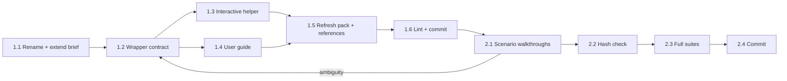

# Planning review implementation plan

> **For agentic workers:** REQUIRED SUB-SKILL: Use the installed sibling
> `executing-plans` skill for inline implementation. Follow the kernel envelope.
> Steps use checkboxes for tracking. Do not start per-task subagents.

**Goal:** Give Patchmill planning one adversarial, fresh-context Planning review
with a flexible scope. It runs on request and at each review boundary.

**Architecture:** Skill-only change. The planning wrapper owns triggers, scope,
bounds, dispositions, and the review record. One renamed reviewer brief owns the
adversarial checks. Kernel, configuration, and result schema do not change.

**Tech Stack:** Markdown skills, the existing skill-pack updater, Node.js test
and lint scripts.

**Spec:**
[Adversarial review of specifications and plans](../specs/2026-11-19-issue-177-add-adversarial-spec-and-plan-review-to-planning-design.md).

## Global constraints

- Do not change `src/kernel/`, configuration, the planning result schema, npm
  manifests, or lockfiles.
- Do not edit vendored upstream skills (`brainstorming`, `writing-plans`, or
  others under `.patchmill/skills/` that come from Superpowers).
- Reuse the canonical `reviewer` agent. Never require `code-reviewer`.
- Reviewer readiness is never human approval and never changes a gate.
- Unattended runs never wait for a human. They return `needs-input` only for a
  blocker that remains after confirmation, an escalated conflict, or a missing
  prerequisite.
- The record's body hash command is exactly:
  `awk '/^## Planning review$/{s=1;next} s&&/^## /{s=0} !s' "$DOC" | sha256sum`.
- Use the terms **Planning review**, **Plan review**, and **Review boundary** as
  defined in `GLOSSARY.md`.

## Review focus

1. A material edit after a review must make the record stale. A receipt-only
   edit must not. Task 2 step 2 exercises both edits with the hash command.
2. At stage `plan` or `implementation`, an approved spec must stay read-only. A
   plan-stage open assumption goes in the plan. Task 2 scenario D exercises
   this.
3. An unattended human-only question must not wait or return `needs-input`. Task
   2 scenario E exercises this.
4. A combined pass must check that the spec and the plan agree. Task 2 scenario
   C exercises this.
5. Installed packs must drop `plan-review.md`, and no live reference may name
   it. Task 1 step 5 exercises this.

## Inputs and execution

Read the spec, `GLOSSARY.md`, `AGENTS.md`, and the installed planning,
writing-plans, brainstorming, and executing-plans guidance. No mockup or HTML
companion applies.

The inspected base is `8f363d0802381662fb739ed5bcd7e24875529ceb`. Source
locations are discovery hints. Inspect the current files before editing.

Use inline execution through the installed `executing-plans/SKILL.md`. Keep the
implementation skill's final independent whole-branch review.

## File responsibilities

| Files                                                    | Responsibility                                                                 |
| -------------------------------------------------------- | ------------------------------------------------------------------------------ |
| `skills/patchmill-planning/SKILL.md`                     | Triggers, boundaries, scope, bounds, dispositions, record, builder-check rule. |
| `skills/patchmill-planning/planning-review.md` (renamed) | Reviewer brief with spec, plan, and combined adversarial checks.               |
| `skills/patchmill-plan/SKILL.md`                         | Interactive helper: on-request reviews and the shared contract.                |
| `site/src/content/docs/guides/skills-configuration.md`   | User guide for Planning review.                                                |
| `.patchmill/skills/`                                     | Installed copies and manifest, refreshed only through the updater.             |
| `docs/verification/issue-177-planning-review.md`         | Scenario walkthroughs and integration evidence.                                |

`GLOSSARY.md` already has the resolved terms from planning. Do not change it
unless a review finds a conflict.

## Testing Value Gate

This change has no new runtime behavior. Do not add tests that assert skill
text. The existing test "updates the pack and removes files dropped from it" in
`src/cli/commands/skills/main.test.ts` already covers the rename in installed
packs. Verify by direct inspection, the real updater, scenario walkthroughs,
`npm run lint`, and `npm test`. No npm dependency changes, so the Nix build is
not required.

---

### Task 1: Define the Planning review contract

**Files:** All rows of the file map except the verification document.

**Interfaces:**

- Consume: the canonical `reviewer` agent from
  `src/cli/commands/init/agent-dir.ts`. Consume the envelope's Planning stage,
  Gate, Spec, Plan, and Parent spec facts.
- Produce: the `planning-review.md` brief. Produce a `## Planning review` record
  section, last in each reviewed document. Produce an optional
  `## Open assumptions` section in the document that owns the decision.

- [ ] **Step 1: Rename and extend the brief.**

Run
`git mv skills/patchmill-planning/plan-review.md skills/patchmill-planning/planning-review.md`.
Retitle it "Planning review brief". Keep the authority, inputs, conceptual
explanations, independent architecture survey, and review rubric sections. Make
the opening say that the scope is a spec, a plan, or both, as the planner
supplies.

Add three sections after the survey, with the checks from the spec's "Reviewer
brief" section:

- "Specification checks", including the builder question.
- "Plan checks", including symbol, path, command, and code-block verification
  against the inspected base.
- "Combined checks", applied only when both documents are in scope.

Make the rubric apply to plans in scope, and to specs that define modules. In
"Findings and report", require each finding to have an identifier, the document,
the severity, the requirement, the evidence, the impact, and the smallest
correction.

- [ ] **Step 2: Replace "Fresh Plan review" in the planning wrapper.**

In `skills/patchmill-planning/SKILL.md`, replace the "Fresh Plan review" section
with a "Planning review" section. It has these subsections, each one taken from
the matching spec section:

- "Triggers": on request, and the boundary check.
- "Review boundaries": the gate table and the stage mapping. Review before
  publishing, submitting, or returning `done`.
- "Running a review": the supplied inputs, the most capable model with explicit
  model and thinking settings, foreground execution, read-only, no nested
  agents, and no planner history.
- "Dispositions": accepted, rejected, open assumption, and escalated, with the
  read-only rule for approved specs and Parent specs.
- "Bounds and outcomes": one pass and one scoped confirmation. Remaining
  blockers and escalations go to the maintainer (interactive) or return
  `needs-input` (unattended). A maintainer request starts a new bounded review.
- "Review record": the entry fields, the "last section" rule, the exact hash
  command, and material-edit invalidation.

Update the other references in the same file:

- "Required siblings": Patchmill planning does not dispatch the upstream builder
  check. Planning review covers the builder question, and its piles map to
  dispositions.
- "Parent spec": the Parent spec is a Planning review input.
- "Conceptual visualizations" and "Fallback and publication": replace "fresh
  Plan review" with "Planning review". Supply the explanations of each document
  in scope.
- "Planning stages": at stage `spec`, the boundary check reviews the spec before
  the planning pull request.
- "Implementation plan": Planning review is required even for inline execution.

- [ ] **Step 3: Align the interactive helper.**

In `skills/patchmill-plan/SKILL.md`, rename the section to "Domain analysis and
Planning review". Say that the maintainer can request a Planning review of a
named scope at any time, and that the boundary check runs before handoff. Name
`planning-review.md`. Keep "ask the maintainer and wait" for missing
prerequisites. Keep "no publication authority".

- [ ] **Step 4: Update the user guide.**

In `site/src/content/docs/guides/skills-configuration.md`, rewrite the paragraph
that starts "Every new or revised plan gets fresh". Describe Planning review:
flexible scope, on-request and boundary triggers, gate-driven boundaries,
adversarial spec and plan checks, dispositions, open assumptions, and the hash
record. Replace the "Fresh Plan review" phrase near the visualization text with
"Planning review".

- [ ] **Step 5: Refresh the installed pack and check references.**

```bash
node --input-type=module -e 'import { main } from "./src/cli/commands/skills/main.ts"; process.exitCode = await main(["update"], { repoRoot: process.cwd(), packageRoot: process.cwd() });'
test ! -e .patchmill/skills/patchmill-planning/plan-review.md
diff -r skills/patchmill-planning .patchmill/skills/patchmill-planning
diff -r skills/patchmill-plan .patchmill/skills/patchmill-plan
rg -n "plan-review\.md|Fresh Plan review" skills .patchmill/skills site/src
```

Expected: the updater reports 1 removed. Both `diff` commands print nothing. The
`rg` command prints no matches. Historical documents under `docs/specs/` and
`docs/plans/` can keep the old name. If the updater refuses because of
customized files, stop for guidance. Do not bypass that protection.

- [ ] **Step 6: Lint and commit.**

Run `npm run lint`. Expected: exit 0. Stage only the files of this task and
commit with
`feat(planning): add adversarial Planning review with flexible scope`.

### Task 2: Verify the scenarios and integration

**Files:** Create `docs/verification/issue-177-planning-review.md`.

**Interfaces:**

- Consume: the Task 1 skill text, brief, and hash command.
- Produce: a verification record that shows the evidence for each scenario.

- [ ] **Step 1: Walk through the scenarios against the installed skill text.**

For each scenario, cite the skill lines that decide the result, and record the
expected planner behavior:

- A. Spec gate only: spec-only review before the spec PR. The plan is reviewed
  at stage `implementation` against the approved spec.
- B. Both gates: spec at stage `spec`, plan at stage `plan`. The approved spec
  is input only.
- C. No gate: one combined pass before `done`, with combined checks.
- D. Plan-stage human-only question with an approved spec: the open assumption
  goes in the plan. The spec does not change.
- E. Unattended human-only question: a conservative open assumption is recorded,
  and the run continues without `needs-input`.
- F. Escalated ADR or Parent spec conflict: interactive runs ask the maintainer.
  Unattended runs return `needs-input`.
- G. Interactive request after brainstorming, then no spec edits: the boundary
  check sees a current spec record and reviews only the plan.
- H. Missing `reviewer` or subagent tool: interactive runs ask the maintainer.
  Unattended runs return `needs-input`. No self-review substitute.

Each result must follow from the text alone. If a scenario is ambiguous, fix the
skill text in Task 1's files, refresh the pack, and amend the record.

- [ ] **Step 2: Exercise the hash command.**

Make a temporary document with a body and a final `## Planning review` section.
Hash it. Edit only the record section and hash again. Then edit the body and
hash again.

Expected: the first two hashes match, and the third differs. Record the three
values.

- [ ] **Step 3: Run the full suites.**

```bash
npm run lint
npm test
git diff --stat 8f363d0802381662fb739ed5bcd7e24875529ceb -- src package.json package-lock.json
```

Expected: lint and tests pass. The diff shows no change under `src/` or in the
npm manifests. Record the results.

- [ ] **Step 4: Commit.**

Commit the verification record with
`docs(planning): record Planning review verification`.

## Visual explanation



Task 1 owns all contract text. Task 2 only verifies it, and it sends any
ambiguity back to the Task 1 files.
