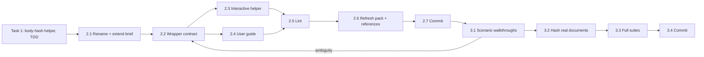

# Planning review implementation plan

> **For agentic workers:** REQUIRED SUB-SKILL: Use the installed sibling
> `executing-plans` skill for inline implementation. Follow the kernel envelope.
> Steps use checkboxes for tracking. Do not start per-task subagents.

**Goal:** Give Patchmill planning one adversarial, fresh-context Planning review
with a flexible scope. It runs on request and at each review boundary.

**Architecture:** The planning wrapper owns triggers, scope, bounds,
dispositions, and the review record. One renamed reviewer brief owns the
adversarial checks. One small helper script computes fence-aware body hashes.
Kernel, configuration, and result schema do not change.

**Tech Stack:** Markdown skills, one dependency-free Node.js ESM script, the
existing skill-pack updater, `node:test`, and the lint scripts.

**Spec:**
[Adversarial review of specifications and plans](../specs/2026-11-19-issue-177-add-adversarial-spec-and-plan-review-to-planning-design.md).

## Global constraints

- Do not change `src/kernel/`, configuration, the planning result schema, npm
  manifests, or lockfiles.
- Do not edit vendored upstream skills, such as `brainstorming` or
  `writing-plans`.
- Reuse the canonical `reviewer` agent. Never require `code-reviewer`.
- Reviewer readiness is never human approval and never changes a gate.
- Unattended runs never wait for a human. They return `needs-input` only for a
  `blocked` or `escalated` outcome, or a missing prerequisite.
- Record outcomes are exactly `ready`, `blocked`, and `escalated`.
- The record heading is exactly `## Planning review`. It occurs once and starts
  the last section.
- Use the terms **Planning review**, **Plan review**, and **Review boundary** as
  defined in `GLOSSARY.md`.

## Review focus

1. Headings inside fenced code must not move the body boundary. Task 1 tests
   both a fenced record heading in the body and a fenced heading in the record.
2. An unchanged document whose latest outcome is `blocked` must not cross a
   boundary. Task 3 scenario I exercises this.
3. A spec edit after a combined review must make the plan record stale. Task 3
   scenario J exercises this.
4. An unattended human-only question must not wait or return `needs-input`. Task
   3 scenario E exercises this.
5. Installed packs must drop `plan-review.md`, and no live reference may name
   it. Task 2 step 6 exercises this.

## Inputs and execution

Read the spec, `GLOSSARY.md`, `AGENTS.md`, and the installed planning,
writing-plans, brainstorming, and executing-plans guidance. No mockup or HTML
companion applies.

The inspected base is `8f363d0802381662fb739ed5bcd7e24875529ceb`. Source
locations are discovery hints. Inspect the current files before editing. The
implementation skill installs dependencies before the first test run.

Use inline execution through the installed `executing-plans/SKILL.md`. Keep the
implementation skill's final independent whole-branch review.

## File responsibilities

| Files                                                    | Responsibility                                                                    |
| -------------------------------------------------------- | --------------------------------------------------------------------------------- |
| `skills/patchmill-planning/scripts/body-hash.mjs`        | Fence-aware body extraction, SHA-256, and the command-line entry point.           |
| `scripts/planning-body-hash.test.mjs`                    | Behavior tests for the helper. Stays outside the skill so packs do not ship it.   |
| `skills/patchmill-planning/SKILL.md`                     | Triggers, boundaries, scope, bounds, dispositions, record, and final-result text. |
| `skills/patchmill-planning/planning-review.md` (renamed) | Reviewer brief with spec, plan, and combined adversarial checks.                  |
| `skills/patchmill-plan/SKILL.md`                         | Interactive helper: on-request reviews and the shared contract.                   |
| `site/src/content/docs/guides/skills-configuration.md`   | User guide for Planning review.                                                   |
| `.patchmill/skills/`                                     | Installed copies and manifest, refreshed only through the updater.                |
| `docs/verification/issue-177-planning-review.md`         | Scenario walkthroughs and integration evidence.                                   |

`GLOSSARY.md` already has the resolved terms from planning. Do not change it
unless a review finds a conflict.

## Testing Value Gate

The helper parses Markdown, and a parsing error would let a changed plan skip
review. It gets behavior tests through its exported function and its command. Do
not add tests that assert skill text. The existing test "updates the pack and
removes files dropped from it" in `src/cli/commands/skills/main.test.ts` already
covers the rename in installed packs. Verify the skill contract by direct
inspection, the real updater, scenario walkthroughs, `npm run lint`, and
`npm test`. No npm dependency changes, so the Nix build is not required.

---

### Task 1: Body-hash helper

**Files:**

- Create: `skills/patchmill-planning/scripts/body-hash.mjs`
- Test: `scripts/planning-body-hash.test.mjs`

**Interfaces:**

- Produce: `planningBody(text: string): string`. It returns the text before the
  line of the record heading, or the whole text when no record exists. It throws
  `Error` with a message that contains `more than one Planning review section`
  or `Planning review must be the last section`.
- Produce: `bodyHash(text: string): string`. It returns the lowercase hex
  SHA-256 of `planningBody(text)` as UTF-8.
- Produce: the command `node body-hash.mjs <document>`. It prints the hash and a
  newline and exits 0. With a missing argument, an unreadable file, or a thrown
  error, it prints the message to stderr and exits 1.

Parsing rules:

- A fence opens at a line that matches ``/^ {0,3}(`{3,}|~{3,})/``, outside a
  fence. A backtick opening fence whose information string contains a backtick
  is not a fence, as in CommonMark. A fence closes at a line of the same
  character, at least as long, that contains only whitespace after the fence
  characters.
- Outside fences, the record heading matches `/^## Planning review[ \t]*$/`.
- Outside fences, a later line matching `/^ {0,3}#{1,2}(?:[ \t]|$)/` after the
  record heading means the record is not last.

- [ ] **Step 1: Write the failing tests.**

Use `node:test` and `node:assert/strict`, as `scripts/tracked-files.test.mjs`
does. Import `{ planningBody, bodyHash }` from
`../skills/patchmill-planning/scripts/body-hash.mjs`. Build documents from
string arrays joined with `"\n"`. Tests:

- `receipt-only edits keep the hash and body edits change it`: `body` +
  `## Planning review\n\nA`. Assert hash(`...A`) equals hash(`...B`). Assert
  that changing a body line changes the hash.
- `ignores a record heading inside a fenced block`: the body contains a
  ` ```markdown ` fence with `## Planning review` inside, then text after the
  fence, then the real record. Assert that editing the text after the fence
  changes the hash. Repeat with a ` ```` ` fence that contains a ` ``` ` line,
  and with a `~~~` fence.
- `ignores headings inside fences in the record`: the record contains a fenced
  `## Findings` line. Assert no throw. Assert that editing that fenced line
  keeps the hash.
- `rejects a second record`: assert a throw matching
  `/more than one Planning review section/`.
- `rejects a section after the record`: a real `## Later` after the record.
  Assert a throw matching `/Planning review must be the last section/`. Assert
  that `### Entry 2` inside the record does not throw. Add a case where the
  record has the line ` ```inline code``` ` before a real `## Later`. Assert the
  same throw, because that line is not a fence.
- `hashes the whole text when no record exists`: assert
  `planningBody(text) === text`.
- `command prints the hash`: write a temporary file. Run
  `spawnSync(process.execPath, [script, file])`. Assert exit 0 and that stdout
  equals `bodyHash(text) + "\n"`. Run with no argument and assert exit 1 and
  non-empty stderr. Run with a missing file, and with a document that has two
  records. Assert exit 1 and non-empty stderr for each.

- [ ] **Step 2: Run the tests and observe the failure.**

Run: `node --test scripts/planning-body-hash.test.mjs`. Expected: FAIL, because
the module does not exist.

- [ ] **Step 3: Implement the helper.**

Implement `planningBody`, `bodyHash`, and the command in `body-hash.mjs` with
`node:crypto`, `node:fs`, and `pathToFileURL` from `node:url`. Do not use other
imports. Scan lines once and track the open fence character and length. Run the
command only when `import.meta.url` equals
`pathToFileURL(process.argv[1]).href`. Use JSDoc types. Make the file
executable, as `patchmill-visual-evidence/scripts/` is.

- [ ] **Step 4: Run the tests and observe the pass.**

Run: `node --test scripts/planning-body-hash.test.mjs`. Expected: PASS.

- [ ] **Step 5: Commit.**

Commit the two files with
`feat(planning): add fence-aware Planning review body hash`.

### Task 2: Define the Planning review contract

**Files:** The file-map rows for the skills, the user guide, and
`.patchmill/skills/`.

**Interfaces:**

- Consume: `node <skill-dir>/scripts/body-hash.mjs <document>` from Task 1.
- Consume: the canonical `reviewer` agent from
  `src/cli/commands/init/agent-dir.ts`. Consume the envelope's Planning stage,
  Gate, Spec, Plan, and Parent spec facts.
- Produce: the `planning-review.md` brief. Produce a `## Planning review` record
  section, last in each reviewed document. Produce an optional
  `## Open assumptions` section in the document that owns the decision.

- [ ] **Step 1: Rename and extend the brief.**

Run
`git mv skills/patchmill-planning/plan-review.md skills/patchmill-planning/planning-review.md`.
Retitle it "Planning review brief". Keep the authority, inputs, conceptual
explanations, independent architecture survey, and review rubric sections. Make
the opening say that the scope is a spec, a plan, or both, as the planner
supplies.

Add three sections after the survey, with the checks from the spec's "Reviewer
brief" section:

- "Specification checks", including the builder question.
- "Plan checks", including symbol, path, command, and code-block verification
  against the inspected base.
- "Combined checks", applied only when both documents are in scope.

Make the rubric apply to plans in scope, and to specs that define modules. In
"Findings and report", require each finding to have an identifier, the document,
the severity, the requirement, the evidence, the impact, and the smallest
correction.

- [ ] **Step 2: Replace "Fresh Plan review" in the planning wrapper.**

In `skills/patchmill-planning/SKILL.md`, replace the "Fresh Plan review" section
with a "Planning review" section. It has these subsections, each one taken from
the matching spec section:

- "Triggers": on request, and the boundary check.
- "Review boundaries": the gate table and the stage mapping. Review before
  publishing, submitting, or returning `done`.
- "Running a review": the supplied inputs, the most capable model with explicit
  model and thinking settings, foreground execution, read-only, no nested
  agents, and no planner history.
- "Dispositions": accepted, rejected, open assumption, and escalated, with the
  read-only rule for approved specs and Parent specs.
- "Bounds and outcomes": one pass and one scoped confirmation. The `blocked` and
  `escalated` outcomes, and how a resumed session leaves them. Planner judgement
  alone never changes `blocked` to `ready`.
- "Review record": the entry fields, including a plan's reviewed spec hash. The
  heading rules, the helper command, and the definitions of current and ready. A
  document crosses a boundary only when its record is current and ready.

Update the other references in the same file:

- "Required siblings": Patchmill planning does not dispatch the upstream builder
  check. Planning review covers the builder question, and its piles map to
  dispositions.
- "Parent spec": the Parent spec is a Planning review input.
- "Conceptual visualizations" and "Fallback and publication": replace "fresh
  Plan review" with "Planning review". Supply the explanations of each document
  in scope.
- "Planning stages": at stage `spec`, the boundary check reviews the spec before
  the planning pull request.
- "Implementation plan": Planning review is required even for inline execution.
- "Final result": unattended `needs-input` covers missing prerequisites and
  `blocked` or `escalated` outcomes. Human-only questions that become open
  assumptions do not return `needs-input`.

- [ ] **Step 3: Align the interactive helper.**

In `skills/patchmill-plan/SKILL.md`, rename the section to "Domain analysis and
Planning review". Say that the maintainer can request a Planning review of a
named scope at any time, and that the boundary check runs before handoff. Name
`planning-review.md` and the body-hash helper. Keep "ask the maintainer and
wait" for missing prerequisites. Keep "no publication authority".

- [ ] **Step 4: Update the user guide.**

In `site/src/content/docs/guides/skills-configuration.md`, rewrite the paragraph
that starts "Every new or revised plan gets fresh". Describe Planning review:
flexible scope, on-request and boundary triggers, gate-driven boundaries,
adversarial spec and plan checks, dispositions, open assumptions, outcomes, and
the hash record. Replace the "Fresh Plan review" phrase near the visualization
text with "Planning review".

- [ ] **Step 5: Lint the source changes.**

Run `npm run lint`. Expected: exit 0.

- [ ] **Step 6: Refresh the installed pack and check references.**

```bash
node --input-type=module -e 'import { main } from "./src/cli/commands/skills/main.ts"; process.exitCode = await main(["update"], { repoRoot: process.cwd(), packageRoot: process.cwd() });'
test ! -e .patchmill/skills/patchmill-planning/plan-review.md
test -x .patchmill/skills/patchmill-planning/scripts/body-hash.mjs
diff -r skills/patchmill-planning .patchmill/skills/patchmill-planning
diff -r skills/patchmill-plan .patchmill/skills/patchmill-plan
rg -n "plan-review\.md|Fresh Plan review" skills .patchmill/skills site/src
```

Expected: the updater reports 1 removed. Both `test` commands succeed. Both
`diff` commands print nothing. The `rg` command prints no matches. Historical
documents under `docs/specs/` and `docs/plans/` can keep the old name. If the
updater refuses because of customized files, stop for guidance. Do not bypass
that protection.

- [ ] **Step 7: Commit.**

Stage only the files of this task and commit with
`feat(planning): add adversarial Planning review with flexible scope`.

### Task 3: Verify the scenarios and integration

**Files:** Create `docs/verification/issue-177-planning-review.md`.

**Interfaces:**

- Consume: the Task 2 skill text and brief, and the Task 1 helper.
- Produce: a verification record that shows the evidence for each scenario.

- [ ] **Step 1: Walk through the scenarios against the installed skill text.**

For each scenario, cite the skill lines that decide the result, and record the
expected planner behavior:

- A. Spec gate only: spec-only review before the spec PR. The plan is reviewed
  at stage `implementation` against the approved spec.
- B. Plan gate only: at stage `plan`, one combined pass before the plan PR.
- C. Both gates: spec at stage `spec`, plan at stage `plan`. The approved spec
  is input only.
- D. No gate: one combined pass before `done`, with combined checks.
- E. Unattended human-only question: a conservative open assumption is recorded,
  and the run continues without `needs-input`.
- F. Plan-stage human-only question with an approved spec: the open assumption
  goes in the plan. The spec does not change.
- G. Escalated ADR or Parent spec conflict: outcome `escalated`. Interactive
  runs ask the maintainer. Unattended runs return `needs-input`.
- H. Interactive request after brainstorming, then no spec edits: the boundary
  check sees a current, ready spec record and reviews only the plan.
- I. A resumed session with an unchanged document whose latest outcome is
  `blocked`: the document does not cross. Only a recorded maintainer ruling or a
  document edit and new review can lead to `ready`.
- J. A spec edit after a combined review: the plan's recorded spec hash no
  longer matches, so both documents get a combined review.
- K. Missing `reviewer` or subagent tool: interactive runs ask the maintainer.
  Unattended runs return `needs-input`. No self-review substitute.

Each result must follow from the text alone. If a scenario is ambiguous, fix the
skill text in Task 2's files, refresh the pack, and amend the record.

- [ ] **Step 2: Hash the real planning documents.**

Run the installed helper on this issue's spec and plan. Expected: each prints a
64-character hex hash and exits 0. Record both values.

- [ ] **Step 3: Run the full suites.**

```bash
npm run lint
npm test
git diff --stat 8f363d0802381662fb739ed5bcd7e24875529ceb -- src package.json package-lock.json
```

Expected: lint and tests pass. The diff shows no change under `src/` or in the
npm manifests. Record the results.

- [ ] **Step 4: Commit.**

Commit the verification record with
`docs(planning): record Planning review verification`.

## Visual explanation



Task 1 owns the only code. Task 2 owns all contract text and names the helper.
Task 3 only verifies, and it sends any ambiguity back to the Task 2 files.
