# Web sessions (interactive Issue runs from the web page) Implementation Plan

> **For agentic workers:** REQUIRED SUB-SKILL: Use the sibling `executing-plans`
> skill to implement this plan inline, task by task. Steps use checkbox
> (`- [ ]`) syntax for tracking.

**Goal:** From the web issue page, a team can start, chat with, answer, stop,
pause and resume an Interactive Issue run, with no terminal (#379).

**Architecture:** `patchmill serve` gets a **Session hub** that holds at most
one **Web session** per issue. Each Web session is one `pi --mode rpc` process.
The process loads a new Patchmill extension entry point that wraps
`createPatchmillExtension`, so `ConsoleController` stays the `HumanChannel`. A
new interactive RPC client connects the hub to the process. The hub turns Pi
records into Issue thread entries and shared questions. The existing issue feed
merges them into `GET /api/issues/:number/events`. Five new POST routes take
input from browsers.

**Tech Stack:** TypeScript on Node (`node:http`, `node:child_process`), Pi
coding agent RPC mode, plain browser JavaScript with JSDoc types, `node:test`.

**Spec:** `docs/specs/2026-11-19-issue-379-web-interactive-sessions-design.md`

**Plan inputs:**

- The spec above (approved, on `main`).
- `docs/mockups/web/run-once-workflow.html` and
  `docs/mockups/web/run-once-workflow.md`: the header controls, the composer and
  the issue-state table. The spec has no mockup of its own.
- `GLOSSARY.md`: this branch adds **Web session**, **Session hub** and **Console
  session lock** and removes the general **Pause** entry (maintainer decision,
  see below).
- Pi docs: `rpc.md`, `rpc-commands.md`, `rpc-extension-ui.md`, `json.md` under
  `node_modules/@earendil-works/pi-coding-agent/docs/`.

**Execution:** inline through the sibling `executing-plans` skill. A fresh Plan
review is required and is recorded at the end of this plan.

## Decisions made during planning

The maintainer decided these in the planning chat:

- The action is **Pause Web session**. In code it is `pause`. In docs it is
  "pause the Web session". The button text stays **Pause** from the mockup, with
  the accessible name "Pause Web session". "End" is not used, because a paused
  Web session can resume.
- `GLOSSARY.md` gets **Web session**, **Session hub** and **Console session
  lock**. Its general **Pause** entry goes, because the word is too general for
  a glossary term.
- One plan and one implementation pull request for #379.
- **Console session lock** (after Plan review B7): a new flock-based lock at
  `<runsDir>/issue-N/console/lock`. The terminal console and Web session Pi
  processes hold it for their whole life, so two processes never write one
  Console session file. The terminal console only gains a refusal.
- **Workers after a Pi crash** (after Plan review B3): Pause Web session and
  server stop end the worker through a Web session stop command. After a Pi
  crash or a forced kill, a stray worker can still run until the next Web
  session or console start stops it with `stopWorkers`, as the terminal console
  does today. The crash message says so.

The spec left these to the builder. The plan decides them:

- **Extension entry point:** `src/console/web-session-extension.ts`. It reads
  the repository root and issue number from the environment variables
  `PATCHMILL_WEB_SESSION_REPO` and `PATCHMILL_WEB_SESSION_ISSUE`. It never reads
  them from browser input. When the Issue run ends, it calls `ctx.shutdown()`,
  so Pi exits when the agent is idle.
- **Session file:** the server process calls `openIssueConsoleSession` before it
  starts Pi. Then it passes `--session <file>`. Web sessions and the terminal
  console therefore choose the same file in the same way.
- **Start checks:** run-once's interactive steps before the console (merged
  cleanup sweep, `workflow.sync`, `selectRunIssue`) move into
  `prepareInteractiveRun`. `run-once --interactive` and the Web session launcher
  both call it.
- **RPC client:** a new module, `src/kernel/pi-rpc-interactive.ts`. It shares
  `jsonlRecords`, `signalGroup` and `piCommandArgs`. `src/kernel/pi-rpc.ts` does
  not change.
- **Earlier conversation:** the live thread holds only what this Pi process
  sent. Earlier conversation comes from the run files (`console-planning.jsonl`
  and progress). The hub does not call `get_messages`.
- **No double entries:** while an issue has a Web session (live or ended but
  kept), the feed hides these run-file entries whose `at` is at or after the
  session's `startedAt`: transcript entries from `console-planning.jsonl`
  (`:console-planning.jsonl:` in the ID) and progress lines from `history.jsonl`
  (`:history:` in the ID). It also hides the `interactive-pending` notice. Live
  entries use IDs `web:<sessionId>:<n>`, so they never collide with run-file
  IDs.
- **Steering:** every chat prompt carries `streamingBehavior: "steer"`. Pi
  ignores it when the agent is idle, so the hub never has to guess whether the
  agent is streaming.
- **Ended sessions:** the hub keeps an ended Web session (its thread and why it
  ended) for 30 minutes, or until the next start for that issue. Then the feed
  shows the run files alone.
- **Routes:** five POST routes under `/api/issues/:number/session` (Task 6).
- **Request IDs:** kept per issue, across Web sessions, for the hub's life (the
  most recent 1000). A retried start after the session ended still counts once.

## Global Constraints

- Server code is TypeScript on `node:http`. Page code is plain HTML, CSS and
  JavaScript with JSDoc types, `fetch` and `EventSource`. No new npm
  dependencies.
- Every state-changing request needs the token cookie, a valid `Host` and an
  `Origin` that matches the `Host`. The existing `RequestPolicy` and `ServeAuth`
  checks come first.
- `patchmill serve --sample` stays view only. It has no Session hub, and its
  session routes answer 404.
- Non-interactive `run-once`, `src/kernel/pi-rpc.ts` and the terminal console do
  not change behaviour.
- No kernel changes beyond what the console already uses. `ConsoleController` is
  the `HumanChannel`.
- At most one live Web session per issue. No start while the issue lock or the
  Console session lock is held by another process.
- No Pi process or worker is left after Pause Web session or server stop. After
  a Pi crash, no Pi RPC process is left, and a stray worker is stopped at the
  next start (maintainer decision).
- Issue and agent text goes into the page as text nodes only, never as HTML.
- A Pi RPC process writes protocol records to stdout. Patchmill code in that
  process writes diagnostics only to stderr.

## Review Focus

1. **A browser reconnects with `Last-Event-ID` while the agent streams.** It
   gets the missed session updates in order, with no gaps and no duplicate
   entries, even when no browser was subscribed for a while. Tests: Task 7,
   "replays session updates after Last-Event-ID" and "reconnect after a
   no-subscriber gap receives the gap's session changes".
2. **Pi crashes while a question is open.** The question closes for every
   browser. The thread shows the error, and the page offers **Resume**. Test:
   Task 5, "crash closes the open question and frees the issue".
3. **Pause Web session while a worker runs.** The stop command stops the worker
   while the pi-subagents connection still works, before any `session_shutdown`.
   A Pi that hangs is still killed with its group. Tests: Task 2, "the stop
   command stops the active worker before session_shutdown", and Task 1, "end
   sends the stop command before stdin closes" and "end kills a group that
   ignores stdin and SIGTERM".
4. **The server stops while a Web session is still starting.** The launch
   finishes, the hub then stops the new process, and `close()` waits for it.
   Test: Task 5, "close waits for a launch in flight and ends it".
5. **A message arrives before Pi is ready.** It waits in the queue and goes out
   after the first `get_state` response, not before. Test: Task 4, "queues input
   until Pi is ready".

---

## File structure

```text
src/kernel/
├── pi-rpc-interactive.ts        # NEW: long-lived RPC client (prompt/abort/dialogs/end)
├── pi-rpc-interactive.test.ts   # NEW: against test-support/fake-interactive-pi.mjs
├── interactive-start.ts         # NEW: prepareInteractiveRun (sweep, sync, select)
└── interactive-start.test.ts    # NEW
src/cli/commands/run-once/
├── deps.ts                      # NEW: createRunOnceDeps, shared by run-once and the extension
└── main.ts                      # uses deps.ts and prepareInteractiveRun
src/cli/commands/serve/
├── session-launcher.ts          # NEW: production launch: prepare, lock, session file, spawn
└── session-launcher.test.ts
src/console/
├── console-lock.ts              # NEW: Console session lock
├── console-lock.test.ts
├── start.ts                     # takes the Console session lock
├── web-session-extension.ts     # NEW: Pi extension entry for Web session processes
└── web-session-extension.test.ts
src/web/session/                 # NEW folder
├── types.ts                     # SessionHub, SessionChange, HubResult, SessionInput
├── web-session.ts               # one Web session: queue, question, record → entry
├── web-session.test.ts
├── hub.ts                       # Session hub: admission, request IDs, retention, close
├── hub.test.ts
├── routes.ts                    # POST route parsing and responses
└── routes.test.ts
src/web/
├── api-types.ts                 # LiveSession, LiveQuestion, new IssueUpdate kinds
├── issue-feed.ts                # merges hub changes into the ordered feed
├── file-run-data.ts             # passes the hub to the feed and decorates snapshots
├── api.ts, request.ts, server.ts# route wiring, hub close on server close
└── sample-data.ts               # session: null, sessions: false
src/cli/commands/serve/{main,source}.ts  # build the hub for live data only
test-support/
├── fake-interactive-pi.mjs      # NEW: scripted RPC Pi for the client tests
└── fake-interactive-pi.ts       # NEW: in-memory InteractivePi for hub tests
web/
├── api.js                       # POST helpers with request IDs
├── controller.js                # always subscribe on an issue page; session kinds; actions
├── live-issue.js                # apply session updates
├── state.js                     # sessionPresentation()
├── issue.js, thread.js, app.js  # controls, composer, live thread, question card
└── styles/                      # question card and live-thread heading
```

## Visual explanation

How one chat message and one question travel, and who owns each step:

```mermaid
sequenceDiagram
    participant A as Browser (Alice)
    participant B as Browser (Bob)
    participant R as routes.ts
    participant H as hub.ts / web-session.ts
    participant C as pi-rpc-interactive.ts
    participant P as pi --mode rpc + web-session-extension
    A->>R: POST /session/messages {author, requestId, text}
    R->>H: send(issue, input)
    H-->>R: accepted (or duplicate)
    H->>H: append person entry "Alice", queue input
    H->>C: prompt("Alice: …")
    C->>P: {"type":"prompt", streamingBehavior:"steer"}
    P-->>C: message_update / tool_execution_* / message_end
    C-->>H: onEvent(record)
    H-->>A: SSE session-entries (via issue-feed)
    H-->>B: SSE session-entries
    P-->>C: extension_ui_request select (planning approval)
    C-->>H: onDialog(request)
    H-->>A: SSE session {question}
    H-->>B: SSE session {question}
    B->>R: POST /session/answers {questionId, choice}
    H->>C: answer(id, {value})
    H-->>A: divider "Bob chose …", question cleared
    A->>R: POST /session/answers (late)
    R-->>A: 409 already_answered "Already answered by Bob."
```



Task order and what each task gives the next:

```text
Task 1 pi-rpc-interactive ──┐
Task 2 console lock + web-session-extension ─┤
Task 3 prepareInteractiveRun + launcher ─┘ (uses 1, 2)
Task 4 web-session (uses the InteractivePi interface from 1)
Task 5 hub (uses 4; launcher from 3 enters by injection)
Task 6 routes + server wiring (uses 5)
Task 7 api-types + feed merge (uses 5)
Task 8 page (uses 6, 7)
Task 9 docs + end-to-end check on a test repository
```

## Companion artifacts

- `GLOSSARY.md`:
  [Web session, Session hub and Console session lock terms](../../GLOSSARY.md)

---

### Task 1: Interactive RPC client

**Files:**

- Create: `src/kernel/pi-rpc-interactive.ts`
- Create: `test-support/fake-interactive-pi.mjs`
- Test: `src/kernel/pi-rpc-interactive.test.ts`

**Interfaces:**

- Consumes: `jsonlRecords`, `RpcRecord` (`src/kernel/pi-rpc-protocol.ts`);
  `signalGroup` (`src/kernel/pi-supervisor.ts`); `piCommandArgs`,
  `PiCommandSpec` (`src/cli/pi-cli.ts`).
- Produces:

```ts
export type DialogRequest = {
  id: string;
  method: "select" | "confirm" | "input" | "editor";
  title: string;
  message?: string;
  options?: string[];
};
export type DialogAnswer =
  | { value: string }
  | { confirmed: boolean }
  | { cancelled: true };
export type InteractivePiOptions = {
  command: PiCommandSpec;
  cwd: string;
  agentDir: string;
  sessionFile: string;
  sessionDir: string;
  skillPaths: string[];
  extensionPaths: string[];
  env?: Record<string, string | undefined>;
  logPath: string; // stderr and non-JSON stdout lines
  graceMs?: number; // default 5_000: each signal step
  stopCommand?: string; // default "/patchmill-web-session-stop" (Task 2)
  shutdownMs?: number; // default 90_000: wait for exit after the stop command (stopWorkers waits up to 60 s)
  onEvent(record: RpcRecord): void; // everything except responses and dialogs
  onDialog(request: DialogRequest): void;
};
export type InteractivePiExit = {
  exitCode: number | null;
  signal: NodeJS.Signals | null;
  requested: boolean; // true when end() started the shutdown
};
export type InteractivePi = {
  ready: Promise<void>; // first get_state response; rejects if Pi exits first
  prompt(text: string): Promise<void>; // always streamingBehavior: "steer"
  abort(): Promise<void>;
  answer(id: string, answer: DialogAnswer): void;
  end(): Promise<InteractivePiExit>; // idempotent
  exited: Promise<InteractivePiExit>;
};
export function interactivePiArgs(options: InteractivePiOptions): string[];
export function startInteractivePi(
  options: InteractivePiOptions,
): InteractivePi;
```

`fake-interactive-pi.mjs` reads a JSON script from `PATCHMILL_FAKE_PI_SCRIPT`.
It writes `<script>.pid` and logs every command to `<script>.commands.log`, as
`fake-pi-rpc.mjs` does. Script fields: `onPrompt` (records to write after a
`prompt`), `dialog` (one `extension_ui_request` to write after the first
prompt), `ignoreStdinEnd`, `ignoreSigterm`, `spawnChild` (starts a grandchild
that sleeps, in the same process group), `exitAfterPrompt` (exit code). It
answers `get_state`, `prompt` (with `disposition: "started"`, or
`success: false` with `promptError` from the script) and `abort`. Unless
`ignoreStopCommand` is set, it exits 0 after a `prompt` whose message is the
stop command.

- [ ] **Step 1: Write the failing tests**

```ts
test("interactivePiArgs selects the session file, skills and extensions", () => {
  assert.deepEqual(
    interactivePiArgs(
      opts({ skillPaths: ["/s1", "/s2"], extensionPaths: ["/e"] }),
    ),
    [
      "--mode",
      "rpc",
      "--session",
      "/runs/issue-7/console/a.jsonl",
      "--session-dir",
      "/runs/issue-7/console",
      "--skill",
      "/s1",
      "--skill",
      "/s2",
      "-e",
      "/e",
    ],
  );
});
test("prompt waits for ready and always sends steer", async (t) => {
  // commands log: get_state, then prompt{message:"Ann: hi", streamingBehavior:"steer"}
});
test("a failed prompt response rejects prompt()", async (t) => {
  /* rejects with the response error */
});
test("abort sends RPC abort and keeps the process", async (t) => {
  // after abort(): commands include {type:"abort"}; signalGroup(pid, 0) === true
});
test("dialogs reach onDialog and answer writes extension_ui_response", async (t) => {
  // onDialog gets {id, method:"select", title, options}; answer(id,{value:"Approve"}) logs
  // {type:"extension_ui_response", id, value:"Approve"}
});
test("other records reach onEvent and non-JSON stdout goes to the log", async (t) => {});
test("end sends the stop command before stdin closes", async (t) => {
  // commands log: abort, then prompt{message:"/patchmill-web-session-stop"}; fake exits on it
});
test("end closes stdin and resolves with requested: true", async (t) => {
  // exit.requested === true; exitCode === 0; end() twice returns the same promise
});
test("end kills a group that ignores stdin and SIGTERM", async (t) => {
  // script {ignoreStopCommand:true, ignoreStdinEnd:true, ignoreSigterm:true, spawnChild:true}, graceMs/shutdownMs 100
  // after end(): signalGroup(pid, 0) === false (grandchild gone too)
});
test("a crash resolves exited with requested: false and rejects pending commands", async (t) => {
  // script {exitAfterPrompt:3}: exitCode 3, requested false; ready rejects if Pi exits before get_state
});
```

- [ ] **Step 2: Run the tests to make sure they fail**

Run: `node --test src/kernel/pi-rpc-interactive.test.ts` Expected: FAIL, module
not found.

- [ ] **Step 3: Implement `startInteractivePi` in
      `src/kernel/pi-rpc-interactive.ts`**

Spawn with `detached: true` and `PI_CODING_AGENT_DIR: agentDir`, as `startPiRpc`
does. Correlate responses by `randomUUID()` IDs. Send `get_state` first and
resolve `ready` with its response. `prompt` and `abort` await `ready`. `prompt`
always adds `streamingBehavior: "steer"`: Pi reads it only while the agent
streams, so a message never fails because Pi started a turn on its own. Chat
text always starts with the author name and a colon, and Task 6 refuses an
author that starts with `/`, so a browser can never run a slash command.
`end()`:

1. sends `abort` (waits at most `graceMs`);
2. sends `stopCommand` as a `prompt`, and waits up to `shutdownMs` for Pi to
   exit (extension commands run at once, even while the agent streams);
3. closes stdin and waits `graceMs`;
4. sends SIGTERM to the group, waits `graceMs`, then sends SIGKILL.

After the child closes, if the group is still alive, SIGTERM and SIGKILL it too.
pi-subagents workers run in their own process group, so signals do not reach
them. The stop command in Task 2 stops them. In RPC mode, `session_shutdown`
cannot stop them, because pi-subagents removes its connection in its own
`session_shutdown` handler first.

- [ ] **Step 4: Run the tests to make sure they pass**

Run:
`node --test src/kernel/pi-rpc-interactive.test.ts src/kernel/pi-rpc.test.ts`
Expected: PASS. The run-once wrapper tests do not change.

- [ ] **Step 5: Commit**

```bash
git add src/kernel/pi-rpc-interactive.ts src/kernel/pi-rpc-interactive.test.ts test-support/fake-interactive-pi.mjs
git commit -m "feat(kernel): add an interactive Pi RPC client for Web sessions (#379)"
```

### Task 2: Console session lock and the Pi extension entry point

**Files:**

- Create: `src/console/console-lock.ts`
- Test: `src/console/console-lock.test.ts`
- Modify: `src/console/start.ts` (take the lock before
  `openIssueConsoleSession`), test in `src/console/start.test.ts`
- Create: `src/cli/commands/run-once/deps.ts`
- Modify: `src/cli/commands/run-once/main.ts` (build `deps` with
  `createRunOnceDeps`)
- Create: `src/console/web-session-extension.ts`
- Test: `src/console/web-session-extension.test.ts`

**Interfaces:**

- Consumes: `createPatchmillExtension` (`src/console/extension.ts`),
  `createStartRun` (`src/console/start.ts`), `loadConfig`, `RunOnceDeps`,
  `acquireLock`, `probeIssueLock`, `LockHeldError`, `IssueLock`
  (`src/kernel/lock.ts`).
- Produces:

```ts
// src/console/console-lock.ts
export const CONSOLE_SESSION_BUSY = (issue: number) =>
  `Issue #${issue}'s Console session is open in another process. Close it first.`;
export function consoleLockPath(
  repoRoot: string,
  runsDir: string,
  issue: number,
): string;
// <repoRoot>/<runsDir>/issue-N/console/lock
export function acquireConsoleLock(
  repoRoot: string,
  runsDir: string,
  issue: number,
): Promise<IssueLock | undefined>; // undefined when another process holds it
export function consoleLockHeld(
  repoRoot: string,
  runsDir: string,
  issue: number,
): Promise<boolean>;

// src/cli/commands/run-once/deps.ts
export function createRunOnceDeps(input: {
  config: PatchmillConfig;
  repoRoot: string;
  runner: CommandRunner;
  output: CliOutput;
}): RunOnceDeps;

// src/console/web-session-extension.ts
export const WEB_SESSION_EXTENSION_PATH: string; // .ts from source, .js from dist (same trick as BACKGROUND_WORK_EXTENSION_PATH)
export function webSessionTarget(env: NodeJS.ProcessEnv): {
  repoRoot: string;
  issue: number;
}; // throws on a missing or invalid value
export function createWebSessionExtension(options: {
  issue: number;
  startRun: StartRun;
  client?: (events: EventBus) => SubagentsClient;
}): ExtensionFactory;
export default async function (pi: ExtensionAPI): Promise<void>;
```

`startConsole` calls `acquireConsoleLock` before `openIssueConsoleSession`. When
the lock is held, it writes `CONSOLE_SESSION_BUSY(issue)` to stderr and returns
1 before it changes the session file. It releases the lock after the runtime has
been disposed. `/patchmill-issue` switching keeps its current behaviour. Only
the first issue's lock is taken (switching inside one console is out of scope
here).

The default export reads `webSessionTarget(process.env)`, loads the config,
builds deps with output to `process.stderr` only, and tries
`acquireConsoleLock`. It keeps the returned `IssueLock` in a module-scope
variable for the life of the process (a dropped `FileHandle` is closed on
garbage collection, which would drop the `flock`). It never releases the lock
itself: the lock drops when the Pi process exits, after every run has settled.
Then it calls
`createWebSessionExtension({ issue, startRun: createStartRun(config, deps), refusal })`.
`refusal` is `CONSOLE_SESSION_BUSY(issue)` when the lock is held. In that case
the extension notifies the refusal at `session_start`, calls `ctx.shutdown()`
and starts no run. The launcher (Task 3) holds the same lock while it writes the
session file, so this happens only in a race.

`createWebSessionExtension`:

- registers its own `session_start` handler _before_ it calls
  `createPatchmillExtension(...)(pi)`, so the handler gets `ctx` first;
- passes `firstIssue: issue` to `createPatchmillExtension`;
- wraps `startRun`, so that when the returned promise settles it notifies one
  closing line for every outcome (the reason for `refused` and
  `claimed-elsewhere`, otherwise the same text `controller.ts` builds for the
  outcome), then calls `ctx.shutdown()`;
- when `session_start` finishes without a call to `startRun` (stray-worker
  cleanup blocked the run), calls `ctx.shutdown()` too, after the existing
  notice;
- leaves out `switchIssue`;
- takes the `shutdown` callback through `registerShutdown`, and registers the
  command `patchmill-web-session-stop`. The command notifies "Stopping the Web
  session.", awaits that `shutdown` (it stops the active worker and settles the
  run while pi-subagents still works), then calls `ctx.shutdown()` in a
  `finally`, so a failed shutdown still exits. The terminal console does the
  same work before teardown in `runConsoleRuntime`.

The `options` type gains `refusal?: string`.

- [ ] **Step 1: Write the failing tests**

```ts
test("webSessionTarget reads the repository and a positive issue number", () => {
  assert.deepEqual(
    webSessionTarget({
      PATCHMILL_WEB_SESSION_REPO: "/r",
      PATCHMILL_WEB_SESSION_ISSUE: "7",
    }),
    { repoRoot: "/r", issue: 7 },
  );
  for (const issue of [undefined, "0", "-1", "1.5", "7x"])
    assert.throws(() =>
      webSessionTarget({
        PATCHMILL_WEB_SESSION_REPO: "/r",
        PATCHMILL_WEB_SESSION_ISSUE: issue,
      }),
    );
  assert.throws(() => webSessionTarget({ PATCHMILL_WEB_SESSION_ISSUE: "7" }));
});
test("session_start starts the Issue run and shutdown follows its end", async (t) => {
  // fakeExtensionApi with a ctx.shutdown spy; startRun resolves {status:"no-work"}
  // assert startRun called with issue 7; shutdown called once, after startRun resolved
});
test("a failed Issue run also requests shutdown", async () => {
  /* startRun rejects */
});
test("a refused run notifies its reason before shutdown", async () => {});
test("blocked stray-worker cleanup shuts the session down", async () => {});
test("a held Console session lock refuses without starting a run", async () => {});
test("the stop command stops the active worker before session_shutdown", async () => {
  // fake subagents client with an active worker; run the stop command;
  // the worker's stop was requested and the run settled before ctx.shutdown() was called,
  // and no session_shutdown had fired yet
});
test("WEB_SESSION_EXTENSION_PATH exists", async () => {
  // as launch.test.ts does for BACKGROUND_WORK_EXTENSION_PATH
});
// console-lock.test.ts
test("a second acquire in another process sees the lock as held", async () => {
  // use test-support/issue-lock-child.mjs as lock.test.ts does
});
// start.test.ts
test("startConsole refuses a Console session that another process holds", async () => {
  // session file unchanged; stderr has CONSOLE_SESSION_BUSY(7); returns 1
});
```

- [ ] **Step 2: Run them to make sure they fail**

Run: `node --test src/console/web-session-extension.test.ts` Expected: FAIL,
module not found. Add a `shutdown` spy to the `ctx` in
`test-support/fake-extension-api.ts` if it has none.

- [ ] **Step 3: Implement `deps.ts`, the `main.ts` change, and
      `web-session-extension.ts`**

`createRunOnceDeps` returns the same object that `main.ts` builds today (host,
workflow, runner, git, `resolveBundledPiCommand()`,
`[resolvePiSubagentsPackageRoot()]`, repoRoot, now, output).

- [ ] **Step 4: Run the tests to make sure they pass**

Run:
`node --test src/console/web-session-extension.test.ts src/cli/commands/run-once/*.test.ts src/console/*.test.ts`
Expected: PASS.

- [ ] **Step 5: Commit**

```bash
git add src/console src/cli/commands/run-once/deps.ts src/cli/commands/run-once/main.ts test-support/fake-extension-api.ts
git commit -m "feat(console): add a Console session lock and the Web session extension (#379)"
```

### Task 3: Start checks and the production launcher

**Files:**

- Create: `src/kernel/interactive-start.ts`
- Test: `src/kernel/interactive-start.test.ts`
- Modify: `src/cli/commands/run-once/main.ts` (call `prepareInteractiveRun`)
- Create: `src/web/session/types.ts`,
  `src/cli/commands/serve/session-launcher.ts` (CLI wiring stays out of
  `src/web`, which imports only kernel code today)
- Test: `src/cli/commands/serve/session-launcher.test.ts`

**Interfaces:**

- Consumes: `sweepMergedIssues`, `selectRunIssue`, `openIssueConsoleSession`,
  `provisionAgentDir`, `consoleSkillPaths`, `resolvePiSubagentsPackageRoot`,
  `createRunOnceDeps`, `acquireConsoleLock`, `WEB_SESSION_EXTENSION_PATH` (Task
  2), `startInteractivePi` and its types (Task 1).
- Produces:

```ts
// src/kernel/interactive-start.ts
export type InteractiveStart =
  | { kind: "ready"; issue: number }
  | { kind: "refused"; reason: string }
  | { kind: "none" }
  | { kind: "cancelled" };
export function prepareInteractiveRun(input: {
  config: PatchmillConfig;
  deps: RunOnceDeps;
  issue?: number;
  report: (line: string) => void;
  signal?: AbortSignal;
}): Promise<InteractiveStart>;

// src/web/session/types.ts
export type PiHandlers = Pick<InteractivePiOptions, "onEvent" | "onDialog">;
export type LaunchResult =
  | { kind: "started"; pi: InteractivePi }
  | { kind: "refused"; reason: string };
export type SessionLauncher = (
  issue: number,
  handlers: PiHandlers,
  report: (line: string) => void,
  signal: AbortSignal, // aborted by Pause Web session or server stop
) => Promise<LaunchResult>;

// src/cli/commands/serve/session-launcher.ts
export function createSessionLauncher(input: {
  config: PatchmillConfig;
  repoRoot: string;
  runner: CommandRunner;
  prepare?: typeof prepareInteractiveRun;
  start?: typeof startInteractivePi;
}): SessionLauncher;
```

The launcher calls `prepare({ issue, signal })`. `refused` and `none` become
`{ kind: "refused" }`; `none` gives "Issue #N is not open or cannot run.";
`cancelled` gives "The start was cancelled.". When `signal` is aborted after
`prepare`, the launcher returns that refusal and spawns nothing. Then it
provisions the agent dir. It takes the Console session lock (a held lock gives
`CONSOLE_SESSION_BUSY(issue)`), opens the session file with
`openIssueConsoleSession(repoRoot, runsDir, issue).getSessionFile()`, releases
the lock, and calls `start` with:

- `cwd: repoRoot`;
- `sessionDir: <runsDir>/issue-N/console`;
- `skillPaths: consoleSkillPaths(config, repoRoot)`;
- `extensionPaths: [resolvePiSubagentsPackageRoot(), WEB_SESSION_EXTENSION_PATH]`;
- `env: { PATCHMILL_WEB_SESSION_REPO: repoRoot, PATCHMILL_WEB_SESSION_ISSUE: String(issue) }`;
- `logPath: <runsDir>/issue-N/console/web-session.log`;
- `command: resolveBundledPiCommand()`.

- [ ] **Step 1: Write the failing tests**

```ts
// interactive-start.test.ts (reuse test-support/run-once-fixture.ts and fake-host)
test("prepareInteractiveRun refuses what selectRunIssue refuses", async () => {});
test("prepareInteractiveRun returns cancelled when the signal aborts during the sweep", async () => {});
test("prepareInteractiveRun returns ready with the selected issue", async () => {});

// launcher.test.ts
test("a refused start never spawns Pi", async () => {
  // prepare → {kind:"refused", reason:"Issue #7 was claimed elsewhere."}; start spy not called
});
test("an aborted signal after prepare spawns nothing", async () => {});
test("a held Console session lock refuses before the session file changes", async () => {});
test("a ready start passes the console session file, skills, extensions and env", async () => {
  // start spy receives sessionFile under <runsDir>/issue-7/console/*.jsonl that exists on disk
  // and contains "Start Issue run #7."; env and extensionPaths as above
});
```

- [ ] **Step 2: Run them to make sure they fail**

Run:
`node --test src/kernel/interactive-start.test.ts src/cli/commands/serve/session-launcher.test.ts`
Expected: FAIL, modules not found.

- [ ] **Step 3: Implement both modules and switch `run-once/main.ts` to
      `prepareInteractiveRun`**

`main.ts` keeps its output: `cancelled` prints "Run cancelled before interactive
selection." and returns 1, `refused` prints the reason and returns 1, and `none`
prints the "No eligible issue" result and returns 0.

- [ ] **Step 4: Run the tests to make sure they pass**

Run:
`node --test src/kernel/interactive-start.test.ts src/cli/commands/serve/session-launcher.test.ts src/cli/commands/run-once/*.test.ts`
Expected: PASS.

- [ ] **Step 5: Commit**

```bash
git add src/kernel/interactive-start.ts src/kernel/interactive-start.test.ts src/cli/commands/run-once/main.ts src/web/session/types.ts src/cli/commands/serve/session-launcher.ts src/cli/commands/serve/session-launcher.test.ts
git commit -m "feat(web): launch Web session Pi processes with the console start checks (#379)"
```

### Task 4: One Web session (queue, questions, thread entries)

**Files:**

- Modify: `src/web/api-types.ts` (types only, as listed below)
- Modify: `src/web/session/types.ts`
- Create: `src/web/session/web-session.ts`
- Create: `test-support/fake-interactive-pi.ts`
- Test: `src/web/session/web-session.test.ts`

**Interfaces:**

- Consumes: `InteractivePi`, `DialogRequest`, `RpcRecord` (Task 1);
  `ThreadEvent`, `TextBlock` (`src/web/api-types.ts`).
- Produces:

```ts
// src/web/api-types.ts (new types)
export type LiveSessionState =
  | "starting"
  | "idle"
  | "replying"
  | "question"
  | "pausing"
  | "ended";
export interface LiveQuestion {
  readonly id: string;
  readonly kind: "select" | "confirm";
  readonly title: string;
  readonly message: string | null;
  readonly options: readonly string[]; // confirm → ["Yes", "No"]
}
export interface LiveSessionHeader {
  readonly id: string;
  readonly startedAt: string;
  readonly state: LiveSessionState;
  readonly status: string | null; // last setStatus("patchmill") text
  readonly question: LiveQuestion | null;
  readonly ended: {
    readonly reason: "finished" | "paused" | "crashed" | "refused";
    readonly message: string;
  } | null;
}
export interface LiveSession extends LiveSessionHeader {
  readonly entries: readonly ThreadEvent[];
}

// src/web/session/types.ts
export type SessionInput = { author: string; requestId: string };
export type SessionChange =
  | { kind: "session"; session: LiveSessionHeader | null }
  | { kind: "session-entries"; entries: readonly ThreadEvent[] }; // upsert by id
export type HubErrorCode =
  | "session_live"
  | "run_live"
  | "no_session"
  | "no_question"
  | "already_answered"
  | "invalid_choice" // HTTP 400, the others 409
  | "not_accepting"
  | "closing";
export type HubResult =
  | { ok: true; duplicate: boolean }
  | { ok: false; code: HubErrorCode; message: string };

// src/web/session/web-session.ts
export type WebSession = {
  readonly id: string;
  snapshot(): LiveSession;
  attach(pi: InteractivePi): void; // after launch; ends pi at once if paused first
  signal: AbortSignal; // aborted by pause(); give to the launcher
  refuse(reason: string): void; // launch refused → ended "refused"
  handlers: PiHandlers; // give to the launcher
  send(input: SessionInput & { text: string }): HubResult;
  answer(
    input: SessionInput & { questionId: string; choice: string },
  ): HubResult;
  stopReply(input: SessionInput): HubResult;
  pause(input: SessionInput | null): Promise<void>; // null: server stop
  ended: Promise<void>;
};
export function createWebSession(input: {
  id: string;
  now: () => Date;
  after: (ms: number, fn: () => void) => () => void;
  onChange: (change: SessionChange) => void;
}): WebSession;
```

Rules the tests pin:

- One FIFO queue. Each item waits for `pi.ready` and for the previous item's
  command response. A chat message adds a person entry with `author` at once,
  then sends `pi.prompt("<author>: <text>")`. If Pi rejects the prompt, the
  session adds an `error` entry
  `"The agent did not get <author>'s message: <reason>. Send it again."` A
  message is never dropped without an entry.
- `message_end` user records whose text equals a text the session sent are not
  shown again. Other user records become `prompt` entries.
- `message_update` `text_delta` upserts one agent entry per assistant
  `contentIndex`. Upserts go out at most every 100 ms per entry. `message_end`
  replaces them with the final text blocks. `thinking` blocks are not shown.
- `tool_execution_start` adds a `running` tool entry. `tool_execution_end` sets
  `completed` or `failed` and the result text, shortened to 8000 characters as
  `pi-thread.ts` does.
- `notify`, and `message_end` with `role: "custom"` and
  `customType: "patchmill"`, become `progress` entries. `setStatus` with key
  `patchmill` sets `status`. `extension_error` becomes an `error` entry. Other
  records are ignored.
- `agent_start` sets `replying`. `agent_settled` sets `idle`, unless a question
  is open.
- `select` and `confirm` open a question and set state `question`. `input` and
  `editor` are answered `{ cancelled: true }` with a `progress` entry "Patchmill
  cancelled a text dialog that the web page cannot show."
- The first answer settles a question. It adds a divider entry
  `"<author> chose “<choice>”."` and clears it. Later answers return
  `already_answered` with `"Already answered by <author>."`. An answer to an
  unknown or old question ID returns `no_question`. A choice that is not one of
  the options returns `invalid_choice`.
- `stopReply` cancels an open question (divider `"<author> stopped the reply."`)
  and then calls `pi.abort()`. It is queued like other input.
- `pause` sets `pausing`, adds divider `"<author> paused the Web session."`
  (with `null`: "The server stopped the Web session."), cancels an open
  question, and awaits `pi.end()`. While `pausing` or `ended`, every input
  returns `not_accepting`.
- `pause` before `attach` aborts `signal` and waits. A later `attach` calls
  `pi.end()` at once, and the session ends as `paused`. A later `refuse` also
  ends it as `paused`, because the person asked for it.
- On `pi.exited`: `requested` → `ended.reason = "paused"`. Exit code 0 without a
  request → `"finished"`. Its message is the text of the last `progress` entry
  (for example a refusal reason from Task 2), or "The Issue run ended." when
  there is none. Anything else → `"crashed"`, plus an `error` entry "Pi stopped
  unexpectedly (exit code N). Press Resume to continue the Issue run. A worker
  that is still running stops when the next session starts.". An open question
  is closed in all cases.
- Entry IDs are `web:<sessionId>:<n>`. The session keeps at most 2000 entries.
  When it drops older ones, the first entry becomes an `earlier` entry "Earlier
  Web session messages appear after the Web session ends." (the run-file filter
  hides them while the session is kept).

`test-support/fake-interactive-pi.ts` gives
`fakeInteractivePi(): { pi: InteractivePi; commands: Array<{type, text?, streaming?, id?, answer?}>; emit(record): void; dialog(request): void; ready(): void; exit(e: InteractivePiExit): void }`.

- [ ] **Step 1: Write the failing tests**

```ts
test("queues input until Pi is ready", async () => {
  // send() before ready(): commands empty; after ready(): [{type:"prompt", text:"Ann: hi"}]
});
test("messages run one at a time", async () => {});
test("a rejected prompt adds an error entry", async () => {});
test("pause while starting ends the process once it starts", async () => {
  // pause before attach: signal aborted; attach(pi) → pi.end() called; reason "paused"
});
test("each message shows its author and is not echoed again", async () => {
  // entries: person "Ann" "hi"; after emit message_end user "Ann: hi": no new entry
});
test("streamed text becomes one agent entry, replaced at message_end", async () => {});
test("tool calls run and complete in place", async () => {});
test("notices and patchmill messages become progress entries; status sets the header", async () => {});
test("the first answer wins and later answers are rejected", async () => {
  // dialog select ["Approve","Request changes"]; Ann answers Approve → ok;
  // Bob answers → {ok:false, code:"already_answered", message:"Already answered by Ann."}
  // pi.answer called once with {value:"Approve"}
});
test("confirm questions offer Yes and No and send confirmed", async () => {});
test("text dialogs are cancelled with a note", async () => {});
test("a choice outside the options is invalid_choice", async () => {});
test("stop reply cancels the open question and aborts the turn", async () => {});
test("pause refuses later input and records who paused", async () => {});
test("exit reasons: paused, finished, crashed", async () => {});
test("entries stay at 2000 with an earlier marker", async () => {});
```

- [ ] **Step 2: Run them to make sure they fail**

Run: `node --test src/web/session/web-session.test.ts` Expected: FAIL, module
not found.

- [ ] **Step 3: Implement `createWebSession`**

- [ ] **Step 4: Run the tests to make sure they pass**

Run: `node --test src/web/session/web-session.test.ts` Expected: PASS.

- [ ] **Step 5: Commit**

```bash
git add src/web/api-types.ts src/web/session/types.ts src/web/session/web-session.ts src/web/session/web-session.test.ts test-support/fake-interactive-pi.ts
git commit -m "feat(web): model one shared Web session with a queue and questions (#379)"
```

### Task 5: Session hub

**Files:**

- Create: `src/web/session/hub.ts`
- Modify: `src/web/session/types.ts` (add `SessionHub`)
- Test: `src/web/session/hub.test.ts`

**Interfaces:**

- Consumes: `createWebSession`, `WebSession` (Task 4), `SessionLauncher` (Task
  3), `probeIssueLock` (`src/kernel/lock.ts`) via an injected `lockHeld`.
- Produces:

```ts
export type SessionHub = {
  start(issue: number, input: SessionInput): Promise<HubResult>;
  send(issue: number, input: SessionInput & { text: string }): HubResult;
  answer(
    issue: number,
    input: SessionInput & { questionId: string; choice: string },
  ): HubResult;
  stopReply(issue: number, input: SessionInput): HubResult;
  pause(issue: number, input: SessionInput): HubResult; // returns at once; effect on the stream
  current(issue: number): LiveSession | null;
  subscribe(
    issue: number,
    listener: (change: SessionChange) => void,
  ): () => void;
  close(): Promise<void>; // idempotent
};
export function createSessionHub(input: {
  launch: SessionLauncher;
  lockHeld: (issue: number) => Promise<boolean>;
  now?: () => Date;
  clock?: Pick<FeedClock, "after">;
  id?: () => string;
  retainMs?: number; // default 30 * 60_000
  warn: (message: string) => void;
}): SessionHub;
```

Rules the tests pin:

- `start` checks, in this order: closing → `closing` "The server is stopping.";
  a request ID it has seen for this issue → `{ ok: true, duplicate: true }`; a
  session that is not `ended` → `session_live` "This issue already has a Web
  session."; then it reserves the issue and records the request ID as pending at
  once, _before_ any `await`, so two starts in the same tick give one session
  and a retry during the lock check is a duplicate. After that,
  `lockHeld(issue)` true → release, forget the request ID and return `run_live`
  "This issue has a live run in another process. Wait for it to finish." The
  start then returns `{ ok: true, duplicate: false }`. The launch goes on
  without blocking the response. It gets the session's `signal`.
- A new start replaces a kept ended session for that issue and emits its header
  first.
- `send`, `answer`, `stopReply` and `pause` check the request ID first (a
  duplicate is `{ ok: true, duplicate: true }` with no effect). Then they check
  that a session that is not `ended` exists (`no_session` "This issue has no
  live Web session."). Then they call the session.
- Request IDs are kept per issue, across sessions, up to the last 1000. An input
  that the hub refuses does not record its request ID, so a retry can still
  succeed.
- An ended session stays for `retainMs`. Then the hub emits
  `{ kind: "session", session: null }` and forgets it.
- `close()` refuses new starts, pauses every session (input `null`), waits for
  launches in flight and then ends them, and resolves when every `pi` has
  exited.

- [ ] **Step 1: Write the failing tests**

```ts
test("one session per issue, even for two starts in the same tick", async () => {});
test("a held issue lock refuses the start and frees the issue", async () => {});
test("a retried start with the same request ID counts once", async () => {
  // launch spy called once; second result {ok:true, duplicate:true},
  // also when the retry arrives while lockHeld is still pending
});
test("a retried message with the same request ID is sent once", async () => {});
test("a refused input keeps its request ID usable", async () => {});
test("a launch refusal ends the session with the reason and frees the issue", async () => {});
test("crash closes the open question and frees the issue", async () => {
  // dialog open, exit {exitCode:3, requested:false}; current(7).question === null,
  // state "ended", reason "crashed"; start(7, new id) → ok
});
test("an ended session is kept for retainMs, then removed", async () => {});
test("close waits for a launch in flight and ends it", async () => {
  // launch resolves after close() starts; its pi.end() called; close resolves after exit
});
test("subscribers get changes only for their issue", async () => {});
```

- [ ] **Step 2: Run them to make sure they fail**

Run: `node --test src/web/session/hub.test.ts` Expected: FAIL, module not found.

- [ ] **Step 3: Implement `createSessionHub`**

- [ ] **Step 4: Run the tests to make sure they pass**

Run: `node --test src/web/session/hub.test.ts` Expected: PASS.

- [ ] **Step 5: Commit**

```bash
git add src/web/session/hub.ts src/web/session/hub.test.ts src/web/session/types.ts
git commit -m "feat(web): add the Session hub with admission and request IDs (#379)"
```

### Task 6: Session routes and server wiring

**Files:**

- Create: `src/web/session/routes.ts`
- Test: `src/web/session/routes.test.ts` (HTTP, through
  `test-support/web-fixture.ts`)
- Modify: `src/web/request.ts`, `src/web/server.ts`,
  `src/cli/commands/serve/main.ts`, `src/cli/commands/serve/source.ts`,
  `test-support/web-fixture.ts`

**Interfaces:**

- Consumes: `SessionHub` (Task 5), `createSessionHub`, `createSessionLauncher`
  (Task 3), `probeIssueLock`, `consoleLockHeld` (Task 2).
- Produces:

```ts
// src/web/session/routes.ts
export function sessionRoute(path: string): {
  issue: string;
  action: "start" | "messages" | "answers" | "stop-reply" | "pause";
} | null;
export function serveSessionRoute(input: {
  req: IncomingMessage;
  res: ServerResponse;
  method: string;
  route: NonNullable<ReturnType<typeof sessionRoute>>;
  sessions: SessionHub | undefined;
}): Promise<void>;

// src/web/server.ts
export type ServeOptions = { /* existing */ sessions?: SessionHub };
// close(): ends streams, closes the HTTP server, then awaits sessions.close()

// src/cli/commands/serve/source.ts
export async function createServeSource(
  input,
): Promise<{ source: RunDataSource; sessions?: SessionHub }>;
```

Routes (all POST; `Allow: POST` and 405 otherwise):

| Path                                | Body                                      | Hub call    |
| ----------------------------------- | ----------------------------------------- | ----------- |
| `/api/issues/:n/session`            | `{author, requestId}`                     | `start`     |
| `/api/issues/:n/session/messages`   | `{author, requestId, text}`               | `send`      |
| `/api/issues/:n/session/answers`    | `{author, requestId, questionId, choice}` | `answer`    |
| `/api/issues/:n/session/stop-reply` | `{author, requestId}`                     | `stopReply` |
| `/api/issues/:n/session/pause`      | `{author, requestId}`                     | `pause`     |

Validation:

- `Content-Type: application/json` (with an optional charset), otherwise 415
  `unsupported_media_type`.
- At most 64 KiB, otherwise 413 `too_large`.
- `author` is 1–80 characters after trim, with no control characters, and does
  not start with `/` (400 `invalid_author`), so it can never form a Pi slash
  command. The hub gets the trimmed author.
- `requestId` matches `/^[A-Za-z0-9-]{8,64}$/`.
- 400 `invalid_request` (or `invalid_author`) with a short message for a bad
  body.
- `questionId` and `choice` are non-empty strings of at most 2000 characters.
- Unknown fields are ignored.

Other failures:

- 400 `invalid_issue` for a bad issue number.
- 400 `invalid_request` with a short message for a bad body.
- 404 `not_found` when the server has no hub (`--sample`).
- 202 `{ accepted: true, duplicate }` when the hub accepts.
- 409 `{ error: { code, message } }` for each `HubErrorCode`, except
  `invalid_choice`, which is 400.

Add the new codes to `ApiError["error"]["code"]`.

In `request.ts`, the session route runs after the host, origin, token exchange
and cookie checks, and before the GET/HEAD-only check. `serve` builds the hub
only for live data:

```ts
createSessionHub({
  launch: createSessionLauncher({ config, repoRoot, runner }),
  lockHeld: async (issue) =>
    (await probeIssueLock(
      join(repoRoot, config.paths.runsDir, `issue-${issue}`, "lock"),
    )) || (await consoleLockHeld(repoRoot, config.paths.runsDir, issue)),
  warn,
});
```

Update the serve `HELP` text: "Serve the repository board and its Web sessions.
Use --sample for view-only design fixtures without a repository."

- [ ] **Step 1: Write the failing tests**

```ts
test("session routes need the cookie", async (t) => {
  /* 401, hub not called */
});
test("session routes need a matching Origin", async (t) => {
  // no Origin → 403; Origin http://evil.test → 403; hub not called
});
test("sample servers have no session routes", async (t) => {
  /* 404 not_found */
});
test("a valid start returns 202 and a retry is a duplicate", async (t) => {});
test("bodies are validated before the hub sees them", async (t) => {
  // wrong content type 415; 70 KiB body 413; author "" / "a\u0007" 400;
  // author " /patchmill-web-session-stop x" 400 invalid_author; requestId "x" 400; text "  " 400
});
test("hub refusals map to 409 with their code and message", async (t) => {});
test("only POST is allowed", async (t) => {
  /* GET → 405 Allow: POST */
});
test("server close waits for the hub to close", async (t) => {});
```

- [ ] **Step 2: Run them to make sure they fail**

Run: `node --test src/web/session/routes.test.ts` Expected: FAIL.

- [ ] **Step 3: Implement the routes and the wiring**

- [ ] **Step 4: Run the tests to make sure they pass**

Run:
`node --test src/web/session/routes.test.ts src/web/server-*.test.ts src/cli/commands/serve/*.test.ts`
Expected: PASS.

- [ ] **Step 5: Commit**

```bash
git add src/web/session/routes.ts src/web/session/routes.test.ts src/web/request.ts src/web/server.ts src/web/api-types.ts src/cli/commands/serve test-support/web-fixture.ts
git commit -m "feat(web): add session routes behind the cookie and Origin checks (#379)"
```

### Task 7: Session data in the issue API and the event stream

**Files:**

- Modify: `src/web/api-types.ts`, `src/web/issue-feed.ts`,
  `src/web/file-run-data.ts`, `src/web/api.ts`, `src/web/sample-data.ts`,
  `src/web/file-issue-detail.ts`, `src/cli/commands/serve/source.ts`
- Test: `src/web/issue-feed.test.ts`, `src/web/server-events.test.ts`,
  `src/web/sample-data.test.ts`

**Interfaces:**

- Consumes: `SessionHub["current" | "subscribe"]` (Task 5), `SessionChange`.
- Produces:

```ts
// api-types.ts
export interface IssueDetail { /* existing */ readonly session: LiveSession | null }
export interface IssueResponse { /* existing */ readonly sessions: boolean } // server has a hub
export type IssueUpdate = { readonly id: string } & (
  | /* existing kinds */
  | { readonly kind: "session"; readonly session: LiveSessionHeader | null }
  | { readonly kind: "session-entries"; readonly entries: readonly ThreadEvent[] }
);

// issue-feed.ts: new optional input
createIssueFeed({ ..., sessions?: Pick<SessionHub, "current" | "subscribe"> })

// file-run-data.ts
export function withLiveSession(detail: IssueDetail, session: LiveSession | null): IssueDetail;
// sets detail.session and, when session is not null, removes thread entries
// whose `at` >= session.startedAt and whose id contains ":console-planning.jsonl:"
// or ":history:", and the entry whose id ends with ":interactive-pending".

// api-types.ts: the header diff leaves the session out
export type IssueHeader = Omit<IssueDetail, "thread" | "session">;
```

Rules the tests pin:

- `GET /api/issues/:n` and the feed's `reset` carry `issue.session` and
  `sessions`. Sample data has `session: null` and `sessions: false`.
- The feed subscribes to the hub for an issue when it creates that issue's
  per-issue state, and keeps the subscription while that state exists. The
  existing 5-minute expiry callback, which deletes the state, also unsubscribes.
  So no session change is missed while a browser is away for a short time, and a
  later subscriber gets a fresh reset that reads `current()`. Changes that
  arrive before the first projection, or while the issue is unavailable
  (`h.state === null`), are ignored; the next reset reads `current()`. And
  `project` reads `sessions.current()` after its last `await`. Each
  `SessionChange` is first folded into the stored `h.state.issue.session`
  (header replaced, entries upserted by `id`). Then it becomes one `IssueUpdate`
  with the next `<epoch>-<sequence>` ID in the same log as run-file updates, so
  `Last-Event-ID` replay covers both, and a reset always carries the current
  session.
- `session` is not part of `IssueHeader`. Reprojection after a run-file change
  keeps the stored `h.state.issue.session` and never emits it in a `header`
  update, so a header update can never undo newer session entries.
- A `session` change whose `id` differs from the last one, or whose `session` is
  `null`, makes the next tick reproject (force), so the run-file filter follows
  the session.

- [ ] **Step 1: Write the failing tests**

```ts
// issue-feed.test.ts
test("session changes share the feed's ordered IDs", async () => {});
test("replays session updates after Last-Event-ID", async () => {
  // subscriber A sees ids e-2..e-5 (thread, session, session-entries x2);
  // B subscribes with lastEventId e-3 and gets e-4, e-5 only
});
test("a reset carries the live session", async () => {});
test("reset after session changes carries current entries", async () => {});
test("reconnect after a no-subscriber gap receives the gap's session changes", async () => {});
test("a header update after a run-file change does not carry the session", async () => {});
test("expiring an idle issue state unsubscribes from the hub", async () => {});
test("run-file entries from a live session's span are hidden", async () => {
  // "r:1:console-planning.jsonl:0" at 10:00 kept (before startedAt 10:05);
  // "r:2:console-planning.jsonl:0" at 10:06 hidden; "r:history:4" at 10:06 hidden;
  // "r:history:1" at 10:00 kept; "r:interactive-pending" hidden
});
test("removing the session reprojects and shows the run files again", async () => {});
// server-events.test.ts
test("the event stream writes session updates with their kind", async (t) => {});
// sample-data.test.ts
test("sample issues are view only", () => {
  /* session null, sessions false */
});
```

- [ ] **Step 2: Run them to make sure they fail**

Run:
`node --test src/web/issue-feed.test.ts src/web/server-events.test.ts src/web/sample-data.test.ts`
Expected: FAIL.

- [ ] **Step 3: Implement the types, the feed merge and the decoration**

- [ ] **Step 4: Run the web tests**

Run: `node --test "src/web/**/*.test.ts"` Expected: PASS.

- [ ] **Step 5: Commit**

```bash
git add src/web src/cli/commands/serve/source.ts
git commit -m "feat(web): stream Web session updates on the issue event feed (#379)"
```

### Task 8: The issue page drives Web sessions

**Files:**

- Modify: `web/api.js`, `web/controller.js`, `web/live-issue.js`,
  `web/state.js`, `web/issue.js`, `web/thread.js`, `web/app.js`, `web/styles/*`
- Test: `src/web/browser-live.test.ts`, `src/web/browser-state.test.ts`,
  `src/web/browser-client.test.ts`
- Check: `npm run test:web` (`scripts/check-serve-layout.mjs`)

**Interfaces:**

- Consumes: routes (Task 6), `IssueDetail.session`, `IssueResponse.sessions`,
  the `session` and `session-entries` update kinds (Task 7).
- Produces:

```js
// web/api.js: ApiClient gains
/** @param {number} issue @param {'start'|'messages'|'answers'|'stop-reply'|'pause'} action
 *  @param {Record<string,string>} body  author/text/questionId/choice
 *  @returns {Promise<{ok:true}|{ok:false,status:number,code:string,message:string}>} */
session(issue, action, body)
// Adds requestId = crypto.randomUUID() once and retries once with the same ID on a network error.

// web/state.js
/** @returns {{header:'start'|'pause'|'resume'|'retry'|'other-process'|null,
 *            composer:'enabled'|'disabled'|'other-process'|'finished',
 *            stopReply:boolean, hint:string}} */
export function sessionPresentation(detail, sessions)
```

`sessionPresentation` rules. Rows are checked in order:

| Condition                                            | header                     | composer        | stopReply |
| ---------------------------------------------------- | -------------------------- | --------------- | --------- |
| `!sessions` (sample)                                 | existing `presentationFor` | existing        | existing  |
| implementation PR open, or done, with no session     | `null`                     | `finished`      | no        |
| session state `starting`                             | `pause`                    | `disabled`      | no        |
| session state `idle`                                 | `pause`                    | `enabled`       | no        |
| `replying` or `question`                             | `pause`                    | `enabled`       | yes       |
| `pausing`                                            | `null`                     | `disabled`      | no        |
| `summary.live` and no session (or an ended one)      | `other-process`            | `other-process` | no        |
| ended `crashed`                                      | `retry`                    | `disabled`      | no        |
| run blocked by an error (`status === "blocked"`)     | `retry`                    | `disabled`      | no        |
| ended `paused`, or a run exists and has not finished | `resume`                   | `disabled`      | no        |
| no run                                               | `start`                    | `disabled`      | no        |

Copy:

- other-process hint: "This run is live in a terminal or another process. You
  can watch it here."
- pausing hint: "Pausing the Web session…"
- composer placeholder while enabled: `"Message the agent as <name>"`.

The **Pause** button has `aria-label="Pause Web session"`.

Page behaviour:

- `controller.js` connects the `EventSource` whenever the route is an issue and
  `source === "live"`. It no longer waits for an active run. It listens for
  `session` and `session-entries` too. It does not reload when the run outcome
  changes while a session exists.
- `live-issue.js` `applyIssueUpdate`: `session` replaces `issue.session`
  (keeping `entries`, or setting `null`). `session-entries` upserts entries by
  `id` into `issue.session.entries`. `header` keeps the current `issue.session`,
  because the server's header leaves it out.
- `issue.js` renders `detail.session.entries` after the recorded thread, under a
  heading "Web session", with the existing `thread.js` renderers. A person
  message shows its `author`. The open question renders last as a card:
  - the title and message in a `pre-wrap` block, set with `textContent`;
  - one button per option, with `data-action="answer"`, `data-question=<id>`,
    `data-choice=<option>`.
- `app.js`:
  - `start`, `resume` and `retry` call `session(n, "start")`;
  - `pause` calls `"pause"` and `stop-reply` calls `"stop-reply"`;
  - `answer` calls `"answers"`, and composer submit calls `"messages"`, then
    clears the draft when the result is ok;
  - a `409` or `400` result shows its `message` with `showNote`;
  - an action before the person has saved a name opens the name dialog first;
  - with `sessions === false`, the existing "This comes with live chat" note
    stays.

- [ ] **Step 1: Write the failing tests**

```ts
// browser-live.test.ts
test("session updates replace the header and upsert entries", async () => {});
test("a header update keeps the session", async () => {});
test("the controller subscribes on an issue page with no active run", async () => {});
test("session updates do not trigger a reload", async () => {});
// browser-state.test.ts
test("sessionPresentation follows the issue-state table", () => {
  // one assertion per table row above
});
// browser-client.test.ts
test("session posts send JSON with one request ID and retry once with it", async () => {
  // fake fetch: first call throws TypeError, second returns 202; both bodies have the same requestId
});
test("session errors return the server's code and message", async () => {});
```

- [ ] **Step 2: Run them to make sure they fail**

Run: `node --test src/web/browser-*.test.ts` Expected: FAIL.

- [ ] **Step 3: Implement the page changes**

- [ ] **Step 4: Run the browser tests, types and the layout check**

Run:
`node --test src/web/browser-*.test.ts && npm run check:types && npm run test:web`
Expected: PASS.

- [ ] **Step 5: Commit**

```bash
git add web src/web/browser-*.test.ts
git commit -m "feat(web): start, chat, answer, stop and pause Web sessions from the issue page (#379)"
```

### Task 9: Docs and the end-to-end check

**Files:**

- Modify: `README.md` (the `patchmill serve` section),
  `docs/mockups/web/run-once-workflow.md` (step 6 and "Chat and controls": Web
  sessions, Pause Web session, how the page shows runs from other processes),
  `CHANGELOG.md`

Docs only. There are no automated tests for this task. Check it by reading the
docs and with `npm run lint` (markdownlint).

- [ ] **Step 1: Update the docs**

Describe:

- what `patchmill serve` now allows;
- that anyone with the token can act under the name they enter;
- that a server restart ends Web sessions and **Resume** continues them;
- that a Web session and a terminal console share one Console session file and
  never run at the same time (the Console session lock refuses the second one);
- that after a Pi crash, a worker that is still running stops when the next
  session starts;
- that the page shows the run files after a Web session ends, as it does after a
  terminal console run.

Use simple English (sibling `simple-english` skill).

- [ ] **Step 2: Full verification**

Run: `npm test && npm run check:types && npm run lint` Expected: all pass. The
npm dependencies do not change, so the Nix build is not needed.

- [ ] **Step 3: End-to-end check on a test repository (manual, recorded in the
      PR)**

1. Run `patchmill setup-test-repo`, then `patchmill serve` in it, and open the
   printed link in two browsers with two names.
2. On one issue, press **Start planning**. Chat from both browsers. Each message
   shows its author in both browsers.
3. When the agent asks for approval, answer in browser A. The question closes in
   browser B. A late answer from B shows "Already answered by …".
4. While the agent replies, press **Stop reply**. The session stays.
5. During implementation, press **Pause**. Check `pgrep -af "pi"` (or
   `ps -eo pid,pgid,args | grep -i pi`): no Pi RPC process and no worker is
   left. Press **Resume**. The same Issue run and conversation continue.
6. Try a second start in a terminal while the Web session is live
   (`patchmill run-once --interactive --issue N`). It is refused with the
   Console session message, and the session file is unchanged. Then the other
   way round: with the terminal console open, also after its run has ended,
   **Start planning** is refused.
7. Let the run finish through spec, plan and implementation. Compare
   `.patchmill/runs/issue-N/` and the result with a terminal console run of
   another issue: they have the same run files and the same result shape.
8. Stop the server with Ctrl-C while a session is live and a worker runs. Check
   with the same command that no Pi process and no worker is left.
9. Run `patchmill serve --sample`. The controls only show "This comes with live
   chat."

- [ ] **Step 4: Commit**

```bash
git add README.md docs/mockups/web/run-once-workflow.md CHANGELOG.md
git commit -m "docs(web): describe Web sessions (#379)"
```

## Plan review

- **Fresh review** (read-only reviewer, base `f0d48dd`): 7 blockers.
  - B1 duplicate progress lines, B2 feed state on reset and reconnect, B4 the
    prompt race and B5 Pause while starting were fixed in the plan.
  - B6: the glossary wording now ties a Web session to a Run attempt.
  - B3 workers after a Pi crash and B7 two writers of one Console session file
    went to the maintainer. They accepted "stray workers stop at the next start"
    and chose the Console session lock.
- **First confirmation review:** B1, B2, B4–B6 resolved. B3 was not resolved: in
  RPC mode pi-subagents tears down its connection before Patchmill's
  `session_shutdown` handler runs. The fix is the Web session stop command.
  Three new blockers were fixed: a header update dropped the session in the page
  (N1), the feed's hub subscription leaked after expiry (N2), and the console
  lock was released before the run settled (N3).
- **Second confirmation review:** B3, N1 and N2 resolved. Two new blockers were
  fixed: an author starting with `/` could run a Pi slash command, and the
  console lock handle must be kept so garbage collection does not drop it. The
  optional notes were also applied: a closing line for every outcome,
  `ctx.shutdown()` in a `finally`, and ignoring changes while the issue is
  unavailable.
- **Accepted limitation:** if stopping workers takes longer than `shutdownMs`,
  `end()` kills Pi and a worker can survive until the next start. The crash
  message covers it.
