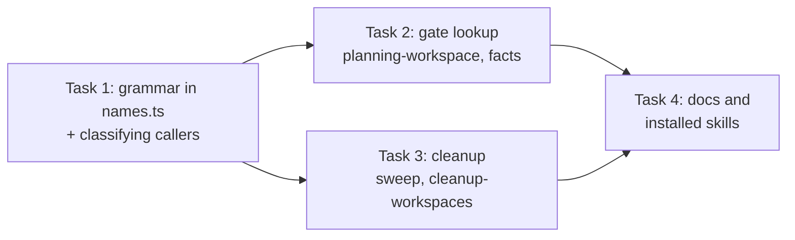

# Include the issue slug in spec and plan branch names Implementation Plan

> **For agentic workers:** REQUIRED SUB-SKILL: Use the sibling `executing-plans`
> skill to implement this plan inline, task by task. Steps use checkbox
> (`- [ ]`) syntax for tracking.

**Goal:** New spec and plan branches are named
`agent/issue-N-<slug>--spec|plan`, the slug stays fixed after the first planning
branch, and legacy `agent/issue-N--spec|plan` names keep working.

**Architecture:** `src/kernel/names.ts` owns the planning-branch grammar through
`planningBranchName`, `parsePlanningBranch`, and `artifactSlug`. Every caller
that classifies a branch uses `parsePlanningBranch`. `planningWorkspace` finds a
stage's branch from remote branches, then from candidate names built from
other-stage planning branch slugs, base artifact slugs, the title slug, and the
legacy name. It uses the existing `findPullRequest` for each lookup.

**Tech Stack:** TypeScript on Node.js, `node:test`, the fake host and Git
fixtures in `test-support/`.

**Spec:**
`docs/specs/2026-11-20-issue-377-include-the-issue-slug-in-spec-and-plan-branch-n-design.md`

## Inputs

- The spec above, including its `## Visual explanation`.
- `GLOSSARY.md`: the **Planning branch** entry.
- No mockups. Frontend design does not apply.

## Global Constraints

- Planning branch grammar: `agent/issue-<N>[-<slug>]--<spec|plan>`. An empty
  slug is the legacy form.
- A valid slug matches `^[a-z0-9]+(?:-[a-z0-9]+)*$` and has at most 48
  characters.
- Implementation branch names (`branchName`) do not change.
- No host interface or host adapter changes.
- New-branch slug: the first non-empty slug of: other-stage remote planning
  branch, then `baseSlugs` in order, then `slugify(issue.title)`. If all are
  empty, use `""`.
- Candidate order when no remote branch exists for a stage: other-stage remote
  planning branch slugs, then `baseSlugs`, then `slugify(issue.title)`, then
  `""`, without duplicates. Pull request preference: open, merged, closed.
  Within one state, the first candidate wins.
- Two or more remote planning branches for one stage return
  `ambiguous-branches`.

## Review Focus

- A title edit after the spec merged and its branch was deleted: the spec gate
  stays passed and the plan branch uses the spec slug (Task 2 test).
- An in-flight legacy `agent/issue-9--spec` branch: Patchmill reuses it and does
  not create a slugged duplicate (Task 2 test).
- An implementation branch whose title ends in "spec", such as
  `agent/issue-9-write-the-spec`, is never a planning branch (Task 1 test).
- A slugged planning workspace left after merge is cleaned up, and it is never
  an implementation candidate in the sweep (Task 3 test).
- A title with no ASCII letters or digits gives the legacy form and still works
  (Task 1 test).

---

### Task 1: Planning-branch grammar and branch classification

**Files:**

- Modify: `src/kernel/names.ts`
- Modify: `src/kernel/envelope.ts`, `src/kernel/chat-approval.ts`,
  `src/kernel/interactive-loop.ts`, `src/kernel/cleanup-state.ts`,
  `src/kernel/merged-cleanup.ts`, `src/web/board-projection.ts`
- Modify (temporary legacy call): `src/kernel/planning-workspace.ts`,
  `src/kernel/facts.ts`, `src/kernel/merged-cleanup-sweep.ts`,
  `src/kernel/cleanup-workspaces.ts`
- Test: `src/kernel/names.test.ts`, `src/web/board-projection.test.ts`

**Interfaces:**

- Produces:
  - `planningBranchName(issue: number, stage: ArtifactKind, slug: string): string`
  - `parsePlanningBranch(issue: number, branch: string): { stage: ArtifactKind; slug: string } | undefined`
  - `artifactSlug(kind: ArtifactKind, issue: number, fileName: string): string | undefined`

- [ ] **Step 1: Write the failing unit tests** in `src/kernel/names.test.ts`:
  - `planningBranchName adds the slug before the stage suffix`:
    `planningBranchName(42, "spec", "add-export-button")` is
    `"agent/issue-42-add-export-button--spec"`, and
    `planningBranchName(42, "plan", "")` is `"agent/issue-42--plan"`.
  - `parsePlanningBranch recognises slugged and legacy planning branches`:
    `"agent/issue-42-add-export-button--plan"` gives
    `{ stage: "plan", slug: "add-export-button" }`, and `"agent/issue-42--spec"`
    gives `{ stage: "spec", slug: "" }`.
  - `parsePlanningBranch rejects implementation branches, neighbours, and bad slugs`:
    each of `"agent/issue-42-write-the-spec"`, `"agent/issue-42-add-export"`,
    `"agent/issue-420--spec"`, `"agent/issue-4--spec"` (for issue 42),
    `"agent/issue-42-Add--spec"`, `"agent/issue-42-a--b--spec"`,
    `"agent/issue-42---spec"`, `"agent/issue-42--specs"`, and a 49-character
    slug gives `undefined`.
  - `planning names round-trip through the parser for every title`: for titles
    `"Add export button"`, `"???"`, and a 60-character title,
    `parsePlanningBranch(42, planningBranchName(42, stage, slugify(title)))`
    gives back the stage and `slugify(title)`, for both stages.
  - `artifactSlug reads the slug from recognised artifact names`:
    `artifactSlug("spec", 42, "2026-11-20-issue-42-add-export-button-design.md")`
    is `"add-export-button"`.
    `artifactSlug("plan", 42, "2026-11-20-issue-42-plan.md")` is `""`. A
    `-plan.md` name for kind `spec`, another issue, and a slug with `--` give
    `undefined`.

- [ ] **Step 2: Write the failing caller tests**
  - In `src/web/board-projection.test.ts`,
    `slugged planning pull requests keep their spec and plan kinds`: with
    `prs("agent/issue-9-add-login--spec")` and
    `prs("agent/issue-9-add-login--plan")`, the column is `"review"` and the
    pull request kinds are `"spec"` and `"plan"`, as for the legacy rows at
    lines 43–44.
  - In `src/kernel/merged-cleanup-safety.test.ts`, run the `"planning"` mode
    (line 40) for both `"agent/issue-9--spec"` and
    `"agent/issue-9-add-login--spec"`. In both cases, also set the merged
    `Closes #9` pull request's `headBranch` to that planning name in the
    `c.mutate` block, so that only the planning-branch guard can refuse it. Both
    give status `"skipped"` and keep the worktree.
  - In `src/kernel/cleanup-state.test.ts`, add receipts whose `identity.branch`
    is `"agent/issue-9--plan"` and `"agent/issue-9-add-login--plan"` to the
    invalid list at lines 43–52. Both are rejected.

- [ ] **Step 3: Run the tests and make sure they fail**

  Run:
  `node --test src/kernel/names.test.ts src/web/board-projection.test.ts src/kernel/merged-cleanup-safety.test.ts src/kernel/cleanup-state.test.ts`

  Expected: FAIL. `names.test.ts` fails because `parsePlanningBranch` and
  `artifactSlug` are not exported. The slugged board, safety, and receipt cases
  fail, because the old guards only compare with the legacy names. The legacy
  cases pass. Without the `headBranch` change, the slugged safety case would
  pass, because no pull request would have the planning head.

- [ ] **Step 4: Implement the three functions in `src/kernel/names.ts`**

  Use one module-level slug pattern source, `[a-z0-9]+(?:-[a-z0-9]+)*`, for
  `parsePlanningBranch` and `artifactSlug`, and check the 48-character limit.
  `artifactSlug` uses `isArtifactFile` first, then takes the text between
  `issue-N-` and the kind suffix.

- [ ] **Step 5: Replace equality tests with `parsePlanningBranch`**
  - `envelope.ts`, `chat-approval.ts`, `interactive-loop.ts`: replace
    `facts.branch === / !== planningBranchName(n, facts.stage)` with
    `parsePlanningBranch(n, facts.branch)?.stage === / !== facts.stage`.
  - `cleanup-state.ts`, `merged-cleanup.ts`: replace the `["spec", "plan"].some`
    blocks with `parsePlanningBranch(issue, branch) !== undefined`.
  - `board-projection.ts`:
    `kind = parsePlanningBranch(input.issue, pr.headBranch)?.stage ?? "implementation"`.
  - `planning-workspace.ts`, `facts.ts`, `merged-cleanup-sweep.ts`,
    `cleanup-workspaces.ts`: pass `""` as the slug for now, so behaviour does
    not change. Tasks 2 and 3 replace these calls.

- [ ] **Step 6: Run the tests and make sure they pass**

  Run:
  `npm run check:types && node --test src/kernel/names.test.ts src/web/board-projection.test.ts src/kernel/envelope.test.ts src/kernel/chat-approval.test.ts src/kernel/cleanup-state.test.ts src/kernel/merged-cleanup-safety.test.ts`
  Expected: PASS.

- [ ] **Step 7: Commit**

  ```bash
  git add src/kernel src/web
  git commit -m "feat(kernel): recognise slugged and legacy planning branches"
  ```

### Task 2: Gate lookup with a fixed slug

**Files:**

- Modify: `src/kernel/planning-workspace.ts`, `src/kernel/facts.ts`
- Test: `src/kernel/planning-gates.test.ts`, and any run-once test that names
  `agent/issue-9--spec` or `agent/issue-9--plan` as the branch Patchmill
  creates: `planning-publication.test.ts`, `interactive-waits.test.ts`,
  `run-snapshot.test.ts`, `run-once.test.ts`, `run-once-failures.test.ts`,
  `chat-approval.test.ts`. Find them with `rg -l 'issue-9--(spec|plan)' src`.
  The `src/console/planning-*.test.ts` files are static display fixtures and
  need no change.

**Interfaces:**

- Consumes: Task 1 functions.
- Produces: `planningWorkspace` input gains `baseSlugs: string[]`. Its result
  can be `{ kind: "ambiguous-branches", branches }` for duplicate planning
  branches of one stage.

- [ ] **Step 1: Write the failing run-once tests** in
      `src/kernel/planning-gates.test.ts`:
  - Change `specBranch` and `planBranch` to `"agent/issue-9-add-login--spec"`
    and `"agent/issue-9-add-login--plan"`. The four-row gate test then proves
    that new branches carry the slug, and that a merged gate survives branch
    deletion.
  - `a title edit after a merged spec keeps the gate and the spec slug`: both
    gates on. Run to the spec PR. Assert that its head is `specBranch` before
    you merge it, so the test fails on that assertion today. Merge it, delete
    `specBranch` on origin. Set the issue title to `"Sign in with passkeys"`
    with `c.mutate`. Run again. Assert that the newest pull request head is
    `"agent/issue-9-add-login--plan"`, that no second spec pull request exists,
    and that the Pi step count is 2.
  - `an in-flight legacy spec branch stays at its gate and passes after merge`:
    both gates on. Push a spec commit to `agent/issue-9--spec` with `c.seed`,
    and add an open pull request with that head and `Refs #9` through
    `c.mutate`. Run. Assert no Pi launch, and that no slugged spec branch exists
    on origin. Merge the legacy branch with `merge`, then run without deleting
    it. Assert that the run advances past the spec gate and that the new plan
    pull request head is `"agent/issue-9-add-login--plan"`, not the legacy plan
    name. Then delete the legacy spec branch on origin and run again. Assert
    that no second spec pull request exists and that Pi did not launch again.
  - `two spec branches for one issue stop as ambiguous`: push both
    `agent/issue-9--spec` and `agent/issue-9-add-login--spec`. Run. Assert no Pi
    launch and a stop that lists both branches.

- [ ] **Step 2: Run the tests and make sure they fail**

  Run: `node --test src/kernel/planning-gates.test.ts`

  Expected: FAIL. Every existing test in this file that uses the `specBranch` or
  `planBranch` constants fails, because new heads are still legacy names. The
  title-edit test fails on its spec head assertion. The ambiguity test fails
  because the slugged branch counts as an implementation branch. The legacy
  in-flight test fails on its slugged plan head. Its other assertions already
  hold today and guard compatibility.

- [ ] **Step 3: Implement the stage selection in `planningWorkspace`**

  Follow the spec's "Gate lookup" steps 1–4 and the "Fixed slug" order. Keep the
  merged, chat-approved, `wrongTarget`, and `selected` logic as it is. The
  implementation candidates are the branches where `parsePlanningBranch` returns
  `undefined`.

- [ ] **Step 4: Supply `baseSlugs` from `selectWorkspace` in `facts.ts`**

  Use `refArtifacts` on the ref `origin/<baseBranch>` with `repoRoot` and the
  issue number to find the spec and plan artifacts. Map their base names through
  `artifactSlug`. Drop `undefined` values and duplicates, spec first. Filter
  implementation branches with `parsePlanningBranch`.

- [ ] **Step 5: Update the other run-once tests**

  Replace created-branch expectations `agent/issue-9--spec|plan` with the
  slugged names. Keep the legacy name where a test seeds an existing branch on
  purpose. `chat-approval.test.ts` (line 150) calls `planningWorkspace`
  directly. Pass `baseSlugs: []` there.

- [ ] **Step 6: Run the tests and make sure they pass**

  Run: `npm test` Expected: PASS.

- [ ] **Step 7: Commit**

  ```bash
  git add src
  git commit -m "feat(kernel): include the issue slug in planning branch names"
  ```

### Task 3: Cleanup of slugged and legacy planning workspaces

**Files:**

- Modify: `src/kernel/merged-cleanup-sweep.ts`,
  `src/kernel/cleanup-workspaces.ts`
- Test: `src/kernel/merged-planning-cleanup.test.ts`,
  `src/kernel/merged-cleanup-sweep.test.ts`,
  `test-support/merged-cleanup-fixture.ts`

**Interfaces:**

- Consumes: `parsePlanningBranch` and `worktreeDirName` from Task 1.

- [ ] **Step 1: Write the failing tests**
  - In `merged-planning-cleanup.test.ts`, run the existing mode loop for two
    name sets: legacy `agent/issue-9--spec|plan` and slugged
    `agent/issue-9-add-login--spec|plan`, with worktree paths from
    `worktreeDirName`. The assertions stay the same.
  - In `test-support/merged-cleanup-fixture.ts`, give `planning()` an optional
    `slug: string` parameter, default `""`. It creates branches with
    `planningBranchName(9, stage, slug)` and paths with `worktreeDirName`.
  - In `merged-cleanup-sweep.test.ts`, run the
    `planning-only leftovers use the receipt…` tests (lines 178–196) and
    `planning-only branches without a receipt never trigger cleanup` for slug
    `""` and slug `"add-login"`. The slugged leftover tests fail before the
    change: the sweep drops `add-login--spec`, so discovery returns `[]`.

- [ ] **Step 2: Run the tests and make sure they fail**

  Run:
  `node --test src/kernel/merged-planning-cleanup.test.ts src/kernel/merged-cleanup-sweep.test.ts`
  Expected: FAIL for most slugged cases. Slugged planning worktrees stay after
  cleanup, so the receipt tests first fail on the `"kept"` status. The sweep
  also does not find the slugged leftover. Two slugged cases pass before the
  change and guard against regressions: the "without a receipt" sweep test and
  the `absent` mode of `merged-planning-cleanup.test.ts`. The legacy cases pass.

- [ ] **Step 3: Implement the changes**
  - `merged-cleanup-sweep.ts`: after the issue-number match, accept the branch
    when `parsePlanningBranch(issue, branch)` recognises it. Otherwise apply the
    current slug check. Filter implementation branches with
    `parsePlanningBranch(issue, branch) === undefined`.
  - `cleanup-workspaces.ts`: build the target list from `input.branch`, then the
    sorted, de-duplicated local heads and registered worktree branches for which
    `parsePlanningBranch(input.issue, branch)` returns a stage. Keep the path
    derivation and all safety checks.

- [ ] **Step 4: Run the tests and make sure they pass**

  Run: `npm test` Expected: PASS.

- [ ] **Step 5: Commit**

  ```bash
  git add src/kernel test-support
  git commit -m "fix(kernel): clean up slugged planning workspaces"
  ```

### Task 4: Documentation and installed skills

**Files:**

- Modify: `skills/patchmill-plan/SKILL.md` (line 24),
  `skills/patchmill-cleanup/SKILL.md` (line 20),
  `site/src/content/docs/using-patchmill/run-once.md` (names table)
- Regenerate: `.patchmill/skills/patchmill-plan/SKILL.md`,
  `.patchmill/skills/patchmill-cleanup/SKILL.md`,
  `.patchmill/skills/patchmill-skill-pack.json`

- [ ] **Step 1: Update the text**

  Describe planning branches as `agent/issue-N-<title-slug>--spec` and
  `agent/issue-N-<title-slug>--plan`. Say that the slug is fixed when the first
  planning branch is created, and that legacy `agent/issue-N--spec` and
  `agent/issue-N--plan` names stay valid. In `skills/patchmill-plan/SKILL.md`,
  give the slug order for a new planning workspace. Use the first non-empty slug
  of: the other stage's planning branch, then the issue's spec or plan file name
  on the base branch, then the current title. In the site table, change the two
  rows to the new rule and add the legacy note below the table.

- [ ] **Step 2: Refresh the installed skills**

  Run: `npm run patchmill -- skills update` Expected: only the two edited skills
  and the manifest change under `.patchmill/skills`. Make sure
  `diff -r skills/patchmill-plan .patchmill/skills/patchmill-plan` and the same
  command for `patchmill-cleanup` print nothing.

- [ ] **Step 3: Verify**

  Run:
  `rg -n 'issue-N--(spec|plan)' skills .patchmill/skills site/src README.md`
  Expected: only the legacy notes. Then run `npm run lint` and `npm test`.
  Expected: PASS. No npm dependency changes, so the Nix build is not required.

- [ ] **Step 4: Commit**

  ```bash
  git add skills .patchmill/skills site
  git commit -m "docs: describe slugged planning branch names"
  ```

## Verification

The tests cover behaviour: name parsing, gate selection after title edits and
branch deletion, legacy compatibility, and cleanup. Documentation and skill
copies are checked with `rg`, `diff`, and `npm run lint`, not with tests.

## Visual explanation

Task order and what each task owns:



## Planning review

### Pass 1: specification and plan together

- **Scope:** this plan, combined with the specification
  `docs/specs/2026-11-20-issue-377-include-the-issue-slug-in-spec-and-plan-branch-n-design.md`.
- **Reviewer:** canonical `reviewer` agent, model `claude-opus-5-5`, thinking
  `high`, base revision `19d588e9033995a53c0f2b22da0b28da6076532b`.
- **Reviewed body SHA-256:** the planner did not record it before the initial
  pass. The confirmation reviewed plan body
  `19ce0b1618aee2b7f43476163985f2056911fce2732199fab92c923b21fb7ba2` against
  specification body
  `f7165b6695f8f0931807f0d13e699bb121c33504c53a689f532c033c25a4321b`.
- **Findings and dispositions:**
  - B1 (blocker: the sweep test passed before the change): accepted. Task 3 now
    runs the receipt-based leftover tests for legacy and slugged names through a
    slug parameter on the fixture's `planning()`.
  - S5 (no slugged tests for the cleanup guards): accepted. Safety and receipt
    cases were added to Task 1.
  - S6 (wrong expected failures; `chat-approval.test.ts` caller; console
    fixtures): accepted. Task 2 was revised.
  - S7 (plan skill slug order): accepted. Task 4 was revised.
  - Specification findings: see the specification's record.
- **Confirmation:** ready. It recommended fixes for two wrong expected-failure
  statements and three wording gaps, and the planner made them. Those edits made
  this pass stale, so pass 2 ran.
- **Outcome:** `ready` (superseded by pass 2)

### Pass 2: plan

- **Scope:** this plan. The specification was an input, unchanged since its
  ready record.
- **Reviewer:** canonical `reviewer` agent, model `claude-opus-5-5`, thinking
  `high`, base revision `19d588e9033995a53c0f2b22da0b28da6076532b`.
- **Reviewed plan body SHA-256:**
  `f89cf5854e2f1ae92bb3887d8c8ff3a9d158a63a58de10ccee659de8947bc6b4`
- **Specification body SHA-256:**
  `9d2133b9aa0123b3b1295808da225cd6e54aeec229ff020dae6d19ebd586877d`, the
  current hash of the same reviewed specification text.
- **Survey:** the reviewer checked all paths, symbols, and line references. It
  confirmed that the five fixes from pass 1 are correct, and that the plan is
  consistent with the specification.
- **Findings and dispositions:**
  - B1 (blocker: the Task 3 commit left out `test-support`): accepted. The
    commit now adds `src/kernel test-support`.
  - S1 (no legacy receipt case in `cleanup-state.test.ts`): accepted. Both the
    legacy and slugged receipts are added.
  - S2 (caller tests were written after the guard change): accepted. Task 1 now
    writes them in Step 2 and runs them failing in Step 3.
  - S3 (expected-failure list incomplete; title-edit test could fail on merge):
    accepted. Task 2 Step 2 was revised, and the title-edit test asserts the
    spec head before it merges.
  - S4 (two slugged cleanup cases pass before the change): accepted. Task 3 Step
    2 names them as regression guards.
- **Confirmation:** all five resolved. No new blockers. Two optional wording
  suggestions:
  - S3-a ("every test" should be "most"; the wrong-target test passes today):
    rejected. The step's expected result, FAIL for the file, is correct, as the
    reviewer confirmed. The implementer runs the file as one unit.
  - S2-a (the Task 1 Files list leaves out two test files): rejected. Steps 2
    and 6 name both files, and the Step 7 `git add src/kernel src/web` commits
    them, as the reviewer confirmed.
- **Limits:** the reviewer ran no tests. Its expected-failure judgements come
  from reading the code paths.
- **Final body SHA-256:**
  `8ced0aec07b803817ff716573905e547d8b654172d9630926cf7db7948477f0c`. The
  reviewed text is the same. The hash includes the blank line before this
  record.
- **Outcome:** `ready`
