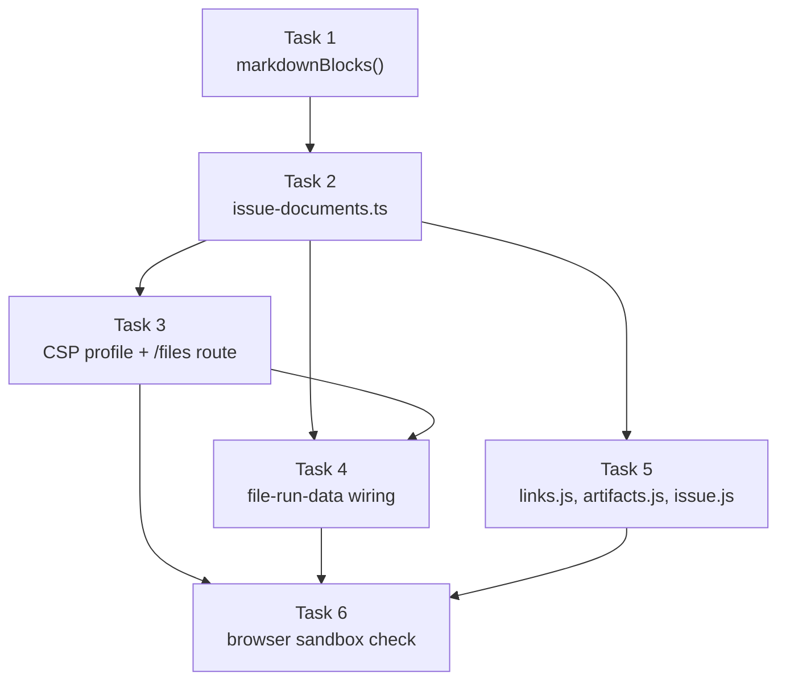

# Issue documents on the live web issue page Implementation Plan

> **For agentic workers:** REQUIRED SUB-SKILL: Use the sibling `executing-plans`
> skill to implement this plan inline, task by task. Steps use checkbox
> (`- [ ]`) syntax for tracking.

**Goal:** The live issue page lists and opens the issue's spec, plan, mockups
and diagrams, also from a local branch that is not pushed yet (#384).

**Architecture:** A new deep module `src/web/issue-documents.ts` finds Issue
documents in Git objects (local Issue branch, then the pushed branch, then the
base). It returns `Artifact` entries and a `file(id)` lookup. A pure
`markdownBlocks()` turns each spec and plan into `TextBlock`s in
`IssueDetail.artifacts`. A new route `/files/issues/<n>/<id>` serves HTML
entries with a CSP `sandbox allow-scripts` profile. The viewer frames them with
`sandbox="allow-scripts"`.

**Tech Stack:** TypeScript on Node (`node:http`, `git` through `CommandRunner`),
plain browser JavaScript with JSDoc types, `node:test`.

**Spec:**
`docs/specs/2026-11-20-issue-384-show-an-issue-s-spec-plan-and-mockups-on-the-liv-design.md`

**Plan inputs:**

- The spec above, written on this branch.
- `docs/mockups/2026-11-20-issue-384-live-issue-documents.html`: the chips and
  the two viewer states.
- The spec's `## Visual explanation` (inline Mermaid).
- `GLOSSARY.md`: this branch adds **Issue document**.

**Execution:** inline through the sibling `executing-plans` skill. Planning
review of this plan and the spec happened before implementation.

## Global Constraints

- Add no npm dependency, browser framework or browser build step.
- Read Git objects only. No fetch, no checkout, no worktree read, no ref write.
- Never follow a symbolic link (`120000` tree entries are not documents).
- The browser never sends a path. The route takes only
  `^(mockup|diagram)-[0-9a-f]{12}$` IDs.
- Document CSP, exactly:
  `default-src 'none'; script-src 'unsafe-inline'; style-src 'unsafe-inline'; img-src data: blob:; font-src data:; media-src data: blob:; connect-src 'none'; worker-src 'none'; frame-src 'none'; object-src 'none'; base-uri 'none'; form-action 'none'; frame-ancestors 'self'; sandbox allow-scripts`
- Live frame: `sandbox="allow-scripts"` exactly. Sample frame:
  `sandbox="allow-same-origin"` exactly, as now.
- Live note:
  `Repository file. Scripts run in an isolated frame. The file cannot read this page or act as you.`
- Location text: `On local branch <branch>. Not pushed yet.`,
  `On branch <branch>`, `On <base>`.
- Limits: spec or plan 1 MiB, HTML 5 MiB, 20 HTML entries for each issue.
- Warning: `Could not read documents for issue #N.`
- A document failure never fails the issue page.

## Review Focus

1. A link like `../../../etc/passwd.html` or `../outside.html` in a spec. It
   must not be listed (Task 2 test `refuses links outside the documents`).
2. A local Issue branch with the same blob as `origin/<branch>`. It must be
   `draft: false` with a host URL, not "Not pushed yet" (Task 2 test
   `pushed blobs are not drafts`).
3. Issue 38 and issue 384 in one repository. The ref fingerprint and the local
   branch filter of issue 38 must not see `agent/issue-384-*` (Task 2 test
   `issue prefixes do not overlap`).
4. A percent-encoded path in the file route, such as
   `/files/issues/9/..%2fpackage.json`. It must be `404`, never a file (Task 3
   test `file route refuses path-like ids`).
5. A broken Git repository or missing refs. The issue page must load with
   `artifacts: []` and one warning (Task 4 test
   `document failure keeps the issue page`).

---

### Task 1: Markdown to text blocks

**Files:**

- Create: `src/web/markdown-blocks.ts`
- Test: `src/web/markdown-blocks.test.ts`

**Interfaces:**

- Produces: `markdownBlocks(source: string): readonly TextBlock[]` and
  `markdownTitle(source: string): string | null` (text of the first level-one
  ATX heading, inline markers removed).

- [ ] **Step 1: Write the failing tests**

  One test per row of the spec's "Markdown to text blocks" table:
  - `headings of any level become heading blocks`: `"# A\n\n### B"` →
    `[{kind:"heading",content:[{kind:"text",text:"A"}]}, {kind:"heading",content:[{kind:"text",text:"B"}]}]`.
  - `fenced code keeps raw text`: a ` ```mermaid ` block and a `~~~` block each
    give one `{kind:"code", text}` with inner lines unchanged, including
    `<script>` text.
  - `lists flatten nesting and join continuation lines`:
    `"- a\n  more\n  - b\n1. c"` → one unordered list with items `a more` and
    `b`, then one ordered list with item `c`.
  - `pipe tables become plain text cells`: the source
    `"| A | **B** |\n|---|---|\n| 1 | \u0060x\u0060 |"` gives
    `{kind:"table", headers:["A","B"], rows:[["1","x"]]}`.
  - `blockquotes and raw HTML are paragraphs of text`:
    `"> q\n\n<iframe src=x></iframe>"` → paragraphs `q` and
    `<iframe src=x></iframe>` as text.
  - `inline markers`: this source (as a JS string, `\u0060` is a backtick):

    ```text
    a \u0060c\u0060 **s** *e* _e_ [h](https://x.test) [r](../m.html)  [j](javascript:x)
    ```

    gives `text`, `code` `c`, `strong` `s`, `emphasis` `e`, `emphasis` `e`,
    `link` `h` with href `https://x.test` as written, then `text` `r`, `text`
    `alt` and `text` `j`, with the spaces as `text` between them.

  - `unclosed markers stay text`: the source `"**a \u0060b"` gives one `text`
    item with the same characters.
  - `markdownTitle` returns `Title` for `"intro\n# Title *x*\n"`, and `null`
    without a level-one heading.

- [ ] **Step 2: Run the tests and see them fail**

  Run: `node --test src/web/markdown-blocks.test.ts` Expected: FAIL, module not
  found.

- [ ] **Step 3: Implement `markdownBlocks` and `markdownTitle`**

  A line-based block scan, then an inline scan for each paragraph, list item and
  heading. Adjacent text items merge. Thematic breaks (`---`, `***`) and blank
  lines end a block. Keep the file under about 250 lines (sibling
  `module-size`).

- [ ] **Step 4: Run the tests and see them pass**

  Run: `node --test src/web/markdown-blocks.test.ts` — Expected: PASS.

- [ ] **Step 5: Commit**

  `git commit -m "feat(web): parse Markdown into text blocks"`

### Task 2: Issue document reader

**Files:**

- Create: `src/web/issue-documents.ts`
- Modify: `src/web/document-links.ts` (import the moved helpers)
- Test: `src/web/issue-documents.test.ts`

**Interfaces:**

- Consumes: `markdownBlocks`, `markdownTitle` (Task 1); `isArtifactFile`,
  `isIssueBranch` (`src/kernel/names.ts`); `createKernelGit().treeFiles`.
- Produces:

  ```typescript
  export type IssueFile = {
    readonly body: Buffer;
    readonly contentType: string;
  };
  export type IssueDocuments = {
    readonly artifacts: readonly Artifact[];
    file(id: string): Promise<IssueFile | null>;
  };
  export type DocumentRepositoryInput = {
    repoRoot: string;
    config: PatchmillConfig;
    baseBranch: string;
    repositoryUrl: string;
    provider: HostProviderId;
    runner: CommandRunner;
  };
  export function createIssueDocumentReader(
    input: DocumentRepositoryInput,
  ): (issue: number, branches: readonly string[]) => Promise<IssueDocuments>;
  export function issueRefsFingerprint(input: {
    repoRoot: string;
    runner: CommandRunner;
    issue: number;
    baseBranch: string;
  }): Promise<string>;
  export const fileIdPattern: RegExp; // /^(mockup|diagram)-[0-9a-f]{12}$/
  export function validBranchName(branch: string): boolean;
  export function hostFileUrl(input: {
    repositoryUrl: string;
    provider: HostProviderId;
    commit: string;
    path: string;
  }): string;
  ```

  `DocumentRepositoryInput` replaces the private `RepositoryInput` of
  `document-links.ts`. `validBranchName` and `hostFileUrl` move from
  `document-links.ts` unchanged in behavior; `document-links.test.ts` must still
  pass.

- [ ] **Step 1: Write the failing tests**

  Build a temporary repository as `document-links.test.ts` does. Use
  `runCommand` as the runner, `issue: 9`, branch `agent/issue-9-docs`, base
  `main`, provider `github-gh`, URL `https://host/owner/repo`. The spec has a
  level-one heading `Docs`, and links `[Full-page mockup](../mockups/m.html)`
  and `[](../specs/2026-11-20-issue-9-docs-design-show-me.html)`.
  - `local-only documents are drafts`: commit spec, plan, mockup and show-me
    file on `refs/heads/agent/issue-9-docs` only. Assert four artifacts in the
    order spec, plan, mockup, diagram. Spec: `id:"spec"`, `title:"Docs"`,
    `draft:true`, `sourceUrl:null`,
    `location:"On local branch agent/issue-9-docs. Not pushed yet."`, `commit` =
    7-hex short SHA, `preview.kind:"document"`. Mockup: `id` =
    `"mockup-" + sha256("docs/mockups/m.html").slice(0,12)`,
    `title:"Full-page mockup"`,
    `preview:{kind:"page",url:"/files/issues/9/<id>"}`. Diagram title is the
    file name.
  - `pushed blobs are not drafts`: set `refs/remotes/origin/agent/issue-9-docs`
    to the same commit. Assert `draft:false`,
    `location:"On branch agent/issue-9-docs"`, and `sourceUrl` =
    `https://host/owner/repo/blob/<full sha>/docs/specs/<name>`. Then add a
    local commit that changes only the plan. Spec stays `draft:false`; plan is
    `draft:true` with the local location text.
  - `base documents`: only `origin/main` has a spec. Location `On main`.
  - `refuses links outside the documents`: links to `https://x.test/a.html`,
    `/abs.html`, `../../../outside.html`, `m.html?x`, `m%2e.html`, a
    symbolic-link blob `docs/mockups/link.html`, a missing file, and a `.md`
    target. None is listed.
  - `limits`: a 1 MiB + 1 byte spec is not listed; 21 linked HTML files give 20
    entries.
  - `file returns only listed HTML`: `file(mockupId)` returns the committed
    bytes with `text/html; charset=utf-8`. `file("spec")`, `file("plan")`,
    `file("mockup-000000000000")`, and the mockup ID of issue 10 return `null`.
  - `issue prefixes do not overlap`: with refs for `agent/issue-38-a` and
    `agent/issue-384-b`, `issueRefsFingerprint({issue:38,...})` does not change
    when the issue 384 ref moves, and changes when `agent/issue-38-a` moves or
    when `origin/main` moves. A branch `agent/issue-384-b` passed in `branches`
    for issue 38 is not read as a local ref.

- [ ] **Step 2: Run the tests and see them fail**

  Run: `node --test src/web/issue-documents.test.ts` — Expected: FAIL.

- [ ] **Step 3: Implement the reader**

  Per call: build the ref list from the spec's "Discovery" order, resolve each
  ref with `git rev-parse --verify <ref>^{commit}`, and for each kind take the
  newest `isArtifactFile` name on the first ref that has one (as
  `createDocumentLinkReader` does). Read blobs with `git cat-file blob <sha>`
  after `git ls-tree -z <commit> -- <path>` confirms mode `100644`/`100755` and
  gives the blob ID and size (`ls-tree -l`). Draft and `sourceUrl` compare blob
  IDs with `origin/<branch>` and `origin/<base>`. Cache by blob ID inside one
  reader. `issueRefsFingerprint` runs
  `git for-each-ref --format=%(refname) %(objectname)` over `refs/heads/agent/`,
  `refs/remotes/origin/agent/` and `refs/remotes/origin/<base>`, then keeps
  lines where `isIssueBranch(issue, …)` holds for the branch part, plus the base
  line. Join with `\n`.

- [ ] **Step 4: Run the tests and see them pass**

  Run:
  `node --test src/web/issue-documents.test.ts src/web/document-links.test.ts`
  Expected: PASS.

- [ ] **Step 5: Commit**

  `git commit -m "feat(web): find Issue documents in Git refs"`

### Task 3: Document CSP profile and file route

**Files:**

- Modify: `src/web/response-headers.ts`, `src/web/response-headers.test.ts`
- Modify: `src/web/run-data.ts`, `src/web/request.ts`
- Create: `src/web/issue-file-route.ts`
- Test: `src/web/issue-file-route.test.ts`

**Interfaces:**

- Consumes: `IssueFile`, `fileIdPattern` (Task 2).
- Produces:
  - `setResponseHeaders(response, profile: "app" | "sample" | "document" = "app")`.
    `"sample"` is today's `preview = true`.
  - `RunDataSource.documentFile?(issue: number, id: string): Promise<IssueFile | null>`.
  - `issueFilePath(path: string): { issue: number; id: string } | "invalid" | null`
    (`null` when the path does not start with `/files/`).

- [ ] **Step 1: Write the failing tests**
  - `response-headers.test.ts`: extend the loop with `/document`. Assert the
    exact document CSP from Global Constraints,
    `doesNotMatch /allow-same-origin/` for it, and the current values for `/`
    and `/preview`.
  - `issue-file-route.test.ts`, with `startWebFixture(t, { source })` where
    `source` is the sample source plus a `documentFile` stub that returns
    `<p>m</p>` only for `(9, "mockup-0123456789ab")`:
    - `file route serves listed HTML with the document CSP`: `GET` with the
      cookie → `200`, body `<p>m</p>`, `content-type`
      `text/html; charset=utf-8`, exact document CSP, `cache-control: no-store`.
      `HEAD` → `200`, empty body.
    - `file route refuses unknown ids and methods`: `mockup-ffffffffffff`,
      `spec`, issue `0`, issue `10` → `404` with body `Not found.`; `POST` with
      a same-origin `Origin` → `405`, `Allow: GET, HEAD`.
    - `file route refuses path-like ids`: `/files/issues/9/..%2fpackage.json`,
      `/files/issues/9/mockup-0123456789ab/x`, `/files/issues/9/%2e%2e` → `404`.
    - `file route needs authentication`: no cookie → `401`.
    - `sample mode has no file route`: the plain sample source → `404`.

- [ ] **Step 2: Run the tests and see them fail**

  Run:
  `node --test src/web/response-headers.test.ts src/web/issue-file-route.test.ts`
  Expected: FAIL.

- [ ] **Step 3: Implement**

  In `request.ts`, after the session route and before the method check, call
  `issueFilePath(path)`. On a match, check the method (`405` with `Allow`), call
  `source.documentFile?.(issue, id)` only when `fileIdPattern` matches, and send
  the body after `setResponseHeaders(res, "document")`. Any other result is
  `404 Not found.` Change line 114 to `setResponseHeaders(res, "sample")`.

- [ ] **Step 4: Run the tests and see them pass**

  Run:
  `node --test src/web/response-headers.test.ts src/web/issue-file-route.test.ts src/web/server-security.test.ts`
  Expected: PASS.

- [ ] **Step 5: Commit**

  `git commit -m "feat(web): serve Issue document HTML in an isolated sandbox"`

### Task 4: Live adapter wiring

**Files:**

- Modify: `src/web/file-run-data.ts`, `src/web/file-issue-detail.ts`
- Test: `src/web/file-issue-selection.test.ts` (or a new
  `src/web/file-issue-documents.test.ts` if that file grows past about 400
  lines)

**Interfaces:**

- Consumes: `createIssueDocumentReader`, `issueRefsFingerprint` (Task 2);
  `RunDataSource.documentFile` (Task 3).
- Produces: `readIssueDetail(input & { artifacts: readonly Artifact[] })`.

- [ ] **Step 1: Write the failing tests**

  Use a fixture whose `repoRoot` is a real temporary Git repository with
  `runCommand` as the runner. Its `progress.json` records branch
  `agent/issue-9-…`, and the local branch has a spec and a linked mockup.
  - `live detail lists Issue documents`: `snapshot({issue:9})` detail has the
    spec and mockup artifacts. The board snapshot (`snapshot()`) reads no blob:
    assert that the runner never received `cat-file`.
  - `documentFile serves a listed mockup`: `source.documentFile(9, mockupId)`
    returns the bytes; `source.documentFile(10, mockupId)` returns `null`.
  - `document failure keeps the issue page`: a runner that fails every `git`
    call. The detail has `artifacts: []`, and `warn` received
    `Could not read documents for issue #9.` once.
  - `a new commit updates the feed`: extend `file-live-feed.test.ts` style. A
    commit on the Issue branch, with run files unchanged, delivers a `header`
    update whose artifacts carry the new commit.

- [ ] **Step 2: Run the tests and see them fail**

  Run:
  `node --test src/web/file-issue-selection.test.ts src/web/file-live-feed.test.ts`
  Expected: FAIL.

- [ ] **Step 3: Implement**

  In `projectIssue`, when `withDetail` is true, call the reader with the same
  branch list as `links`, catch and warn, and pass `artifacts` to
  `readIssueDetail`. Add `documentFile(issue, id)`: read the host cache, find
  the eligible issue, rebuild its branch list as `projectIssue` does, and return
  `reader(issue, branches).file(id)`. Wrap the feed fingerprint:
  `issueFingerprint(...) + "\n" + issueRefsFingerprint(...)`.

- [ ] **Step 4: Run the tests and see them pass**

  Run: `node --test "src/web/*.test.ts"` — Expected: PASS.

- [ ] **Step 5: Commit**

  `git commit -m "feat(web): show Issue documents on the live issue page"`

### Task 5: Browser viewer and chips

**Files:**

- Modify: `web/links.js`, `web/artifacts.js`, `web/issue.js`
- Test: `src/web/browser-links.test.ts`

**Interfaces:**

- Produces: `safePreviewUrl(value)` accepts `/files/issues/<n>/<id>` where `<n>`
  matches `^[1-9]\d*$` and `<id>` matches `fileIdPattern`'s source; and
  `previewSandbox(url: string): "allow-scripts" | "allow-same-origin"`.

- [ ] **Step 1: Write the failing tests**
  - `safePreviewUrl` accepts `/files/issues/384/mockup-0123456789ab` and
    `/files/issues/1/diagram-abcdefabcdef`. It refuses `/files/issues/0/…`,
    `/files/issues/9/spec`, `/files/issues/9/mockup-0123`,
    `/files/issues/9/mockup-0123456789ab/x`, `/files/issues/9/MOCKUP-…`,
    `/files/issues/9/mockup-0123456789ab?x`, and `/files/../index.html`. The
    current `/samples/` cases still pass.
  - `previewSandbox("/files/issues/9/mockup-0123456789ab")` is
    `"allow-scripts"`; `previewSandbox("/samples/board.html")` is
    `"allow-same-origin"`.

- [ ] **Step 2: Run the tests and see them fail**

  Run: `node --test src/web/browser-links.test.ts` — Expected: FAIL.

- [ ] **Step 3: Implement**

  `artifacts.js`: set `frame.setAttribute("sandbox", previewSandbox(local))` and
  choose the note: the live note from Global Constraints for `/files/`, the
  current sample note otherwise. `issue.js`: build the `documentLinks` row from
  links whose `kind` is not in `detail.artifacts`; skip the row when none
  remain.

- [ ] **Step 4: Run the checks**

  Run: `node --test src/web/browser-links.test.ts && npm run lint:ts` Expected:
  PASS, no warnings.

- [ ] **Step 5: Commit**

  `git commit -m "feat(web): open live Issue documents in the viewer"`

### Task 6: Real-browser sandbox check and full verification

**Files:**

- Create: `scripts/check-document-sandbox.mjs`
- Modify: `package.json` (`test:web` runs the new script after the two current
  ones)

- [ ] **Step 1: Write the check**

  Start `startServeServer` with a source that is the sample source plus a
  `documentFile` that returns a mockup whose script stores three results in
  `window.results`: `document.cookie`, the outcome of `fetch("/api/board")`, and
  whether `parent.document` throws. Wrap `snapshot` so that the detail of sample
  issue 210 also has a `mockup` artifact, ID `mockup-0123456789ab`, with
  `preview.url` `/files/issues/210/mockup-0123456789ab`. With Chromium over CDP
  (as `check-serve-layout.mjs` does), open the issue, open the mockup chip, and
  evaluate `window.results` in the frame's execution context. Assert: cookie is
  `""`, fetch rejected, `parent.document` threw, and the frame's
  `location.origin` is `"null"`. Then open the file URL as a top-level tab and
  assert `self.origin === "null"`. The script skips with a message when
  `CHROMIUM` is not set and `chromium` is not on `PATH`, like the current
  scripts.

- [ ] **Step 2: Run the full verification**

  Run: `npm test && npm run lint && npm run test:web` Expected: all pass.
  `test:web` reports the sandbox check passed.

- [ ] **Step 3: Manual check of the acceptance criteria**

  Run `patchmill serve` against this repository while this branch is local-only.
  Open issue #384. Make sure that Spec, Plan and Mockup chips show `draft`, each
  opens, and the mockup's own toggles work in the frame. Request
  `/files/issues/384/mockup-000000000000` and make sure the result is `404`.
  Record the results in the implementation PR body.

- [ ] **Step 4: Commit**

  `git commit -m "test(web): check that Issue document frames are isolated"`

## Verification choices

- Tests cover behavior and security boundaries only: parsing, discovery, access
  rules, CSP, the frame sandbox value, and the feed update.
- No test asserts document prose or the glossary text. `npm run lint:md` checks
  them.
- No npm dependency changes, so the Nix build is not required.

## Visual explanation



Tasks 1 and 2 build the server-side model. Tasks 3 to 5 attach it to the route,
the adapter and the browser. Task 6 proves isolation in a real browser.

## Companion artifacts

- `docs/mockups/2026-11-20-issue-384-live-issue-documents.html`:
  [Full-page mockup](../mockups/2026-11-20-issue-384-live-issue-documents.html)
