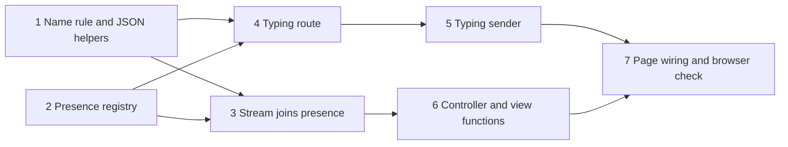

# Presence and typing on the web issue page Implementation Plan

> **For agentic workers:** REQUIRED SUB-SKILL: Use the sibling `executing-plans`
> skill to implement this plan inline, task by task. Steps use checkbox
> (`- [ ]`) syntax for tracking.

**Goal:** Show on each live issue page who else has it open, and who types in
the composer.

**Architecture:** A new in-memory presence registry (`src/web/presence.ts`)
tracks the open event streams of each issue by name. It sends the full list as
an SSE `presence` event without an `id`. A new typing route sets short-lived
typing flags in the registry. The browser updates the "here now" avatars and a
typing line in place, without a full render, and announces joins and leaves in a
persistent polite status element.

**Tech Stack:** Node.js `node:http`, TypeScript run by Node, `node:test`, plain
browser ES modules with JSDoc types, Chromium over CDP for the browser check.

**Spec:**
[`docs/specs/2026-11-20-issue-386-show-who-is-on-a-web-issue-page-and-who-is-typin-design.md`](../specs/2026-11-20-issue-386-show-who-is-on-a-web-issue-page-and-who-is-typin-design.md)

## Inputs

- The spec above, with its `## Visual explanation`.
- Mockup:
  [`docs/mockups/2026-11-20-issue-386-presence.html`](../mockups/2026-11-20-issue-386-presence.html).
- `GLOSSARY.md`: **Presence**, **Typing signal**, **Issue update**, **Web
  session**.

## Global Constraints

- No persistence: nothing about presence or typing goes to run files or any
  other file.
- The same name in two tabs counts once. Names compare after trim and NFC. Case
  counts.
- Name rule (server): trim, 1 to 80 characters, no control characters, no
  leading `/`. Error code `invalid_author`.
- Name rule (browser, `web/preferences.js`): the server rule, but 1 to 32
  characters, and the saved name is in NFC form.
- Browser typing interval: at most one `typing: true` every 3000 ms. Server
  typing expiry: 6000 ms after the last `true`.
- Presence events have no SSE `id:` line and never enter the issue feed log.
- `--sample` gets no presence registry: no presence events, and the typing route
  answers 404 `not_found`.
- The typing route needs the cookie and a matching `Origin` (checked in
  `src/web/request.ts` before routing). Body limit 4096 bytes.
- Presence and typing changes never call `render()` in `web/app.js`.
- Copy: `here now`, `Here now: you, Ana and Ben`, `Ana is typing`,
  `Ana and Ben are typing`, `3 people are typing`, `Ana joined the page.`,
  `Ana left the page.`
- Run `npm test` and `npm run lint` before each commit. Run
  `CHROMIUM=$(command -v chromium) npm run test:web` in Task 7.

## Review Focus

1. **A name that the browser accepts but the server refuses** (for example
   `/dev` or a name with a tab). Every stream would answer 400 and the
   controller would reload without end. The browser rule must match the server
   rule. Test in Task 1 (`saveName` refuses these names; `readName` returns
   `null` for an old saved one).
2. **Rename mid-page.** A person saves a new name while the page is open. The
   old name must leave and the new one join, and the old name's typing flag must
   clear. Test in Task 6 (controller `rename()` reconnects with the new
   `?name=`) and Task 2 (last leave clears the flag).
3. **A typing signal while the stream reconnects.** The route answers 409
   `not_present`. The browser must not show an error or retry in a loop. Test in
   Task 5 (a rejected `send` does not change the throttle or throw).
4. **A stream that ends by any path, also during `join`.** Client close, server
   shutdown, and the 8 MiB back-pressure cut all run the same cleanup. Each must
   call leave, also when cleanup runs before `join` returns. A failing
   `source.subscribe` must not join. Tests in Task 3.
5. **Composer caret during updates.** A presence change while the person types
   must not move focus, the caret or the thread. Test in Task 7 (browser check).

---

### Task 1: Shared name rule and JSON request helpers

**Files:**

- Create: `src/web/person-name.ts`, `src/web/json-request.ts`
- Modify: `src/web/session/routes.ts`, `web/preferences.js`
- Test: `src/web/person-name.test.ts`, `src/web/browser-preferences.test.ts`;
  existing `src/web/session/routes.test.ts` must stay green unchanged.

**Interfaces:**

- Produces: `parsePersonName(value: unknown): string | null` (returns the
  trimmed, NFC-normalized name).
- Produces: `class BadRequest extends Error { status: number; code: string }`,
  `json(res: ServerResponse, status: number, body: unknown): void`,
  `readBody(req: IncomingMessage, maxBytes: number): Promise<unknown>`.

- [ ] **Step 1: Write the failing test** `src/web/person-name.test.ts`:
      `parsePersonName(" Ana ") === "Ana"`; `"\u00c5"` and `"A\u030a"` return
      the same string; `null` for `""`, `"   "`, `"/x"`, `"a\u0007"`, `42`, and
      a string of 81 code points; a string of 80 code points is accepted. In
      `src/web/browser-preferences.test.ts`, add a test
      `browser names follow the server rule`: `saveName` throws for `"/dev"` and
      `"a\tb"`; `saveName(storage, "Å")` returns `"Å"`; with `"/dev"` already
      stored under `patchmill-name`, `readName` returns `null`.
- [ ] **Step 2: Run** `node --test src/web/person-name.test.ts`. Expected: FAIL,
      module not found.
- [ ] **Step 3: Implement** `parsePersonName` with the rule from `sessionInput`
      in `src/web/session/routes.ts` plus `.normalize("NFC")`. Move
      `BadRequest`, `json` and `readBody` to `src/web/json-request.ts`, with
      `MAX_BODY` as the `maxBytes` argument. Make `sessionInput` use
      `parsePersonName` and keep its `invalid_author` message. Keep the
      `Connection: close` on a 413 in the route's `catch`. In
      `web/preferences.js`, make `validName` also refuse a leading `/` and
      control characters (`/[\u0000-\u001f\u007f-\u009f]/`) and return the NFC
      form; keep the 32-character limit and the existing message style.
- [ ] **Step 4: Run**
      `node --test src/web/person-name.test.ts src/web/session/routes.test.ts src/web/browser-preferences.test.ts`.
      Expected: PASS.
- [ ] **Step 5: Commit**
      `refactor(web): share the name rule and JSON request helpers`.

### Task 2: Presence registry

**Files:**

- Create: `src/web/presence.ts`
- Modify: `src/web/api-types.ts` (add `PresencePerson`, `PresenceUpdate`)
- Test: `src/web/presence.test.ts`

**Interfaces:**

- Consumes: `feedClock()` from `test-support/feed-clock.ts` in tests.
- Produces: the `Presence` type and
  `createPresence(input: { clock: { after(ms: number, fn: () => void): () => void }; typingMs?: number }): Presence`,
  exactly as in the spec. `export const TYPING_MS = 6000`.

- [ ] **Step 1: Write the failing tests** in `src/web/presence.test.ts`. Each
      test records the lists each `send` receives.
  - `join sends the current list at once and every change to every stream`: Ana
    joins → Ana gets `[{name:"Ana",typing:false}]`; Ben joins → both get
    `[Ana, Ben]` in join order.
  - `the same name in two streams counts once and stays until the last leave`:
    Ana joins twice, Ben joins; one Ana leave sends nothing; the second sends
    `[Ben]` to Ben.
  - `an unnamed stream receives lists but is not listed`.
  - `leave is idempotent and issues are independent`: calling leave twice sends
    once; a join on issue 2 does not reach issue 1 streams.
  - `typing sets a flag once, refreshes the timer, and expires after typingMs`:
    `typing(1,"Ben",true)` returns `true` and sends `[Ana, Ben typing]`; a
    second `true` at 5000 ms sends nothing; at 10999 ms the flag is still set;
    at 11000 ms the list without the flag goes out.
  - `typing false clears at once; typing for an absent name returns false`.
  - `the last leave clears the typing flag and its timer`: wrap the test clock's
    `after` to count timers that are set and not yet cancelled or run; after the
    leave the count is 0, and advancing 6000 ms sends nothing.
  - `a send that throws does not stop the others`.
  - `a leave during a send is safe`: Ann's `send` calls Ben's leave function
    when it receives a list; the call does not throw, and the next list has no
    Ben.
- [ ] **Step 2: Run** `node --test src/web/presence.test.ts`. Expected: FAIL,
      module not found.
- [ ] **Step 3: Implement** `createPresence`. Use one `Map<number, IssueState>`
      where `IssueState` holds the stream set, a `Map<name, count>` in insertion
      order, and a `Map<name, cancel>` of typing timers. Delete the issue state
      when its last stream leaves.
- [ ] **Step 4: Run** the test file. Expected: PASS.
- [ ] **Step 5: Commit** `feat(web): add the presence registry`.

### Task 3: Presence on the event stream and server wiring

**Files:**

- Modify: `src/web/event-stream.ts`, `src/web/request.ts`, `src/web/server.ts`,
  `src/cli/commands/serve/source.ts`, `src/cli/commands/serve/main.ts`
- Test: `src/web/server-presence.test.ts` (new),
  `src/cli/commands/serve/source.test.ts`

**Interfaces:**

- Consumes: `Presence`, `createPresence` (Task 2); `parsePersonName` (Task 1).
- Produces: `ServeOptions.presence?: Presence`;
  `RequestContext.presence?: Presence`; `serveIssueEvents` input gains
  `query: string` and `presence?: Presence`. `createServeSource` returns
  `{ source; sessions?: SessionHub; presence?: Presence }`.

- [ ] **Step 1: Write the failing tests** in `src/web/server-presence.test.ts`.
      Reuse the `stream()` reader pattern of `src/web/server-events.test.ts`,
      with a `name` argument added to the URL. Start the fixture with
      `startWebFixture(t, { presence: createPresence({ clock }) })`.
  - `named streams see each other and a closed stream leaves`: Ana's stream
    reads a frame `event: presence` whose data is `[Ana]` and which has no `id:`
    line. Ben connects. Ana reads `[Ana, Ben]`. Ben closes. Ana reads `[Ana]`.
  - `invalid names are refused before the stream opens`: `?name=%2Fx` and
    `?name=a&name=b` answer 400 with code `invalid_author`. `?name=` opens and
    the stream is not listed.
  - `server close leaves presence`: two streams; `serving.close()`; a spy
    `Presence` (wrapping a real one) records one leave per join.
  - `a failing subscribe does not join`: a source whose `subscribe` throws; the
    spy records no join.
  - `a stream cut during join still leaves`: a spy `Presence` whose `join` calls
    `send` with a list larger than 8 MiB, which cuts the stream inside `join`.
    The spy records one leave.
  - `sample servers send no presence events`: the default fixture with
    `keepAliveMs: 20`; the frames are `retry:`, the `reset` update, then
    `: keep-alive`.
  - In `source.test.ts`, assert `presence` is `undefined` for `sample: true` and
    is an object with `join` and `typing` for the existing live case.
  - In `src/cli/commands/serve/main.test.ts`, add
    `live data passes presence to the server`: inject `createSource` that
    returns a `presence` object and `startServer` that records its options; the
    recorded `presence` is that object.
- [ ] **Step 2: Run**
      `node --test src/web/server-presence.test.ts src/cli/commands/serve/source.test.ts src/cli/commands/serve/main.test.ts`.
      Expected: FAIL.
- [ ] **Step 3: Implement.** In `request.ts`, pass
      `query: target.includes("?") ? target.slice(target.indexOf("?") + 1) : ""`
      and `presence` to `serveIssueEvents`. In `serveIssueEvents`, after the
      method and issue checks and before `source.snapshot`, read
      `new URLSearchParams(query).getAll("name")`: more than one value, or one
      non-empty value that `parsePersonName` rejects, answers 400
      `invalid_author` with the session route's message. After
      `source.subscribe` returns, call
      `presence?.join(issue, name, (people) => write("event: presence\ndata: " + JSON.stringify({ kind: "presence", people }) + "\n\n"))`
      and call its leave function in `cleanup`. Then copy the existing guard:
      `if (stopped) leave?.()`, because cleanup can run during `join`. Thread
      `presence` through `ServeOptions` and `createRequestHandler`. In
      `createServeSource`, return
      `presence: createPresence({ clock: { after: (ms, fn) => { const t = setTimeout(fn, ms); t.unref(); return () => clearTimeout(t); } } })`
      for live data only; `main.ts` passes it to `startServeServer`.
- [ ] **Step 4: Run** the tests of Step 2 and
      `node --test src/web/server-events.test.ts`. Expected: PASS.
- [ ] **Step 5: Commit** `feat(web): send presence on issue event streams`.

### Task 4: Typing route

**Files:**

- Create: `src/web/presence-routes.ts`
- Modify: `src/web/request.ts`
- Test: `src/web/presence-routes.test.ts`

**Interfaces:**

- Consumes: `BadRequest`, `json`, `readBody` (Task 1); `parsePersonName` (Task
  1); `Presence` (Task 2).
- Produces: `typingRoute(path: string): string | null` (the raw issue segment)
  and
  `serveTypingRoute(input: { req; res; method: string; rawIssue: string; presence: Presence | undefined }): Promise<void>`.

- [ ] **Step 1: Write the failing tests** in `src/web/presence-routes.test.ts`,
      with a `post()` helper like the one in `src/web/session/routes.test.ts`.
      The fixture uses a real registry with Ann joined on issue 7 through
      `presence.join(7, "Ann", send)`.
  - `typing needs the cookie` (401) and `typing needs a matching Origin` (403
    for no `Origin` and for `http://evil.test`). The registry sends nothing.
  - `only POST is allowed`: GET answers 405 with `Allow: POST`.
  - `sample servers have no typing route`: no `presence` → 404 `not_found`.
  - `bodies are validated`: issue `0` → 400 `invalid_issue`; text/plain → 415;
    5000 bytes → 413; `typing: "yes"` → 400 `invalid_request`; author `"/x"` →
    400 `invalid_author`.
  - `a present name sets and clears typing`: `{author:"Ann",typing:true}` → 202
    `{"accepted":true}` and `send` receives `[Ann typing]`; then `false` → 202
    and `[Ann]`.
  - `an absent name is refused`: author `Bob` → 409 `not_present`.
- [ ] **Step 2: Run** `node --test src/web/presence-routes.test.ts`. Expected:
      FAIL.
- [ ] **Step 3: Implement** `typingRoute` with
      `/^\/api\/issues\/([^/]*)\/typing$/` and `serveTypingRoute` with the
      answer table in the spec. Check in this order: method, issue number,
      registry, body (4096 bytes), author, `typing` boolean, presence. Set
      `Connection: close` on a 413, as `serveSessionRoute` does. Route it in
      `request.ts` next to the session route.
- [ ] **Step 4: Run** the test file and
      `node --test src/web/server-security.test.ts`. Expected: PASS.
- [ ] **Step 5: Commit** `feat(web): add the typing route`.

### Task 5: Typing sender in the browser

**Files:**

- Create: `web/typing.js`
- Modify: `web/api.js`
- Test: `src/web/browser-typing.test.ts`

**Interfaces:**

- Produces: `createTypingSignal({ send, clock, intervalMs = 3000 })` where
  `send: (typing: boolean) => Promise<unknown>` and `clock: { now(): number }`;
  returns `{ input(hasText: boolean): void, sent(): void, dispose(): void }`.
- Produces:
  `ApiClient.typing(issue: number, author: string, typing: boolean): Promise<boolean>`.
  It posts JSON to `/api/issues/<issue>/typing` with
  `credentials: "same-origin"`, returns `response.ok`, and returns `false` on a
  network error. It never throws.

- [ ] **Step 1: Write the failing tests** in `src/web/browser-typing.test.ts`
      with a fake clock and a `send` that records calls:
  - `input with text sends true at most every interval`: `input(true)` at 0,
    1000, 2999 ms → `[true]`; at 3000 ms → `[true, true]`.
  - `an empty composer sends false once after true`: `input(false)` twice → one
    `false`. `input(false)` before any `true` sends nothing.
  - `sent clears once`: after `input(true)`, `sent()` → `false`; a second
    `sent()` sends nothing; the next `input(true)` sends `true` at once.
  - `a rejected send does not throw or change the throttle`.
  - `dispose stops all sends`.
  - `api.typing posts the body and reports failure`: a fake `fetch` sees
    `POST /api/issues/7/typing` with body `{"author":"Ann","typing":true}`; a
    409 returns `false`; a thrown fetch returns `false`.
- [ ] **Step 2: Run** `node --test src/web/browser-typing.test.ts`. Expected:
      FAIL.
- [ ] **Step 3: Implement** `createTypingSignal` and `api.typing`. Catch the
      promise of `send` with an empty handler.
- [ ] **Step 4: Run** the test file and `npm run check:types`. Expected: PASS.
- [ ] **Step 5: Commit** `feat(web): send typing signals from the composer`.

### Task 6: Controller presence and presence view functions

**Files:**

- Create: `web/presence-view.js`
- Modify: `web/controller.js`
- Test: `src/web/browser-presence.test.ts`

**Interfaces:**

- Consumes: `PresencePerson`, `PresenceUpdate` from `src/web/api-types.ts`.
- Produces: `createPageController` options `name?: () => string | null` and
  `onPresence?: (people: readonly PresencePerson[] | null) => void`; method
  `rename(): void`.
- Produces in `web/presence-view.js`:
  `presenceNames(me: string, people: readonly PresencePerson[] | null): string[]`,
  `typingText(me: string, people: readonly PresencePerson[] | null): string`,
  `presenceChanges(previous: readonly PresencePerson[] | null, next: readonly PresencePerson[], me: string): string[]`,
  `paintPresence(root: ParentNode, me: string, people: readonly PresencePerson[] | null): void`.

- [ ] **Step 1: Write the failing tests** in `src/web/browser-presence.test.ts`.
      For the controller, reuse the fake `EventSourceLike` style of
      `src/web/browser-session.test.ts`.
  - `the stream URL carries the saved name`: `name: () => "Ann Lee"` opens
    `/api/issues/298/events?name=Ann%20Lee`; `name: () => null` opens the URL
    without a query.
  - `presence events reach onPresence without a new page state`: dispatch a
    `presence` event; `onPresence` gets the list; `onState` is not called.
  - `closing the stream reports null`: `navigate` to the board →
    `onPresence(null)`.
  - `rename reconnects with the new name`: after the name changes, `rename()`
    closes the old fake and opens a new one with the new query.
  - `a presence event on a closed stream is ignored`.
  - `presenceNames` puts `me` first and lists each name once.
  - `typingText`: `""` with nobody or only `me` typing; `"Ana is typing"`;
    `"Ana and Ben are typing"`; `"3 people are typing"`.
  - `presenceChanges`: `null → [Ana]` gives `[]`; `[Ana] → [Ana, Ben]` gives
    `["Ben joined the page."]`; `[Ana, Ben] → [Ana]` gives
    `["Ben left the page."]`; `me` never appears.
- [ ] **Step 2: Run** `node --test src/web/browser-presence.test.ts`. Expected:
      FAIL.
- [ ] **Step 3: Implement.** In `connect`, append
      `"?name=" + encodeURIComponent(n)` when `name?.()` returns a name. Listen
      to `presence` and call `onPresence(update.people)` when `current()`. In
      `closeStream`, call `onPresence?.(null)`. `rename()` calls `closeStream()`
      then `connect()` and `publish()`. Implement the view functions.
      `paintPresence` builds the avatars with `person()` from `web/dom.js`, at
      most 5 plus a `.av.more` chip whose `title` lists the rest. It sets the
      `.presence-text` hidden text to `Here now: you, Ana and Ben`, and fills
      `.typing` with three `.dots i` and the `typingText`, or empties it. Mark
      the avatars `aria-hidden="true"`. `me` is already in NFC form, because
      `saveName` returns NFC (Task 1).
- [ ] **Step 4: Run** the test file,
      `node --test src/web/browser-session.test.ts src/web/browser-live.test.ts`,
      and `npm run check:types`. Expected: PASS.
- [ ] **Step 5: Commit** `feat(web): receive presence in the page controller`.

### Task 7: Issue page wiring, styles, docs and the browser check

**Files:**

- Modify: `web/issue.js`, `web/app.js`, `web/styles/issue.css`,
  `src/web/assets.ts` (add `typing.js` and `presence-view.js` to `publicFiles`),
  `package.json` (`test:web`), `README.md` (Web sessions section)
- Create: `scripts/check-web-presence.mjs`

**Interfaces:**

- Consumes: everything from Tasks 1, 4, 5 and 6.

- [ ] **Step 1: Write the failing browser check**
      `scripts/check-web-presence.mjs`. Base it on
      `scripts/check-web-session.mjs` (Chromium over CDP, real
      `startServeServer`). Copy its wrapping of `createSampleRunDataSource`:
      `source: "live"`, `sessions: true`, a fake Session hub and a current idle
      Web session for issue 298, so the composer is enabled. Pass a real
      `createPresence`. Give each person a separate browser context
      (`Target.createBrowserContext`), because two targets in one context share
      `localStorage`. Open issue 298 in each, with `patchmill-name` set to `Ana`
      and `Ben` before load. Check:
  - Within 3 s each page's `.presence-text` contains the other's name.
  - Ben types `hi` in `#composer-input`. Within 4 s Ana's `.typing` reads
    `Ben is typing`. Ben's own `.typing` stays empty.
  - Ben stops. Ana's `.typing` is empty within 7 s.
  - Ana's `#composer-input` holds focus and its caret while Ben joins, types and
    leaves. The top of `.thread` on Ana's page does not change.
  - Ben closes the target. Within 3 s Ana's `.presence-text` does not contain
    `Ben`, and the persistent status element says `Ben left the page.`
  - Add `&& node scripts/check-web-presence.mjs` to `test:web`.
- [ ] **Step 2: Run**
      `CHROMIUM=$(command -v chromium) node scripts/check-web-presence.mjs`.
      Expected: FAIL (no presence on the page).
- [ ] **Step 3: Implement.**
  - `web/issue.js`: on live pages, `renderMeta` renders the `.presence` slot
    with only the own avatar, plus
    `<span class="visually-hidden presence-text">`. The visible `here now` label
    and the avatars get `aria-hidden="true"`. Sample pages keep
    `detail.participants`. `renderComposer` adds
    `<span class="typing" aria-hidden="true">` between the status text and
    `.kbd-hint`.
  - `web/app.js`: keep `let savedName = readName(storage)`; set it to the result
    of `saveName` in the name form handler. It stays set when storage is off.
    Use `savedName` for the controller's `name: () => savedName`, for `me` in
    `paintPresence`, and for the typing author. Create a second persistent
    `role="status"` element after `announcement`. Keep `let people = null`.
    `onPresence` calls `presenceChanges` and writes the lines to the status
    element, stores the list and calls
    `paintPresence(mount, savedName ?? name, people)`. Call `paintPresence` at
    the end of `render()`. On name save, call `controller.rename()` and make a
    new typing signal. Keep one typing signal per issue number on screen: in
    every `onState` call, if the state is a live issue on a server with
    `sessions` and there is no signal for that number, create one (the composer
    becomes enabled only after a Web session starts, so a check at first load is
    not enough). Dispose it when the route leaves that issue. Its `send` is
    `(t) => api.typing(number, savedName, t)`. Feed it from the `input` handler
    for `#composer-input` with `input(value.trim() !== "")` only when
    `savedName` is set, and call `sent()` when a message post returns `ok`.
  - `web/styles/issue.css`: give `.presence` a fixed width of 5 overlapped small
    avatars plus the chip and a height of 24px. Add `.av.more`, `.typing` (flex
    1, fixed height, ellipsis, brass text), `.dots` with a pulse, and a
    `prefers-reduced-motion: reduce` rule that stops it. Follow the mockup.
  - `README.md`: add one bullet to "Web sessions": the page shows who has it
    open and who types, by the entered name. This is not stored and is lost on
    restart. In "Browser regression checks", add presence and typing to the list
    of what `test:web` checks.
- [ ] **Step 4: Run** the browser check,
      `CHROMIUM=$(command -v chromium) npm run test:web`, `npm test` and
      `npm run lint`. Expected: PASS.
- [ ] **Step 5: Commit**
      `feat(web): show presence and typing on the issue page`.

## Verification

The tests prove behavior at the module interfaces: the registry, the HTTP
routes, the controller and the pure view functions. The browser check proves the
acceptance criteria end to end in two real tabs. README and CSS changes get no
tests; lint and the browser check cover them. This plan changes no npm
dependencies, so no Nix build is needed.

| Acceptance criterion                     | Task and test                                  |
| ---------------------------------------- | ---------------------------------------------- |
| Each sees the other within a few seconds | Task 2 join tests, Task 3 stream test, Task 7  |
| Closing a tab removes the name           | Task 2 leave, Task 3 close tests, Task 7       |
| Duplicate tabs                           | Task 2 duplicate-name test                     |
| Typing shown, cleared on send or idle    | Task 2 expiry, Task 4, Task 5, Task 7          |
| Polite announcement, thread still        | Task 6 `presenceChanges`, Task 7 browser check |
| Access rules of the new route            | Task 4 cookie, Origin, method and sample tests |

## Visual explanation

The tasks build from the server core outwards to the page. Tasks 1 and 2 have no
dependencies on later work. The browser tasks need only the wire format from
Task 3 and the route from Task 4.



```text
src/web/person-name.ts      Task 1  name rule (server)
src/web/json-request.ts     Task 1  body limits and JSON errors
src/web/presence.ts         Task 2  owns presence and typing state
src/web/event-stream.ts     Task 3  joins and leaves with the stream
src/web/presence-routes.ts  Task 4  POST /api/issues/:n/typing
web/typing.js               Task 5  throttled typing signals
web/controller.js           Task 6  ?name=, presence events, rename()
web/presence-view.js        Task 6  names, typing text, announcements, paint
web/app.js, issue.js, css   Task 7  slots, status element, wiring
```

## Companion artifacts

- Spec:
  [`docs/specs/2026-11-20-issue-386-show-who-is-on-a-web-issue-page-and-who-is-typin-design.md`](../specs/2026-11-20-issue-386-show-who-is-on-a-web-issue-page-and-who-is-typin-design.md)
- Mockup:
  [`docs/mockups/2026-11-20-issue-386-presence.html`](../mockups/2026-11-20-issue-386-presence.html)

## Planning review

### Pass 1: combined review (spec and plan)

- Scope: this plan, together with the spec
  `docs/specs/2026-11-20-issue-386-show-who-is-on-a-web-issue-page-and-who-is-typin-design.md`.
- Reviewer: canonical `reviewer` agent, model `claude-bridge/claude-opus-5-5`,
  thinking `high`, base revision `19d588e9033995a53c0f2b22da0b28da6076532b`.
- Reviewed body SHA-256: plan
  `584ed03980cf15c839155925ecac06d7ba931c05987994e67e9fdc00aadc635d`; spec
  `e39a075689d4e479152eccca199201ed4edebbba00d25ebdec245c0abefb64cf`.
- Compared specification body SHA-256 (final):
  `f2d48413db2b7a645978e2aad505f84295564a7ba259fdd621401d01f26fabb4`.
- Survey: each path, symbol and helper that the plan names exists at the base
  revision or is created by an earlier task. This includes `feedClock`,
  `startWebFixture`, the CDP pattern in `scripts/check-web-session.mjs`, and the
  injection points of `createSource` and `startServer` in `main.test.ts`. The
  task order respects dependencies.
- Findings and dispositions:
  - B1 (blocker), the browser and server name rules differ. Accepted: Task 1
    changes `validName` and adds tests. This is Review Focus item 1.
  - B2 (blocker), there are three sources for the name. Accepted: Task 7 uses
    one `savedName`, and the browser check uses separate browser contexts.
  - S1, the typing sender only at load. Accepted: Task 7 makes it on any
    `onState` call.
  - S2, a skipped leave. Accepted: Task 3 adds the guard and a test for a cut
    during `join`. Task 2 adds a test for a leave during a send.
  - S3, a timer check that cannot run. Accepted: Task 2 wraps `clock.after`.
  - S4, a weak sample-stream test. Accepted: Task 3 checks for the keep-alive
    frame.
  - S5, no test of the live wiring. Accepted: Task 3 adds tests in
    `source.test.ts` and `main.test.ts`.
  - S6, the browser check setup. Accepted: Task 7 spells it out.
  - S7 to S10. Accepted, as in the spec record. Task 7 also updates the README
    section on browser regression checks.
- Inspection limits: the reviewer ran no tests and no browser.
- Confirmation: a fresh scoped confirmation passed and found no new blocker. It
  made four optional suggestions. They do not change the plan body. The
  implementer applies them as notes:
  1. In `serveIssueEvents`, return before `join` when the stream already stopped
     during `source.subscribe` (`if (stopped) { unsubscribe(); return; }`).
     Without this, other pages announce a join and a leave.
  2. In the Task 1 browser test, write the input as `"A\u030a"`, expect
     `"\u00c5"`, and add `" /dev"`. The NFC literals in the plan text are
     already composed, so they do not test normalization.
  3. Make `validName` reject a string that is not well formed
     (`!name.isWellFormed()`). `encodeURIComponent` throws on a lone surrogate.
  4. In `sessionInput` in `web/app.js`, check `savedName` instead of
     `readName(storage)`, so a person with storage off can also send messages.
  - Residual risk: the test for a cut during `join` depends on a send larger
    than 8 MiB that stays buffered. If that is flaky, use a larger payload.
- Final body SHA-256:
  `e9b26751c882217389f81846f463ab734122dcfa33b52253bc98e9462b38a1d2`. The record
  helper hashes the body with the blank line before this heading, so this value
  differs from the reviewed hash only by that line.
- Outcome: `ready`.
