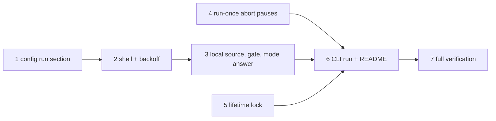

# Local `patchmill run` loop Implementation Plan

> **For agentic workers:** REQUIRED SUB-SKILL: Use the sibling `executing-plans`
> skill to implement this plan inline, task by task. Steps use checkbox
> (`- [ ]`) syntax for tracking.

**Goal:** Add `patchmill run`, a supervised loop that triages and runs issues
one at a time in label mode or local state mode, with one runner per clone.

**Architecture:** A runner shell owns the loop, backoff, and stop. It receives a
triage gate and a work source through its input and sees only `PassResult`. The
local work source maps `runOneIssue` outcomes. The CLI owns the configuration,
the mode answer, the lifetime lock, signals, and exit codes.

**Tech Stack:** TypeScript on Node 24 with `.ts` imports, `node:test`, `fs-ext`
`flock`, and the existing `CommandRunner`.

**Spec:**
[`docs/specs/2026-11-21-issue-398-add-a-local-patchmill-run-loop-for-one-runner-pe-design.md`](../specs/2026-11-21-issue-398-add-a-local-patchmill-run-loop-for-one-runner-pe-design.md)

**Inputs:** the spec above, its `## Visual explanation`, `GLOSSARY.md` (changed
by the spec), and the #356 spec
`docs/specs/2026-11-14-issue-356-patchmill-control-plane-prototype-design.md`
(sections Runner and Architecture item 7) as background. No mockup applies.

## Global Constraints

- The shell never imports or reads `RunOnceOutcome`.
- No new `workflow.stateTracking` string comparisons. Ask
  `stateTrackingMode(config)`.
- No new local workflow state, assignments, or completion records.
- No `--runner` flag. `patchmill run` accepts only `--help`.
- Configuration loads once, at startup.
- Exit codes: 0 clean stop, 1 invalid state or unrecoverable fault, 2 live lock
  owner.
- Defaults: `run.triageIntervalMinutes` 5, `run.idleBackoff` 60 s initial and
  900 s cap, `run.errorBackoff` 30 s initial and 1800 s cap.
- Lock path: `<real git common dir>/patchmill/run.lock`.
- Delay: `min(max, initial * 2^(streak-1)) * (0.5 + 0.5 * random)` seconds,
  returned in milliseconds.
- Log prefix: `patchmill run:` on stderr.

## Review Focus

1. **Stop during a wait.** A signal during an idle or error wait must end the
   wait at once and return `stopped`. Test in Task 2.
2. **Pass that throws after the abort.** It must not count as an error or log an
   error delay. It returns `stopped`. Test in Task 2.
3. **Planning-gate wait.** `stopped` with label `inProgress` must back off, not
   loop. Test in Task 3.
4. **PID reuse.** A record whose PID is alive with another start marker is
   stale. Test in Task 5.
5. **Abort before the claim.** `runOneIssue` with an aborted signal must not
   claim an issue. Test in Task 4.

## File map

```text
src/config/config.ts                     modify: run section, validation
src/config/config.test.ts                modify
src/kernel/runner/backoff.ts             create
src/kernel/runner/shell.ts               create: types + runRunnerShell
src/kernel/runner/shell.test.ts          create (includes backoff tests)
src/kernel/runner/local-triage-gate.ts   create
src/kernel/runner/local-work-source.ts   create
src/kernel/runner/local-work-source.test.ts  create (includes gate tests)
src/kernel/state-tracking-mode.ts        modify: run answer
src/kernel/state-tracking-mode.test.ts   modify
src/kernel/run-once.ts                   modify: abort pauses
src/kernel/run-once-failures.test.ts     modify
src/kernel/runner/lifetime-lock.ts       create
src/kernel/runner/lifetime-lock.test.ts  create
test-support/lifetime-lock-child.mjs     create
src/cli/commands/run/main.ts             create
src/cli/commands/run/main.test.ts        create
src/cli/main.ts                          modify: HELP_TEXT, COMMANDS
README.md                                modify
site/src/content/docs/using-patchmill/run.md  create
site/src/content/docs/...                modify: run-once, configuration
site/astro.config.mjs                    modify: sidebar entry
```

---

### Task 1: `run` configuration section

**Files:**

- Modify: `src/config/config.ts`
- Test: `src/config/config.test.ts`

**Interfaces:**

- Produces:
  `PatchmillConfig["run"]: { triageIntervalMinutes: number; idleBackoff: { initialSeconds: number; maxSeconds: number }; errorBackoff: { initialSeconds: number; maxSeconds: number } }`
  with the defaults above in `DEFAULT_CONFIG`.

- [ ] **Step 1: Write the failing tests**
  - `run defaults apply when the section is absent`: `parseConfig({}).run`
    deep-equals
    `{ triageIntervalMinutes: 5, idleBackoff: { initialSeconds: 60, maxSeconds: 900 }, errorBackoff: { initialSeconds: 30, maxSeconds: 1800 } }`.
  - `run accepts partial overrides`:
    `parseConfig({ run: { idleBackoff: { maxSeconds: 120 } } }).run.idleBackoff`
    deep-equals `{ initialSeconds: 60, maxSeconds: 120 }`.
  - `run rejects non-positive values`: for each of `0`, `-1`, and `Number.NaN`
    in `triageIntervalMinutes`, `idleBackoff.initialSeconds`, and
    `errorBackoff.maxSeconds`, `parseConfig` throws `ConfigError` matching
    `/run\.<key path>/`.
  - `run rejects a cap below its initial delay`:
    `{ run: { errorBackoff: { initialSeconds: 60, maxSeconds: 30 } } }` throws
    `ConfigError` matching `/run\.errorBackoff\.maxSeconds/`.
  - `run rejects unknown keys`: `{ run: { lane: 1 } }` throws
    `/Unknown config key: run\.lane/`.

- [ ] **Step 2: Run `node --test src/config/config.test.ts`.** Expected: the new
      tests fail.

- [ ] **Step 3: Implement.** Add the five leaf paths to `schema` with kind
      `"number"`, the defaults to `DEFAULT_CONFIG`, and a check after `walk`
      that each value is finite and `> 0` and each
      `maxSeconds >=     initialSeconds`. The `NaN` case cannot come from JSON,
      but `parseConfig` is also called with objects in tests, so reject it.

- [ ] **Step 4: Run the test file.** Expected: PASS.

- [ ] **Step 5: Commit** `feat(config): add run loop settings`.

### Task 2: Runner shell and backoff

**Files:**

- Create: `src/kernel/runner/backoff.ts`, `src/kernel/runner/shell.ts`
- Test: `src/kernel/runner/shell.test.ts`

**Interfaces:**

- Consumes: `PatchmillConfig["run"]` shape from Task 1, as
  `RunBackoffConfig = { idle: BackoffDelay; error: BackoffDelay }`.
- Produces (exact types from the spec section Runner shell): `PassResult`,
  `WorkSource`, `TriageGrant`, `TriageGate`, `RunnerShellInput`,
  `RunnerShellResult`, `runRunnerShell(input)`, and in `backoff.ts`
  `BackoffDelay`, `RunBackoffConfig`,
  `backoffDelay(delay, streak, random): number`.

Test harness: a scripted fake work source that returns or throws the next item
of an array and aborts a shared controller when the array ends; a fake gate that
grants on chosen calls and counts `release()`; a fake `sleep` that records `ms`
and resolves at once (or at abort); `random: () => 0.5`; `log` collects lines.

- [ ] **Step 1: Write the failing tests**
  - `backoffDelay doubles, jitters, and caps`: with
    `{ initialSeconds: 10, maxSeconds: 60 }`: streak 1, random 0 → `5000`;
    streak 1, random 0.999… → `< 10000`; streak 3, random 0.5 → `30000`; streak
    10, random 0.5 → `45000`.
  - `worked runs the next pass without a wait`: script `[worked, worked]`;
    `sleeps` is `[]` and `pass` was called 2 times, then the result is
    `{ kind: "stopped" }`.
  - `idle backs off with a growing idle delay`: script `[idle, idle, idle]` with
    idle `{ 10, 60 }` → sleeps `[7500, 15000, 30000]`; the log contains the idle
    reason.
  - `a throw backs off with the error delay`: script
    `[throw "host down", throw, ...]` with error `{ 5, 100 }` → sleeps
    `[3750, 7500]`; the log matches `/host down/`.
  - `worked resets both streaks`: script `[idle, idle, worked, idle]` → sleeps
    `[7500, 15000, 7500]`; script `[throw, throw, worked, throw]` → error sleeps
    `[3750, 7500, 3750]`.
  - `idle resets the error streak and a throw resets the idle streak`: script
    `[throw, throw, idle, throw]` → sleeps `[3750, 7500, 7500, 3750]`.
  - `fatal returns at once`: script `[fatal "conflict", worked]` → result
    `{ kind: "fatal", reason: "conflict" }`; `pass` called once.
  - `triage runs before the pass when the gate grants, and its grant is released`:
    gate grants on call 1 only; the call order recorded by the fakes is
    `["tryGrant", "triage", "release", "pass", "tryGrant", "pass"]`.
  - `the grant's beforeWrite reaches triage`: the fake `triage` receives the
    same `grant` object that `tryGrant` returned.
  - `a triage throw is logged and the pass still runs`: triage throws
    `"list failed"`; the log matches `/triage failed: list failed/`; `pass`
    runs; no sleep was added for it; `release` was called.
  - `a signal during a pass stops after the pass returns`: the pass aborts the
    controller, then resolves `idle`; result `stopped`; `sleeps` is `[]`; no
    second `tryGrant`.
  - `a pass that throws after the abort is not an error`: the pass aborts, then
    throws; result `stopped`; the log does not match `/error/i`.
  - `a signal during triage stops before the pass`: triage aborts, then
    resolves; result `stopped`; `pass` never called; `release` called.
  - `a signal during a wait ends the wait`: the fake `sleep` returns a promise
    that resolves only on abort; script `[idle]`; the test aborts after the
    sleep starts; result `stopped`.
  - `an aborted signal at start runs nothing`: result `stopped`; neither
    `tryGrant` nor `pass` was called.

- [ ] **Step 2: Run `node --test src/kernel/runner/shell.test.ts`.** Expected:
      FAIL, module not found.

- [ ] **Step 3: Implement `backoffDelay` and `runRunnerShell`** as the spec
      describes. The shell keeps `idleStreak` and `errorStreak` in local
      variables. Check `signal.aborted` before triage, before the pass, after
      the pass (before mapping a throw to an error), and after each wait. Log
      lines use the `patchmill run:` prefix.

- [ ] **Step 4: Run the test file.** Expected: PASS.

- [ ] **Step 5: Commit** `feat(kernel): add the runner shell`.

### Task 3: Local triage gate, local work source, and the mode answer

**Files:**

- Create: `src/kernel/runner/local-triage-gate.ts`,
  `src/kernel/runner/local-work-source.ts`
- Modify: `src/kernel/state-tracking-mode.ts`
- Test: `src/kernel/runner/local-work-source.test.ts`,
  `src/kernel/state-tracking-mode.test.ts`

**Interfaces:**

- Consumes: `WorkSource`, `PassResult`, `TriageGate` from Task 2; `runOneIssue`,
  `RunOnceDeps`, `RunOnceOutcome` (types only) from `src/kernel/run-once.ts`.
- Produces:
  - `localTriageGate(input: { intervalMs: number; now: () => Date }): TriageGate`
  - `type LocalWorkSourceInput = { config: PatchmillConfig; deps: RunOnceDeps; runOneIssue: typeof runOneIssue }`
  - `localWorkSource(input: LocalWorkSourceInput): WorkSource`
  - `StateTrackingMode.run: { allowed: true; createWorkSource(input: LocalWorkSourceInput): WorkSource } | { allowed: false; reason: string }`

- [ ] **Step 1: Write the failing tests**

  In `local-work-source.test.ts`, a fake `runOneIssue` returns a fixed outcome
  and records its options. One test per row, using a table-driven loop:

  | outcome                                                                    | expected `PassResult`                                                    |
  | -------------------------------------------------------------------------- | ------------------------------------------------------------------------ |
  | `{ status: "completed", issue: 4 }`                                        | `{ kind: "worked" }`                                                     |
  | `{ status: "stopped", issue: 4, label: "needsInfo", summary: "s" }`        | `{ kind: "worked" }`                                                     |
  | `{ status: "stopped", issue: 4, label: "inProgress", summary: "s" }`       | `{ kind: "idle", reason: "issue #4 waits for a planning pull request" }` |
  | `{ status: "no-work" }`                                                    | `{ kind: "idle", reason: "no eligible issue" }`                          |
  | `{ status: "claimed-elsewhere", issue: 4 }`                                | `{ kind: "idle", reason: "issue #4 is claimed elsewhere" }`              |
  | `{ status: "refused", issue: 4, reason: "another Run attempt is active" }` | `{ kind: "idle", reason: "another Run attempt is active" }`              |
  | `{ status: "paused", issue: 4, summary: "s" }`, aborted                    | `{ kind: "idle", reason: "stopping" }`                                   |
  | `{ status: "paused", issue: 4, summary: "s" }`, not aborted                | `{ kind: "fatal", reason: "run paused without a stop request" }`         |
  | `{ status: "dry-run", issue: 4, derived: "ambiguous-branches" }`           | `{ kind: "fatal", reason: "unexpected dry-run outcome" }`                |

  Also:
  - `the pass passes only its signal`: the recorded options deep-equal
    `{ signal }`.
  - `a runOneIssue throw passes through`: `pass()` rejects with the same error.
  - `the local gate grants at start, then once per interval`: with a mutable
    clock at T, `tryGrant()` grants; at T+4 min it returns `undefined`; at T+5
    min it grants; at T+9 min `undefined`. The grant has no `beforeWrite`, and
    `release()` resolves.

  In `state-tracking-mode.test.ts`:
  - `labels and local modes allow run with the local work source`: for both
    modes, `mode.run.allowed` is `true` and `mode.run.createWorkSource` is
    `localWorkSource`.

- [ ] **Step 2: Run both test files.** Expected: FAIL.

- [ ] **Step 3: Implement** the gate, the source, and the `run` answer in
      `LABELS_MODE` and `LOCAL_MODE`. `local-work-source.ts` uses `import type`
      for everything from `run-once.ts`.

- [ ] **Step 4: Run both test files and `npm run check:types`.** Expected: PASS.

- [ ] **Step 5: Commit**
      `feat(kernel): add the local work source and triage gate`.

### Task 4: An aborted unattended run pauses

**Files:**

- Modify: `src/kernel/run-once.ts`
- Test: `src/kernel/run-once-failures.test.ts`

**Interfaces:**

- Produces: unchanged `runOneIssue` signature. New behavior: an aborted signal
  before the claim returns `{ status: "no-work" }`; after the claim, an aborted
  signal with a stop label other than `done` returns
  `{ status: "paused", issue, summary: "Run paused." }` and publishes nothing.

- [ ] **Step 1: Change the existing tests to the new behavior**
  - Rename `aborted signal stops the claimed attempt without starting Pi` to
    `an aborted signal before the claim returns no-work without a claim`. Assert
    `outcome` deep-equals `{ status: "no-work" }`, the issue has no comments,
    the host recorded no `setLabels` call, and the fake Pi counter file does not
    exist.
  - In `workflow question policy: abort`, assert `outcome.status === "paused"`,
    `updates.length === 1`, `updates[0].status === "inProgress"`, and that
    `result.json` has `outcome.status === "paused"`. Keep the other modes as
    they are.
  - Add `an abort that makes the run throw pauses without publishing`: make
    `c.deps.git.fetch` abort the controller and then throw `"fetch failed"`;
    assert `status === "paused"` and no `commentIssue` or `setLabels` call after
    the claim.
  - Add `a done stop still publishes after a late abort`: use the `implement`
    fixture with the spec and plan seeded; wrap `c.deps.git.unpushedCommits` so
    that it aborts the controller and then delegates (it runs after the session,
    before verification); assert `status === "completed"` and that the `done`
    status was written.

- [ ] **Step 2: Run `node --test src/kernel/run-once-failures.test.ts`.**
      Expected: the changed tests fail.

- [ ] **Step 3: Implement.** Before the lock block, return
      `{ status:     "no-work" }` when `options.signal?.aborted`. Change the
      pause condition to
      `(deps.human || options.signal?.aborted) && session.aborted`. Before
      `if (!published && !paused) await publish()`, set `paused = true` and
      `stop.summary = "Run paused."` when `options.signal?.aborted` and
      `stop.label !== "done"`.

- [ ] **Step 4: Run
      `node --test src/kernel/run-once*.test.ts     src/cli/commands/run-once/main.test.ts`.**
      Expected: PASS.

- [ ] **Step 5: Commit** `fix(kernel): pause an aborted unattended run`.

### Task 5: Lifetime lock

**Files:**

- Create: `src/kernel/runner/lifetime-lock.ts`,
  `test-support/lifetime-lock-child.mjs`
- Test: `src/kernel/runner/lifetime-lock.test.ts`

**Interfaces:**

- Consumes: `flock` from `src/process/flock.ts`; `CommandRunner` from
  `src/process/command.ts`.
- Produces: `LifetimeLockRecord`, `LifetimeLockHeldError` (fields `record`,
  `path`),
  `acquireLifetimeLock(input: { repoRoot; runner; now; log }): Promise<LifetimeLock>`
  where
  `LifetimeLock = { path: string; record: LifetimeLockRecord; release(): Promise<void> }`,
  and
  `lifetimeLockPath(repoRoot: string, runner: CommandRunner): Promise<string>`.

The child script takes `<repoRoot>` and `hold | crash`. `hold` acquires the
lock, sends `acquired`, and waits. `crash` acquires, sends `acquired`, and then
the test kills it with `SIGKILL`. Each test creates a temporary repository with
`git init`.

- [ ] **Step 1: Write the failing tests**
  - `the lock lives in the git common directory shared by worktrees`: add a
    worktree with `git worktree add`; `lifetimeLockPath` from the main checkout
    and from the worktree are equal and end with `/patchmill/run.lock`.
  - `a live owner refuses a second runner`: child `hold`; then
    `acquireLifetimeLock` rejects with `LifetimeLockHeldError` whose
    `record.pid` is the child PID; the same holds from the worktree.
  - `recovery after an unclean exit`: child `crash`, then `SIGKILL`, await
    `exit`; `acquireLifetimeLock` resolves, the log matches
    `/replaced a stale run lock \(pid <childPid>/`, and the file record has the
    test process PID.
  - `a stale record of a dead PID is replaced`: write a record with the host
    name, PID of an exited child, and a start marker; acquire resolves and logs
    the replacement.
  - `a reused PID with another start marker is stale`: write a record with
    `process.pid`, this host, and `processStart: "1"`; acquire resolves (Linux
    only; skip when `/proc/self/stat` is absent).
  - `a record of this live process with its own start marker refuses`: write a
    record with `process.pid` and the real marker; acquire rejects with
    `LifetimeLockHeldError`.
  - `a record from another host refuses`: write a record with
    `host: "elsewhere"`; acquire rejects with `LifetimeLockHeldError` whose
    message matches `/remove .*run\.lock/`.
  - `release clears the record and keeps the inode`: acquire, release; the file
    is empty, its inode is unchanged, and a new acquire succeeds without a
    replacement log line.

- [ ] **Step 2: Run `node --test src/kernel/runner/lifetime-lock.test.ts`.**
      Expected: FAIL.

- [ ] **Step 3: Implement** following `acquireLock` in `src/kernel/lock.ts` for
      the open, `flock "exnb"`, truncate, write, and release steps. Read the
      record after the `flock` succeeds. Apply the stale rules from the spec. On
      refusal after a free `flock`, unlock and close before the throw. Read the
      start marker from `/proc/<pid>/stat` field 22, counted after the last `)`.

- [ ] **Step 4: Run the test file.** Expected: PASS.

- [ ] **Step 5: Commit** `feat(kernel): add the runner lifetime lock`.

### Task 6: `patchmill run` command and documentation

**Files:**

- Create: `src/cli/commands/run/main.ts`
- Create: `site/src/content/docs/using-patchmill/run.md`
- Modify: `src/cli/main.ts`, `README.md`, `site/astro.config.mjs`,
  `site/src/content/docs/using-patchmill/run-once.md`,
  `site/src/content/docs/getting-started/configuration.md`,
  `site/src/content/docs/reference/configuration-example.md`
- Test: `src/cli/commands/run/main.test.ts`

**Interfaces:**

- Consumes: everything above; `createRunOnceDeps` from
  `src/cli/commands/run-once/deps.ts`; `runTriage`;
  `createTriageProgressReporter`.
- Produces:
  `main(args?: string[], options?: { runner?; output?; repoRoot?; runOneIssue?; runTriage?; runRunnerShell?; acquireLifetimeLock?; stateTrackingMode?; exit?: (code: number) => void }): Promise<number>`.

- [ ] **Step 1: Write the failing tests**
  - `help prints usage without configuration`: `main(["--help"])` returns 0 and
    stdout matches `/Usage: patchmill run/`.
  - `unknown arguments exit 1`: `main(["--runner", "a"])` returns 1, and the
    lock was never requested.
  - `a refused mode exits 1 before the lock`: inject `stateTrackingMode`
    returning a mode with
    `run: { allowed: false, reason: "patchmill run does not support control-plane mode yet (#360)." }`;
    returns 1, stderr contains the reason, and `acquireLifetimeLock` was not
    called.
  - `a live lock owner exits 2`: inject `acquireLifetimeLock` that throws
    `LifetimeLockHeldError`; returns 2, and stderr names the owner PID.
  - `a clean stop exits 0 and releases the lock`: inject `runRunnerShell`
    returning `{ kind: "stopped" }`; returns 0 and `release` was called once.
  - `a fatal pass exits 1 and releases the lock`: shell returns
    `{ kind: "fatal", reason: "x" }`; returns 1, stderr matches `/x/`, `release`
    called.
  - `the shell receives the configured backoff and a local work source`: with
    config `run.idleBackoff.initialSeconds: 7`, the shell input has
    `backoff.idle.initialSeconds === 7`, and calling
    `input.workSource.pass(signal)` calls the injected `runOneIssue`.
  - `the shell's triage calls runTriage with the grant's beforeWrite`: call
    `input.triage({ beforeWrite: fn, release }, signal)`; the injected
    `runTriage` receives `beforeWrite === fn` and the same `signal`.
  - For `SIGINT` and `SIGTERM`:
    `the first signal aborts and a second forces exit 1`: the injected shell
    emits the signal once, asserts `input.signal.aborted`, emits it again, and
    the injected `exit` was called with 1; after `main` returns,
    `process.listeners(signal)` equals the list before.

- [ ] **Step 2: Run `node --test src/cli/commands/run/main.test.ts`.** Expected:
      FAIL.

- [ ] **Step 3: Implement `main`** in the order from the spec section Signals
      and exit codes. Use `createRunOnceDeps` once for both the work source and
      triage, so that both share one `WorkflowState`. Production `sleep` is
      `setTimeout(ms, undefined, { signal })` from `node:timers/promises` with
      the `AbortError` caught. Register `["run", runMain]` in `COMMANDS` and add
      `run  Triage and run issues until stopped.` to `HELP_TEXT`.

- [ ] **Step 4: Update the documentation** listed in the spec section
      Documentation. `README.md` gets the Commands table row, a "Run unattended"
      section (usage, an example `systemd` unit with `KillSignal=SIGTERM`, exit
      codes, one runner per repository in local state mode, the label-mode claim
      race between clones), the `run` keys in the Configuration example, and one
      sentence that Ctrl-C in `run-once` now pauses the run and the next start
      resumes it. The new site page `using-patchmill/run.md` gets the same
      content in more detail and a sidebar entry
      `{ label: "Run unattended", slug: "using-patchmill/run" }` after Run-once
      in `site/astro.config.mjs`.

- [ ] **Step 5: Run the test file and `npm run test:cli`.** Expected: PASS.

- [ ] **Step 6: Commit** `feat(cli): add patchmill run`.

### Task 7: Full verification

- [ ] **Step 1:** `npm test`. Expected: all tests pass.
- [ ] **Step 2:** `npm run lint`. Expected: no errors or warnings.
- [ ] **Step 3:** `npm run build`. Expected: exit 0.
- [ ] **Step 4:** `nix build`. Expected: exit 0.
- [ ] **Step 5:** Run `node bin/patchmill.ts run --help` (or the built binary)
      and `node bin/patchmill.ts --help`. Expected: the usage line and the `run`
      command row. Do not start a live runner against a real repository during
      implementation. That needs host access and creates real claims.

## Verification choice

Automated tests cover the shell, backoff, mapping, lock, run-once pause, config
validation, and CLI exit codes, because each is production behavior with a
regression worth catching. Documentation, help text, and the glossary are
checked by `npm run lint` and inspection, not by tests that assert text.

## Visual explanation

Task order and what each task gives to later tasks:



Tasks 4 and 5 are independent of Tasks 2 and 3. Inline execution runs them in
number order.
