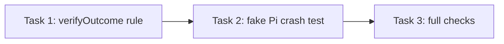

# Fail a phase on an abnormal Pi exit after done: Implementation Plan

> **For agentic workers:** REQUIRED SUB-SKILL: Use the sibling `executing-plans`
> skill to implement this plan inline, task by task. Steps use checkbox
> (`- [ ]`) syntax for tracking.

**Goal:** `verifyOutcome` fails a phase when Pi does not have a clean exit after
a `done` result.

**Architecture:** One new failure cause in `verifyOutcome`
(`src/kernel/verify.ts`). The session types of `VerifyInput` and `PhaseRun` get
an optional `signal`. The fake RPC Pi gets a `killSignal` step field for the
end-to-end test.

**Tech Stack:** TypeScript on Node 24 with `.ts` imports and `node:test`.

**Spec:**
[`docs/specs/2026-11-22-issue-374-fail-a-phase-when-pi-exits-abnormally-after-a-do-design.md`](../specs/2026-11-22-issue-374-fail-a-phase-when-pi-exits-abnormally-after-a-do-design.md)

**Inputs:** the spec above and its `## Visual explanation`. No mockup, Parent
spec, or HTML companion applies.

## Global Constraints

- Clean exit: `session.exitCode === 0 && !session.signal`.
- The new cause applies only when `result.ok`, the status is `done`, and the
  session is neither `timedOut` nor `aborted`.
- Reason texts, exact:
  - `Pi was stopped by signal ${signal} after a done result.`
  - `Pi exited with code ${exitCode} after a done result.`
  - `Pi exited without an exit code after a done result.`
- Exit line: `Exit code: ${exitCode}`. When a signal is set, the line is
  `Exit code: ${exitCode} (signal ${signal})`.
- `signal` is optional in `VerifyInput.session` and `PhaseRun.session`.
- Do not change `needs-input`, `failed`, timeout, abort, or parse-failure paths.
- Do not change the "nonzero question" test.

## Review Focus

- A timeout with `signal: "SIGTERM"` and a `done` result: only the timeout
  reason shows. Task 1 pins this.
- An abort with `exitCode: 1` and a `done` result: only the abort reason shows.
  Task 1 pins this.
- A `needs-input` result with `exitCode: 1`: the question survives. The existing
  "nonzero question" run-once test pins this.
- A `done` result with `exitCode: null` and no signal fails. Task 1 pins this.
- A real signal reaches `verifyOutcome` through `rpcModeLauncher`. Task 2 pins
  this.

## File Structure

- `src/kernel/verify.ts`: the new failure cause and exit line.
- `src/kernel/launch.ts`: `PhaseRun.session` type.
- `src/kernel/verify.test.ts`: unit tests.
- `test-support/fake-pi-rpc.mjs`: `killSignal` step field.
- `src/kernel/run-once-failures.test.ts`: end-to-end test.

---

### Task 1: Fail `verifyOutcome` on an abnormal exit after done

**Files:**

- Modify: `src/kernel/verify.ts` (`VerifyInput`, `verifyOutcome`)
- Modify: `src/kernel/launch.ts` (`PhaseRun`)
- Test: `src/kernel/verify.test.ts`

**Interfaces:**

- Produces: `VerifyInput["session"]` and `PhaseRun["session"]` equal to
  `Pick<PiSession, "exitCode" | "timedOut" | "aborted"> & Partial<Pick<PiSession, "signal">>`.
  `verifyOutcome(input: VerifyInput): Outcome` keeps its signature.

- [ ] **Step 1: Write the failing tests in `src/kernel/verify.test.ts`**

Add a table test, `done after an abnormal exit fails verification: ${name}`:

```ts
for (const [name, session, reason, exitLine] of [
  [
    "exit 7",
    { exitCode: 7 },
    /Pi exited with code 7 after a done result\./,
    /Exit code: 7$/,
  ],
  [
    "SIGKILL",
    { exitCode: null, signal: "SIGKILL" },
    /Pi was stopped by signal SIGKILL after a done result\./,
    /Exit code: null \(signal SIGKILL\)$/,
  ],
  [
    "no exit code",
    { exitCode: null },
    /Pi exited without an exit code after a done result\./,
    /Exit code: null$/,
  ],
] as const) {
  // verifyOutcome({ ...input, session: { ...input.session, ...session } })
  // assert kind "stop", label "needsInfo"
  // assert comment matches reason, exitLine, /The work is ready\./, and includes input.logPath
  // assert comment does not match /claim was not verified/
}
```

Change these existing tests:

- `verified PR succeeds with exit code ${exitCode}`: loop over `[0]` only. Keep
  the test name pattern.
- `implementation rejects ${name} with a specific diagnostic`: use
  `exitCode: 0`. Assert `/exit code: 0/i`.
- The `timeout overrides done` and `abort overrides done` cases: add an
  assertion in the shared loop body that the comment does not match
  `/after a done result/`. For the timeout case, set the session to
  `{ exitCode: null, signal: "SIGTERM", timedOut: true, aborted: false }`, so
  that it proves a signal does not add a reason. The existing
  `VerifyInput["session"]` type of that table accepts `signal` after Step 3.

- [ ] **Step 2: Run the tests and see them fail**

Run:
`node --test --test-name-pattern="abnormal exit|overrides done" src/kernel/verify.test.ts`
Expected: FAIL. The three new cases get label `done` today. The timeout case
fails type checking only under `check:types`; at runtime it passes.

- [ ] **Step 3: Implement**

In `src/kernel/verify.ts`, widen `VerifyInput.session` as in Interfaces. In
`src/kernel/launch.ts`, widen `PhaseRun.session` the same way. In
`verifyOutcome`, after the existing three `failures.push` lines, push the
abnormal-exit reason when the Global Constraints conditions hold. Pick the
reason in this order: signal, non-null exit code, null. Build the exit line from
`session.exitCode` and `session.signal`. Put the reason text in a small
unexported helper `abnormalExit(session): string | undefined` in the same file.
It returns `undefined` for a clean exit.

- [ ] **Step 4: Run the tests and see them pass**

Run: `node --test src/kernel/verify.test.ts`, then `npm run check:types`.
Expected: PASS, with no type errors.

- [ ] **Step 5: Commit**

```bash
git add src/kernel/verify.ts src/kernel/launch.ts src/kernel/verify.test.ts
git commit -m "fix(kernel): fail a phase when Pi exits abnormally after done"
```

### Task 2: Run-once test for a Pi crash after done

**Files:**

- Modify: `test-support/fake-pi-rpc.mjs`
- Test: `src/kernel/run-once-failures.test.ts`

**Interfaces:**

- Consumes: Task 1 behavior and reason texts.
- Produces: the fake Pi step field `killSignal` (a signal name). After the
  result message and after `sleepMs`, `runRpc` calls
  `process.kill(process.pid, step.killSignal)`. Put it next to the existing
  `if (step.exitCode) process.exit(step.exitCode);` line, before it.

- [ ] **Step 1: Write the failing test**

Add `implementation ${mode} after done stops with needsInfo` for `mode` in
`"exit 7"` and `"SIGKILL"`:

```ts
const c = await setupRun(t, [
  {
    pullRequest: { draft: false, body: "Closes #9" },
    result: done,
    ...(mode === "exit 7" ? { exitCode: 7 } : { killSignal: "SIGKILL" }),
  },
]);
await c.seed({ [spec]: "spec", [plan]: "plan" });
await c.mutate((s) => s.issues[0]!.labels.push("spec-approved"));
const outcome = await c.run();
// assert outcome.status === "stopped" and outcome.label === "needsInfo"
// issue = c.host.state().issues[0]!
// assert issue.labels includes "needs-info" and not "agent-done"
// assert issue.comments[0]!.body matches
//   mode === "exit 7"
//     ? /Pi exited with code 7 after a done result\./
//     : /Pi was stopped by signal SIGKILL after a done result\./
```

The step is the clean variant (no `writeFiles`) of the `dirty` case of the
existing test
`implementation ${mode} evidence controls verified outcome and warnings`. That
case completes, because implementation checks do not need a remote branch. Thus
only the abnormal exit makes this run stop.

- [ ] **Step 2: Run the test and see it fail**

Run:
`node --test --test-name-pattern="after done stops" src/kernel/run-once-failures.test.ts`
Expected: the `SIGKILL` case fails, because `killSignal` does not exist yet. The
`exit 7` case passes, because Task 1 is committed. To see the `exit 7` case
fail, run `git checkout HEAD~1 -- src/kernel/verify.ts`, run the test, and see
`completed` instead of `stopped`. Then run
`git checkout HEAD -- src/kernel/verify.ts`. Make sure that
`git diff HEAD -- src/kernel/verify.ts` is empty before Step 3. Do not discard
the new test.

- [ ] **Step 3: Implement the `killSignal` field in
      `test-support/fake-pi-rpc.mjs`**

- [ ] **Step 4: Run the test and see it pass**

Run:
`node --test --test-name-pattern="after done stops|workflow question policy" src/kernel/run-once-failures.test.ts`
Expected: PASS. The "nonzero question" case also passes without a change.

- [ ] **Step 5: Commit**

```bash
git add test-support/fake-pi-rpc.mjs src/kernel/run-once-failures.test.ts
git commit -m "test(kernel): cover a Pi crash after a done result in run-once"
```

### Task 3: Full verification

- [ ] **Step 1:** Run `npm test`. Expected: all tests pass.
- [ ] **Step 2:** Run `npm run check:types`. Expected: no errors.
- [ ] **Step 3:** Run `npm run lint`. Expected: no errors. If `format:check`
      fails, run Prettier on the changed files, then commit the result.

No npm dependency changes, so the Nix build is not necessary.

## Visual explanation

Task order and ownership:

```text
Task 1  verify.ts + launch.ts + verify.test.ts   (rule and types)
  └─ Task 2  fake-pi-rpc.mjs + run-once-failures.test.ts   (end-to-end proof)
       └─ Task 3  npm test, check:types, lint
```



## Planning review

Combined pass with the spec
(`docs/specs/2026-11-22-issue-374-fail-a-phase-when-pi-exits-abnormally-after-a-do-design.md`).

- Reviewer: canonical `reviewer` agent, model `claude-bridge/claude-opus-5-5`,
  thinking `high`. Base revision `12f871afd84725007a81cd629cae8e5ac6182444`.
- Compared spec body SHA-256:
  `cbc3eda1b567156f6c504428de6294e5eb9b18c7550f2bdd9c0661c3cbe5c72a`.
- Survey: as in the spec record. The reviewer checked each path, symbol, and
  command against the base and found task order correct.
- Findings (no blockers):
  - S2 (suggestion): the plan called its run-once step "the same as the `dirty`
    case", but that case has `writeFiles`. Accepted: Task 2 now calls it the
    clean variant and says why it completes before the change.
  - S3 (suggestion): the Task 2 Step 2 stash instructions could not apply,
    because Task 1 commits. Accepted: replaced them with the `HEAD~1` checkout
    and the expected result of each case.
  - S4 (suggestion): Task 1 asked to widen a `satisfies` type that already uses
    `VerifyInput["session"]`. Accepted: reworded.
  - S5 (suggestion, from the confirmation): "make sure that `git status` is
    clean" conflicted with the uncommitted new test. Accepted: replaced with the
    reviewer's proposed check, `git diff HEAD -- src/kernel/verify.ts` is empty.
- Inspection limits: as in the spec record.
- Confirmation: a fresh scoped confirmation confirmed S2, S3, and S4 at plan
  body SHA-256
  `7ba235b6b8cfa7262bffe84487d009fed49e5a331d98ce700617dedc6aa172f5` (hashed
  before this record existed). It found S5 and called it a one-line wording
  change that needs no further review. The S5 edit is the reviewer's exact
  proposed text.
- Final body SHA-256:
  `5ea5b0f57eb2db9faac8ddbfff4f0421b7ea8db6f2d4be0fd31412e2f600ea90`.
- Outcome: `ready`.
