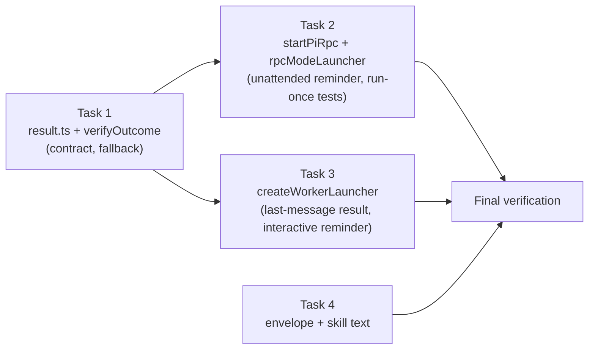

# Result Reminder and Repository-Facts Fallback Implementation Plan

> **For agentic workers:** REQUIRED SUB-SKILL: Use executing-plans (inline
> execution, as for every kernel run) to implement this plan task-by-task. Steps
> use checkbox (`- [ ]`) syntax for tracking.

**Goal:** The interactive launcher reads the Result block from the worker's last
message first. When a phase worker ends normally without its Result block,
Patchmill sends one Result reminder in the same conversation. If an
implementation worker still writes no block, a ready pull request that closes
the issue counts as `done` with a warning. Otherwise the stop reason says
plainly that the block is missing.

**Architecture:** `src/kernel/result.ts` owns the Result block contract. The two
launcher adapters (`rpcModeLauncher` over `startPiRpc`, and
`createWorkerLauncher` over pi-subagents) each send the reminder at their normal
end point. `verifyOutcome` owns the repository-facts fallback. `run-once.ts`
does not change: its existing `done` path enters the review wait.

**Tech Stack:** TypeScript on Node 24, `node:test`, the scripted fake Pi
(`test-support/fake-pi.mjs`, `test-support/fake-pi-rpc.mjs`), the fake subagents
bus (`test-support/fake-subagents.ts`).

**Spec:**
[`docs/specs/2026-11-22-issue-407-recover-when-an-implementation-worker-finishes-w-design.md`](../specs/2026-11-22-issue-407-recover-when-an-implementation-worker-finishes-w-design.md)

**Inputs:** the spec above, its `## Visual explanation` (inline Mermaid), and
the `GLOSSARY.md` entries **Result block** and **Result reminder**. The spec has
no mockup and no HTML companion.

## Global Constraints

- Reminder text, exact:
  ``Your last message has no final result block. Do not do more work. Reply with only the final fenced `json` block, with the fields `status` and `summary`, as the run envelope describes.``
- `MISSING_RESULT_REASON = "The worker ended without a result block."`
- `REMINDED_RESULT_REASON = "The worker ended without a result block, also after a reminder."`
- Fallback warning, exact:
  `the worker ended without a result block, so Patchmill verified the ready pull request`
- Fallback failure comment:
  `<result.reason> The repository does not prove completion. <diagnostics> Log: <logPath>`,
  then the `Exit code: <n>` line, joined as `verifyOutcome` joins today.
- At most one reminder per execution. No reminder after a non-zero exit, a
  timeout, an abort, a failed or truncated response
  (`printModeResult().failed`), or a crash before a settle.
- No fallback unless `session.exitCode === 0`, not timed out, not aborted, and
  the phase is `implementation`.
- `parseJsonBlock` keeps the reason `no result` (triage uses it).
- `PhaseRun`, `HumanChannel` and `run-once.ts` do not change.

## Review Focus

1. A duplicate `0` background report for the settle that triggered the reminder
   must not finish the session before the reminder turn. Task 2 pins it.
2. A worker that answers the reminder with a truncated (`length`) or error
   message gets exit code 1 and no fallback, even with a ready pull request.
   Task 2 pins it.
3. A guidance resume that ends without a block gets one reminder too, not zero
   and not two. An interactive worker that writes a prose `output.md` but ends
   its last message with a block is not reminded. Task 3 pins both.
4. A timeout that fires during the reminder turn reports `timedOut`, not a
   fallback `done`. Task 3 pins it.
5. A missing block with a ready, closing pull request but exit code `1` or
   `null` stays `needsInfo` and lists every reason. Task 1 pins it.

---

### Task 1: Result block contract and repository-facts fallback

**Files:**

- Modify: `src/kernel/result.ts`
- Modify: `src/kernel/verify.ts` (`verifyOutcome`)
- Test: `src/kernel/result.test.ts`, `src/kernel/verify.test.ts`
- Modify (expected reason only): `src/console/worker-launcher.test.ts`
  (`missing JSON matches rpcModeLauncher parsing…`) and
  `src/kernel/run-once-failures.test.ts` (the `invalid` case of
  `${mode} stops with actionable evidence and releases the lock`)

**Interfaces:**

- Produces in `result.ts`:
  - `export const RESULT_REMINDER: string` (exact copy above)
  - `export const MISSING_RESULT_REASON: string`
  - `export const REMINDED_RESULT_REASON: string`
  - `export function hasResultBlock(text: string): boolean`
  - `ParsedResult` failure arm becomes
    `{ ok: false; reason: string; missing?: true }`
  - `parseAgentResult(text)` with no block returns
    `{ ok: false, reason: MISSING_RESULT_REASON, missing: true }`
- `verifyOutcome(input: VerifyInput): Outcome` keeps its signature.

- [ ] **Step 1: Write the failing tests**

In `result.test.ts`, change `parseAgentResult reports no result without a fence`
to expect
`{ ok: false, reason: "The worker ended without a result block.", missing: true }`.
Add `hasResultBlock finds only a closed json fence`: true for
`"```json\n{}\n```"`, false for `"plain"` and for an unclosed `"```json\n{}"`.
Add an assertion that `parseAgentResult("```json\nnot JSON\n```")` has no
`missing` key.

In `verify.test.ts`, use the existing `input`. Its `facts` already have a ready
PR for issue 12 (`state: "open"`, `draft: false`, body `Fixes #12`, base
`main`). Change only the field that a case names:

- `a missing block with a ready closing PR is done with a warning`:
  `result: { ok: false, reason: REMINDED_RESULT_REASON, missing: true }`,
  `exitCode: 0`. Expect `label === "done"`, the comment matches
  `/The pull request was verified\./`, and `warnings` includes the exact
  fallback warning.
- `a missing block with a draft PR names both causes`: same result, PR
  `draft: true`. Expect `needsInfo`, and the comment includes
  `REMINDED_RESULT_REASON`, `The repository does not prove completion.`,
  `The pull request is a draft.`, and `input.logPath`.
- `a missing block without a PR says no pull request exists`: expect
  `No pull request exists for the branch.` after the reason.
- For `exitCode` in `[1, null]`, and for `timedOut: true` and `aborted: true`
  with `exitCode: 0`: `a missing block after an abnormal end gets no fallback`.
  Expect `needsInfo`, the comment includes the reason, and `warnings` does not
  include the fallback warning.
- `a missing block in planning gets no fallback`: `phase: "planning"` with facts
  that would advance. Expect `needsInfo` and the reason in the comment.
- Update `all failures remain visible` to use
  `{ ok: false, reason: MISSING_RESULT_REASON, missing: true }` and match
  `/without a result block/`.

- [ ] **Step 2: Run the tests to verify that they fail**

Run: `node --test src/kernel/result.test.ts src/kernel/verify.test.ts` Expected:
FAIL. `hasResultBlock` is not exported, and the fallback cases give `needsInfo`.

- [ ] **Step 3: Implement the contract in `src/kernel/result.ts`**

`hasResultBlock` is `lastJsonBlock(text) !== undefined`. `parseAgentResult`
checks `hasResultBlock` first, then calls `parseJsonBlock` as today.

- [ ] **Step 4: Implement the fallback in `verifyOutcome`**

Compute
`const missingBlock = !result.ok && result.missing === true && session.exitCode === 0 && !session.timedOut && !session.aborted && input.phase === "implementation"`.
When `missingBlock` is true, do not push `result.reason` to `failures`. Run the
existing implementation pull request checks. On success, set `done` and add the
fallback warning before the uncommitted and unpushed warnings. On failure, build
the comment from the Global Constraints. Every other path stays as it is.

- [ ] **Step 5: Update the existing expectations**

In `src/console/worker-launcher.test.ts`, the test
`missing JSON matches rpcModeLauncher parsing and uses completion fallback`
expects `{ ok: false, reason: MISSING_RESULT_REASON, missing: true }`. That run
timed out, so it is not reminded in later tasks either. In
`src/kernel/run-once-failures.test.ts`, the `invalid` case expects
`/without a result block/` instead of `/no result/`. This regex also matches the
reminded reason after Task 2.

- [ ] **Step 6: Run the tests to verify that they pass**

Run:
`node --test src/kernel/result.test.ts src/kernel/verify.test.ts src/console/worker-launcher.test.ts src/kernel/run-once-failures.test.ts`
Expected: PASS.

- [ ] **Step 7: Commit**

```bash
git add src/kernel/result.ts src/kernel/result.test.ts src/kernel/verify.ts src/kernel/verify.test.ts src/console/worker-launcher.test.ts src/kernel/run-once-failures.test.ts
git commit -m "feat(kernel): verify a ready PR when the result block is missing (#407)"
```

### Task 2: Result reminder in the RPC session

**Files:**

- Modify: `src/kernel/pi-rpc.ts` (`PiRpcOptions`, `startPiRpc`)
- Modify: `src/kernel/launch.ts` (`rpcModeLauncher`)
- Modify: `test-support/fake-pi-rpc.mjs`
- Test: `src/kernel/pi-rpc.test.ts`
- Create: `src/kernel/run-once-result-reminder.test.ts`

**Interfaces:**

- Consumes: `RESULT_REMINDER`, `REMINDED_RESULT_REASON`, `hasResultBlock`, and
  `parseAgentResult` from Task 1.
- Produces: `PiRpcOptions.remind?: (stdout: string) => string | undefined`.
  `startPiRpc` calls it at most once, only from the settle path of `evaluate()`,
  before it ends Pi's input.

- [ ] **Step 1: Extend the fake RPC Pi**

In `fake-pi-rpc.mjs`, a step can have
`reminder: { stdout?: string; result?: object; stopReason?: string }`. After the
first turn's settles, a later `prompt` command gets a success response. Then the
fake writes `agent_start`, one `message_end` with the reminder text (stdout
lines, then the `json` fence when `result` is set; empty text when the step has
no `reminder`), the report `<n>:0` and `agent_settled`. `<n>` is the number of
settles so far plus 1. The reminder message uses
`reminder.stopReason ?? "stop"`. A step with `duplicateZero: true` writes the
report `1:0` a second time when it receives the reminder `prompt`, before it
writes the reminder turn's `agent_start`. Then it waits 50 ms before the
reminder turn. Every command still goes to `commands.log`.

- [ ] **Step 2: Write the failing tests in `pi-rpc.test.ts`**

Use a `remind` option that returns `"remind"` when `!hasResultBlock(stdout)`,
and counts its calls.

- `a settled session without a block gets one reminder and returns its answer`:
  step `{ stdout: "work done", reminder: { result: done } }`. Expect exit code
  0, `parseAgentResult(result.stdout)` is `{ ok: true, result: done }`, exactly
  one `prompt` command with `message === "remind"` after the first, and `remind`
  called once.
- `a reminder answer without a block ends the session without a second reminder`:
  step `{ stdout: "work done", reminder: { stdout: "still prose" } }`. Expect
  exit code 0, `stdout === "still prose\n"`, two `prompt` commands in total.
- `a session with a block is not reminded`: step `{ result: done }`. Expect one
  `prompt` command.
- `a duplicate zero report does not finish before the reminder turn`: step
  `{ stdout: "work done", duplicateZero: true, reminder: { result: done } }`,
  `reportWaitMs: 60_000`. Expect the result block from the reminder.
- `a truncated reminder answer exits with code 1`: step
  `{ stdout: "work done", reminder: { result: done, stopReason: "length" } }`.
  Expect exit code 1.
- For each abnormal end, `abnormal end <kind> is not reminded`: a crash
  (`exitCode: 3` before the settle), a timeout (`sleepMs: 500`,
  `timeoutMs: 100`), an abort (`sleepMs: 500`, abort the signal when the log
  contains the first text), and an error stop reason (`stopReason: "error"`).
  Expect exactly one `prompt` command.
- For `promptError: "No model configured"` and for `handled: true`:
  `a <kind> first prompt is not reminded`. Pass a `remind` that always returns
  `"remind"`. Expect exactly one `prompt` command and `remind` not called.

- [ ] **Step 3: Run the tests to verify that they fail**

Run: `node --test src/kernel/pi-rpc.test.ts` Expected: FAIL. No second `prompt`
command is sent.

- [ ] **Step 4: Implement `remind` in `startPiRpc`**

In `evaluate()`, at the point where it would call `finish()`: if no reminder was
sent, `failedPrompt` is false, the session is not interrupted,
`printModeResult(lastMessage).failed` is false, and
`options.remind?.(printModeResult(lastMessage).stdout)` returns a message, then
record `reminderSettle = settles` and send `prompt` with that message. Return
without calling `finish()`. After a reminder, `evaluate()` goes on only when
`settles > reminderSettle`. If the reminder `prompt` response is not a success,
has the `handled` disposition, or the `send` rejects, call `finish()`. The
reminder `prompt` response must not set `failedPrompt`. The two `finish()` calls
in the first `prompt` handler do not change.

- [ ] **Step 5: Pass `remind` from `rpcModeLauncher`**

The callback returns `RESULT_REMINDER` when `!hasResultBlock(stdout)`, and sets
a local `reminded = true`. After the session, if `reminded` and the parsed
result has `missing`, return
`{ ok: false, reason: REMINDED_RESULT_REASON, missing: true }`.

- [ ] **Step 6: Write the run-once acceptance tests**

In `run-once-result-reminder.test.ts`, use `setupRun`, `seed` with `spec` and
`plan`, and `implement` without `result`:

- `a worker that answers the reminder is verified from its block`: unattended,
  step `{ ...implementWithoutResult, reminder: { result: done } }`. Expect
  `status: "completed"`, label `agent-done`, and the kernel comment does not
  contain `without a result block`.
- `an interactive worker without a block and a ready PR enters the review wait`:
  `fakeHuman(c, { onWait })`, step
  `{ ...implementWithoutResult, reminder: { stdout: "PR is ready" } }`. The
  `onWait` callback asserts `wait.kind === "review"`, then calls
  `mergePullRequest(c)` and returns `"continue"`. Expect `human.calls` to
  include `"wait:review"`, the status `completed`, and the first kernel comment
  contains the fallback warning.
- `an unattended worker without a block and a ready PR completes with a warning`:
  same step without `human`. Expect `completed` and the warning in the comment.
- `a worker without a block and a draft PR stops with a clear reason`: PR
  `draft: true`, reminder without a block. Expect `status: "stopped"`, label
  `needsInfo`, and the summary matches
  `/without a result block, also after a reminder/` and
  `/The pull request is a draft\./`.

- [ ] **Step 7: Run the tests to verify that they pass**

Run:
`node --test src/kernel/pi-rpc.test.ts src/kernel/run-once-result-reminder.test.ts`
Expected: PASS.

- [ ] **Step 8: Commit**

```bash
git add src/kernel/pi-rpc.ts src/kernel/launch.ts test-support/fake-pi-rpc.mjs src/kernel/pi-rpc.test.ts src/kernel/run-once-result-reminder.test.ts
git commit -m "feat(kernel): remind an RPC worker once about its result block (#407)"
```

### Task 3: Result reminder for interactive workers

**Files:**

- Modify: `src/console/worker-launcher.ts` (`execute` in `createWorkerLauncher`)
- Test: `src/console/worker-launcher.test.ts`

This task also fixes the result source of the five failed runs. See the spec,
"Interactive adapter" and "Open assumptions".

**Interfaces:**

- Consumes: `RESULT_REMINDER`, `MISSING_RESULT_REASON`,
  `REMINDED_RESULT_REASON`, `hasResultBlock` and `parseAgentResult` from Task 1.
  `assistantText` from `src/kernel/pi-rpc-protocol.ts`.
- Produces: no new exports. `WorkerLauncher` keeps its type.

- [ ] **Step 1: Write the failing tests**

Use the existing `fixture`, `waitUntil` and `bus.complete`. A helper
`sessionWith(text)` writes a JSONL file whose last line is
`{"type":"message","message":{"role":"assistant","content":[{"type":"text","text":<text>}],"stopReason":"stop"}}`.

- `the last message block wins over a prose output file`: write `output.md` with
  `"# Report"`, complete `run-1` with
  `results: [{ sessionFile: sessionWith(text) }]`. Expect
  `{ ok: true, result: done }`, no `resume` request, and the log contains
  `# Report` and the block. This is the regression test for the five failed
  runs.
- `a needs-input block in the last message is kept`: same, with a `needs-input`
  block. Expect that result and no `resume` request.
- `an unreadable session file uses the output text`: the session file contains
  `session` (not JSON). Expect the result from `output.md` as today.
- `a complete worker without a block is resumed once with the reminder`:
  complete `run-1` with `results: [{ output: "prose" }]`. Wait for a `resume`
  request with params `{ id: "run-1", message: RESULT_REMINDER }`. Complete
  `run-2` with `results: [{ output: text }]`. Expect
  `{ ok: true, result: done }`, exit code 0, and the session log contains
  `prose` and the block.
- `a reminder answer without a block reports the reminded reason`: `run-2`
  answers `"still prose"`. Expect
  `{ ok: false, reason: REMINDED_RESULT_REASON, missing: true }`, exit code 0,
  and one `resume` request.
- `a worker with a block is not resumed`: no `resume` request.
- For each of `{ state: "failed" }`, `{ state: "failed", timedOut: true }` and
  `{ state: "stopped", stopped: true }`: `<state> completion is not reminded`.
  Expect no `resume` request.
- `a guidance resume without a block gets one reminder`: run, complete with a
  block, resume with `"guidance"`, complete `run-2` with `"prose"`. Expect a
  second `resume` with `{ id: "run-2", message: RESULT_REMINDER }`.
- `a failed reminder resume keeps the missing result`: the `resume` script
  throws a `SubagentsRpcError` for the reminder. Expect
  `{ ok: false, reason: MISSING_RESULT_REASON, missing: true }`, exit code 0.
- `a timeout during the reminder reports timedOut`: `timeoutMs: 100`, complete
  `run-1` with prose, never complete `run-2`. Expect
  `session.timedOut === true`, and the log contains `prose`.
- `an abort before the reminder sends no resume`: abort `launch.signal`, then
  complete `run-1` with prose in `complete` state. Expect no `resume` request.
- For `shutdown` and `deadline`:
  `<kind> during the reminder resume stops the resumed worker`. Gate
  `f.client.resume` as the existing test
  `shutdown stops an in-flight ${method}…` does. Complete `run-1` with prose.
  While the gate holds, call `f.launcher.stopActive()` (shutdown), or wait for a
  20 ms `timeoutMs` (deadline). Release the gate. Expect a `stop` request with
  `id: "run-2"`, `session.aborted` (shutdown) or `session.timedOut` (deadline),
  and `f.launcher.active()` is `undefined`.
- `a stale last message after a failed guidance resume is not used`: the session
  file's last assistant message has a `needs-input` block, and the completion
  has `state: "failed"` with output `"error"`. Expect the reason
  `MISSING_RESULT_REASON` from the output text, not the `needs-input` result.

Change the existing tests that complete `run-1` in `complete` state without a
block, so that they keep their meaning: in
`resume uses previous id and fresh fallback rather than stale output`,
`shutdown stops an in-flight resume…` and `resume execution deadline stops…`,
complete `run-1` with `results: [{ output: text }]`.

- [ ] **Step 2: Run the tests to verify that they fail**

Run: `node --test src/console/worker-launcher.test.ts` Expected: FAIL. No
`resume` request is sent.

- [ ] **Step 3: Implement the reminder in `execute`**

Add a module-local
`lastAssistantText(sessionFile: string | undefined): Promise<string | undefined>`.
It reads the JSONL file, skips lines that are not JSON, and returns
`assistantText(entry.message)` of the last `type: "message"` entry with
`role: "assistant"`. A read error gives `undefined`.

Move the wait-and-read part into a local `awaitWorker(id)` that sets
`previousId`, `active`, `stop` and the `onAbort` check for `id`, awaits
`client.waitForCompletion`, and returns the completion, the output text and the
last message. The result text is the last message when `hasResultBlock` is true
for it, otherwise the output text. The log text is the output text, plus a blank
line and the last message when the two differ.

The last message is read only when `completion.state === "complete"`.

After the first completion, if the reminder conditions of the spec hold
(including `!launch.signal?.aborted`), write the log, copy the first session
file, remove `output.md`, and call `client.resume(id, RESULT_REMINDER)`. When it
returns, bind `previousId`, `active`, `stop` and the `onAbort` check to the new
id before anything else. Then apply the spawn check: if `closing` or `timedOut`,
`await stop()` and return `aborted()` or the timed-out run. Then await the new
id with `awaitWorker`. Keep the deadline and the `finally` block as they are.
After a reminder, write the log as the first log text, a blank line, and the
second log text, and copy the second session file. Only when the `client.resume`
call itself throws a `SubagentsRpcError`, and `closing`, `timedOut` and
`launch.signal?.aborted` are all false, return the first result with exit
code 0. Every error from the wait goes to the existing `catch`.

- [ ] **Step 4: Run the tests to verify that they pass**

Run:
`node --test src/console/worker-launcher.test.ts src/console/controller.test.ts`
Expected: PASS.

- [ ] **Step 5: Commit**

```bash
git add src/console/worker-launcher.ts src/console/worker-launcher.test.ts
git commit -m "feat(console): remind an interactive worker once about its result block (#407)"
```

### Task 4: Envelope and implementation skill text

**Files:**

- Modify: `src/kernel/envelope.ts` (`resultRules`, the branch that is not
  interactive planning)
- Modify: `src/kernel/fixtures/envelope-implementation.txt`,
  `src/kernel/fixtures/envelope-planning.txt`
- Modify: `skills/patchmill-implementation/SKILL.md` ("Final result")
- Modify: `.patchmill/skills/patchmill-implementation/SKILL.md`,
  `.patchmill/skills/patchmill-skill-pack.json`

**Interfaces:** none. This task changes prompt and skill text only. The Testing
Value Gate excludes text-assertion tests, so the existing fixture test and
direct inspection verify it.

- [ ] **Step 1: Change the envelope result rule**

After the sentence ``Use a string for `summary`.`` add, before the example
block:

```text
This block is the required last step. Patchmill reads the result only from
this block. Write it after all other work and after every subagent has
finished. If the runtime asks you to write your findings to a file, still end
your last message with this block.
```

- [ ] **Step 2: Update the fixtures**

Regenerate both fixtures from `renderRunEnvelope` with the inputs of the fixture
test in `src/kernel/envelope.test.ts`, and check with `git diff` that only the
new lines changed.

- [ ] **Step 3: Change the skill**

In `skills/patchmill-implementation/SKILL.md`, "Final result", before
`End with a fenced …`, add:

```text
The result block is the last and required step. Write it after the ready
pull request handoff and after every subagent has finished. Patchmill reads
the phase result only from this block. If the runtime asks you to write your
findings to a file, still end your last message with this block.
```

Copy the file to `.patchmill/skills/patchmill-implementation/SKILL.md`. Set its
`sha256` in `.patchmill/skills/patchmill-skill-pack.json` to the output of
`sha256sum .patchmill/skills/patchmill-implementation/SKILL.md`.

- [ ] **Step 4: Verify**

Run:
`cmp skills/patchmill-implementation/SKILL.md .patchmill/skills/patchmill-implementation/SKILL.md`
Expected: no output.

Run:
`node --test src/kernel/envelope.test.ts src/cli/commands/skills/main.test.ts src/cli/commands/init/skill-installer.test.ts`
Expected: PASS.

Run: `npx markdownlint-cli2 skills/patchmill-implementation/SKILL.md` Expected:
no errors.

- [ ] **Step 5: Commit**

```bash
git add src/kernel/envelope.ts src/kernel/fixtures skills/patchmill-implementation/SKILL.md .patchmill/skills/patchmill-implementation/SKILL.md .patchmill/skills/patchmill-skill-pack.json
git commit -m "docs(skills): make the result block the required last step (#407)"
```

### Final verification

- [ ] Run `npm test`, `npm run lint` and `npm run build`. Expected: all pass. No
      npm dependency changes, so the Nix build is not required.

## Visual explanation

Task order and ownership:



Tasks 2 and 3 both depend on the Task 1 exports. Task 4 is independent.

## Planning review

### Entry 1: combined pass (spec and plan)

- **Scope:** this plan and the specification
  `docs/specs/2026-11-22-issue-407-recover-when-an-implementation-worker-finishes-w-design.md`.
- **Reviewer:** canonical `reviewer` agent, model
  `claude-bridge/claude-opus-5-5`, thinking `high`, base revision `12f871a`
  (`main`).
- **Reviewed body SHA-256:** plan
  `646fe1176ed283ab588c5fcd9a4f1de067381994b9af9c40c6b5d1a2d87cfa91`, compared
  with spec `fc9c0480649092531b1cbdae515b2431b81b71e4172b0a3c8f46be35effb9530`.
- **Findings and dispositions:** the same as Entry 1 of the specification's
  record (B1–B3, S1–S5, all accepted). Plan revisions: Task 1 lists
  `run-once-failures.test.ts` and uses issue 12 facts. Task 2 moves the reminder
  to `evaluate()`, adds `promptError` and `handled` cases, and changes the
  `duplicateZero` fake. Task 3 adds the last-message result text, its tests, the
  abort check, and the fixes to existing tests. Task 4 adds the findings-file
  sentence.

### Entry 2: scoped confirmation

- **Scope:** the corrections of Entry 1 and their effects.
- **Reviewer:** canonical `reviewer` agent, model
  `claude-bridge/claude-opus-5-5`, thinking `high`, base revision `12f871a`
  (`main`).
- **Reviewed body SHA-256:** not recorded before the pass.
- **Findings and dispositions:** R1 (blocker) and R2–R5 (suggestions), all
  accepted, as in the specification's record. Task 3 Step 3 now binds `stop` to
  the resumed id, applies the spawn check, limits the exit-0 return, and copies
  the first session file. Task 3 Step 1 adds the shutdown, deadline and stale
  last-message tests.
- **Final body SHA-256:** plan
  `d337d87a3e945b7b5c4d306b26978732bc47accea1d39aca10dbb0f9c59ec577`, compared
  with spec `6f6ab4d3162ffa3dd4c0e3e86b897795102ed88b5ebafd0deb048b10caf3b4a7`.
- **Outcome:** `blocked`. The R1 correction is not confirmed.
