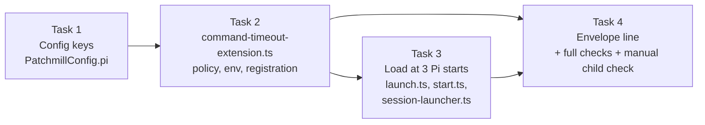

# Command Timeout for Agent Bash Calls Implementation Plan

> **For agentic workers:** Execute this plan inline with the sibling
> `executing-plans` skill. Steps use checkbox (`- [ ]`) syntax for tracking.

**Goal:** Give each agent `bash` call in an Issue run session, and in each
subagent session that it starts, a configured default timeout and cap.

**Architecture:** A new Pi extension module changes `bash` arguments in
`tool_call` and registers its own file as a pi-subagents required child
extension. Patchmill passes the configured limits to each Pi process in two
environment variables, and loads the extension at the three Pi starts.

**Tech Stack:** TypeScript, Node.js test runner, Pi extension API
(`@earendil-works/pi-coding-agent` 1.6.0 as pinned in `package.json`),
`pi-subagents` 0.80.0 (`pi-subagents/required-child-extensions`), faux provider
of `@earendil-works/pi-ai`.

**Spec:**
[`docs/specs/2026-11-23-issue-322-give-agent-bash-commands-in-run-once-sessions-a-design.md`](../specs/2026-11-23-issue-322-give-agent-bash-commands-in-run-once-sessions-a-design.md)

## Inputs

- The spec above, including its `## Visual explanation`.
- `GLOSSARY.md`: the new term **Command timeout**.
- Issue #322 and its triage notes.
- No mockups. No HTML companions.

## Global Constraints

- Config keys: `pi.commandTimeoutMinutes` (default `20`) and
  `pi.maxCommandTimeoutMinutes` (default `25`). `0` turns a limit off.
- Each value: finite, `>= 0`, `<= 35791`. Fractions allowed.
- When both are `> 0`, default must be `<=` cap, or `ConfigError` names both
  keys.
- Environment: `PATCHMILL_COMMAND_TIMEOUT_SECONDS`,
  `PATCHMILL_MAX_COMMAND_TIMEOUT_SECONDS`. Values in seconds. Missing variable:
  `1200` or `1500`. Invalid variable: throw at load.
- Required child extension id: `patchmill-command-timeout`. No
  `requireForAllRunners`.
- The background-work extension stays first in the unattended extension list.
- Envelope copy: the exact lines in the spec's "Implementation envelope" table.
  Implementation phase only.
- No test waits more than a few seconds.
- npm dependencies do not change, so a Nix build rerun is not required. The faux
  provider comes from `@earendil-works/pi-ai`, a dependency of the pinned
  pi-coding-agent.
- The extension module has no import-time side effects.
- Run single test files with `node --test --test-force-exit <file>`.
- The worktree needs `node_modules` before `npm test` (its `pretest` runs
  `npm ls`). Run `npm ci` first if it is missing.

## Review Focus

1. A `bash` call with `timeout: 0`, a negative value, or `NaN`: it must stay
   unchanged so Pi reports its own error, not become the default. Task 2 tests
   it.
2. A Console session switch with `/patchmill-issue`: the old registration must
   be disposed and a new one made for the new session ID, or the second
   registration throws. Task 2 tests shutdown then start.
3. A second load of the extension file in one session: the duplicate
   registration must not fail the session. Task 2 tests it.
4. A grandchild process of the command: the timeout must kill it too. Task 2's
   faux-provider test checks the `sleep` PID.
5. A config with `commandTimeoutMinutes: 30` and `maxCommandTimeoutMinutes: 0`:
   it is valid, because the cap is off. Task 1 tests it.

---

### Task 1: Config keys

**Files:**

- Modify: `src/config/config.ts` (`PatchmillConfig.pi`, `DEFAULT_CONFIG.pi`,
  `schema`, `parseConfig()`)
- Modify: `patchmill.config.json` (`pi` section)
- Modify: `README.md` (config example near line 411, key list near line 431)
- Modify: `site/src/content/docs/getting-started/configuration.md` (near lines
  107 and 137), `site/src/content/docs/reference/configuration-example.md` (near
  line 31)
- Test: `src/config/config.test.ts`

**Interfaces:**

- Produces: `PatchmillConfig["pi"]` =
  `{ agentDir: string; timeoutMinutes: number; commandTimeoutMinutes: number; maxCommandTimeoutMinutes: number }`.

- [ ] **Step 1: Write the failing tests** in `src/config/config.test.ts`:
  - `"command timeout keys default to 20 and 25 minutes"`: `parseConfig({}).pi`
    has `commandTimeoutMinutes === 20` and `maxCommandTimeoutMinutes === 25`.
  - `"command timeout keys accept 0 and fractions"`:
    `{ pi: { commandTimeoutMinutes: 0, maxCommandTimeoutMinutes: 0.5 } }` parses
    with those values.
  - `"a default longer than an enabled cap is rejected"`:
    `{ pi: { commandTimeoutMinutes: 30, maxCommandTimeoutMinutes: 25 } }` throws
    `ConfigError` whose message contains `pi.commandTimeoutMinutes` and
    `pi.maxCommandTimeoutMinutes`.
  - `"a default longer than a disabled cap is accepted"`:
    `{ pi: { commandTimeoutMinutes: 30, maxCommandTimeoutMinutes: 0 } }` parses.
  - `"invalid command timeout values are rejected"`: for each of `-1`, `35792`,
    and `"20"` on each key, `parseConfig` throws `ConfigError`.
- [ ] **Step 2: Run** `node --test src/config/config.test.ts`. Expected: the new
      tests FAIL.
- [ ] **Step 3: Implement.** Add both keys to the type, the defaults, and
      `schema` (kind `number`). Add a `checkPi(pi)` next to `checkRun()` and
      call it in `parseConfig()` after `checkRun()`. Messages follow the
      `checkRun` form, for example
      `Invalid value for pi.commandTimeoutMinutes: use a number from 0 to 35791`.
- [ ] **Step 4: Run** `node --test src/config/config.test.ts`. Expected: PASS.
      Also run `node --test src/cli/commands/init/main.test.ts`, because `init`
      writes `DEFAULT_CONFIG`. Update its expected config if it compares the
      whole object.
- [ ] **Step 5: Docs.** Add both keys with defaults to `patchmill.config.json`
      and to the README and site config examples. Add one line for each key next
      to `pi.timeoutMinutes` in the README and the site configuration page, with
      the `0` rule and the default-not-above-cap rule.
- [ ] **Step 6: Commit**
      `feat(config): add command timeout limits for agent bash calls (#322)`.

### Task 2: Command timeout extension

**Files:**

- Create: `src/pi/command-timeout-extension.ts`
- Modify: `test-support/fake-extension-api.ts` (a `tool_call` emitter, and a way
  to read or set the session ID that `fire()` passes)
- Test: `src/pi/command-timeout-extension.test.ts`

**Interfaces:**

- Consumes: `PatchmillConfig["pi"]` from Task 1.
- Produces (exact names from the spec's interface block): `CommandLimits`,
  `COMMAND_TIMEOUT_EXTENSION_PATH`, `COMMAND_TIMEOUT_ENV`,
  `MAX_COMMAND_TIMEOUT_ENV`, `commandLimits(pi)`, `commandLimitsEnv(limits)`,
  `readCommandLimits(env)`, `limitCommandTimeout(timeout, limits)`,
  `createCommandTimeoutExtension({ limits, register? })`, and a default export
  `(pi) => createCommandTimeoutExtension({ limits: readCommandLimits(process.env) })(pi)`,
  which reads the environment only when Pi calls it.
- `COMMAND_TIMEOUT_EXTENSION_PATH` uses the same `extname(fileURLToPath(...))`
  pattern as `BACKGROUND_WORK_EXTENSION_PATH` in `src/kernel/launch.ts`.

- [ ] **Step 1: Write the failing unit tests**:
  - `"limitCommandTimeout applies the policy table"`: a table test with
    `limits = { defaultSeconds: 1200, maxSeconds: 1500 }` and each disabled
    variant. Cases: `undefined → 1200`; `600 → 600`; `1500 → 1500`;
    `1501 → 1500`; `undefined` with default `0` → `undefined`; `9999` with cap
    `0` → `9999`; `0`, `-5`, `NaN`, `Infinity` → unchanged in every column;
    `undefined` with `{ defaultSeconds: 2000, maxSeconds: 1500 }` → `1500`.
  - `"commandLimits converts minutes to seconds"`:
    `commandLimits({ ..., commandTimeoutMinutes: 20, maxCommandTimeoutMinutes: 0.5 })`
    → `{ defaultSeconds: 1200, maxSeconds: 30 }`.
  - `"commandLimitsEnv and readCommandLimits round-trip"`:
    `readCommandLimits( commandLimitsEnv(x))` deep-equals `x` for `{1200,1500}`,
    `{0,1500}`, `{1,0}`.
  - `"missing variables give the built-in defaults"`: `readCommandLimits({})` →
    `{ defaultSeconds: 1200, maxSeconds: 1500 }`.
  - `"an invalid variable throws"`: `"abc"`, `"-1"`, `""`, and `"2147484"` in
    either variable throw an `Error` that names the variable.
  - `"importing the module with an invalid variable does not throw"`: in a child
    process with `PATCHMILL_COMMAND_TIMEOUT_SECONDS=abc`, a dynamic `import()`
    of the module succeeds, and a call of the default export with a fake API
    throws.
  - `"the extension path is a file"`:
    `existsSync(COMMAND_TIMEOUT_EXTENSION_PATH)`, as `launch.test.ts` does for
    the background-work path.
  - `"tool_call sets and caps bash timeouts and ignores other tools"`: use
    `fakeExtensionApi()` from `test-support/fake-extension-api.ts` (add a
    `tool_call` emitter there if it lacks one). Emit
    `{ toolName: "bash", input: { command: "x" } }` → `input.timeout === 1200`;
    `{ timeout: 2000 }` → `1500`; `{ timeout: 30 }` → `30`; a `read` call input
    is unchanged. With default `0`, the bash input has no `timeout` property.
  - `"session_start registers the extension file for the session"`: with a
    recording `register`, `session_start` for session `s1` records
    `{ sessionId: "s1", extensions: [{ id: "patchmill-command-timeout", path: COMMAND_TIMEOUT_EXTENSION_PATH }] }`
    and no `requireForAllRunners`.
  - `"session_shutdown disposes and a new session registers again"`: start `s1`,
    shutdown, start `s2`. The `s1` registration's `dispose` ran once, and `s2`
    was registered.
  - `"a duplicate registration does not fail the session"`: `register` throws
    `Required child extensions are already registered for session 's1'; dispose them first.`
    `session_start` resolves, stderr gets one line, and `tool_call` still sets
    the timeout.
  - `"other registration errors are raised"`: `register` throws
    `Error("not an importable file")`. `session_start` rejects with it.
  - `"the real registry holds the entry under the session ID"`: use the real
    `registerRequiredChildExtensions`. After `session_start` for a session with
    ID `id`, a direct `registerRequiredChildExtensions` call for `id` throws
    `already registered`. After `session_shutdown`, the same call succeeds;
    dispose it in `t.after`. (`fakeExtensionApi().fire()` uses a fresh in-memory
    `SessionManager`; read its ID from the ctx, or extend the fake to accept
    one.)
- [ ] **Step 2: Write the failing end-to-end test**
      `"a command that never ends times out, its children die, and the agent continues"`.
      Run a Pi agent session (SDK `createAgentSessionServices` /
      `createAgentSessionFromServices`, as in `src/console/start.ts`) in a child
      process. Copy the isolation pattern of
      `src/console/session-switch-lifecycle.test.ts`: re-run the file with
      `--test --test-force-exit`, a marker variable, and a `--test-name-pattern`
      for this test only, and clear `PI_SUBAGENT_*` and `PI_SESSION_*`. Use the
      faux provider from `@earendil-works/pi-ai`, the built-in tools, and
      `extensionFactories: [createCommandTimeoutExtension({ limits: { defaultSeconds: 1, maxSeconds: 2 }, register: recorder })]`.
      Use a temp `agentDir` and `cwd`. Script the faux model: turn 1 calls
      `bash` with `{ command: "sleep 30 & echo $! > <tmp>/pid; wait" }` and no
      `timeout`; turn 2 replies with text `done`. Assert:
  - the `bash` tool result is an error whose text contains
    `Command timed out after 1 seconds`;
  - `process.kill(pid, 0)` on the PID from `<tmp>/pid` throws `ESRCH` within 2
    seconds of the result;
  - the faux model received a second request, and the last assistant text is
    `done`;
  - the test finishes in under 10 seconds.

  If the SDK cannot run the real `bash` tool with extension factories, fall back
  to `createBashTool(cwd)` from `@earendil-works/pi-coding-agent`: apply the
  `tool_call` handler to the input, run the tool, and assert the same error and
  PID. Record the reason in a test comment.

- [ ] **Step 3: Run**
      `node --test --test-force-exit src/pi/command-timeout-extension.test.ts`.
      Expected: FAIL (module missing).
- [ ] **Step 4: Implement** `src/pi/command-timeout-extension.ts` as the spec's
      "The Command timeout extension" section describes. Import
      `registerRequiredChildExtensions` from
      `pi-subagents/required-child-extensions` as the default `register`. Import
      `isToolCallEventType` from `@earendil-works/pi-coding-agent`. Seconds from
      minutes: `minutes * 60`. In `commandLimitsEnv`, use `String(seconds)`.
      Catch only errors whose message contains
      `are already registered for session`.
- [ ] **Step 5: Run**
      `node --test --test-force-exit src/pi/command-timeout-extension.test.ts`.
      Expected: PASS.
- [ ] **Step 6: Commit**
      `feat(pi): add a command timeout extension for agent bash calls (#322)`.

### Task 3: Load the extension at each Pi start

**Files:**

- Modify: `src/kernel/launch.ts` (`rpcModeLauncher` options and
  `extensionPaths`)
- Modify: `src/kernel/interactive-loop.ts` (`preparePhasePrompt()`)
- Modify: `src/console/start.ts` (new `prepareConsoleExtensions()`,
  `openConsole()`)
- Modify: `src/cli/commands/serve/session-launcher.ts`
  (`createSessionLauncher()`)
- Modify: `test-support/run-once-fixture.ts` (the fake Pi wrapper records the
  two variables)
- Modify: `test-support/fake-human.ts` (line 22) and
  `src/console/worker-launcher.test.ts` (line 98): they call `rpcModeLauncher`
  and must pass the now-required `env`. Pass `env: {}`.
- Test: `src/kernel/launch.test.ts`,
  `src/cli/commands/serve/session-launcher.test.ts`,
  `src/kernel/run-once-output.test.ts` (it uses `setupRun`),
  `src/console/start.test.ts`

**Interfaces:**

- Consumes: `COMMAND_TIMEOUT_EXTENSION_PATH`, `commandLimits()`,
  `commandLimitsEnv()` from Task 2.
- Produces:
  `rpcModeLauncher(options: { command; agentDir; extensionPaths; env: Record<string, string> })`.
  `env` is required, so TypeScript flags a caller without it. It goes to
  `runPiRpc()` unchanged.
- Produces:
  `prepareConsoleExtensions(config: PatchmillConfig, env?: NodeJS.ProcessEnv): string[]`
  in `src/console/start.ts`. `env` defaults to `process.env`.

- [ ] **Step 1: Extend the failing tests**:
  - In `launch.test.ts`, extend
    `"rpcModeLauncher runs Pi in RPC mode with the background-work extension first"`:
    the `-e` list is
    `[BACKGROUND_WORK_EXTENSION_PATH, COMMAND_TIMEOUT_EXTENSION_PATH, ...extensionPaths]`,
    and Pi gets the `env` passed to `rpcModeLauncher`. Use a non-default value,
    `{ PATCHMILL_COMMAND_TIMEOUT_SECONDS: "77" }`, because a Patchmill phase
    session that runs this test already has `1200` in its environment. Use the
    test's existing fake Pi to observe the environment, for example by having it
    record `process.env`.
  - In `session-launcher.test.ts`, extend
    `"a ready start passes the console session file, skills, extensions and env"`:
    `extensionPaths` contains `COMMAND_TIMEOUT_EXTENSION_PATH`, and `env` has
    both variables from the test config.
  - New run-once test `"a phase session gets the configured command limits"`:
    `setupRun()` with `config.pi.commandTimeoutMinutes = 2` and
    `config.pi.maxCommandTimeoutMinutes = 0`. The fake Pi wrapper writes
    `PATCHMILL_COMMAND_TIMEOUT_SECONDS` and
    `PATCHMILL_MAX_COMMAND_TIMEOUT_SECONDS` to a file. Assert `"120"` and `"0"`.
    Non-default values make sure the built-in fallback cannot hide a missing
    step.
  - New `start.test.ts` test
    `"prepareConsoleExtensions sets the configured limits and lists the extension"`:
    with a config of `2` and `0` minutes and an empty object as `env`, the
    result is
    `[resolvePiSubagentsPackageRoot(), COMMAND_TIMEOUT_EXTENSION_PATH]`, and
    `env` has `"120"` and `"0"`.
- [ ] **Step 2: Run** the four test files. Expected: FAIL.
- [ ] **Step 3: Implement.**
  - `rpcModeLauncher`: insert the path after `BACKGROUND_WORK_EXTENSION_PATH`;
    pass `options.env` to `runPiRpc`. Keep the existing ordering comment.
  - `preparePhasePrompt()`: pass
    `env: commandLimitsEnv(commandLimits(config.pi))`.
  - `prepareConsoleExtensions()`: copy
    `commandLimitsEnv(commandLimits(config.pi))` into `env`, and return
    `[resolvePiSubagentsPackageRoot(), COMMAND_TIMEOUT_EXTENSION_PATH]`.
    `openConsole()` calls it next to the `PI_CODING_AGENT_DIR` line, and passes
    the result as `additionalExtensionPaths`.
  - `createSessionLauncher()`: add the path to `extensionPaths` and spread the
    variables into `env`.
  - Each other `rpcModeLauncher` caller that TypeScript flags: pass `env: {}`.
- [ ] **Step 4: Run** the four test files, then `npm run check:types`. Expected:
      PASS.
- [ ] **Step 5: Commit**
      `feat(kernel): load the command timeout extension in Issue run sessions (#322)`.

### Task 4: Implementation envelope line and final checks

**Files:**

- Modify: `src/kernel/run-envelope.md` (Facts, after `Time limit`)
- Modify: `src/kernel/envelope.ts` (`RunEnvelopeInput`, `renderRunEnvelope()`)
- Modify: `src/kernel/interactive-loop.ts` (pass `commandLimits`)
- Modify: `src/kernel/fixtures/envelope-implementation.txt`
- Test: `src/kernel/envelope.test.ts`

**Interfaces:**

- Consumes: `CommandLimits`, `commandLimits()` from Task 2.
- Produces: `RunEnvelopeInput.commandLimits: CommandLimits` (required).

- [ ] **Step 1: Write the failing tests** in `envelope.test.ts`:
  - `"implementation states the command timeout limits"`: a table over the four
    spec rows, with `{1200,1500}`, `{0,1500}`, `{1200,0}`, `{0,0}`. Each
    rendered implementation envelope contains exactly the spec line, or no
    `Command timeout` text for `{0,0}`. Add one row with `{90,1500}` that
    renders `1.5-minute`.
  - `"planning has no command timeout line"`: a planning envelope with
    `{1200,1500}` has no `Command timeout` text.
  - Update the implementation fixture with the `{1200,1500}` line. The planning
    fixture stays the same, and `"the non-interactive envelope is unchanged"`
    keeps passing.
- [ ] **Step 2: Run** `node --test src/kernel/envelope.test.ts`. Expected: FAIL.
- [ ] **Step 3: Implement.** Add a `{{commandTimeout}}` placeholder directly
      after `{{timeoutMinutes}} minutes` in the template. Render it as
      `"\n- Command timeout: ..."` for implementation, else `""`. Format minutes
      as `Number((seconds / 60).toFixed(2))`. Pass
      `commandLimits: commandLimits(config.pi)` from `preparePhasePrompt()`, and
      add it to each test's envelope input that TypeScript flags.
- [ ] **Step 4: Run** `node --test src/kernel/envelope.test.ts`. Expected: PASS.
- [ ] **Step 5: Full checks.** Run `npm run lint` and `npm test`. Expected: both
      exit 0.
- [ ] **Step 6: Manual child check.** This also checks the one `openConsole()`
      line that unit tests do not reach. When model access is available, start
      `npm run patchmill -- run-once --interactive --issue <test issue>` in a
      test repository (preferred, because it goes through `openConsole()`), or a
      plain `pi` session with
      `-e $(npm root)/pi-subagents -e src/pi/command-timeout-extension.ts` and
      `PATCHMILL_COMMAND_TIMEOUT_SECONDS=3`. Ask it to start a `reviewer`
      subagent that runs `sleep 30` without a timeout. Expected: the child's
      session file has a tool result with `Command timed out after 3 seconds`.
      Record the result, or the reason it was not possible, in the pull request
      body.
- [ ] **Step 7: Commit**
      `feat(kernel): state command timeout limits in the implementation envelope (#322)`.

## Visual explanation

Task order and what each task gives the next:



```text
src/
├── config/config.ts                       # Task 1: keys, defaults, checkPi()
├── pi/command-timeout-extension.ts        # Task 2: new module, owns the policy
├── kernel/launch.ts                       # Task 3: -e path + env (unattended)
├── kernel/interactive-loop.ts             # Task 3/4: env and envelope limits
├── console/start.ts                       # Task 3: Console session
├── cli/commands/serve/session-launcher.ts # Task 3: Web session
└── kernel/envelope.ts + run-envelope.md   # Task 4: implementation line
```
