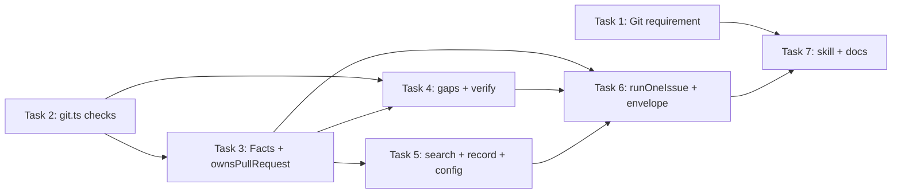

# Resolve merge conflicts on open Patchmill pull requests: Implementation Plan

> **For agentic workers:** REQUIRED SUB-SKILL: Use the sibling `executing-plans`
> skill to implement this plan inline, task by task. Steps use checkbox
> (`- [ ]`) syntax for tracking.

**Goal:** Before an unattended `runOneIssue` selects new work, it finds an open
Patchmill implementation pull request that conflicts with the base. It resolves
the conflict through a Conflict resolution session, verifies the merge, and
backs off on repeats.

**Architecture:** `KernelGit` gains `mergeConflict` and `isAncestor`. `Facts`
gains `mergeConflict`. `pull-request.ts` exports `ownsPullRequest`. A new
module, `src/kernel/merge-conflicts.ts`, owns the conflict search, the attempt
record, and the post-session checks. `runOneIssue` calls the search before
`selectRunIssue`, takes the first free issue lock, and passes the checks to
`verifyOutcome` as `conflictGaps`. The envelope and the implementation skill
tell the agent to merge, not rebase. Git 2.38 or later becomes a hard
requirement: the Nix wrapper brings it, and `doctor` checks it.

**Tech Stack:** TypeScript on Node 24 (`node --test`), Git 2.38 or later
(`merge-tree --write-tree`), Nix.

**Spec:**
[`docs/specs/2026-11-23-issue-405-resolve-merge-conflicts-on-open-patchmill-pull-r-design.md`](../specs/2026-11-23-issue-405-resolve-merge-conflicts-on-open-patchmill-pull-r-design.md)

**Inputs:** the spec above and its inline `## Visual explanation`. The spec has
no mockup and no HTML companion.

**Execution:** inline, through the sibling `executing-plans` skill. The final
whole-branch review uses the canonical `reviewer` agent, as the implementation
skill says.

## Global Constraints

- Kernel code never rebases, resets, or force-pushes. It only reads Git state
  for this feature.
- Only implementation pull requests: `ownsPullRequest` holds, the head is an
  Issue branch of N and not a Planning branch, and the pull request targets the
  base.
- The search runs only when `options.issue` is undefined and `deps.human` is
  undefined. Local-mode candidates: open issues with status `done`, oldest
  `createdAt` first.
- Attempt record path: `<runsDir>/issue-N/merge-conflict-attempt.json` with
  fields `runId`, `startedAt`, `headSha`, `baseSha`.
- Config key `run.conflictRetryMinutes`, number greater than 0, default `30`.
- Git 2.38 or later. Nix wrapper: `--prefix PATH : ${lib.makeBinPath [ git ]}`.
- Verbatim strings (from the spec):
  - `Issue #N: pull request #P conflicts with origin/<base> in <files>; resolving it first.`
    (a dry run omits `; resolving it first`)
  - `Pull request #P no longer conflicts with origin/<base>; nothing to resolve.`
  - `The pull request still conflicts with origin/<base> in: <files>.`
  - `The pull request conflicts with origin/<base> again at <short> in: <files>; the base moved during the session.`
  - `The pushed branch does not contain its previous head <short>; its history was rewritten.`
  - `The pushed branch does not contain origin/<base> at <short>; merge the base branch.`
  - `Merge conflict check failed: <message>`
  - `Issue #N conflict check failed: <message>`
  - `Issue #N conflict check skipped: several open pull requests: #A, #B`
  - `Issue #N conflict resolution skipped: <reason>`, with reasons
    `already attempted at head <short> and base <short>`,
    `last attempt at <startedAt>; retry after <time>`, and
    `another Run attempt is active`
  - `Issue #N conflict attempt record is unreadable: <message>`
  - `Git 2.38 or later is required; found <version>. Upgrade Git.`
  - `Cannot read the Git version: <output>`
  - The two envelope lines of the spec section "Envelope fact".
- `<files>` is the sorted file list, joined by a comma and a space. `<short>` is
  the first 7 characters of a SHA.
- Envelopes without a conflict stay byte-identical.

## Review Focus

1. A pull request that was clean, then conflicts after another commit lands on
   `main`: the next run must select it before older `ready` work (Task 6 test "a
   done pull request that starts to conflict is resolved first").
2. A conflicting `done` issue whose lock an Interactive Issue run holds: the
   runner must still select other work (Task 6 test "a held lock falls back to
   normal selection").
3. A paused feature run with a draft pull request that now conflicts: the agent
   must not get the conflict-only instruction (Task 6 test "normal work gets the
   continue line").
4. A resolution that rebases and force-pushes but merges cleanly: it must stop
   with `needsInfo` (Task 4 test "history rewrite is a gap").
5. A host listing failure: normal selection still runs (Task 5 test "listing
   failure reports and returns nothing" and Task 6 test "a failed search does
   not block ready work").

## File Structure

```text
nix/package.nix                     # git on the wrapper PATH
src/cli/commands/doctor/checks.ts   # + git version check (+ test)
src/kernel/git.ts (+ test)          # + MergeConflict, mergeConflict, isAncestor
src/kernel/pull-request.ts          # + ownsPullRequest
src/kernel/facts.ts (+ test)        # + Facts.mergeConflict, resolveBaseBranch
src/kernel/merge-conflicts.ts       # new: search, attempt record, gaps
src/kernel/merge-conflicts.test.ts  # new
src/kernel/verify.ts (+ test)       # + VerifyInput.conflictGaps
src/kernel/run-once.ts              # search, lock, record, gaps
src/kernel/run-once-conflicts.test.ts  # new end-to-end tests
src/kernel/envelope.ts, run-envelope.md, interactive-loop.ts  # envelope fact
src/config/config.ts (+ test)       # + run.conflictRetryMinutes
test-support/fake-pi.mjs            # + `git` step
skills/patchmill-implementation/SKILL.md (+ installed copy)
README.md, site/src/content/docs/... # requirement, config key, behavior
```

## Tasks

### Task 1: Git requirement

**Files:**

- Modify: `nix/package.nix`, `src/cli/commands/doctor/checks.ts`
- Test: `src/cli/commands/doctor/checks.test.ts`

**Interfaces:**

- Consumes: nothing.
- Produces: doctor check named `git`.

- [ ] **Step 1: Write the failing doctor tests** with that file's existing
      runner stub: `git version 2.37.1` fails with
      `Git 2.38 or later is required; found 2.37.1. Upgrade Git.`;
      `git version 2.38.0` and `git version 2.56.0.windows.1` pass; `nonsense`
      fails with `Cannot read the Git version: nonsense`.

- [ ] **Step 2: Run** `node --test src/cli/commands/doctor/checks.test.ts`.
      Expected: FAIL.

- [ ] **Step 3: Implement** the `git` check with severity `fail`, before the
      `excludes` check. Update the existing doctor tests that this shifts:
      runner stubs that assert `command === "git"` must answer `--version`; the
      ordered check names in the `deepEqual` near line 80; the `f.probes` record
      near line 97, which must filter `--version`; and the
      `checks[2]`/`checks[6]` index assertions near lines 195-197. In
      `nix/package.nix`, add `--prefix PATH : ${lib.makeBinPath [ git ]}` to
      `makeWrapper` and keep `git` in `nativeBuildInputs`. The install check
      adds `grep -q '${git}/bin' $out/bin/patchmill`, which proves that the
      wrapper puts that Git on `PATH`.

- [ ] **Step 4: Run** `node --test src/cli/commands/doctor/checks.test.ts` and
      `nix build`. Expected: PASS, and the build with its install check
      succeeds.

- [ ] **Step 5: Commit**
      `feat(doctor): require Git 2.38 and ship Git in the Nix package`.

### Task 2: Git checks

**Files:**

- Modify: `src/kernel/git.ts`
- Test: `src/kernel/git.test.ts`

**Interfaces:**

- Consumes: nothing.
- Produces:
  `export type MergeConflict = { baseSha: string; headSha: string; files: string[] }`;
  `KernelGit.mergeConflict(base: string, head: string): Promise<MergeConflict | undefined>`;
  `KernelGit.isAncestor(ancestor: string, descendant: string): Promise<boolean>`.

- [ ] **Step 1: Write the failing tests** in `git.test.ts`, with the existing
      `setup`. Make branches in the fixture repository, push them, then fetch.
  - `mergeConflict returns undefined for a clean merge`: `main` changes `a.txt`,
    branch `b` changes `b.txt`;
    `await kernel.mergeConflict("origin/main", "origin/b")` is `undefined`.
  - `mergeConflict lists conflicted files`: both sides change `z.txt` and
    `a.txt` differently, and `b` also adds `c.txt`. The result deep-equals
    `{ baseSha: <rev-parse origin/main>, headSha: <rev-parse origin/b>, files: ["a.txt", "z.txt"] }`.
  - `mergeConflict throws for a missing ref`: `origin/missing` rejects with
    `CommandFailedError`.
  - `isAncestor`: true for `main~1` and `main`, false for `main` and `main~1`.

- [ ] **Step 2: Run** `node --test src/kernel/git.test.ts`. Expected: the new
      tests FAIL (`kernel.mergeConflict is not a function`).

- [ ] **Step 3: Implement both methods** in `createKernelGit`. `mergeConflict`
      resolves each ref with the `git()` helper, then calls `runner` directly
      for `merge-tree --write-tree --name-only --no-messages <base> <head>`,
      because `git()` drops stdout for an expected code. Code 0 is `undefined`.
      Code 1 parses the lines after the first, up to the first empty line, and
      removes duplicates and sorts them. Other codes throw `CommandFailedError`.
      `isAncestor` uses `merge-base --is-ancestor` with codes 0 and 1.

- [ ] **Step 4: Run** `node --test src/kernel/git.test.ts`. Expected: PASS.

- [ ] **Step 5: Commit**
      `feat(kernel): detect merge conflicts with git merge-tree`.

### Task 3: Merge conflict fact and ownership predicate

**Files:**

- Modify: `src/kernel/facts.ts`, `src/kernel/pull-request.ts`
- Test: `src/kernel/facts.test.ts`, `src/kernel/pull-request.test.ts`

**Interfaces:**

- Consumes: `KernelGit.mergeConflict` (Task 2).
- Produces: `Facts.mergeConflict?: MergeConflict`;
  `export async function resolveBaseBranch(deps: Pick<Deps, "git" | "host" | "config">): Promise<string>`;
  `export function ownsPullRequest(pr: PullRequest, branch: string, pushRepository: string): boolean`.

- [ ] **Step 1: Write the failing tests.**
  - `facts.test.ts`, with that file's existing fixture:
    - `an open implementation pull request that conflicts has mergeConflict`:
      the branch and `main` change the same line, with an open pull request into
      `main`; `collectFacts` gives `facts.mergeConflict.files` equal to
      `["<file>"]`.
    - `no mergeConflict when clean, without an open pull request, or at a planning stage`:
      three cases, each with `facts.mergeConflict === undefined`.
  - `pull-request.test.ts`: `ownsPullRequest` is true for the same branch and a
    head repository that differs only in case; false for another branch, another
    repository, and a `null` head repository.

- [ ] **Step 2: Run**
      `node --test src/kernel/facts.test.ts src/kernel/pull-request.test.ts`.
      Expected: FAIL.

- [ ] **Step 3: Implement.** Move the base-branch expression from
      `selectWorkspace` into the exported `resolveBaseBranch`, and call it
      there. In `observe`, set `mergeConflict` under the three conditions of the
      spec section "Merge conflict fact". Extract `ownsPullRequest` from the
      `ours` filter in `findPullRequest`, and call it there.

- [ ] **Step 4: Run**
      `node --test src/kernel/facts.test.ts src/kernel/pull-request.test.ts src/kernel/run-once.test.ts`.
      Expected: PASS.

- [ ] **Step 5: Commit**
      `feat(kernel): observe merge conflicts of open implementation pull requests`.

### Task 4: Conflict gaps in verification

**Files:**

- Create: `src/kernel/merge-conflicts.ts` (gaps part)
- Modify: `src/kernel/verify.ts`
- Test: `src/kernel/merge-conflicts.test.ts`, `src/kernel/verify.test.ts`

**Interfaces:**

- Consumes: `MergeConflict`, `KernelGit.isAncestor`, `Facts.mergeConflict`.
- Produces:
  `conflictResolutionGaps(git: Pick<KernelGit, "isAncestor">, before: MergeConflict, after: Facts): Promise<string[]>`;
  `VerifyInput.conflictGaps?: string[]`.

- [ ] **Step 1: Write the failing tests.**
  - `merge-conflicts.test.ts`, with a real fixture repository and
    `createKernelGit`:
    - `a merge of base that resolves the conflict has no gaps`: the result is
      `[]`.
    - `history rewrite is a gap`: in the fixture, reset the branch to a new
      commit on base and push it with `--force`. The result contains
      `The pushed branch does not contain its previous head <short>; its history was rewritten.`
    - `a push without base is a gap`: the result contains
      `The pushed branch does not contain origin/main at <short>; merge the base branch.`
    - `a remaining conflict is a gap`: `after.mergeConflict` with the same
      `baseSha` and files `["a.txt"]` gives
      `The pull request still conflicts with origin/main in: a.txt.` first.
    - `a moved base is worded as a new conflict`: another `baseSha` gives the
      `again at <short>` line.
    - `a deleted remote branch skips the ancestry checks`: `after` with
      `remoteBranchExists: false` and no `mergeConflict` gives `[]` without a
      throw.
  - `verify.test.ts`: `conflict gaps make a verified pull request needsInfo`. An
    otherwise valid implementation input with `conflictGaps: ["X."]` returns
    label `needsInfo`. The comment starts with `The claim was not verified.` and
    contains `X.`.

- [ ] **Step 2: Run**
      `node --test src/kernel/merge-conflicts.test.ts src/kernel/verify.test.ts`.
      Expected: FAIL.

- [ ] **Step 3: Implement** `conflictResolutionGaps` with the order and strings
      of the spec. In `verifyOutcome`, the implementation branch uses
      `[...pullRequestGaps(input), ...(input.conflictGaps ?? [])]`.

- [ ] **Step 4: Run** the same command. Expected: PASS.

- [ ] **Step 5: Commit** `feat(kernel): verify merge conflict resolutions`.

### Task 5: Conflict search and attempt record

**Files:**

- Modify: `src/kernel/merge-conflicts.ts`
- Modify: `src/config/config.ts`, `src/config/config.test.ts`
- Test: `src/kernel/merge-conflicts.test.ts`

**Interfaces:**

- Consumes: `KernelGit.fetch`, `KernelGit.mergeConflict`, `Host`,
  `ownsPullRequest`, `isIssueBranch`, `parsePlanningBranch`.
- Produces: `ConflictCandidate`; `findConflictingPullRequests(input)`,
  `recordConflictAttempt(issueDir, attempt)` and
  `isRecordedAttempt(issueDir, conflict, report)` with the spec's signatures;
  `RunConfig.conflictRetryMinutes: number`.

- [ ] **Step 1: Write the failing tests** in `merge-conflicts.test.ts`. Use a
      real fixture repository, `createKernelGit`, and a `FakeHost` with the open
      pull requests. `now` is fixed, `retryMinutes` is `30`, and `report`
      collects lines.
  - `lists conflicting done issues oldest first`: two candidates both conflict,
    and the older `createdAt` comes first.
  - `an empty candidate list calls no host method`: the FakeHost call record has
    no `listOpenPullRequests` or `pushRepository` entry.
  - `skips clean, fork, planning, and wrong-base pull requests`: each case gives
    `[]` and reports nothing.
  - `several open pull requests are skipped with a report`.
  - `same head and base is skipped`: a record with the current SHAs and a
    `startedAt` two hours earlier gives `[]` and reports
    `Issue #9 conflict resolution skipped: already attempted at head <h> and base <b>`.
  - `a young record is skipped`: another base SHA and a `startedAt` ten minutes
    earlier. The candidate is skipped, and the reason starts with
    `last attempt at`.
  - `an old record with a new base is listed`: `startedAt` 31 minutes earlier
    and another base SHA; the candidate is listed.
  - `an unreadable record is treated as missing`: the file holds `{`; the
    candidate is listed, and the unreadable report appears.
  - `listing failure reports and returns nothing`: FakeHost
    `listOpenPullRequests` throws; the result is `[]`, and the report starts
    with `Merge conflict check failed:`.
  - `recordConflictAttempt writes the record`: read the JSON back and deep-equal
    the four fields. `isRecordedAttempt` is true for the same conflict and false
    for another head.
  - `config.test.ts`: the default `run.conflictRetryMinutes` is `30`, and `0` is
    rejected with
    `Invalid value for run.conflictRetryMinutes: use a number > 0`.

- [ ] **Step 2: Run**
      `node --test src/kernel/merge-conflicts.test.ts src/config/config.test.ts`.
      Expected: FAIL.

- [ ] **Step 3: Implement** the search, the record (temporary file, then
      rename), `isRecordedAttempt`, and the config key. Add the key to
      `DEFAULT_CONFIG.run`, the `schema` list, and `checkRun`'s `positive`
      checks.

- [ ] **Step 4: Run** the same command. Expected: PASS.

- [ ] **Step 5: Commit**
      `feat(kernel): find conflicting Patchmill pull requests with backoff`.

### Task 6: Run integration and envelope fact

**Files:**

- Modify: `src/kernel/run-once.ts`, `src/kernel/envelope.ts`,
  `src/kernel/run-envelope.md`, `src/kernel/interactive-loop.ts`
  (`preparePhasePrompt`), `test-support/fake-pi.mjs`
- Test: `src/kernel/run-once-conflicts.test.ts` (new),
  `src/kernel/envelope.test.ts`

**Interfaces:**

- Consumes: everything from Tasks 2 to 5.
- Produces: `RunEnvelopeInput.conflictResolution?: boolean`; a new last
  parameter `conflictResolution?: boolean` of `preparePhasePrompt`; fake Pi step
  field `git: { args: string[]; allowFailure?: boolean }[]`. The `git` entries
  run in the worktree before `writeFiles`, so a test agent can start a merge and
  leave it with conflicts.

- [ ] **Step 1: Extend the fake Pi.** In `sideEffects`, run each `step.git`
      entry before `writeFiles`. Ignore a non-zero exit only when `allowFailure`
      is true.

- [ ] **Step 2: Write the failing tests** in `run-once-conflicts.test.ts`, with
      `setupRun`. A helper puts issue 9 into `done` with an open ready pull
      request: it seeds spec, plan, and `login.ts` on `branch`, adds a pull
      request with body `Closes #9`, and sets the label `agent-done`. Then it
      pushes a commit that changes `login.ts` on `main` from the seed clone.
  - `a done pull request that starts to conflict is resolved first`: issue #10
    with `agent-ready` and an older `createdAt` also exists. The fake agent runs
    `git fetch origin` and `git merge origin/main` (allowFailure), writes the
    resolved `login.ts`, commits, and pushes. Expected: outcome `completed` for
    issue 9, label `agent-done`, `prompt()` contains
    `This session is a Conflict resolution`, the output contains
    `Issue #9: pull request #1 conflicts with origin/main in login.ts; resolving it first.`,
    and `merge-conflict-attempt.json` exists.
  - The same test in local state mode, with `LocalWorkflowState` as in
    `local-mode.test.ts`. The status log ends at `done`.
  - `a push without the merge stops with needsInfo`: the agent commits a new
    file and pushes. Expected: outcome `stopped`/`needsInfo`, and the kernel
    comment contains
    `The pull request still conflicts with origin/main in: login.ts.`
  - `an agent needs-input stops with needsInfo`: the result is
    `{ status: "needs-input", summary: "login.ts: both sides change the token rule" }`,
    and the comment contains that summary.
  - `a second pass after a failed attempt starts no session`: after the
    needs-input case, set the label back to `agent-done`. Use a `now` 31 minutes
    later, so that only the pair rule applies. The next run returns `no-work`,
    and the fake Pi counter does not advance.
  - `a held lock falls back to normal selection`: hold issue 9's lock with
    `acquireLock`, and give issue #10 `agent-ready`. The run selects #10, and
    the output contains
    `Issue #9 conflict resolution skipped: another Run attempt is active`.
  - `normal work gets the continue line`: issue 9 is `inProgress` with a draft
    pull request that conflicts, and no attempt record exists. `prompt()`
    contains `then continue your normal work` and not
    `This session is a Conflict resolution`.
  - `nothing to resolve stops without a session`: the agent script is empty.
    Wrap `deps.workflow.setStatus` once so that it pushes a merge of `main` into
    `branch` from the seed clone before it delegates. Expected: outcome
    `completed`, and the summary
    `Pull request #1 no longer conflicts with origin/main; nothing to resolve.`
  - `a failed search does not block ready work`: `listOpenPullRequests` throws,
    and a `ready` issue is selected as before.
  - `envelope.test.ts`: `renders the merge conflict fact` checks both lines for
    a `Facts` with `mergeConflict`, with and without `conflictResolution`. The
    existing fixture tests stay unchanged.

- [ ] **Step 3: Run**
      `node --test src/kernel/run-once-conflicts.test.ts src/kernel/envelope.test.ts`.
      Expected: FAIL.

- [ ] **Step 4: Implement** steps 1 to 7 of the spec section "Run integration".
  - Move the existing `options.signal?.aborted` check before the candidate
    locks. The run keeps the selected candidate as `conflictSelection`, and the
    lock that it took for it as the run's lock. The existing `finally` releases
    that lock, because it is not `heldLock`. No early return may sit between the
    candidate lock and the `try` whose `finally` releases it.
  - On the first derivation, `conflictSelection` without `facts.mergeConflict`
    gives the nothing-to-resolve stop.
  - Before each implementation launch, `conflictResolution` is
    `!!facts.mergeConflict && (conflictSelection !== undefined || await isRecordedAttempt(...))`.
    When it is true, write the record, then pass it to `preparePhasePrompt`.
  - After the session, compute `conflictGaps` from the before facts, and pass
    them in the `VerifyInput` that goes to `verifyPlanningApproval`.
  - Add `{{mergeConflict}}` to `run-envelope.md` directly after
    `{{pullRequest}}`. It renders `""` or `\n- Merge conflict: …`, and `""` for
    any phase other than `implementation`.
  - `conflictResolutionGaps` skips the ancestry checks when
    `after.remoteBranchExists` is false (Task 4 adds a test:
    `a deleted remote branch skips the ancestry checks`).

- [ ] **Step 5: Run**
      `node --test src/kernel/run-once-conflicts.test.ts src/kernel/envelope.test.ts src/kernel/run-once*.test.ts`.
      Expected: PASS.

- [ ] **Step 6: Commit**
      `feat(kernel): resolve conflicting pull requests before new work`.

### Task 7: Skill text and documentation

**Files:**

- Modify: `skills/patchmill-implementation/SKILL.md`
- Modify: `.patchmill/skills/patchmill-implementation/SKILL.md` and
  `.patchmill/skills/patchmill-skill-pack.json` (through `skills update`)
- Modify: `README.md` (Requirements, Nix section, Run unattended, config
  example), `site/src/content/docs/using-patchmill/run.md`,
  `site/src/content/docs/getting-started/configuration.md`,
  `site/src/content/docs/reference/configuration-example.md`,
  `site/src/content/docs/reference/git-safety.md`

Testing Value Gate: prose and static configuration. Verify by inspection, lint,
and the existing suites. Do not add text-assertion tests.

- [ ] **Step 1: Add `## Merge conflicts`** before `## Commit and publish`, with
      the steps of the spec section "Implementation skill".

- [ ] **Step 2: Refresh the installed copy.** Run
      `node bin/patchmill.ts skills update`. Expected:
      `diff skills/patchmill-implementation/SKILL.md .patchmill/skills/patchmill-implementation/SKILL.md`
      prints nothing, and `git diff --stat .patchmill/skills` shows only that
      file and the manifest.

- [ ] **Step 3: Document** these points:
  - Git 2.38 or later in the README requirements.
  - The Nix package now includes Git. Name a system credential helper by its
    full path.
  - `run.conflictRetryMinutes`.
  - The behavior: before new work, an unattended run resolves open Patchmill
    pull requests that conflict with the base.
  - In `git-safety.md`: the search runs before selection, the merge does not
    rebase, and the history checks apply.

- [ ] **Step 4: Validate.** Run `npm run lint`, `npm test`, and `nix build`.
      Expected: all pass.

- [ ] **Step 5: Commit**
      `docs: describe merge conflict resolution in the run loop`.

## Verification

- `npm test` (types and all suites), `npm run lint`, and `nix build` after
  Task 7. The npm dependencies do not change. `nix build` runs because
  `nix/package.nix` changes.

## Visual explanation

Task order and ownership:



```text
merge-conflicts.ts   # owns: eligibility, backoff record, post-session gaps
pull-request.ts      # owns: pull request ownership rule
git.ts               # owns: merge-tree and ancestry commands
verify.ts            # owns: the outcome (adds conflictGaps)
run-once.ts          # orders the calls and takes the lock; no conflict rules
```

## Planning review

### Pass 1: initial (combined spec and plan)

- **Scope:** this document, reviewed together with the specification
  `docs/specs/2026-11-23-issue-405-resolve-merge-conflicts-on-open-patchmill-pull-r-design.md`,
  at stage `implementation` (no gate). The `GLOSSARY.md` entry was in scope as a
  companion.
- **Reviewer:** canonical `reviewer` agent, model
  `claude-bridge/claude-opus-5-5`, thinking `high`, base revision `360c592`.
- **Reviewed body SHA-256:** not recorded for this pass. The planner computed
  the hashes only after the corrections.
- **Survey:** the reviewer traced `runOneIssue` (sweep, sync, selection, lock,
  claim, phase loop, verification), `derivePhase` on a Done issue,
  `selectWorkspace`/`observe`, `findPullRequest`, `verifyOutcome`, the review
  wait lock in `review-wait.ts`, `local-work-source.ts`, the Nix wrapper,
  `doctor`, and the run-once test fixtures. It confirmed the #356 claim that an
  assignment stays with its runner until the merge.
- **Findings and dispositions:**
  - S1/P1 (blocker): a held issue lock on a conflicting Done issue, for example
    in a review wait, makes every pass idle. Accepted: the search returns an
    ordered list, and the run takes the first free lock or falls back to
    `selectRunIssue`. There is a new run test.
  - S2 (blocker): the Git 2.38 claim was false, and the requirement was not
    stated. Escalated to the maintainer, who chose a hard requirement and Git in
    the Nix wrapper. Accepted: section "Git requirement" and plan Task 1.
  - S3/P2 (blocker): the conflict-only instruction reached normal sessions.
    Accepted: section "Conflict resolution or normal work", two envelope lines,
    a split skill section, and a run test.
  - S4: one ownership predicate. Accepted (`ownsPullRequest`).
  - S5: search only in unattended runs. Accepted.
  - S6: fast-forward to `origin/<branch>` before the merge. Accepted.
  - S7: wording for a moved base. Accepted.
  - S8: diagram order. Accepted.
  - S9: `git-safety.md` docs. Accepted.
  - S10: the second-pass test isolates the pair rule. Accepted.
  - S11: dry-run wording. Accepted.
- **Inspection limits:** no tests or builds run; issue read from the supplied
  summary; old-Git behavior not checked empirically.

### Pass 2: scoped confirmation

- **Reviewer:** canonical `reviewer` agent, model
  `claude-bridge/claude-opus-5-5`, thinking `high`, base revision `360c592`.
- **Result:** S1 to S11 confirmed in both documents and against the source. No
  new blocker.
- **New suggestions, all accepted after the confirmation:**
  - N1: install-check wording aligned with the plan's grep.
  - N2: plan Task 1 names the doctor test assertions that shift.
  - N3: the abort check comes before candidate locks.
  - N4: a Risks line and a README note for credential helpers.
  - N5: no conflict line outside the implementation phase.
  - N6: a diverged fast-forward stops with `needs-input`.
  - N7: ancestry checks are skipped when the remote branch is gone.

  These are small text corrections, and no fresh reviewer read them. The
  maintainer can check them against this list.

- **Inspection limits:** no tests, `nix build`, or Git version checks run.
- **Final body SHA-256:** specification
  `ba4168635cbe4d9f849f8a7ef4c4962d5e271666562404b1b5124a8497acf68c`; plan
  `bde218868bc3312cb4e1febc093ba1bc1e36af33a9d4711d5c16ffc424599183`. The plan
  was compared with specification
  `ba4168635cbe4d9f849f8a7ef4c4962d5e271666562404b1b5124a8497acf68c`.
- **Outcome:** `ready`.
