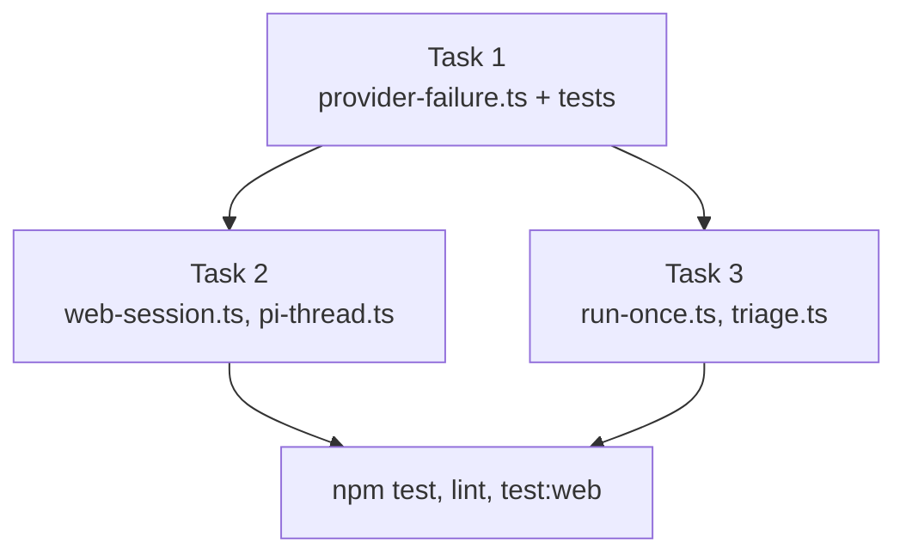

# Surface provider failures Implementation Plan

> **For agentic workers:** REQUIRED SUB-SKILL: Use the sibling `executing-plans`
> skill to implement this plan inline, task by task. Steps use checkbox
> (`- [ ]`) syntax for tracking.

**Goal:** Show each Provider failure (a Pi assistant message with
`stopReason: "error"`) in the web Issue thread, live and in history, and in the
stop reason of unattended phases and triage, with sign-in guidance for sign-in
failures.

**Architecture:** One new kernel module, `src/kernel/provider-failure.ts`, owns
the definition, the sign-in classification, the text, and the read from session
files. Four call sites use it: the Web session, the Issue thread projection,
`run-once.ts`, and `triage.ts`. No browser, `verifyOutcome`, or Pi changes.

**Tech Stack:** TypeScript on Node (type stripping), `node:test`,
`node:assert/strict`.

**Spec:**
[`docs/specs/2026-11-23-issue-417-surface-expired-authentication-tokens-instead-of-design.md`](../specs/2026-11-23-issue-417-surface-expired-authentication-tokens-instead-of-design.md)

**Inputs:** the spec above, its inline Visual explanation, and the `GLOSSARY.md`
term **Provider failure**. There is no mockup: frontend design does not apply.

## Global Constraints

- A Provider failure is only `stopReason: "error"`. `"aborted"` is never one.
- Empty `errorMessage` → message text `The request failed.`
- `message` is trimmed and at most 2000 characters.
- Thread titles: `Sign-in failed` and `The agent's request failed`.
- Thread sign-in guidance (after a blank line):
  `The model provider refused the sign-in. Run patchmill auth in the repository, then send your message again. If it fails again, press Pause and then Resume.`
- Stop reason: `The model provider refused the request: <message>`; sign-in adds
  `Run patchmill auth in the repository, then start the run again.` separated by
  one space.
- A parsed result is never changed. The `missing` flag of a result is kept.
- No new npm dependencies. No browser changes.

## Review Focus

- A Pi auto-retry: a failed message, then a successful reply. History and
  `lastProviderFailure` must not report the retried failure as the session's
  end; the live thread shows the failed attempt once. Covered in Task 1
  (`lastProviderFailure` retry test) and Task 2 (history test).
- A failed message that has partial text before the error: the text stays, the
  error comes after it. Covered in Task 2.
- Session directory absent or unreadable (a phase that never started Pi):
  `lastProviderFailure` returns `undefined` and never throws. Covered in Task 1.
- A resumed worker with two session files: the newest file decides. Covered in
  Task 1.
- An implementation worker that ends with a provider failure after it opened a
  verified pull request and exited cleanly: the `missing` flag keeps the
  existing "done with warning" rule. Covered in Task 1 (`explainProviderFailure`
  keeps `missing`).

---

### Task 1: Provider failure module

**Files:**

- Create: `src/kernel/provider-failure.ts`
- Test: `src/kernel/provider-failure.test.ts`

**Interfaces:**

- Consumes: `ParsedResult` from `src/kernel/result.ts`.
- Produces:
  - `type ProviderFailure = { readonly message: string; readonly signIn: boolean }`
  - `providerFailure(message: unknown): ProviderFailure | undefined`
  - `lastProviderFailure(sessionDir: string): Promise<ProviderFailure | undefined>`
  - `providerFailureEntry(failure: ProviderFailure): { title: string; text: string }`
  - `providerFailureReason(failure: ProviderFailure): string`
  - `explainProviderFailure(result: ParsedResult, sessionDir: string): Promise<ParsedResult>`

- [ ] **Step 1: Write the failing tests**

Tests in `src/kernel/provider-failure.test.ts`:

- `providerFailure classifies sign-in failures`: for each of these
  `errorMessage` values,
  `providerFailure({ role: "assistant", content: [], stopReason: "error", errorMessage })`
  returns `{ message, signIn: true }`:
  `Your authentication token has expired. Please try refreshing it.`,
  `401 Unauthorized`, `Request failed: 403 forbidden`, `Invalid API key`,
  `API key is missing`, `The access token expired`, `Please log in again`,
  `Unauthenticated`.
- `providerFailure keeps other errors without sign-in`: `Overloaded`,
  `429 Too Many Requests: rate limit reached` → `signIn: false`.
- `aborted, stop, and non-assistant messages are not failures`:
  `stopReason: "aborted"`, `stopReason: "stop"`, `role: "user"` with
  `stopReason: "error"`, `null`, `"text"` → `undefined`.
- `empty error message`: `errorMessage: ""` or absent →
  `{ message: "The request failed.", signIn: false }`.
- `long message is cut`: a 5000-character message → `message.length === 2000`.
- `entry and reason text`: for the issue's message, `providerFailureEntry`
  returns
  `{ title: "Sign-in failed", text: <message> + "\n\n" + <thread guidance> }`;
  `providerFailureReason` returns
  `The model provider refused the request: <message> Run patchmill auth in the repository, then start the run again.`.
  For `Overloaded`: title `The agent's request failed`, text `Overloaded`,
  reason `The model provider refused the request: Overloaded`.
- `lastProviderFailure reads the newest session file` (real temp dirs):
  - missing directory → `undefined`;
  - empty directory → `undefined`;
  - one `.jsonl` file whose last assistant record is a failure, with a broken
    line before it → the failure;
  - a failure followed by an assistant record with `stopReason: "stop"` →
    `undefined`;
  - two files, older file (mtime set with `fs.utimes`) ends with success, newer
    ends with a failure → the failure; the reverse → `undefined`.
- `explainProviderFailure`: `{ ok: true, … }` returns the same object even when
  the directory holds a failure; `{ ok: false, reason: "x", missing: true }`
  with a failure returns
  `{ ok: false, reason: providerFailureReason(f), missing: true }`; without
  `missing` the result has no `missing`; with no failure the same object
  returns.

- [ ] **Step 2: Run the tests to verify they fail**

Run: `node --test src/kernel/provider-failure.test.ts` Expected: FAIL, module
not found.

- [ ] **Step 3: Implement `src/kernel/provider-failure.ts`**

Keep the sign-in patterns private, all with the `i` flag: `/authenticat/`,
`/unauthori[sz]ed/`, `/\b40[13]\b/`,
`/token (has )?expired|expired token|access token expired/`,
`/invalid (api )?key|api key (is )?(invalid|missing)/`,
`/(log ?in|sign ?in|re-?authenticate).*(again|required|expired)/`. For "newest
file", use `fs.stat(...).mtimeMs` of each `.jsonl` file; on a tie, the later
name in sort order wins. Parse lines with `JSON.parse` in `try`; ignore lines
that are not objects. Each failure inside `lastProviderFailure` returns
`undefined`.

- [ ] **Step 4: Run the tests to verify they pass**

Run: `node --test src/kernel/provider-failure.test.ts` Expected: PASS.

- [ ] **Step 5: Commit**

```bash
git add src/kernel/provider-failure.ts src/kernel/provider-failure.test.ts
git commit -m "feat(kernel): classify Provider failures from Pi messages (#417)"
```

### Task 2: Show Provider failures in the Issue thread

**Files:**

- Modify: `src/web/session/web-session.ts` (`onMessageEnd`)
- Modify: `src/web/pi-thread.ts` (`projectPiThread`, assistant branch)
- Test: `src/web/session/web-session.test.ts`
- Create test: `src/web/pi-thread.test.ts`

**Interfaces:**

- Consumes: `providerFailure`, `providerFailureEntry` from Task 1.
- Produces: no new exports. The existing `error` `ThreadEvent`
  (`{ kind: "error"; title; text }`) carries the entry.

- [ ] **Step 1: Write the failing tests**

In `web-session.test.ts`, with the existing `fakeInteractivePi` helpers:

- `a failed reply adds a sign-in error entry`: emit `agent_start`, then
  `message_end` with
  `{ role: "assistant", content: [], stopReason: "error", errorMessage: "Your authentication token has expired. Please try refreshing it." }`,
  then `agent_settled`. Assert the snapshot has exactly one entry with
  `kind: "error"`, `title: "Sign-in failed"`, and text that contains
  `Run patchmill auth`; assert `state === "idle"`.
- `each failed reply adds its own error entry`: two such message ends → two
  `error` entries with different IDs.
- `text before a failure stays before the error`: `message_end` with
  `content: [{ type: "text", text: "Partial" }]` and `stopReason: "error"`,
  `errorMessage: "Overloaded"` → entries in order: agent message `Partial`, then
  error `The agent's request failed` with text `Overloaded`.
- `an aborted reply adds no error entry`: `stopReason: "aborted"` → no `error`
  entry.

In new `src/web/pi-thread.test.ts`:

- `a failed assistant record becomes an error event`: records = session header,
  a user message, an assistant record with `content: []`, `stopReason: "error"`,
  the issue's `errorMessage` → the last event is
  `{ kind: "error", id: "<prefix>:2:error", title: "Sign-in failed", … }`.
- `a retried failure keeps both the error and the reply`: failed record, then an
  assistant record with text `Done` → events end with the error, then the agent
  message `Done`.
- `an aborted record gives no error event`.

- [ ] **Step 2: Run the tests to verify they fail**

Run: `node --test src/web/session/web-session.test.ts src/web/pi-thread.test.ts`
Expected: the new tests FAIL (no `error` entries).

- [ ] **Step 3: Implement**

In `onMessageEnd`, after the text-block loop and before `streams.clear()`, call
`providerFailure(message)`; if set, call the local `error(title, text)` helper
with `providerFailureEntry(failure)`. In `projectPiThread`, after the
content-block loop of an assistant message, push an `error` event with the id
`<id>:error`, the record's `at`, and the fields of
`providerFailureEntry(failure)`. The assistant branch must not skip a message
whose `content` is not an array before it checks for a failure.

- [ ] **Step 4: Run the tests to verify they pass**

Run: `node --test src/web/session/web-session.test.ts src/web/pi-thread.test.ts`
Expected: PASS.

- [ ] **Step 5: Commit**

```bash
git add src/web/session/web-session.ts src/web/pi-thread.ts src/web/session/web-session.test.ts src/web/pi-thread.test.ts
git commit -m "fix(web): show Provider failures in the Issue thread (#417)"
```

### Task 3: Name Provider failures in stop reasons and triage

**Files:**

- Modify: `src/kernel/run-once.ts:358-367` (the `explainMissingResult` call)
- Modify: `src/kernel/triage.ts` (the failed-session warning, about line 230)
- Test: `src/kernel/run-once-failures.test.ts`
- Test: `src/kernel/triage.test.ts`

**Interfaces:**

- Consumes: `explainProviderFailure`, `lastProviderFailure`,
  `providerFailureReason` from Task 1.
- Produces: nothing new.

- [ ] **Step 1: Write the failing tests**

- `run-once-failures.test.ts`,
  `a phase that ends with a Provider failure names it`: use `setupRun` with one
  step
  `{ stdout: "", exitCode: 1, sessionEntries: [ <assistant record with stopReason "error" and the issue's errorMessage> ] }`
  (`test-support/fake-pi.mjs` writes `sessionEntries` to `fake.jsonl` in the
  session directory and exits with `exitCode`, as in the existing test
  `a worker that ends with a running reviewer names the cause`). Assert the
  issue gets `needs-info` and the first comment matches
  `/The model provider refused the request: Your authentication token has expired\. Please try refreshing it\. Run patchmill auth in the repository, then start the run again\./`,
  and still contains `Log:` and `Exit code:`.
- `triage.test.ts`, `a failed triage session names its Provider failure`: a fake
  Pi step with `exitCode: 1` and session entries that end with the issue's
  failed assistant record. Assert the warning for that issue contains
  `The model provider refused the request:` and `Skipping.`

- [ ] **Step 2: Run the tests to verify they fail**

Run:
`node --test src/kernel/run-once-failures.test.ts src/kernel/triage.test.ts`
Expected: the two new tests FAIL with the old reasons.

- [ ] **Step 3: Implement**

In `run-once.ts`, replace the result expression of the non-timed-out,
non-aborted branch with:
`explainProviderFailure(launched.result, launch.sessionDir)`; if that returns a
different object, use it; otherwise use
`explainMissingResult(launched.result, launch.sessionDir)`. In `triage.ts`, in
the failed-session branch, read
`lastProviderFailure(<the sessionDir passed to supervisePi>)` and warn
`${providerFailureReason(failure)} Skipping.` when it is set; keep the current
warning otherwise.

- [ ] **Step 4: Run the tests to verify they pass**

Run:
`node --test src/kernel/run-once-failures.test.ts src/kernel/triage.test.ts`
Expected: PASS.

- [ ] **Step 5: Run the full checks**

Run: `npm test && npm run lint && npm run test:web` Expected: all pass. No npm
dependency changes, so no Nix build.

- [ ] **Step 6: Commit**

```bash
git add src/kernel/run-once.ts src/kernel/triage.ts src/kernel/run-once-failures.test.ts src/kernel/triage.test.ts
git commit -m "fix(kernel): name Provider failures in stop reasons and triage (#417)"
```

## Verification choice

Behaviour tests above cover the classifier, both thread surfaces, the stop
reason and triage. The glossary entry is checked by `npm run lint`
(markdownlint, Prettier) only; no test asserts document text.

## Visual explanation



## Companion artifacts

None besides the spec and its `GLOSSARY.md` entry.
