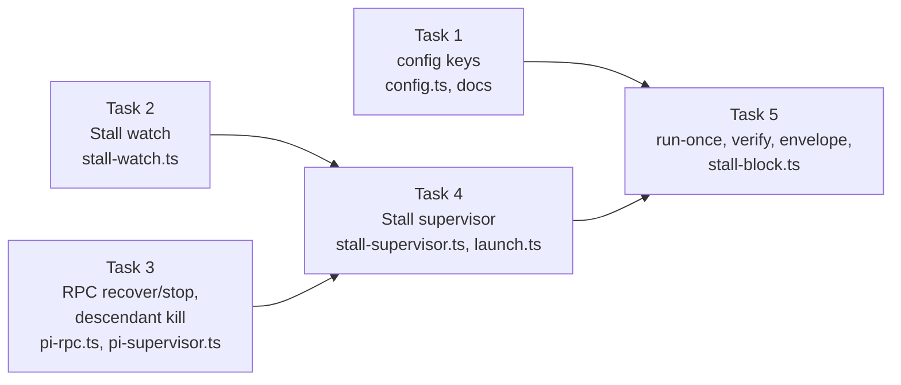

# Stall recovery for unattended implementation sessions: Implementation Plan

> **For agentic workers:** Execute this plan inline with the `executing-plans`
> skill. Steps use checkbox (`- [ ]`) syntax for tracking.

**Goal:** Stop and recover stalled unattended implementation sessions, and block
the Run attempt after repeated Stalls.

**Architecture:** A Stall watch reads the session files of the phase session
directory and decides `recorded`, `recover` or `block`. A Stall supervisor runs
it next to one Pi RPC session and stops, continues or restarts Pi. `run-once`
turns a block into a `needsInfo` stop, and `stall-block.ts` passes the stalled
commands to the next Run attempt.

**Tech Stack:** TypeScript on Node 24, `node:test`, Pi RPC mode, the fake Pi in
`test-support/`.

**Spec:**
[`docs/specs/2026-11-24-issue-319-recover-stalled-run-once-implementation-sessions-design.md`](../specs/2026-11-24-issue-319-recover-stalled-run-once-implementation-sessions-design.md)

**Inputs:** the spec, its Visual explanation, `GLOSSARY.md` (Stall, Stall stop,
Command timeout), and the #322 spec for the Command timeout policy.

## Global Constraints

- Only unattended implementation sessions get the Stall policy. Interactive
  runs, planning, triage and doctor do not change. The Previous stalls fact goes
  into every implementation envelope.
- Defaults: `pi.stallStopMinutes: 10`, `pi.maxStalls: 3`. `0` turns each off.
  The same-command rule is always on.
- `pi.stallStopMinutes` is a finite number from `0` to `35791`. `pi.maxStalls`
  is an integer from `0` to `100`.
- No config rule links the new keys to `pi.maxCommandTimeoutMinutes`.
- `pi.timeoutMinutes` keeps its behavior. A restart gets the remaining time of
  the same deadline.
- Activity is session file bytes and RPC `message_update` records only.
- Quiet time uses a monotonic clock. An open `bash` call is exempt for its
  effective Command timeout plus 60 seconds.
- A Stall limit gives the `needsInfo` stop. Never commit, discard or push work
  for the agent.
- Agent command text in the prompt, reason and envelope: at most 200 characters,
  in a code span, backticks replaced by `'`.
- No `ps` on Linux: read `/proc`. The Nix build sandbox has no `ps`.
- Tests use `test-support/feed-clock.ts` or limits below one second, and the
  fail-fast fake Pi. No test waits more than a few seconds.
- Repository checks: `npm run lint`, `npm test`, `npm run build`, and
  `nix build .#patchmill` (Task 3 adds a process test that also runs there).

## Review Focus

1. A child session file that appears after the first poll (a new subagent): the
   watch finds it and counts its growth as Activity. Test in Task 2.
2. A partial last line, or a UTF-8 character split across two polls: the watch
   parses it on the next poll, with no lost tool call. Test in Task 2.
3. A Command timeout that is also the Stall limit: the decision is `block`, not
   `recorded`. Test in Task 2.
4. The settle after the recovery `abort` reports `0` background runs: the
   session must not finish before the recovery turn starts. Test in Task 3.
5. A Stall stop when the implementation session file does not exist yet (Pi
   froze before its first entry): an unresponsive Pi then cannot restart, and
   the Stall becomes the Stall limit through `fail()`. Test in Task 4.

---

### Task 1: Configuration keys

**Files:**

- Modify: `src/config/config.ts` (`PatchmillConfig.pi`, `DEFAULT_CONFIG`, the
  schema list near line 110, `checkPi()`)
- Modify: `patchmill.config.json`, `README.md`,
  `site/src/content/docs/getting-started/configuration.md`,
  `site/src/content/docs/reference/configuration-example.md`
- Test: `src/config/config.test.ts`

**Interfaces:**

- Produces: `config.pi.stallStopMinutes: number`, `config.pi.maxStalls: number`.

- [ ] **Step 1: Write the failing tests** in `src/config/config.test.ts`:
      `stall keys default to 10 and 3`; `stall keys accept 0`;
      `pi.stallStopMinutes accepts 0.01`;
      `pi.stallStopMinutes rejects -1 and 35792`;
      `pi.maxStalls rejects 1.5, -1 and 101`;
      `a stall stop shorter than the command cap is accepted` (stop `5`, cap
      `25`). Each range rejection asserts a `ConfigError` whose message names
      the key. A string value gives the existing `Invalid type for` error.
- [ ] **Step 2: Run** `node --test src/config/config.test.ts`. Expected: the new
      tests fail.
- [ ] **Step 3: Implement.** Add both keys with JSDoc ("0 turns it off"), the
      defaults, the two schema entries as `number`, and the checks in
      `checkPi()`. Messages:
      `Invalid value for pi.stallStopMinutes: use a number from 0 to 35791` and
      `Invalid value for pi.maxStalls: use a whole number from 0 to 100`. Add
      the keys to the config file and the three documents, next to the #322
      keys, with one sentence each from the spec's table.
- [ ] **Step 4: Run** `node --test src/config/config.test.ts`. Expected: PASS.
- [ ] **Step 5: Commit**
      `feat(config): add the Stall stop and Stall limit keys (#319)`.

### Task 2: The Stall watch

**Files:**

- Create: `src/kernel/stall-watch.ts`
- Test: `src/kernel/stall-watch.test.ts`

**Interfaces:**

- Consumes: `limitCommandTimeout()` and `CommandLimits` from
  `src/pi/command-timeout-extension.ts`.
- Produces: `StallLimits`, `StallCall`, `Stall`, `StallDecision`,
  `createStallWatch()` with `record`, `poll`, `recovered`, `fail`, `stalls`,
  `sessionFile`, exactly as in the spec, section "Module 1".

Tests write session files in a temp directory with helpers:
`call(file, id, name, args)` appends an assistant `message` entry with one
`toolCall`; `result(file, id, name, text, isError)` appends a `toolResult`
entry; `user(file, text)` appends a user `message` entry. The clock is a plain
counter (`let now = 0; createStallWatch({ ..., now: () => now })`). Limits:
`{ stopAfterMs: 600_000, maxStalls: 3, command: { defaultSeconds: 1200, maxSeconds: 1500 } }`.

- [ ] **Step 1: Write the failing tests:**
  - `quiet time reaches the stop limit and gives one recover decision`: after
    one poll with entries, set `now = 599_999`, poll: `[]`. Set `now = 600_000`,
    poll: one `recover` with `stall.kind === "stall-stop"`,
    `quietMs === 600_000`. Poll again: `[]`.
  - `a message_update record resets quiet time`:
    `watch.record({ type: "message_update" })` at `500_000`; poll at `600_000`
    gives `[]`.
  - `heartbeat records are not activity`: `extension_ui_request` and
    `tool_execution_update` records every 1,000 ms; poll at `600_000` gives
    `recover`.
  - `a growing child session file is activity`: the top-level file is quiet; a
    file `parent/3f2a/run-0/session.jsonl`, created after the first poll, grows
    every 300 s. No decision in 30 minutes.
  - `subagent-artifacts files are not activity`: growth only under
    `subagent-artifacts/` gives a Stall stop at 600 s.
  - `an open bash call inside its timeout is exempt`: open `bash` with
    `timeout: 1500` at `now = 0`. Polls up to `now = 2_159_999` give `[]`. At
    `now = 2_160_000` (1,500 s + 60 s + 600 s) the decision is `recover`, and
    its call has `command: "npm test"`.
  - `an open bash call without a timeout uses the default` (1,200 s), and
    `an open bash call is not exempt when both command limits are 0`.
  - `a later user or assistant message closes an open call`: open `bg_wait` (no
    result), then a `user` entry. The next Stall stop lists no calls.
  - `a sibling tool result does not close an open call`: two calls in one
    assistant message; a result for the second keeps the first open.
  - `a call left open by a killed run is not a repeat`: a nested `bash` call
    open with no later entry. Stall 1 lists it. After `recovered()`, a second
    Stall stop does not list it and gives `recover`, not `block`.
  - `a partial line and a split UTF-8 character are parsed on the next poll`:
    write the first part of a `toolCall` line that cuts a `é` in its command,
    poll, write the rest, poll. The call is open with the full command.
  - `a timed-out bash result is a recorded stall`: text
    `"out\n\nCommand timed out after 1200 seconds"`, `isError: true`, in a
    nested file. Decision `recorded`, `kind: "command-timeout"`, the call's
    `session` is the nested path and `run` is `3f2a`. Also with the suffix
    `. The shell exited with code 0 after 3 seconds, but background processes it started kept writing output until the timeout.`
  - `the same command twice blocks`: a timeout of `npm  test`, then a Stall stop
    with `npm test` open. The second decision is `block`, and the reason starts
    with `The implementation stopped: the same command stalled twice.`
  - `the third stall blocks, also when it is a command timeout`: two Stall stops
    on different calls, then a timeout. The third decision is `block`, and the
    reason starts with `The implementation stopped after 3 stalls.`
  - `maxStalls 0 never blocks on count`, and
    `stopAfterMs 0 gives no stall stop`.
  - `fail turns the last stall into a block`: after one `recover`,
    `fail("no session file")` returns a `block` whose reason starts with
    `The implementation stopped: Patchmill could not restart Pi after a stall (no session file).`
  - `the recovery prompt names the calls, their durations and the background run`:
    a parent `bg_wait` open since `now = 0` and a child `bash` call without a
    timeout (command limits at `0`) open since `now = 120_000`. The poll at
    `now = 720_000` gives a prompt that contains `This is stall 1 of 3.`,
    `implementation session: bg_wait, started`, `ran 12 min`,
    `subagent run 3f2a`, `` bash `npm test` ``, `ran 10 min` and
    `check run 3f2a`. After `recovered()`, the parent makes 6 tool calls. The
    next Stall has `tried.length === 5`.
  - `a stall stop with no open call says the model reply made no progress`.
  - `long command text is cut and quoted`: a 300-character command with a
    backtick. The prompt has at most 200 characters of it, and no backtick
    inside the code span.
- [ ] **Step 2: Run** `node --test src/kernel/stall-watch.test.ts`. Expected:
      FAIL, module missing.
- [ ] **Step 3: Implement** `createStallWatch()` in `src/kernel/stall-watch.ts`.
      Keep per-file byte offsets and remainder `Buffer`s in a `Map`, and decode
      only complete lines. Find files with
      `fs.readdir(sessionDir, { recursive: true })`; a missing directory gives
      no files. The run ID of a nested file is the path segment before
      `run-<n>`. Collapse whitespace in command text with `/\s+/g` and `trim()`.
      The key of a non-`bash` call is `${name} ${JSON.stringify(sortedArgs)}`.
      Use the prompt and reason text from the spec. If the module passes about
      300 lines, split the file reading into `src/kernel/stall-files.ts`
      (internal; tests stay on the watch interface).
- [ ] **Step 4: Run** the test file. Expected: PASS.
- [ ] **Step 5: Commit** `feat(kernel): add the Stall watch (#319)`.

### Task 3: Stop and continue a Pi RPC session

**Files:**

- Modify: `src/kernel/pi-rpc.ts`, `src/kernel/pi-supervisor.ts`
  (`descendantGroups()`)
- Modify: `test-support/fake-pi-rpc.mjs`; `test-support/fake-pi.mjs` (accept
  `--session`)
- Test: `src/kernel/pi-rpc.test.ts`, `src/kernel/pi-supervisor.test.ts`

**Interfaces:**

- Produces: `PiRpcOptions.onRecord`, `PiRpcOptions.sessionFile`,
  `PiRpcOptions.appendLogs`, `PiRpcSession.recover(message, graceMs)`,
  `PiRpcSession.stop()`, and `descendantGroups(pid: number): Promise<number[]>`
  in `pi-supervisor.ts`. The recovery prompt is sent with
  `streamingBehavior: "steer"`; a test checks the field in the commands log.

New fake Pi step fields in `fake-pi-rpc.mjs`:

- `hang: true`: after `agent_start`, write no records until `abort`. On `abort`,
  write the report `N:0` and `agent_settled`, then answer `abort`.
- `ignoreAbort: true`: never answer `abort`.
- `commandChild: true`: start `sleep 600` with `detached: true` (its own process
  group) and write its pid to `${script}.command.pid`.
- `recovery`: the answer to the first prompt after an `abort`. It takes the
  fields of `reminder`, plus `hang`, `sessionEntries` (appended to
  `fake.jsonl`), and the side effects of a step (`writeFiles`, `commit`, `push`,
  `pullRequest`). `recovery.delayStartMs` waits before `agent_start`, and a late
  `N:0` report is sent in that gap. A nested `recovery` answers the next prompt
  after a further `abort`.
- `hang` runs the step's side effects and `sessionEntries` first, then hangs.
- Every turn sends one `message_update` record after `agent_start` and one after
  its side effects, as a streaming reply does. So the side effects do not count
  as quiet time in the timed tests.

- [ ] **Step 1: Write the failing tests:**
  - `pi-rpc.test.ts`: `onRecord sees each parsed record`.
  - `piRpcArgs uses --session when sessionFile is set`.
  - `recover aborts the turn and sends the message as a new prompt`: step
    `{ hang: true, recovery: { result: done, delayStartMs: 50 } }`.
    `recover("Continue.", 1000)` returns `"continued"`. The commands log has
    `abort` then `prompt` with `Continue.`. `done` resolves with the recovery
    result, so the late report did not finish the session.
  - `a rejected recovery prompt finishes the session`: `recovery.promptError`.
  - `recover returns unresponsive when Pi ignores abort`: step
    `{ hang: true, ignoreAbort: true }`, `graceMs` `100`. Then `stop()`: `done`
    resolves with `aborted: false` and `timedOut: false`.
  - `stop kills a command in its own process group`: step
    `{ hang: true, ignoreAbort: true, ignoreSigterm: true, commandChild: true }`
    with `graceMs: 100`. After `stop()` and `done`, `signalGroup(commandPid, 0)`
    is `false`.
  - `appendLogs keeps the earlier log`.
  - `pi-supervisor.test.ts`:
    `descendantGroups lists the group of a detached grandchild`: spawn a child
    that spawns a detached `sleep`; the result contains the `sleep` group and
    not the child's own group when they are equal to the caller's group.
- [ ] **Step 2: Run**
      `node --test src/kernel/pi-rpc.test.ts src/kernel/pi-supervisor.test.ts`.
      Expected: the new tests fail.
- [ ] **Step 3: Implement.** Call `options.onRecord` first in the record
      handler. Add a `recovering` flag: `evaluate()` returns while it is set.
      `recover()` sets it, races the `abort` response against a `graceMs` timer,
      and sends `prompt` on success. The flag clears on the next `agent_start`,
      or when the prompt is rejected or `handled` (then `finish()` as for the
      first prompt). `stop()` calls `interrupt()` with no kind. `interrupt()`
      (not the normal-exit path) calls `descendantGroups(child.pid)` first and,
      after Pi exits, sends `SIGKILL` to each kept group that
      `signalGroup(g, 0)` still finds. In `descendantGroups()`, on Linux read
      `/proc/*/stat` (parse after the last `)`: field 2 is ppid, field 3 is
      pgrp) and walk the tree from `pid`. Elsewhere run
      `ps -A -o pid=,ppid=,pgid=` with `execFile`. Exclude Pi's own group. Any
      failure gives `[]`.
- [ ] **Step 4: Run** both test files. Expected: PASS, and the existing tests
      still pass.
- [ ] **Step 5: Commit** `feat(kernel): recover and stop Pi RPC turns (#319)`.

### Task 4: The Stall supervisor and the launcher

**Files:**

- Create: `src/kernel/stall-supervisor.ts`
- Modify: `src/kernel/launch.ts` (`rpcModeLauncher()` option `stall`,
  `PhaseRun.stalls`, `PhaseRun.stallBlock`, `PhaseLaunch.onStall`)
- Modify (if a field is missing): `test-support/fake-pi-rpc.mjs`
- Test: `src/kernel/stall-supervisor.test.ts`, `src/kernel/launch.test.ts`

**Interfaces:**

- Consumes: Task 2 and Task 3 interfaces.
- Produces: `StallNotice`, `superviseStalls()` as in the spec, section "Module
  3"; `rpcModeLauncher({ ..., stall?: { limits: StallLimits } })`;
  `PhaseLaunch.onStall?: (notice: StallNotice) => Promise<void>`;
  `PhaseRun.stalls?: Stall[]`, `PhaseRun.stallBlock?: string`.

Supervisor tests use `feedClock()` and a fake `start` that returns a scripted
`PiRpcSession` (`recover`, `stop` and `done` as controlled promises) and records
its options. They write session files as in Task 2.

- [ ] **Step 1: Write the failing tests** in
      `src/kernel/stall-supervisor.test.ts`:
  - `a stall stop recovers in the same session`: 600 s quiet. `recover` is
    called once with the prompt. `onStall` gets `recovering`. `start` is called
    once.
  - `a tick during a recovery is skipped`: `recover` stays pending for three
    poll intervals; it is called once.
  - `an unresponsive Pi restarts on the session file with the remaining time`:
    `recover` returns `"unresponsive"`. `stop` is called. The second `start`
    gets `sessionFile` (the top-level `.jsonl`), `appendLogs: true`, a prompt
    file `recovery-1.md` that starts with the restart variant, and `timeoutMs`
    equal to the original minus the elapsed clock time. `onStall` gets
    `restarted`.
  - `no session file means the stall blocks`: the reason starts with
    `The implementation stopped: Patchmill could not restart Pi after a stall`.
  - `a block stops Pi and returns the reason`.
  - `a recorded command timeout only notifies`.
  - `the default poll interval follows the stop limit`: with `stopAfterMs: 400`,
    a Stall stop comes by clock time 500.
  - `polling stops when the session ends`: `clock.intervals === 0` after `done`.
  - In `launch.test.ts`: `rpcModeLauncher with stall returns stallBlock`, with
    the fake Pi (`hang: true` twice through `recovery`), `stopAfterMs: 50`,
    `maxStalls: 2`, and the command limits at `0`. `run.stallBlock` starts with
    `The implementation stopped`, and no Result reminder was sent (the commands
    log has no second `prompt` after the last `abort`).
- [ ] **Step 2: Run** both test files. Expected: FAIL.
- [ ] **Step 3: Implement** `superviseStalls()` as the spec's five behavior
      steps, with the default `pollMs` formula from the spec. A restart writes
      the restart prompt to `recovery-<n>.md` next to the original prompt file.
      In `rpcModeLauncher()`, when `options.stall` is set, call
      `superviseStalls()` with `onStall: launch.onStall ?? (async () => {})`,
      and make `remind` return `undefined` once a block is decided.
- [ ] **Step 4: Run** both test files. Expected: PASS.
- [ ] **Step 5: Commit**
      `feat(kernel): supervise Stalls in implementation launches (#319)`.

### Task 5: Kernel integration, envelope and resume

**Files:**

- Create: `src/kernel/stall-block.ts`
- Modify: `src/kernel/interactive-loop.ts` (`preparePhasePrompt()`),
  `src/kernel/run-once.ts`, `src/kernel/verify.ts`, `src/kernel/console.ts`
  (`formatStall()`), `src/kernel/envelope.ts`, `src/kernel/run-envelope.md`
- Modify (if a field is missing): `test-support/fake-pi-rpc.mjs`
- Test: `src/kernel/run-once-stalls.test.ts` (new),
  `src/kernel/envelope.test.ts`, `src/kernel/verify.test.ts`

**Interfaces:**

- Consumes: Task 1 keys, Task 4 launcher option and `PhaseRun` fields.
- Produces: `formatStall(notice: StallNotice, maxStalls: number): string`;
  `VerifyInput.stallBlock?: string`;
  `RunEnvelopeInput.stallStop?: { minutes: number; maxStalls: number }` and
  `RunEnvelopeInput.previousStalls?: Stall[]`; `STALL_BLOCK_FILE`,
  `writeStallBlock()`, `readStallBlock()`, `consumeStallBlock()` as in the spec,
  section "Resume after a Stall limit".

- [ ] **Step 1: Write the failing tests:**
  - `verify.test.ts`: `a stall block stops with needsInfo and the reason first`,
    with `uncommitted: true` still giving the warning.
  - `envelope.test.ts`: the Stall stop fact for `10`/`3` and for `maxStalls 0`;
    the shorter Stalls fact for `minutes: 0`; no fact for planning, for an
    interactive run, or without `stallStop`; the Previous stalls fact with two
    commands, also in an interactive implementation envelope.
  - `run-once-stalls.test.ts`, with the fake Pi,
    `config.pi.stallStopMinutes = 0.02` (1.2 s),
    `config.pi.commandTimeoutMinutes = 0`,
    `config.pi.maxCommandTimeoutMinutes = 0`, `maxStalls = 3`, and the fixture's
    12 s `pi.timeoutMinutes`:
    - `a recovered stall keeps the completed outcome`: step
      `{ hang: true, recovery: implement }`. Outcome `completed`. stderr and
      `history.jsonl` contain `Stall 1 of 3`. The `result.json` session has
      `stalls: 1`.
    - `the stall limit stops with needs-info and keeps the work`: a step that
      writes a file without a commit and hangs with an open `bg_wait` call in
      its session entries, and a recovery that hangs with a new `bg_wait` call
      (new tool-call ID) with the same arguments. Outcome `stopped` with
      `needsInfo`. The issue has `needs-info`. The outcome `summary` starts with
      `The implementation stopped: the same command stalled twice.` The worktree
      still has the file uncommitted, and `stall-block.json` exists in the issue
      directory.
    - `the next attempt names the stalled command and moves the record`: seed
      `stall-block.json`, run with `implement`. The prompt contains
      `Previous stalls:` and the command. The file is now
      `<runDir>/stall-block-resumed.json`.
    - `a paused attempt keeps the record`: seed `stall-block.json`, abort the
      run signal during the session. The record is still in the issue directory.
- [ ] **Step 2: Run** the three test files. Expected: FAIL.
- [ ] **Step 3: Implement.**
  - `stall-block.ts`: `writeStallBlock()` writes JSON. `readStallBlock()`
    returns the Stalls, or `undefined` when the file is missing or broken.
    `consumeStallBlock()` renames it into the run directory and ignores a
    missing file.
  - `preparePhasePrompt()`: for an implementation phase, call `readStallBlock()`
    before it renders the envelope. Pass `stall: { limits }` to
    `rpcModeLauncher()` for every unattended implementation session, with
    `limits` from `config.pi` and `commandLimits(config.pi)`. Pass `stallStop`
    to the envelope when `pi.stallStopMinutes > 0`, or when a Command timeout
    limit is on (with `minutes: 0`).
  - `runOneIssue()`: set `launch.onStall` to write `formatStall()` with
    `progressOutput("stderr", …)`. Pass `stallBlock: run.stallBlock` to the
    verify input, skip `explainResult()` when it is set, add `stalls` to the
    session entry, and call `writeStallBlock()` on a block. After an
    implementation session that did not pause, call `consumeStallBlock()` before
    a block writes the new record.
  - Add the three envelope facts with the spec's text.
- [ ] **Step 4: Run** the three test files, then `npm run lint`, `npm test`,
      `npm run build` and `nix build .#patchmill`. Expected: all pass.
- [ ] **Step 5: Commit**
      `feat(kernel): block and resume after repeated Stalls (#319)`.

## Verification

- Automated: the tests above prove the Stall rules, the Activity record rule,
  the RPC stop and continue, the descendant kill, the restart, the outcome, the
  progress output and the resume fact.
- Not automated: the documentation sentences and the `GLOSSARY.md` terms.
  Inspect them. Static text tests add no value (Testing Value Gate).
- Build: `nix build .#patchmill` runs `npm test` in the sandbox, so it proves
  the `/proc` path without `ps`.
- Manual, optional: one unattended run on `patchmill-test` with
  `stallStopMinutes: 1` and an agent prompt that starts a background subagent
  that runs `sleep 300` with `timeout: 3000`. Check the Stall line and that
  heartbeats did not prevent the stop. If it does not run, the pull request says
  why.

## Visual explanation

Task order and ownership:

Tasks 1, 2 and 3 do not depend on each other. Task 4 needs 2 and 3. Task 5 needs
1 and 4.

## Planning review

Reviewer for every pass: agent `reviewer`, model
`claude-bridge/claude-opus-5-5`, thinking `high`, base revision `e05fb6b`
(`main`). Scope of every pass: combined, the specification and the
implementation plan, with `GLOSSARY.md` (Stall, Stall stop) as a companion.

### Review 1, pass 1: initial review

- **Reviewed body SHA-256:** spec
  `056b161b1cfc67942c7f41694c2fa431d3ddae44d1d7a59549041483999299bf`, plan
  `16f37bad8540a7d25ddcfcd098eec9507ea2e39a30f34f2613ad5d92d9fd59ef` (compared
  with spec `056b161b…`).
- **Survey:** launch path through `preparePhasePrompt()`, `rpcModeLauncher()`
  and `startPiRpc()`; Pi 1.5.2 `abort`, `bash` timeout text and process-tree
  kill; pi-subagents child session layout and RPC heartbeats; #322 policy; the
  Nix sandbox tool set.
- **Findings, all accepted:**
  - B1 (blocker): RPC heartbeats counted as Activity. Revision: only session
    file bytes and `message_update`; `watch.record()` owns the rule.
  - B2 (blocker): a stuck command in a background run survives the abort.
    Revision: the prompt names the run; restart and block stop it.
  - B3 (blocker): a call left open by a killed process stayed open. Revision: a
    later message closes it.
  - B4 (blocker): poll timing made tests unbuildable. Revision: `pollMs` follows
    the stop limit; tests set the command limits to `0`.
  - B5 (blocker): `ps` is missing in the Nix sandbox. Revision: `/proc` on
    Linux; `nix build` in verification.
  - S1–S11: launcher option shape, policy for all key values, `fail()`, skipped
    overlapping ticks, `stall-block.ts`, quoting of command text, recovery flag
    until `agent_start`, dropped untestable test, glossary wording, byte
    buffers, per-call duration.
- **Limits:** Pi 1.5.2 inspected, not the pinned 1.6.0; no `nix build`.

### Review 1, pass 2: scoped confirmation

- **Reviewed body SHA-256:** spec
  `e47f84ce27249c6e535b66db6178329159f2f62d06232afd2d6395696d41e837`, plan
  `7693d4a1adcaa747f2741a1af918ac64e17596d34272c1075e730103a89f82f3`.
- **Result:** 13 of 15 corrections confirmed. N1 (rest of B3): a call left open
  by a killed subagent run could still repeat a command key. N2 (rest of B2):
  Goals, Anti-goals and acceptance row 1 still promised that every stuck command
  dies.
- **Outcome:** `blocked`. The maintainer decided N2 (a stuck background run is
  left to the agent after an in-process recovery; a restart or block stops it)
  and asked for a new Planning review.

### Review 2, pass 1: maintainer-requested review

- **Reviewed body SHA-256:** spec
  `c699132abab3c18589a89e47ace6decdf4633c380f7cef6558ccd4e2d915e9cb`, plan
  `ddc29b0900718a04f5b95347ecc8bf967a7e2fd94a88d498fd269d9911a00a4c` (compared
  with spec `c699132a…`).
- **Changes before this pass:** N1 fixed by the Stalled call rule (by tool-call
  ID); N2 recorded as a maintainer decision; only user or assistant messages
  close a call; descendant snapshot only on interrupt paths; short grace in the
  process test.
- **Findings:** no blockers. Suggestions, all accepted: S1 fake Pi sends
  `message_update` and run-once tests use a 1.2 s stop; S2 fake Pi fields for
  recovery turns and a new call ID for the repeat test; S3 seam adapters named
  correctly; S4 recovery prompt with `streamingBehavior: "steer"`; S5 shorter
  Stalls fact when Stall stops are off; S6 the resume record is consumed after
  the session unless paused; S7 glossary wording; S8 the interrupt-path kill
  applies to all RPC phase sessions on purpose.
- **Limits:** Pi 1.5.2 only; no `nix build`; Mermaid not rendered.

### Review 2, pass 2: scoped confirmation

- **Reviewed body SHA-256:** spec
  `04d3cda380557a9ec342eeca3d5ffb9919a51c7f597f5b0efa710c36fb5379b0`, plan
  `05cde710e75c1d58bb94888bb220dc019e490299ebf33b4800ca7ecad8cc6562`.
- **Compared specification SHA-256 for the plan:**
  `04d3cda380557a9ec342eeca3d5ffb9919a51c7f597f5b0efa710c36fb5379b0`.
- **Result:** all eight corrections confirmed, no new blocker. Optional notes,
  not applied, for the builder: N1 the `launch.test` stop limit can be 200–300
  ms instead of 50 ms under load; N2 the shorter Stalls fact needs a
  `maxStalls: 0` variant like the Stall stop fact; N3 a signal that arrives
  after a normal session end pauses the run after the record moved, which only
  loses a hint; N4 a `hang` turn starts after its second `message_update`.
- **Final body SHA-256:** spec
  `0249d7ad2c19c8bc7e14f37abbeb1cb4e92eff049ed7f2619ee6571ba103f336`, plan
  `bce87ab610a28e2f29e57c8a56581fed74c31a7154f8017f08e5fc1f0b5bd810`.
- **Hash note:** the helper includes the blank line before this record's
  heading. Without that line, the bodies hash to the confirmed values above. The
  reviewed text is unchanged.
- **Outcome:** `ready`.
