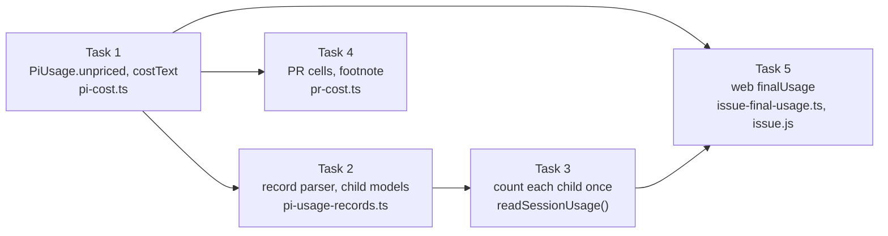

# Subagent Usage Attribution and Unpriced Usage Implementation Plan

> **For agentic workers:** Execute this plan inline with the sibling
> `executing-plans` skill. Steps use checkbox (`- [ ]`) syntax for tracking.

**Goal:** Count each subagent child's usage once under its real model, and show
Unpriced usage and partial dollar sums honestly in the PR table, the `Cost:`
line, and the web issue page.

**Architecture:** A new internal module `src/kernel/pi-usage-records.ts` turns
one session record into usage records. `readSessionUsage()` in
`src/kernel/pi-cost.ts` reads all files first, then skips child files and child
aggregates that the parent tool result already covers. `PiUsage` gets an
`unpriced` flag, and one `costText()` function decides the cost cell text.

**Tech Stack:** TypeScript, Node.js test runner (`node --test`), plain browser
JavaScript in `web/issue.js`.

**Spec:**
[`docs/specs/2026-11-24-issue-376-pr-run-cost-report-attribute-subagent-usage-to-m-design.md`](../specs/2026-11-24-issue-376-pr-run-cost-report-attribute-subagent-usage-to-m-design.md)

## Inputs

- The spec above, including its `## Visual explanation`.
- `GLOSSARY.md`: the new term **Unpriced usage** (already added with the spec).
- Issue #376 and its triage notes. The spec corrects the triage note about
  `run-once-cost.test.ts`: those rows stay unchanged.
- No mockups. No HTML companions.

## Global Constraints

- Unpriced: recorded cost exactly `0` and `inputTokens + outputTokens > 0`.
  Zero-token, zero-cost usage stays priced at `$0` with no `unpriced` key.
- Cost text: `"Unpriced"` when `unpriced && costUsd === 0`;
  `"$<amount> (partial)"` when `unpriced`; `"$<amount>"` otherwise; `undefined`
  when `costUsd` is undefined. PR uses 4 fraction digits, `costLine()` uses 2.
- "Unknown model" only for usage with no recorded model.
- Thinking levels stripped from child models: `off`, `minimal`, `low`, `medium`,
  `high`, `xhigh`, `max`. Strip the provider prefix up to the first `/` from
  child models only.
- Never change parent record model names.
- Callers keep importing from `src/kernel/pi-cost.ts`.

## Review Focus

- A subagent tool result whose children have no usage, but whose aggregate has
  usage: the aggregate must still count, as "Unknown model" (Task 2 test).
- A run directory moved after the run: recorded absolute paths do not equal the
  walked paths, but the suffix match must still skip the copies (Task 3 test
  uses a different absolute root).
- A row that mixes priced and Unpriced usage of one normalized model, for
  example `anthropic/claude-opus-5-5` and `claude-bridge/claude-opus-5-5`: shows
  `$x (partial)` (Task 1 `totalUsage` test).
- A total with one row Unavailable and one row Unpriced: shows `Unavailable`
  (Task 1 `costText` test).
- A transcript record with `usage` at the top level and in `message`, with no
  tool result that names it: counts once (Task 2 test).

---

### Task 1: Unpriced usage in `PiUsage`, `totalUsage()`, `costText()`, and `costLine()`

**Files:**

- Modify: `src/kernel/pi-cost.ts`
- Test: `src/kernel/pi-cost.test.ts`

**Interfaces:**

- Produces: `PiUsage.unpriced?: true`;
  `costText(usage: PiUsage, fractionDigits: number): string | undefined`;
  `costLine()` with the new suffixes. `usageRecord()` sets `unpriced: true` for
  Unpriced usage (it moves in Task 2, keep the rule).

- [ ] **Step 1: Write the failing tests** in `pi-cost.test.ts`:
  - `"zero-priced usage with tokens is unpriced, zero-token usage is not"`: a
    file with `{"usage":{"input":100,"output":20,"cost":{"total":0}}}` gives
    `sumSessionUsage()` =
    `{ inputTokens: 100, outputTokens: 20, costUsd: 0, unpriced: true }`. The
    existing zero-token test still expects no `unpriced` key.
  - `"totals keep a priced sum and flag unpriced parts"`:
    `totalUsage([{inputTokens:1,outputTokens:1,costUsd:0.5522},{inputTokens:2,outputTokens:2,costUsd:0,unpriced:true}])`
    deep-equals
    `{ inputTokens: 3, outputTokens: 3, costUsd: 0.5522, unpriced: true }`. With
    one entry lacking `costUsd`, the result has no `costUsd` and has
    `unpriced: true`.
  - `"cost text distinguishes unavailable, unpriced, partial, and priced"`:
    `costText({…, unpriced: true}, 4)` with no `costUsd` → `undefined`;
    `costUsd: 0, unpriced: true` → `"Unpriced"`;
    `costUsd: 0.5522, unpriced: true` → `"$0.5522 (partial)"`; `costUsd: 0.1` →
    `"$0.1000"`.
  - Extend
    `"formats grouped tokens and optional dollar cost deterministically"`:
    `costLine({ inputTokens: 1000, outputTokens: 20, costUsd: 0, unpriced: true })`
    → `"Cost: 1,000 in / 20 out tokens, Unpriced"`; with `costUsd: 0.5522` →
    `"Cost: 1,000 in / 20 out tokens, $0.55 (partial)"`.

- [ ] **Step 2: Run** `node --test src/kernel/pi-cost.test.ts`. Expected: the
      new tests FAIL (`costText` is not exported, no `unpriced`).

- [ ] **Step 3: Implement** in `pi-cost.ts`: the `unpriced` field and rule in
      `usageRecord()`, the flag in `totalUsage()`, `costText()` per the Global
      Constraints, and `costLine()` as tokens plus `, ${costText(usage, 2)}`
      when defined.

- [ ] **Step 4: Run**
      `node --test src/kernel/pi-cost.test.ts src/kernel/issue-cost.test.ts src/console/planning-usage.test.ts src/kernel/run-snapshot.test.ts`.
      Expected: PASS.

- [ ] **Step 5: Commit**
      `feat(kernel): flag unpriced Pi usage in cost totals (#376)`.

### Task 2: Record parser with Child usage records and model names

**Files:**

- Create: `src/kernel/pi-usage-records.ts`
- Modify: `src/kernel/pi-cost.ts` (remove `usageRecord()`, call the new parser)
- Test: `src/kernel/pi-cost.test.ts`, `src/kernel/issue-cost.test.ts`

**Interfaces:**

- Consumes: Task 1 `PiUsage`, `PiUsageRecord`.
- Produces, internal to the kernel cost code:

  ```ts
  export type ChildFiles = { sessionFile?: string; transcriptPath?: string };
  export type ParsedRecord = {
    /** Own container usage, or the aggregate fallback of a tool result. */
    own: PiUsageRecord[];
    /** One entry per Child usage record with valid usage, in index order. */
    children: { record: PiUsageRecord; files: ChildFiles }[];
    /** Files of every child entry, also of entries without valid usage. */
    childFiles: ChildFiles[];
  };
  export function parseUsageRecord(record: unknown): ParsedRecord;
  ```

  `ChildFiles.transcriptPath` is the child's `transcriptPath`, else its
  `artifactPaths.transcriptPath`. A subagent tool result has `toolName`
  `"subagent"` or `"bg_wait"`; its children are `details.results[]`, then each
  `details.completions[].results[]`, with one index across both. With at least
  one valid child, `own` is empty. With none, `own` holds the aggregate as
  "Unknown model". A private `childModel()` returns "Unknown model" for a
  missing or blank value.

- [ ] **Step 1: Write the failing tests.**
  - `issue-cost.test.ts`,
    `"subagent children are grouped under their own models"`: one planning
    session file with a parent assistant record (`id: "p"`,
    `model: "claude-opus-5-5"`, `input: 10, output: 1, cost.total: 0`) and a
    tool result record:

    ```json
    {
      "type": "message",
      "id": "t",
      "message": {
        "role": "toolResult",
        "toolName": "subagent",
        "usage": { "input": 300, "output": 30, "cost": { "total": 0.5522 } },
        "details": {
          "results": [
            {
              "model": "claude-bridge/claude-opus-5-5:high",
              "usage": {
                "input": 100,
                "output": 10,
                "cacheRead": 0,
                "cacheWrite": 0,
                "cost": 0
              }
            },
            {
              "model": "openai-codex/gpt-6.1-sol:xhigh",
              "usage": {
                "input": 200,
                "output": 20,
                "cacheRead": 0,
                "cacheWrite": 0,
                "cost": 0.5522
              }
            }
          ]
        }
      }
    }
    ```

    Expected rows: `claude-opus-5-5`
    `{ inputTokens: 110, outputTokens: 11, costUsd: 0, unpriced: true }` and
    `gpt-6.1-sol` `{ inputTokens: 200, outputTokens: 20, costUsd: 0.5522 }`.
    Total
    `{ inputTokens: 310, outputTokens: 31, costUsd: 0.5522, unpriced: true }`.
    No "Unknown model" row.

  - `pi-cost.test.ts`,
    `"child models drop the provider and thinking level only"`: for each input,
    write one `subagent` tool result with one child of that `model` (usage
    `input: 1, output: 1, cost: 0`) and assert the `model` of the only
    `readSessionUsage()` record: `claude-bridge/claude-opus-5-5:high` →
    `claude-opus-5-5`; `openrouter/anthropic/claude-x:max` →
    `anthropic/claude-x`; `ollama/llama3:8b` → `llama3:8b`; `openrouter/x:free`
    → `x:free`; `gpt-5` → `gpt-5`; `""`, `undefined` → `Unknown model`.
  - `pi-cost.test.ts`,
    `"subagent aggregates count only when no child usage exists"`: a tool result
    with `details.results: [{ "model": "m" }]` and aggregate
    `input: 5, output: 1` gives one "Unknown model" record of 5/1. A child with
    usage (`input: 3, output: 1`) and no `model`, with aggregate
    `input: 9, output: 9`, gives one "Unknown model" record of 3/1. The first
    case is a regression guard that already passes on base; the second fails on
    base (9/9).
  - `pi-cost.test.ts`, `"async children in a bg_wait result use their models"`:
    a record with `toolName: "bg_wait"`, aggregate `input: 50, output: 5`,
    `details.results: []` and
    `details.completions: [{ results: [{ model: "openai-codex/gpt-6.1-sol:high", usage: { input: 50, output: 5, cacheRead: 0, cacheWrite: 0, cost: 0.2 } }] }]`
    gives one record, model `gpt-6.1-sol`, usage
    `{ inputTokens: 50, outputTokens: 5, costUsd: 0.2 }`.
  - `pi-cost.test.ts`,
    `"a record with usage at the top level and in message counts once"`:
    `{ "usage": {input:2,output:1,cost:0}, "message": { "role": "assistant", "model": "m", "usage": {input:2,output:1,cost:{total:0}} } }`
    gives `readSessionUsage()` length 1, model `m`.

- [ ] **Step 2: Run**
      `node --test src/kernel/pi-cost.test.ts src/kernel/issue-cost.test.ts`.
      Expected: the new tests FAIL (Unknown model rows, double count, raw child
      model names).

- [ ] **Step 3: Implement** `pi-usage-records.ts`: container selection
      (`message` when it has `usage`, else the record), the subagent tool result
      rule for `subagent` and `bg_wait`, child cost (`usage.cost` number or
      `usage.cost.total`), `childModel()`, and keys `[id, model, usage]` for own
      records and `[id, "child", index, model, usage]` for children. In
      `readSessionUsage()`, push `own` records and all `children[].record` (Task
      3 adds the skip). Avoid a runtime import cycle: `pi-usage-records.ts`
      imports only types from `pi-cost.ts` (`import type`), and the `object()`
      and `amount()` helpers move to `pi-usage-records.ts`, which `pi-cost.ts`
      imports.

- [ ] **Step 4: Run**
      `node --test src/kernel/pi-cost.test.ts src/kernel/issue-cost.test.ts src/kernel/run-once-cost.test.ts src/console/planning-usage.test.ts`.
      Expected: PASS. `run-once-cost.test.ts` stays unchanged.

- [ ] **Step 5: Commit**
      `fix(kernel): attribute subagent usage to child models (#376)`.

### Task 3: Count each child once when its files are below the session directory

**Files:**

- Modify: `src/kernel/pi-cost.ts` (`readSessionUsage()`),
  `src/kernel/issue-cost.ts` (pass `seen`, remove its own key check)
- Test: `src/kernel/pi-cost.test.ts`, `src/kernel/issue-cost.test.ts`

**Interfaces:**

- Consumes: Task 2 `parseUsageRecord()` and `ChildFiles`.
- Produces:
  `readSessionUsage(sessionDir: string, seen?: Set<string>): Promise<PiUsageRecord[] | undefined>`.
  It adds the key of each counted record and each skipped child record to
  `seen`, and drops records whose key is already there. Without `seen` it uses a
  new set. It returns `[]` when it found usage records but dropped or skipped
  all of them, and `undefined` only on a read or parse failure or when no usage
  record exists.

- [ ] **Step 1: Write the failing test**
      `"child session and transcript below the session directory count once"`:
      in the temp dir write
  - `parent.jsonl`: the Task 2 tool result shape with one child
    (`model: "claude-bridge/child:high"`, usage
    `input: 100, output: 10, cost: 0`),
    `sessionFile: "/elsewhere/sessions/1/parent/run-a/run-0/session.jsonl"`,
    `transcriptPath: "/elsewhere/sessions/1/subagent-artifacts/run-a_reviewer_0_transcript.jsonl"`;
  - `parent/run-a/run-0/session.jsonl`: one assistant record (`id: "c1"`,
    `model: "child"`, `input: 100, output: 10, cost.total: 0`);
  - `subagent-artifacts/run-a_reviewer_0_transcript.jsonl`: one record with the
    same usage at the top level and in `message`.

  Expected `sumSessionUsage(dir)`:
  `{ inputTokens: 100, outputTokens: 10, costUsd: 0, unpriced: true }` and
  `readSessionUsage(dir)` has one record with model `child`. A second case
  removes `parent/run-a/run-0/session.jsonl`: the result is still 100/10, now
  from the child usage record. A third case uses a `bg_wait` record whose child
  has `artifactPaths: { transcriptPath: … }` and no `transcriptPath`: the
  transcript still does not count. A fourth case adds a `bg_wait` child with
  `artifactPaths.transcriptPath` and no `usage`, whose transcript file is below
  the session directory: that transcript does not count.

- [ ] **Step 1b: Write the failing test**
      `"a tool result copied into a forked session does not count again"` in
      `issue-cost.test.ts`: a run with two planning sessions. `sessions/1` holds
      the Step 1 parent, child session, and transcript files. `sessions/2` holds
      only a copy of the parent tool result line (same `id`). Expected:
      `readIssueCostReport()` resolves (no rejection) with total 100/10.

- [ ] **Step 2: Run**
      `node --test src/kernel/pi-cost.test.ts src/kernel/issue-cost.test.ts`.
      Expected: FAIL (300/30 counted).

- [ ] **Step 3: Implement** a two-pass walk: collect each file's absolute path,
      its path relative to `sessionDir` (with `/` separators), and its parsed
      records. Build the set of recorded `sessionFile` and `transcriptPath`
      values from every record's `childFiles`. A file matches a recorded path
      when they are equal or the recorded path ends with `/` + relative path.
      Skip files that match a `transcriptPath`. Skip a child record whose
      `sessionFile` matches a walked file, but add its key to `seen`. Then apply
      key deduplication against `seen` in file order. In
      `readIssueCostReport()`, pass the shared `seen` set and remove the
      caller's own `seen` check. Return `[]`, not `undefined`, when usage
      records existed but none remain.

- [ ] **Step 4: Run**
      `node --test src/kernel/pi-cost.test.ts src/kernel/issue-cost.test.ts src/web/file-issue-detail.test.ts src/console/planning-usage.test.ts`.
      Expected: PASS, including the unchanged `issue-cost.test.ts` test
      "attempts that never started Pi do not invent costs or block historical
      totals", whose `prior` session holds only a copy of a `copied` record.

- [ ] **Step 5: Commit** `fix(kernel): count each subagent child once (#376)`.

### Task 4: PR table cells and footnote

**Files:**

- Modify: `src/kernel/pr-cost.ts` (`row()`, footnote),
  `site/src/content/docs/using-patchmill/run-once.md` ("Cost reporting": the two
  sentences that the spec's Callers section names; checked by `npm run lint`, no
  test)
- Test: `src/kernel/pr-cost.test.ts`

**Interfaces:**

- Consumes: Task 1 `costText()`.

- [ ] **Step 1: Write the failing test**
      `"unpriced rows and partial totals do not claim a complete dollar figure"`:
      a report with rows `claude-opus-5-5`
      `{1000, 20, costUsd: 0, unpriced: true}` and `gpt-6.1-sol`
      `{200, 30, costUsd: 0.5522}`, and total
      `{1200, 50, costUsd: 0.5522, unpriced: true}`. Assert the body contains
      `| Planning | claude-opus-5-5 | 1,000 | 20 | Unpriced |`,
      `| Planning | gpt-6.1-sol | 200 | 30 | $0.5522 |`,
      `| **Total** |  | **1,200** | **50** | **$0.5522 (partial)** |`, and the
      sentence `Unpriced means that Pi recorded tokens at a zero price`. A
      report whose total is `{…, costUsd: 0, unpriced: true}` renders
      `**Unpriced**`. The existing test keeps `Unavailable`.

- [ ] **Step 2: Run** `node --test src/kernel/pr-cost.test.ts`. Expected: FAIL.

- [ ] **Step 3: Implement** `row()` with `costText(usage, 4) ?? "Unavailable"`,
      and replace the footnote with the exact text in the spec's "Cost text"
      section.

- [ ] **Step 4: Run**
      `node --test src/kernel/pr-cost.test.ts src/kernel/run-once-cost.test.ts`.
      Expected: PASS.

- [ ] **Step 5: Commit**
      `fix(kernel): show unpriced usage in the PR cost table (#376)`.

### Task 5: Web issue page final usage

**Files:**

- Modify: `src/web/api-types.ts` (`finalUsage`), `src/web/issue-final-usage.ts`,
  `web/issue.js`, `src/web/samples/threads.ts`, `scripts/issue-run-replay.mjs`
- Test: `src/web/file-issue-detail.test.ts`

**Interfaces:**

- Consumes: Task 1 `PiUsage.unpriced`.
- Produces:
  `finalUsage: { tokens: number | null; cost: { amount: string; currency: string; partial: boolean } | null; unpriced: boolean } | null`.

- [ ] **Step 1: Write the failing test**
      `"unpriced usage is not shown as a zero dollar cost"` in
      `file-issue-detail.test.ts`, modelled on the nested agent usage test.
      Three fixtures, one per state of the spec's web list:
  - a `piEntry()` assistant record (`cost.total: 0.1`) and a second assistant
    record with `cost.total: 0` and non-zero tokens: `cost` =
    `{ amount: "0.1000", currency: "USD", partial: true }`, `unpriced: true`;
  - every assistant record with `cost.total: 0`: `cost: null`, `unpriced: true`;
  - one record with no `cost` and one with `cost.total: 0`: `cost: null`,
    `unpriced: false` (Unavailable wins).

  Update the existing `finalUsage` assertions only where the new keys appear.

- [ ] **Step 2: Run** `node --test src/web/file-issue-detail.test.ts`. Expected:
      FAIL.

- [ ] **Step 3: Implement** `issueFinalUsage()` per the spec's web states:
      `cost` is `null` when `costUsd` is undefined, or when
      `unpriced && costUsd === 0`; otherwise it has
      `partial: report.total.unpriced === true`. `unpriced` is
      `report.total.unpriced === true && report.total.costUsd !== undefined`. In
      `web/issue.js`, show `Unpriced` when `cost` is null and `unpriced` is
      true, and append the text "(partial)", after a space, to the formatted
      amount when `cost.partial` is true. Keep `not recorded` for the other
      `null` case. Add `partial: false` and `unpriced: false` to the two
      non-null `finalUsage` samples in `src/web/samples/threads.ts`. In
      `scripts/issue-run-replay.mjs`, report `cost: null` when
      `report.total.unpriced && report.total.costUsd === 0`.

- [ ] **Step 4: Run** `npm test` and `npm run lint`. Expected: PASS. When a
      Chromium binary is available (`CHROMIUM`, default `chromium`), also run
      `npm run test:web` and `node scripts/check-issue-thread-layout.mjs`.
      Expected: PASS. Do not set `LAYOUT_SCREENSHOTS` or
      `CAPTURE_ISSUE_THREADS`; these checks then leave `docs/screenshots/`
      untouched. If `git status` shows changes there, restore them with
      `git restore docs/screenshots` and do not commit them. Without Chromium,
      inspect the `web/issue.js` diff by hand for the three states and record
      that in the PR. Do not run the `PATCHMILL_REPLAY_ISSUE=305` replay: it
      fails on base because two #305 attempts have `result.json` but no
      `sessions/`, and fixing that is out of scope.

- [ ] **Step 4b: Check real retained logs (read-only).** Run a one-off
      `node --input-type=module` script, not committed, that prints the rows of
      `readIssueCostReport()` for:
  - `/home/roche/projects/patchmill/.patchmill/runs/issue-305`, no selection.
    Expected: Planning `claude-opus-5-5` 157,388 output, Unpriced;
    Implementation `claude-opus-5-5` 114,773 output, Unpriced; Implementation
    `gpt-6.1-sol` 14,964 output, `$0.5522`; total `$0.5522 (partial)`; no
    `Unknown model` row.
  - `/home/roche/projects/patchmill/.patchmill/runs/issue-407` with
    `{ runIds: ["20261122-162222-707b", "20261122-191836-4f05"] }`. Without a
    selection it rejects with `Run metadata unavailable`, because attempt
    `20261122-183233-a2aa` has `sessions/` but no `result.json`; keep that
    safeguard. Expected: Planning `claude-opus-5-5` 132,994 output (65,965
    parent + 26,800 + 40,229), Unpriced; Implementation `claude-opus-5-5` 11,585
    output, Unpriced; total Unpriced; no `Unknown model` row.

  Put the rows in the PR description.

- [ ] **Step 5: Commit**
      `fix(web): show unpriced usage on the issue page (#376)`.

## Verification

Each task's tests prove behavior through the module interfaces:
`readSessionUsage()`, `sumSessionUsage()`, `readIssueCostReport()`,
`upsertRunCostSection()`, `costLine()`, and the web issue detail reader. No test
asserts document text other than the user-visible table, footnote, and cost
copy. The final step runs the full suite and lint. No npm dependency changes, so
no Nix build.

## Visual explanation

Task order and ownership:



Task 5 runs after Task 3 because its full-suite step checks the web reader with
the final walk rules.

## Planning review

All passes were combined reviews of the spec
(`docs/specs/2026-11-24-issue-376-pr-run-cost-report-attribute-subagent-usage-to-m-design.md`)
and the plan
(`docs/plans/2026-11-24-issue-376-pr-run-cost-report-attribute-subagent-usage-to-m-plan.md`),
with `GLOSSARY.md` as a companion. Reviewer: canonical `reviewer` agent, model
`claude-bridge/claude-opus-5-5`, thinking `high`. Base revision: `e05fb6b`
(`main`). Each pass inspected source, tests, pi-subagents 0.80.0, and the usage,
model, path, id, and toolName fields of retained run logs. In each pass, the
plan was compared with the spec hash listed for that pass.

### Review 1, pass 1

- **Reviewed body SHA-256:** spec
  `0e71f68a3364040cc104a5c5f9151bbe338e048f38b06f1fa99449be977c0795`, plan
  `363a1f3e83c4c9aaed1f4a42c7368698dfe3c9150768bec9649f71e26fc52c59`.
- **Survey:** the cost flow, three display places, and the claims about retained
  logs were confirmed. The four-way count for issue-407 was reproduced.
- **Findings:**
  - B1 (blocker): `bg_wait` async children were not handled. Accepted: the spec
    and plan treat `details.completions[].results[]` and
    `artifactPaths.transcriptPath`, with tests in Tasks 2 and 3.
  - B2 (blocker): Task 5 web `unpriced` contradicted "Unavailable wins".
    Accepted: the spec has four web states, and the plan has a third fixture.
  - S1: the non-null web samples need the new keys. Accepted (Task 5).
  - S2: the replay helper would look for `0.0000`. Accepted (spec Cost text,
    Task 5).
  - S3: no executed check for `web/issue.js`. Accepted (Task 5 Step 4).
  - S4: a tool result copied into a forked session would count again. Accepted:
    a caller-owned `seen` set with reserved keys.
  - S5: a test imported the internal module. Accepted: tests go through
    `readSessionUsage()`.
- **Confirmation:** reviewed spec
  `02ec330c1ced271dc8d44f296834116a7a6a78c896f87feca66cea87ae2d4143`, plan
  `704a5dd9681079e80f542e4772a2440ea00b00feeed9d68e61b17d88bee77590`. It found
  C1 (blocker): a session of only duplicate records would throw. C2–C4
  (suggestions): a wrong sentence about async child file locations, a wrong
  expected failure count, and a repeated-`bg_wait` limit. All accepted:
  `readSessionUsage()` returns `[]`, the sentence and the count are corrected,
  and the limit is recorded.
- **Outcome:** `blocked`, because C1 came from the confirmation. The maintainer
  asked for a new Planning review.

### Review 2, pass 1: maintainer-requested review

- **Reviewed body SHA-256:** spec
  `7452ca3b22f9390089fa80c699d5908fae522009de905dc57c67fe34af22eee8`, plan
  `3e5606198b3b6a5bc9b3a3b26254dbcf3f2ea611ecff135ba2c5ca7ab88b0b9f`.
- **Findings:** no blockers. S1 (collect child files from every entry), S2
  (cross-session `bg_wait` limit), S3 (missing child cost written as `0`), S4
  (check on real logs), S5 (import cycle, Chromium condition). All accepted.
- **Confirmation:** reviewed spec
  `9a34d2730d0e2b1e2c63f19dbbdd9e862cb09213fdbd48e14964a8524198f89f`, plan
  `78ecae2ba006814909c8208d2d65211e6519fec0a486523810c4bf8e532a6cce`. It found
  B1 (blocker): the Step 4b check on issue-407 rejects on
  `Run metadata unavailable`. S-a to S-c (suggestions): the #305 replay cannot
  pass, the #305 rows were not exact, and S1 had no test. All accepted: Step 4b
  selects two run IDs and has exact rows, the replay is dropped, and Task 3 has
  a fourth case.
- **Outcome:** `blocked`, because B1 came from the confirmation. The maintainer
  asked for a new Planning review.

### Review 3, pass 1: maintainer-requested review

- **Reviewed body SHA-256:** spec
  `9a34d2730d0e2b1e2c63f19dbbdd9e862cb09213fdbd48e14964a8524198f89f`, plan
  `33d55c3e0e15d4eb152856a22941a674247591a70f183812c8738dea65499855`.
- **Survey:** a simulation of the planned rules on all 115 retained session
  directories gives the Step 4b rows exactly. It leaves no "Unknown model" rows
  and finds no false path matches.
- **Findings:** no blockers.
  - S1: the user guide "Cost reporting" section is not updated. Accepted (spec
    Callers, Task 4).
  - S2: browser checks and screenshots. Accepted (Task 5 Step 4).
  - S3: two Task 2 cases pass on base. Accepted: case 1 is a regression guard,
    and case 2 now fails on base.
  - S4: malformed child usage next to a valid child. Accepted as a known limit.
  - S5: `artifactPaths.jsonlPath`. Accepted as a known limit.
- **Confirmation:** reviewed spec
  `be25cde138681a535e9e4e7e159c5dee39270899c1b73ef6591177fbc3cc2496`, plan
  `2b54801ac3f16984b7a02dd067adc5c3f36095ebf44a71cec7bb70dd55ec9a9f`. It
  confirmed S1, S3, S4, and S5 and found no blockers. F1 (suggestion): the S2
  sentence claimed that the checks always write screenshots. They write them
  only with `LAYOUT_SCREENSHOTS` or `CAPTURE_ISSUE_THREADS`. Accepted: the plan
  now uses the reviewer's replacement sentence verbatim.
- **Inspection limits:** the planned code was not run. Browser checks were not
  run. The issue text came from the brief.
- **Final body SHA-256:** spec
  `ca18608910239d9a4401f01ad98347b46ca74494b0e3b5a864e94c2531c79b91`, plan
  `d87e618b8e531abd99765962f2c51af939268be28925ca5448f4c066d4865241`, compared
  with spec `ca18608910239d9a4401f01ad98347b46ca74494b0e3b5a864e94c2531c79b91`.
  These are the confirmed bodies after F1. They differ from the hashes above
  only by the blank line before this record's heading.
- **Outcome:** `ready`.
