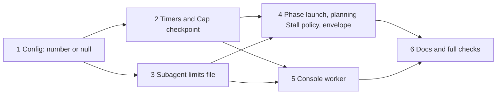

# Progress-based session and subagent limits Implementation Plan

> **For agentic workers:** REQUIRED SUB-SKILL: Use the sibling `executing-plans`
> skill to implement this plan inline, task by task. Steps use checkbox
> (`- [ ]`) syntax for tracking.

**Goal:** Make the Session cap optional and off by default, give unattended
planning the Stall policy, and manage pi-subagents deadlines from Patchmill.

**Architecture:** `pi.timeoutMinutes` becomes `number | null`. A missing
`timeoutMs` in the launch options means no deadline. A new module
`src/pi/subagent-limits.ts` owns two keys of the pi-subagents config. A capped
RPC session gets one Cap checkpoint steer before its deadline.

**Tech Stack:** TypeScript on Node, `node:test`, the fake Pi in `test-support/`.

**Spec:**
[`docs/specs/2026-11-25-issue-371-replace-wall-clock-session-and-subagent-timeouts-design.md`](../specs/2026-11-25-issue-371-replace-wall-clock-session-and-subagent-timeouts-design.md)

**Inputs:** the spec, its
[HTML companion](../specs/2026-11-25-issue-371-replace-wall-clock-session-and-subagent-timeouts-design-show-me.html),
and `GLOSSARY.md` (Session cap, Cap checkpoint, Stall, Stall stop).

## Global Constraints

- `pi.timeoutMinutes` default: `null`. Valid number: finite, `> 0`, `<= 35791`.
- Error text:
  `Invalid value for pi.timeoutMinutes: use null for no cap, or a number greater than 0 and at most 35791`.
- Largest pi-subagents deadline: `2147483647` ms.
- Checkpoint lead: `300_000` ms, for both the Cap checkpoint and
  `checkpointBeforeDeadlineMs`.
- Triage backstop without a cap: `TRIAGE_BACKSTOP_MINUTES = 90`.
- Cap checkpoint text:
  `Patchmill ends this session in 5 minutes. Start no new work. Wait for running subagents, commit and push your work, and end with the result.`
- Envelope with a cap longer than 5 minutes:
  `- Time limit: N minutes. About 5 minutes before the end, Patchmill asks you to stop new work and hand off.`
  With a cap of at most 5 minutes: `- Time limit: N minutes`. With no cap: no
  line.
- Never remove operator keys from `<agentDir>/extensions/subagent/config.json`.
- Use the glossary terms Session cap, Cap checkpoint, Stall, and Stall stop.

## Review Focus

1. A restart after a Stall stop with no cap must not compute `NaN` or a negative
   remaining time. It must start without a deadline (Task 2 test).
2. A malformed existing `config.json` (not JSON, or an array) must fail with the
   file path. Patchmill must not overwrite it (Task 3 test).
3. A fractional cap such as `0.2` gives an integer `timeoutMs` of at least 1
   (Task 3 test).
4. An unattended planning session that hits the Stall limit must block the Run
   attempt, and the next planning attempt must get the Previous stalls fact
   (Task 4 test).
5. The Console worker with no cap must not start a Patchmill deadline timer, and
   it must pass `maxRuntimeMs: 2147483647` (Task 5 test).

---

### Task 1: Optional Session cap in config

**Files:**

- Modify: `src/config/config.ts`
- Modify: `patchmill.config.json` (`"timeoutMinutes": null`)
- Test: `src/config/config.test.ts`

**Interfaces:**

- Produces: `PatchmillConfig["pi"]["timeoutMinutes"]: number | null`;
  `DEFAULT_CONFIG.pi.timeoutMinutes === null`; schema kind `"number|null"`.

- [ ] **Step 1: Write failing tests** in `config.test.ts`:
      `pi.timeoutMinutes defaults to null`; `accepts null and 0.5 and 35791`;
      `rejects 0, -1, 35792, Infinity and "90"` — each rejection asserts
      `ConfigError` with the exact Global Constraints message (a string value
      may fail the type check first; assert the path `pi.timeoutMinutes` is in
      the message).
- [ ] **Step 2: Run** `node --test src/config/config.test.ts`. Expected: FAIL.
- [ ] **Step 3: Implement.** Add the `number|null` kind to `matches()`, change
      the schema entry and the type, set the default to `null`, and check the
      range in `checkPi()`. Fix the type errors that follow in callers only
      enough to compile, with a temporary `config.pi.timeoutMinutes ?? 90` at
      each `* 60_000` so intermediate commits never compute a 0 ms deadline.
      Tasks 2, 4 and 5 own the final behavior and remove the temporary fallback.
      Update `patchmill.config.json`.
- [ ] **Step 4: Run** `node --test src/config/config.test.ts` and
      `npm run check:types`. Expected: PASS.
- [ ] **Step 5: Commit**
      `feat(config): make pi.timeoutMinutes an optional Session cap (#371)`.

### Task 2: No deadline without a cap, and the Cap checkpoint

**Files:**

- Modify: `src/kernel/pi-supervisor.ts`, `src/kernel/pi-rpc.ts`,
  `src/kernel/stall-supervisor.ts`, `src/kernel/stall-watch.ts`,
  `src/kernel/stall-text.ts`, `src/kernel/console.ts`, `src/kernel/launch.ts`,
  `src/kernel/triage.ts`
- Test: `src/kernel/pi-supervisor.test.ts`, `src/kernel/pi-rpc.test.ts`,
  `src/kernel/stall-supervisor.test.ts`, `src/kernel/stall-watch.test.ts`,
  `src/kernel/triage.test.ts`; update the block-reason assertions in
  `src/kernel/launch.test.ts` and `src/kernel/run-once-stalls.test.ts`

**Interfaces:**

- Consumes: Task 1 config type.
- Produces: `PiSessionOptions.timeoutMs?: number`;
  `PiRpcOptions.checkpointBeforeMs?: number` (default `300_000`) and
  `PiRpcOptions.checkpointNow?: boolean`;
  `superviseStalls({ ..., phase: Phase })` and
  `createStallWatch({ ..., phase: Phase })`;
  `rpcModeLauncher({ ..., stall?: { limits: StallLimits; phase: Phase } })`;
  `PhaseLaunch.timeoutMs?: number`; exported `CAP_CHECKPOINT_MESSAGE: string`
  and `CAP_CHECKPOINT_MS = 300_000` from `src/kernel/pi-rpc.ts`;
  `TRIAGE_BACKSTOP_MINUTES = 90` and
  `triageTimeoutMs(timeoutMinutes: number | null): number` in `triage.ts`.

- [ ] **Step 1: Write failing tests.**
  - `pi-supervisor.test.ts`: `supervisePi without timeoutMs does not time out` —
    the fake Pi sleeps past a short interval and exits 0; `timedOut === false`.
  - `pi-rpc.test.ts`: `sends one Cap checkpoint steer before the deadline` —
    `timeoutMs: 600`, `checkpointBeforeMs: 300`, fake Pi records commands;
    assert exactly one `prompt` with `streamingBehavior: "steer"` and
    `message === CAP_CHECKPOINT_MESSAGE` before the stop, and `timedOut`.
    `no checkpoint when timeoutMs <= checkpointBeforeMs`;
    `no timer and no checkpoint without timeoutMs`;
    `checkpointNow sends the steer right after the prompt`;
    `a handled checkpoint response does not end the session` (fake Pi answers
    the steer with `disposition: "handled"`; the session still runs to its
    normal end).
  - `stall-supervisor.test.ts`: `a late restart gets checkpointNow` — manual
    clock, cap 1000 ms, lead 300 ms, Stall stop and restart at 800 ms; the
    restarted `start()` call has `timeoutMs === 200` and
    `checkpointNow === true`. `an early restart gets no checkpointNow` — restart
    at 200 ms; no `checkpointNow`, `timeoutMs === 800`.
  - `stall-watch.test.ts`: `a planning watch names the planning session` — the
    top-level call `session === "planning session"` and the block reason of the
    same-command rule starts `The planning session stopped`. Update the existing
    implementation assertions to `The implementation session stopped`. In the
    `stall-text` or `console` tests: `callWhere` prints `planning session` and
    still prints `implementation session` for an old record.
  - `stall-supervisor.test.ts`:
    `restart without a deadline starts with no timeoutMs` — manual clock; the
    restarted `start()` call has `timeoutMs === undefined` and no block
    `no time left`.
  - `triage.test.ts`:
    `triageTimeoutMs gives 90 minutes without a cap and the cap when set` —
    `triageTimeoutMs(null) === 5_400_000`, `triageTimeoutMs(2) === 120_000`. The
    existing `timeout` mode test keeps proving that a cap stops triage.
- [ ] **Step 2: Run** the Task 2 test files. Expected: FAIL.
- [ ] **Step 3: Implement.** Start the timeout only when `timeoutMs` is defined
      (`supervisePi`, `startPiRpc`). In `startPiRpc`, when
      `timeoutMs > checkpointBeforeMs`, schedule the steer at
      `timeoutMs - checkpointBeforeMs` with `later()`; with `checkpointNow`,
      send it right after the prompt instead. Send
      `send("prompt", { message, streamingBehavior: "steer" })`, ignore the
      response, catch a rejection, and never call `finish()` from it. In
      `superviseStalls`, keep `deadline` only when `rpc.timeoutMs` is defined;
      otherwise restart without `timeoutMs`. With a deadline, pass
      `checkpointNow: true` when `rpc.timeoutMs > lead` and `remaining <= lead`.
      Pass `phase` to `createStallWatch`: the top-level label is
      `` `${phase} session` `` and the block reasons start
      `` `The ${phase} session stopped` ``. `callWhere()` and `formatStall()`
      treat both `planning session` and `implementation session` as the
      top-level session. Make `PhaseLaunch.timeoutMs` optional and pass it
      through `rpcModeLauncher` only when defined. Triage passes
      `triageTimeoutMs(config.pi.timeoutMinutes)`, which is
      `(timeoutMinutes ?? TRIAGE_BACKSTOP_MINUTES) * 60_000`.
- [ ] **Step 4: Run** the Task 2 test files and `npm run check:types`. Expected:
      PASS.
- [ ] **Step 5: Commit**
      `feat(kernel): no session deadline without a Session cap, and a Cap checkpoint (#371)`.

### Task 3: Managed subagent limits

**Files:**

- Create: `src/pi/subagent-limits.ts`, `src/pi/subagent-limits.test.ts`
- Modify: `src/cli/commands/init/agent-dir.ts`, `src/console/start.ts`,
  `src/cli/commands/serve/session-launcher.ts`, `src/cli/commands/init/main.ts`,
  `src/cli/commands/doctor/main.ts`, `src/cli/commands/doctor/checks.ts`,
  `src/cli/commands/doctor/reviewer-role.ts`
- Test: `src/cli/commands/init/agent-dir.test.ts`, the existing reviewer-role
  and doctor tests that compare `REVIEWER_AGENT`

**Interfaces:**

- Produces:
  - `MAX_SUBAGENT_TIMEOUT_MS = 2_147_483_647`
  - `subagentLimits(timeoutMinutes: number | null): { timeoutMs: number; checkpointBeforeDeadlineMs: number }`
  - `provisionSubagentLimits(agentDir: string, timeoutMinutes: number | null): Promise<void>`
  - `provisionAgentDir(repoRoot: string, agentDir: string, timeoutMinutes: number | null, skillPaths: string[] = [])`
    (the cap is required, so a caller cannot forget it)
  - `reviewerAgent(timeoutMinutes: number | null): string` and
    `implementationAgent(timeoutMinutes: number | null): string` replace the
    `REVIEWER_AGENT` and `IMPLEMENTATION_AGENT` constants; each adds the
    frontmatter line `timeoutMs: <subagentLimits(timeoutMinutes).timeoutMs>`
  - `provisionReviewerAgent(repoRoot, agentDir, timeoutMinutes)` and
    `checkReviewerRole({ repoRoot, agentDir, timeoutMinutes })`

- [ ] **Step 1: Write failing tests** in `subagent-limits.test.ts`:
  - `no cap gives the largest timeout`: `subagentLimits(null)` equals
    `{ timeoutMs: 2147483647, checkpointBeforeDeadlineMs: 300000 }`.
  - `a cap gives its milliseconds`: `subagentLimits(120).timeoutMs === 7200000`;
    `subagentLimits(0.2).timeoutMs === 12000`; `subagentLimits(35791)` is at
    most `2147483647`; results are integers `>= 1`.
  - `creates the file and folder`: temp agent dir; the file at
    `extensions/subagent/config.json` parses to the two keys.
  - `keeps other keys and replaces the managed ones`: seed
    `{ "toolTimeoutMs": 600000, "timeoutMs": 5 }`; after the call
    `toolTimeoutMs` stays and `timeoutMs` is the managed value.
  - `fails on a malformed file`: seed `not json` and, separately, `[]`; the call
    rejects with a message that contains the file path, and the file content is
    unchanged.
  - In `agent-dir.test.ts`: `provisionAgentDir writes the subagent limits`;
    `managed agents carry the subagent deadline` — `reviewer.md` and
    `patchmill-implementation.md` contain `timeoutMs: 2147483647` with no cap
    and `timeoutMs: 7200000` with a 120-minute cap; a cap change rewrites them.
  - Reviewer-role test: `a reviewer written for another cap is stale`.
- [ ] **Step 2: Run**
      `node --test src/pi/subagent-limits.test.ts src/cli/commands/init/agent-dir.test.ts`.
      Expected: FAIL.
- [ ] **Step 3: Implement** the module (read, merge, `mkdir -p`, write a
      temporary file in the same folder and rename it, only when the content
      changes). Use the same temporary-file-and-rename write in
      `writeWhenDifferent()` of `agent-dir.ts`, so a concurrent Pi never reads a
      half-written agent file. Call it from `provisionAgentDir()`. Replace the
      agent constants with the two functions. Pass `config.pi.timeoutMinutes`
      from `start.ts`, `session-launcher.ts`, `init/main.ts`, `doctor/main.ts`,
      and `doctor/checks.ts`. Update every other call site and test that uses
      the old signatures or constants
      (`rg -n "provisionAgentDir|provisionReviewerAgent|REVIEWER_AGENT|IMPLEMENTATION_AGENT" src`).
- [ ] **Step 4: Run** the same tests. Expected: PASS.
- [ ] **Step 5: Commit**
      `feat(pi): manage pi-subagents deadlines in the Patchmill agent dir (#371)`.

### Task 4: Phase launch, Stall policy for unattended planning, and envelope

**Files:**

- Modify: `src/kernel/interactive-loop.ts`, `src/kernel/run-once.ts`,
  `src/kernel/envelope.ts`, `src/kernel/run-envelope.md`
- Modify: `src/kernel/fixtures/envelope-planning.txt`,
  `src/kernel/fixtures/envelope-implementation.txt` (golden files)
- Test: `src/kernel/envelope.test.ts`, `src/kernel/run-once-stalls.test.ts`,
  Create: `src/kernel/phase-prompt.test.ts` (calls the exported
  `preparePhasePrompt()` with a fake host that answers `repository()` and
  `checkCli()`, and a temporary repo root and run directory)

**Interfaces:**

- Consumes: Task 1 type, Task 2 `PhaseLaunch.timeoutMs?` and `rpcModeLauncher`
  `stall.phase`, Task 3 `provisionSubagentLimits` and `provisionReviewerAgent`.
- Produces: `RunEnvelopeInput.timeoutMinutes: number | null`; template
  placeholder `{{timeLimit}}`.

- [ ] **Step 1: Write failing tests.**
  - `envelope.test.ts`: `no Time limit line without a cap`;
    `Time limit with checkpoint text for a 90-minute cap` (exact Global
    Constraints line); `plain Time limit for a 5-minute cap`;
    `unattended planning gets the Command timeout and Stall facts`;
    `interactive planning gets neither`. Change the existing test
    `planning has no command timeout line` to cover only interactive planning,
    and the lookup of the line after `- Time limit:` to find the Command timeout
    line by its own prefix.
  - `run-once-stalls.test.ts`:
    `unattended planning Stall limit blocks the Run attempt and the next planning attempt names the stalled command`
    — mirror the existing implementation test with a planning-stage fixture.
  - `preparePhasePrompt` test: `no timeoutMs without a cap`;
    `timeoutMs = cap * 60000 with a cap`;
    `writes the subagent limits and the reviewer before the launch` (both files
    exist in the agent dir);
    `unattended planning gets a Stall policy with phase planning` (the launcher
    options carry `stall.phase`).
- [ ] **Step 2: Run** these test files. Expected: FAIL.
- [ ] **Step 3: Implement.** `stallPolicy = !deps.human`. Read the Stall block
      for any phase (`readStallBlock` in `preparePhasePrompt`) and consume it
      for any phase in `runOneIssue` (remove the `phase === "implementation"`
      guards). Show the Command timeout and Stall facts for implementation and
      for unattended planning. Show the Previous stalls fact whenever the record
      exists, in any phase and mode. Replace
      `Time limit: {{timeoutMinutes}} minutes` so the line reads
      `- Gate: {{gate}}{{timeLimit}}{{commandTimeout}}`; `{{timeLimit}}` starts
      with its own newline and bullet, and is empty with no cap. Regenerate the
      golden files. Set `launch.timeoutMs` only with a cap and remove the Task 1
      fallback. Pass `phase` in `stall`. Call
      `provisionSubagentLimits(resolve(repoRoot, config.pi.agentDir), config.pi.timeoutMinutes)`
      and
      `provisionReviewerAgent(repoRoot, config.pi.agentDir, config.pi.timeoutMinutes)`
      in `preparePhasePrompt`.
- [ ] **Step 4: Run** these test files. Expected: PASS.
- [ ] **Step 5: Commit**
      `feat(kernel): Stall policy for unattended planning and envelope Time limit for the Session cap (#371)`.

### Task 5: Console worker deadline

**Files:**

- Modify: `src/console/worker-launcher.ts`, `src/console/subagents-client.ts`
- Test: `src/console/worker-launcher.test.ts`

**Interfaces:**

- Consumes: Task 2 `PhaseLaunch.timeoutMs?`, Task 3 `MAX_SUBAGENT_TIMEOUT_MS`.
- Produces: `spawnWorker({ timeoutMs?: number, ... })` sends
  `maxRuntimeMs: timeoutMs ?? MAX_SUBAGENT_TIMEOUT_MS`.

- [ ] **Step 1: Write failing tests:**
      `no cap: spawn gets maxRuntimeMs 2147483647 and no Patchmill deadline`
      (fake timers or a short wait with no stop call);
      `cap: spawn gets the cap and the deadline still stops the worker` (keep
      the existing timeout test passing).
- [ ] **Step 2: Run** `node --test src/console/worker-launcher.test.ts`.
      Expected: FAIL.
- [ ] **Step 3: Implement.** Start `deadline` only when `launch.timeoutMs` is
      defined.
- [ ] **Step 4: Run** the test file. Expected: PASS.
- [ ] **Step 5: Commit**
      `feat(console): no worker deadline without a Session cap (#371)`.

### Task 6: Docs and full verification

**Files:**

- Modify: `README.md`, `site/src/content/docs/using-patchmill/run-once.md`,
  `site/src/content/docs/getting-started/configuration.md`,
  `site/src/content/docs/reference/configuration-example.md`

- [ ] **Step 1: Update docs.** `pi.timeoutMinutes` is the optional Session cap
      (`null` by default, number range, triage 90-minute backstop, Cap
      checkpoint). Safety and Supervision and cleanup describe the Stall policy
      as the default net for unattended planning and implementation. Say that
      Patchmill owns `timeoutMs` and `checkpointBeforeDeadlineMs` in
      `<agentDir>/extensions/subagent/config.json` and keeps other keys. Change
      the Stall stop text from implementation to planning and implementation.
      Examples use `"timeoutMinutes": null`. Add: an upgrade note (an existing
      `90` keeps the cap and now also caps subagents; set `null` to turn it
      off); the fail-closed effect of `checkpointBeforeDeadlineMs`; and that
      agents Patchmill does not manage keep the pi-subagents default in async
      chain or parallel steps and on resume.
- [ ] **Step 2: Verify by inspection** that no doc still says 90 minutes for
      phase sessions:
      `rg -n "timeoutMinutes|90 minutes" README.md site/src/content/docs`. No
      doc-text tests (Testing Value Gate).
- [ ] **Step 3: Run** `npm test`, `npm run lint`, `npm run build`. Expected: all
      pass. No npm dependency changes, so no Nix build.
- [ ] **Step 4: Commit**
      `docs: describe the optional Session cap and subagent limits (#371)`.

## Verification choice

Behavior tests cover config parsing, timers, the checkpoint, the config-file
merge, the Stall policy scope, and the envelope. Docs are checked by inspection
and `npm run lint`. No test asserts doc text or static config.

## Visual explanation

Task order and what each task owns:

## Companion artifacts

- `docs/specs/2026-11-25-issue-371-replace-wall-clock-session-and-subagent-timeouts-design-show-me.html`:
  [Limits at a glance](../specs/2026-11-25-issue-371-replace-wall-clock-session-and-subagent-timeouts-design-show-me.html)
  (spec companion, a plan input)
