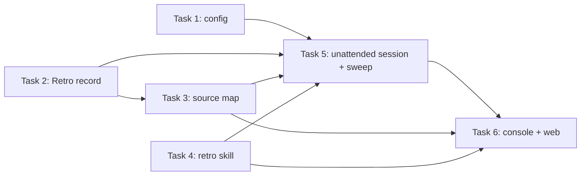

# Retro at the end of each Issue run: Implementation Plan

> **For agentic workers:** Execute this plan inline with the `executing-plans`
> skill. Steps use checkbox (`- [ ]`) syntax for tracking.

**Goal:** At each Issue run end, offer a Retro in Interactive Issue runs, and
run an opt-in Retro session in unattended runs. One Retro covers every Run
attempt that no earlier Retro covers.

**Architecture:** `retro-record.ts` claims one Retro per Issue run end and
decides which Run attempts it covers. `retro-sources.ts` builds the Retro source
map. `retro-session.ts` starts the unattended print-mode Retro session; both
`runOneIssue()` and the merged-issue sweep call it. The console adds
`patchmill_offer_retro` and `patchmill_finish_retro`; Web sessions add
`patchmill_end_session` and an `onRunEnd` hook. The managed `patchmill-retro`
skill tells the agent how to read the files and file issues with `gh` or `tea`.

**Tech Stack:** TypeScript on Node 24, `node:test`, Pi print and RPC modes, the
fake Pi and fake extension API in `test-support/`.

**Spec:**
[`docs/specs/2026-11-26-issue-412-run-an-unattended-retro-at-the-end-of-each-issue-design.md`](../specs/2026-11-26-issue-412-run-an-unattended-retro-at-the-end-of-each-issue-design.md)

**Inputs:** the spec, its Visual explanation, `GLOSSARY.md` (Retro, Issue run
end, Retro source map, Run attempt, Interactive Issue run), and the upstream
skill at `node_modules/mattpocock-skills/skills/engineering/retro/SKILL.md`
(1.3.2).

## Global Constraints

- `retro.unattended`: `"off"` | `"findings-only"` | `"file-issues"`, default
  `"off"`. `skills.retro` default `.patchmill/skills/patchmill-retro`.
- Issue run ends: `merged` (end key `merged-<pullRequest>`) and `needs-info`
  after at least one phase session (end key `needs-info-<runId>`). Nothing else:
  not PR ready, gate wait, pause, `--plan-only`, or a thrown error.
- Every `claimRetro()` runs under the issue lock. "Skip" records a `skipped`
  Retro.
- Retro folder: `<issueDir>/retros/<retroId>/` with `retro.json` (`version: 1`)
  and `findings.md`. One Retro per end key, also after a failed Retro.
- A Retro covers the Run attempt folders with a `result.json` that no earlier
  `retro.json` lists.
- A Retro never changes `RunOnceOutcome`, `result.json`, labels, or comments of
  the source issue. `runUnattendedRetro()` never throws.
- Retro usage stays out of the run cost line and the issue cost report.
- An interactive start (`prepareInteractiveRun()`) never runs a Retro.
- No change to the Runner shell, `RunOnceOutcome`, or `Host`.
- `mattpocock-skills` stays at 1.3.2. The skill pack manifest keeps
  `mattPocock: "1.3.2"`.

## Review Focus

- A Console session reused over three Run attempts: the map lists only Console
  files changed at or after `since`, and the map shows `since`.
- The sweep finds a merge whose cleanup is `kept`: the next sweep finds it
  again, and `claimRetro()` returns `undefined` for the same end key.
- A Run attempt folder without `result.json` (a crashed attempt): not covered,
  not listed, and no throw.
- A Web session where the agent never calls `patchmill_end_session`: the session
  stays open, and Pause still stops it.
- An aborted unattended run (stop signal): no Retro claim and no session.

---

### Task 1: Configuration keys

**Files:**

- Modify: `src/config/config.ts`, `README.md` (configuration and Skills
  sections, including the "Three keys" sentence),
  `site/src/content/docs/getting-started/configuration.md`,
  `site/src/content/docs/reference/configuration-example.md`,
  `site/src/content/docs/guides/skills-configuration.md`
- Test: `src/config/config.test.ts`

**Interfaces:**

- Produces: `export type RetroMode = "off" | "findings-only" | "file-issues"`,
  `PatchmillConfig.retro: { unattended: RetroMode }`,
  `PatchmillConfig.skills.retro: string`.

- [ ] **Step 1: Write the failing tests.**
      `"retro defaults to off with the managed retro skill"` asserts
      `config.retro.unattended === "off"` and
      `config.skills.retro === ".patchmill/skills/patchmill-retro"` for an empty
      config. `"retro.unattended accepts the three modes and rejects others"`
      loads `"findings-only"` and `"file-issues"`, and expects `"on"` to throw
      `ConfigError` with a message that names `retro.unattended`.
- [ ] **Step 2: Run** `node --test src/config/config.test.ts`. Expected: FAIL.
- [ ] **Step 3: Implement** the type, the defaults, the schema rows
      `retro.unattended` and `skills.retro` (`string`), and an enum check beside
      the `workflow.stateTracking` check.
- [ ] **Step 4: Run** the test. Expected: PASS.
- [ ] **Step 5: Document** both keys in the five docs places. Say that a Retro
      skill may file `retro` issues, so the README sentence that skills "must
      leave labels and issue comments to the kernel" names this exception.
- [ ] **Step 6: Commit** `feat(config): add retro settings`.

### Task 2: The Retro record

**Files:**

- Create: `src/kernel/retro-record.ts`
- Test: `src/kernel/retro-record.test.ts`

**Interfaces:**

- Produces: `RetroEnd`, `RetroScope`, `claimRetro(input)`, and
  `finishRetro(scope, status, summary)`, exactly as in the spec, and
  `export function retroEndKey(end: RetroEnd): string`.

- [ ] **Step 1: Write the failing tests** in a temporary issue folder with run
      folders that hold a `result.json` with `startedAt`:
  - `"the first claim covers every run folder with a result, oldest first"`:
    `runIds` and `since` match; `retro.json` has status `started`.
  - `"a second claim for the same end returns undefined, also after failed"`.
  - `"a later end covers only uncovered run folders"`.
  - `"no uncovered run folder gives no claim"`.
  - `"a run folder without result.json is not covered"`.
  - `"an unreadable retro.json does not block a claim"`.
  - `"finishRetro records status and summary"`, for `done`, `failed`, and
    `skipped`; a `skipped` end blocks a later claim for the same end.
- [ ] **Step 2: Run** `node --test src/kernel/retro-record.test.ts`. Expected:
      FAIL.
- [ ] **Step 3: Implement.** `retroId` from `newRunId(now())`. Run folders are
      the direct children of `issueDir` that hold `result.json`, except
      `console/` and `retros/`. Write `retro.json` with `fs.writeFile` and
      `flag: "wx"` in a new folder.
- [ ] **Step 4: Run** the test. Expected: PASS.
- [ ] **Step 5: Commit** `feat(kernel): record one Retro per Issue run end`.

### Task 3: The Retro source map

**Files:**

- Modify: `src/kernel/pi-cost.ts` (export a per-file walk)
- Create: `src/kernel/retro-sources.ts`
- Test: `src/kernel/retro-sources.test.ts`

**Interfaces:**

- Consumes: `RetroScope` (Task 2).
- Produces (`pi-cost.ts`):
  `export type SessionFileUsage = { path: string; relative: string; records: ParsedRecord[] }`
  and
  `export async function readSessionFiles(dir: string): Promise<{ files: SessionFileUsage[]; unreadable: string[] }>`.
  `readSessionUsage()` uses it and still returns `undefined` when any file is
  unreadable, so its results and tests do not change.
- Produces (`retro-sources.ts`): `RetroSourceRole`, `RetroSource`,
  `collectRetroSources(scope, issueDir)`, and `renderRetroSourceMap(sources)`,
  as in the spec.

- [ ] **Step 1: Write the failing tests** with small JSONL fixtures (reuse the
      record shapes in `src/kernel/pi-cost.test.ts`):
  - `"lists phase sessions, subagent artifacts and run records of covered attempts"`:
    roles, `runId`, `session: 1`, and `agent` for both
    `<id>_reviewer_0_transcript.jsonl` and
    `<id>_patchmill-implementation_transcript.jsonl`.
  - `"skips run folders that the scope does not cover"`.
  - `"lists Console files changed at or after since, and no older ones"` (set
    `mtime` with `fs.utimes`).
  - `"gives each file its own usage and the first recorded model"`: the parent
    file usage excludes the child record counted in the child file.
  - `"lists an unparsable file without usage and keeps the others"`.
  - `"never lists files below retros/"`.
  - `"renders a table grouped by Run attempt, largest input first, with since"`.
- [ ] **Step 2: Run** `node --test src/kernel/retro-sources.test.ts`. Expected:
      FAIL.
- [ ] **Step 3: Refactor** `readSessionUsage()` onto `readSessionFiles()`. Run
      `node --test src/kernel/pi-cost.test.ts src/kernel/issue-cost.test.ts src/kernel/pr-cost.test.ts`.
      Expected: PASS with no test edits.
- [ ] **Step 4: Implement** `retro-sources.ts`.
- [ ] **Step 5: Run** the Task 3 tests. Expected: PASS.
- [ ] **Step 6: Commit** `feat(kernel): build the Retro source map`.

### Task 4: The managed retro skill

**Files:**

- Create: `skills/patchmill-retro/SKILL.md`, `skills/patchmill-retro/LICENSE`
  (copy of `node_modules/mattpocock-skills/LICENSE`)
- Modify: `src/cli/commands/init/skill-installer.ts` (`PATCHMILL_SKILLS`),
  `src/console/skills.ts`, `THIRD_PARTY_NOTICES.md`
- Test: `src/cli/commands/init/skill-installer.test.ts`,
  `src/console/skills.test.ts`, `src/cli/commands/doctor/checks.test.ts` (only
  if its fixtures list every skill key)
- Refresh: `.patchmill/skills/` with `node bin/patchmill.ts skills update`

**Interfaces:**

- Produces: `.patchmill/skills/patchmill-retro/SKILL.md`, and
  `consoleSkillPaths()` that includes its directory.

- [ ] **Step 1: Write the failing tests.** The installer test expects
      `patchmill-retro/SKILL.md` and `patchmill-retro/LICENSE`. The console test
      expects `consoleSkillPaths()` to contain
      `<repo>/.patchmill/skills/patchmill-retro`.
- [ ] **Step 2: Run** both tests. Expected: FAIL.
- [ ] **Step 3: Write `SKILL.md`.** Frontmatter `name: patchmill-retro` and a
      description for "Patchmill asks for a Retro of an ended Issue run". No
      `disable-model-invocation`. Sections as the spec's "The retro skill"
      defines: Inputs, Reading session files (record shapes, `jq`/`rg` recipes
      with a `node -e` fallback, tested against a real folder under
      `.patchmill/runs/`), Categories, Findings file, Filing (mode rules,
      `gh issue list --label retro --state open --search …` or the `tea`
      equivalent, comment or create, label creation), Data and secrets, Limits,
      Interactive (show, ask, file, confirm URLs, then call
      `patchmill_finish_retro`; on the web, then call `patchmill_end_session`),
      Result block, and the upstream reference sections. Use the
      `simple-english` rules.
- [ ] **Step 4: Implement** the installer and console path changes, and add the
      `THIRD_PARTY_NOTICES.md` entry in the Matt Pocock format (version 1.3.2,
      status "adapted").
- [ ] **Step 5: Run** both tests. Expected: PASS. Refresh `.patchmill/skills/`.
      Check that `.patchmill/skills/patchmill-retro/SKILL.md` exists, that
      `patchmill-skill-pack.json` still says `"mattPocock": "1.3.2"`, and that
      `node --test src/cli/commands/doctor/*.test.ts` passes.
- [ ] **Step 6: Commit** `feat(skills): add the patchmill-retro skill`.

### Task 5: The unattended Retro session and its two callers

**Files:**

- Create: `src/kernel/retro-session.ts`, `src/kernel/retro-envelope.md`
- Modify: `src/kernel/envelope.ts` (`renderRetroEnvelope`),
  `src/kernel/merged-cleanup.ts` (`CleanupResult.merged`),
  `src/kernel/merged-cleanup-sweep.ts` (`retro` callback),
  `src/kernel/run-once.ts`
- Test: `src/kernel/retro-session.test.ts`, `src/kernel/run-once-retro.test.ts`,
  `src/kernel/merged-cleanup.test.ts`, `src/kernel/merged-cleanup-sweep.test.ts`

**Interfaces:**

- Consumes: Tasks 1–4.
- Produces: `runUnattendedRetro(config, deps, input)` as in the spec;
  `CleanupResult.merged?: { pullRequest: number }`;
  `sweepMergedIssues(input & { retro?: (issue: number, end: RetroEnd) => Promise<void> })`.

- [ ] **Step 1: Write the failing tests.**
  - `merged-cleanup.test.ts`: `"a confirmed merge reports its pull request"` for
    `cleaned` and `kept`; `skipped` has no `merged`;
    `"a host failure before confirmation returns kept without merged"`.
  - `merged-cleanup-sweep.test.ts`:
    `"the sweep calls retro inside the issue lock for a confirmed merge"` (the
    lock file is held during the callback); `"no retro callback, no call"`;
    `"a throwing retro callback is reported and the sweep continues"`.
  - `retro-session.test.ts`, with the fake Pi pattern of `triage.test.ts`:
    - `"off and an aborted signal start nothing"`.
    - `"findings-only starts one session in the repo root with the retro skill"`:
      the Pi args contain `--skill <repo>/.patchmill/skills/patchmill-retro`,
      the cwd is the repo root, and `prompt.md` holds the source map, the
      findings path, and the words that forbid host writes.
    - `"file-issues names the host CLI"` (`gh` for `github-gh`, `tea` for
      `forgejo-tea`).
    - `"a failing, timed-out or result-less session warns once and marks failed"`.
    - `"a second call for the same end starts nothing"`.
  - `run-once-retro.test.ts`, with `test-support/run-once-fixture.ts`:
    - `"an unattended needsInfo stop runs a Retro after result.json and keeps the outcome"`:
      the returned outcome and `result.json` equal those of a run with `"off"`.
    - `"a merge found by the sweep runs a Retro"`.
    - `"a PR-ready end, a gate wait, a paused run and a --plan-only run start no Retro"`.
    - `"an interactive start runs no Retro"` (`prepareInteractiveRun()` passes
      no `retro`).
    - Regression guard: `"the run cost line excludes Retro usage"`, with a Retro
      session that writes usage.
- [ ] **Step 2: Run** the test files. Expected: FAIL (the regression guard may
      pass before the change).
- [ ] **Step 3: Implement** `CleanupResult.merged`, set only after
      `mergedIdentity()` returns, and the sweep callback. Call it after
      `cleanupMergedIssue()` and before the lock is released, in its own
      `try`/`catch` that reports and continues.
- [ ] **Step 4: Implement** the envelope and `retro-session.ts`: `claimRetro()`,
      `collectRetroSources()`, `supervisePi()` with
      `timeoutMs: triageTimeoutMs(config.pi.timeoutMinutes)`,
      `sessionDir: <retro dir>/sessions`, `logPath: <retro dir>/session.log`,
      and `parseJsonBlock()` for the Result block. Wrap the body in
      `try`/`catch`, call `finishRetro()`, and warn on `output.stderr`.
- [ ] **Step 5: Wire `runOneIssue()`.** When `deps.human` is absent, pass a
      `retro` callback to its `sweepMergedIssues()` call. After
      `snapshot.ended()` and before `return`, call `runUnattendedRetro()` with
      `needs-info` (stop label `needsInfo`, `sessions.length > 0`, and not
      `options.planOnly`) or with `merged` (`cleanup?.merged`).
- [ ] **Step 6: Run** the Task 5 tests and
      `node --test src/kernel/run-once*.test.ts src/kernel/merged-cleanup*.test.ts src/kernel/interactive-start.test.ts`.
      Expected: PASS.
- [ ] **Step 7: Commit** `feat(kernel): run an opt-in unattended Retro`.

### Task 6: Interactive offer and Web sessions

**Files:**

- Modify: `src/console/run-end.ts`, `src/console/controller.ts`,
  `src/console/tools.ts`, `src/console/extension.ts`,
  `src/console/session-host.ts`, `src/console/start.ts`,
  `src/console/web-session-extension.ts`
- Test: `src/console/run-end.test.ts`, `src/console/controller.test.ts`,
  `src/console/extension.test.ts`, `src/console/web-session-extension.test.ts`

**Interfaces:**

- Consumes: `RetroEnd`, `claimRetro`, `finishRetro` (Task 2),
  `collectRetroSources`, `renderRetroSourceMap` (Task 3).
- Produces: `EndedRun.retroEnd?: RetroEnd`;
  `ConsoleController.retroInstructions(): Promise<string | undefined>` and
  `ConsoleController.finishRetro(summary: string): Promise<string>`;
  `createPatchmillExtension({ onRunEnd?(ended: EndedRun): void, retro?: { config: PatchmillConfig; repoRoot: string }, … })`,
  passed into the controller `Dependencies`; the tools `patchmill_offer_retro`,
  `patchmill_finish_retro`, and (Web only) `patchmill_end_session`.

- [ ] **Step 1: Write the failing tests.**
  - `run-end.test.ts`: `"a merged run and a needsInfo stop offer a Retro"` (the
    message ends with the `patchmill_offer_retro` line; `retroEnd` holds the
    pull request or the run ID);
    `"PR ready, paused, gate wait, failed and a stop without sessions offer none"`.
    Update the exact-message rows that gain the offer line.
  - `controller.test.ts`: `"an offered Retro triggers an agent turn"`. Update
    the existing assertions at `controller.test.ts:123` and `:190`, which expect
    `triggerTurn: false` for runs that now offer a Retro.
    `"retroInstructions claims once"`: the instructions contain the skill path,
    `file-issues`, the findings path, `since`, and the source map; a second call
    returns `undefined`. `"finishRetro marks the Retro done"`.
    `"Skip records a skipped Retro"`. `"a held issue lock refuses the claim"`.
    `"no retro option, no offer"`.
  - Tool tests with `test-support/fake-extension-api.ts`: "Run retro" returns
    the instructions; "Skip" and a cancelled dialog return a text and claim
    nothing.
  - `extension.test.ts`: `"onRunEnd receives the ended run"`.
  - `web-session-extension.test.ts`:
    `"a run without a Retro offer closes at once"` (today's behavior);
    `"a run with a Retro offer stays open until patchmill_end_session"`;
    `"patchmill_end_session ends the session as finished"`;
    `"patchmill_end_session refuses during an active run"`;
    `"a thrown run closes at once"`; and
    `"the terminal console has no patchmill_end_session"`.
- [ ] **Step 2: Run** the test files. Expected: FAIL.
- [ ] **Step 3: Implement** `retroEnd` and the offer line in `run-end.ts`
      (synchronous, from the snapshot),
      `triggerTurn: ended.explain || !!ended.retroEnd`, `onRunEnd` in `settle()`
      before the `announceRunEnd === false` return, and the controller methods.
      `retroInstructions()` takes `acquireLock(<dirname(runDir)>/lock)` around
      `claimRetro()`. Pass the `retro` option from `start.ts` through
      `createConsoleSessionHost()` and from `webSessionExtension()`.
- [ ] **Step 4: Implement** the tools in `tools.ts`, with
      `ctx.ui.select("Run a retro on this Issue run?", ["Run retro", "Skip"])`.
      Add a prompt guideline: "When an end-of-run message offers a Retro, call
      `patchmill_offer_retro` after any explanation. Follow the returned
      instructions with the patchmill-retro skill."
- [ ] **Step 5: Implement** the Web change. Use `onRunEnd` instead of
      `run.then()` for the closing line and the shutdown decision. With
      `retroEnd`, post the offer line with `triggerTurn: true` and keep Pi
      running. Register `patchmill_end_session`. It refuses while
      `startRefusal()` reports an active run; otherwise it calls the stored
      `ctx.shutdown()`. Its guideline: "In a Web session, call
      `patchmill_end_session` after the maintainer skips the Retro, or after
      `patchmill_finish_retro`."
- [ ] **Step 6: Run** the Task 6 tests, `node --test src/console/*.test.ts`, and
      `npm run test:web`. Expected: PASS.
- [ ] **Step 7: Commit** `feat(console): offer a Retro at an Issue run end`.

## Verification

- `npm test`, `npm run lint`, `npm run build`, `npm run test:web`, and
  `nix build`. No npm dependency changes are planned; run `nix build` anyway,
  because the issue requires it.
- Manual check: one real unattended Retro with
  `retro.unattended: "findings-only"` on a copied run folder of this repository,
  to confirm the recipes and the source map. Do not commit its output.

## Visual explanation



```text
src/kernel/retro-record.ts       Task 2  one Retro per end, covered attempts
src/kernel/retro-sources.ts      Task 3  file discovery, usage per file, map
skills/patchmill-retro/          Task 4  the agent's instructions
src/kernel/retro-session.ts      Task 5  unattended print-mode session
src/kernel/merged-cleanup*.ts    Task 5  merged end + sweep callback
src/kernel/run-once.ts           Task 5  needs-info / merged call after ended
src/console/run-end.ts           Task 6  retroEnd + offer line
src/console/tools.ts             Task 6  offer and finish tools
src/console/extension.ts         Task 6  onRunEnd hook
src/console/web-session-ext...   Task 6  stay open, patchmill_end_session
```
