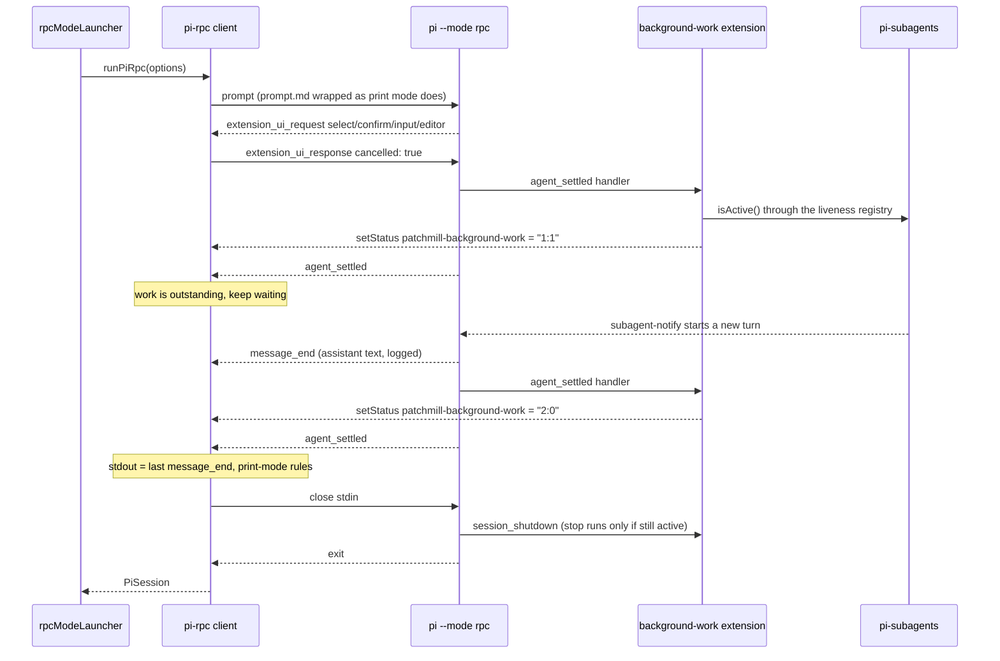

# Run Pi in RPC mode in the run-once workflow

- **Issue:** #305
- **Parent spec:**
  [Interactive Issue runs](2026-10-14-issue-225-interactive-issue-runs-design.md)
  (#225). Read it from `origin/main`. It is approved and read-only.
- **Status:** Proposed for the Interactive Issue run approval dialog.
- **Scope:** Run-once phase sessions start Pi with `--mode rpc` instead of `-p`.
  The behavior of the Run-once workflow does not change.

## What this delivers from the parent spec

The parent spec names this issue in **Constraints**: "Non-interactive phases run
Pi through `supervisePi` ... RPC mode (#305) would change only supervision and
does not affect this design." This issue delivers that supervision change and
nothing else. It is groundwork for the live-chat slices (#300). It does not
deliver any of the parent's **First slices**.

The parent spec does not decide how RPC supervision works. All decisions below
are decisions that the parent spec leaves open.

## Intent

`pi -p` takes one prompt and exits. A later client cannot steer a busy agent,
add a follow-up, or abort a run cleanly. RPC mode keeps one Pi process under a
JSONL protocol on stdin and stdout. This issue moves run-once phases to that
protocol with no change in behavior. The RPC client offers `steer`, `follow_up`,
and `abort`, so that live chat can use them later. Nothing calls `steer` or
`follow_up` in this issue.

## Evidence

- The issue names `src/cli/commands/run-once/pi.ts` and `extensions/todos.ts`.
  Neither file exists now. Phase sessions start in `printModeLauncher`
  (`src/kernel/launch.ts`), which calls `supervisePi`
  (`src/kernel/pi-supervisor.ts`). `piArgs` builds
  `-p --session-dir <dir> [--skill <path>] -e <ext>... @<prompt>`.
- `preparePhasePrompt` (`src/kernel/interactive-loop.ts`) creates the launcher.
  Run-once loads one extension with `-e`: `pi-subagents` 0.80.0
  (`src/cli/commands/run-once/main.ts`). The packages in the configured
  `pi.agentDir` also load.
- `supervisePi` starts Pi in its own process group. On timeout or abort it sends
  `SIGTERM` to the group, then `SIGKILL` after `graceMs` (5 s by default). It
  writes stdout and stderr to `session-<n>.log` and appends them to `pi.log`. In
  print mode, stdout holds only the final assistant text. `parseAgentResult`
  reads the result from that text.
- Pi's print mode (`dist/modes/print-mode.js`) handles a last assistant message
  with `stopReason` `error` or `aborted` like this: it writes the error message
  to stderr, writes nothing to stdout, and exits with code 1. With `length`, it
  writes the text, then a truncation message to stderr, and exits with code 1.
- In RPC mode, Pi exits with code 0 after stdin closes. The client must derive
  the print-mode exit code itself.
- Pi exports `RpcClient`, but it starts `node` with no process group and kills
  only the leader. Patchmill needs `PiCommandSpec`, a process group, and the
  same escalation as `supervisePi`. Thus Patchmill keeps its own small client.
- In RPC mode, `ctx.hasUI` is `true` and `ctx.mode` is `"rpc"`. This was checked
  with Pi 1.5.2. Dialogs (`select`, `confirm`, `input`, `editor`) wait for an
  `extension_ui_response`.
- `pi-subagents` 0.80.0 changes behavior when `ctx.hasUI` is `true`. In
  `extension/index.js`, its `agent_end` handler drains background subagent work
  only when `!ctx.hasUI`. With a UI, a finished background run is delivered
  later as a `subagent-notify` message that starts a new turn
  (`runs/background/notify.js`). Thus, in RPC mode, the first `agent_settled`
  can come before a background reviewer finishes.
- Other `ctx.hasUI` branches in `pi-subagents` do not change run-once results:
  - Widgets and status records are fire-and-forget.
  - Program status needs `ctx.mode === "tui"`.
  - Management confirmations get a cancelled dialog. This declines the action,
    as the `!ctx.hasUI` refusal does in print mode.
- Two `ctx.hasUI` branches are visible to the model, and approach 1 accepts
  them:
  - The tool result after an async launch tells the model that completion wakes
    the session (`async-execution.js`). This is true in RPC mode.
  - `clarify: true` on a chain opens a TUI dialog. RPC mode cannot show it, so
    it returns no answer.
- `pi-subagents` async runners start with `detached: true`. A signal to the Pi
  process group does not reach them.

## Answers to the two open questions

Both were tested with the installed Pi 1.5.2. A test extension reported
`pi.getActiveTools()`. No model call was necessary.

1. **`--fork` works with `--mode rpc`.**
   `pi --mode rpc --fork <file> --session-dir <dir>` creates a new session file
   in `<dir>`. Its header records `parentSession: <file>`, and it holds a copy
   of the source entries. The RPC `fork` command is a different feature. It
   branches the current session from an earlier user message. Live chat does not
   need it.
2. **A resumed session can use a different tool list.**
   `--session <file> --tools read,ls` gives `["read","ls"]`. A later resume of
   the same file without `--tools` gives `["read","bash","edit","write"]`. An
   extension can also change the tools during a session with
   `pi.setActiveTools()`. That change is not kept for a later resume. The
   command line wins.

Patchmill agents must not post issue comments. The implementation records these
answers in `docs/mockups/web/run-once-workflow.md`. The maintainer copies them
into an issue comment.

## Decisions

### Background subagent work

| Approach                                        | Benefit                                           | Cost                                                                      |
| ----------------------------------------------- | ------------------------------------------------- | ------------------------------------------------------------------------- |
| 1. Wait until no background work is outstanding | Same results as print mode. Agents do not change. | A small Patchmill extension in run-once RPC sessions.                     |
| 2. Make subagents blocking in run-once          | Simpler client.                                   | Agents work differently. Parallel reviews become slower.                  |
| 3. End at the first `agent_settled`             | Simplest.                                         | Breaks skills that wait for a background reviewer. This changes behavior. |

**Selected: approach 1.** The maintainer chose it in the planning chat.

### Rules

- **Finish rule.** A phase session finishes at an `agent_settled` event when the
  background-work report for that settle is `0`. If the report is `1`, the
  session continues and waits for the next `agent_settled`. The phase timeout
  still applies.
- **Outstanding work.** `pi-subagents` already computes whether a session still
  owes work: queued or running runs, owed results, pending deliveries, and a
  pending parent wake (`isActive` in `extension/index.js`). It publishes this
  check to a host registry at
  `globalThis[Symbol.for("@agegr/pi-web/session-liveness/v1")]` with the shape
  `{ version: 1, register(registration) → release }`. The background-work
  extension installs this registry when it loads, if no registry is there. If a
  registry is there, it wraps `register` and keeps a copy of each registration.
  The report is `1` when any registration for the current session returns
  `isActive() === true`. Otherwise it is `0`.
- **Report channel.** The extension's `agent_settled` handler calls
  `ctx.ui.setStatus("patchmill-background-work", "<settle>:<count>")`.
  `<settle>` is the 1-based number of that `agent_settled` event in the process.
  In RPC mode, that call becomes a fire-and-forget `extension_ui_request` on
  stdout. Pi waits for extension handlers before it writes `agent_settled`, so
  the report normally arrives first. The client keeps reports by settle number
  and matches them to its own count of `agent_settled` events, in either order.
- **Missing report.** If no report for a settle arrives within 15 s, the client
  writes a warning to the logs and treats the count as `0`. A missing extension
  thus cannot hold a phase until its timeout.
- **Shutdown.** The background-work extension loads before the other `-e`
  extensions, so its `session_shutdown` handler runs before the `pi-subagents`
  handler removes its RPC bridge. If work is still active, it stops each active
  run of the session through the `pi-subagents` `stop` RPC, within 3 s in total.
  Async subagent runners are detached from the Pi process group, so a group
  signal does not stop them. After a normal finish no work is active, so this
  matters only for abort, timeout, and a failed report.
- **Result.** After the finish rule passes, the client builds `stdout` from the
  last `message_end` message with the print-mode rules below. It does not use
  `get_last_assistant_text`, although the issue names that command. That command
  joins text blocks with no newline and trims the text, and it skips some
  aborted messages. Print mode writes each text block followed by `\n`. The
  `message_end` route keeps the result text byte for byte. This is my call. Then
  the client closes stdin and waits for Pi to exit.
- **Exit-code parity.** These rules copy `dist/modes/print-mode.js`:
  - The last message is not an assistant message: `stdout` is empty and the exit
    code of Pi is used.
  - `stopReason` `error` or `aborted`: `stdout` is empty, the error message (or
    `Request <stopReason>`) goes to the logs, and `exitCode` is `1`.
  - `stopReason` `length`: `stdout` is the text, the print-mode truncation
    message goes to the logs, and `exitCode` is `1`.
  - Otherwise, `stdout` is the text and the exit code of Pi is used.
  - A non-zero exit or a signal from Pi always wins.
- **Crash before settle.** If Pi exits before the finish rule passes, `stdout`
  is the text of the last assistant `message_end`, or empty. `exitCode` and
  `signal` come from the process. `parseAgentResult` and `verifyOutcome` handle
  the failure as they do today.
- **Prompt.** RPC mode rejects `@file` arguments. Print mode sends the prompt
  file as `<file name="<absolute path>">\n<contents without BOM>\n</file>\n`.
  The client sends exactly this text in one `prompt` command, so the first user
  message in the session file does not change. A `success: false` response is a
  Pi error: the message goes to the logs and `exitCode` is `1`. If the response
  has `disposition: "handled"`, no run starts, and the client reads the result
  at once.
- **Dialogs.** The client answers each `select`, `confirm`, `input`, and
  `editor` request with
  `{"type":"extension_ui_response","id":...,"cancelled":true}`. It ignores other
  fire-and-forget requests, except the background-work report.
- **Abort and timeout.** On `AbortSignal` or timeout, the client sets `aborted`
  or `timedOut`. It sends `abort` and waits at most `graceMs` for the response.
  Then it closes stdin and waits at most `graceMs` for Pi to exit, so that the
  shutdown handlers can run. Then it sends `SIGTERM` to the process group, and
  `SIGKILL` after `graceMs`, as `supervisePi` does. Thus an abort can take up to
  three times `graceMs` (15 s by default), not one. `SIGINT` in the CLI already
  becomes an abort of the run signal.
- **No processes left.** After a normal exit, the client checks the process
  group. If any member is alive, it uses the same `SIGTERM` and `SIGKILL`
  escalation.
- **Logs.** `session-<n>.log` and `pi.log` keep the print-mode content: Pi's
  stderr, `Extension error (<path>): <error>` lines for `extension_error`
  records, non-JSON stdout lines, and the assistant text or error message. The
  JSONL protocol stream does not go into the logs. One difference is deliberate:
  the client writes the text of each assistant `message_end` when it arrives,
  not only the last one at exit. Thus the result is in the log before Pi exits,
  and a crash or an abort still leaves the last assistant text in the log. The
  log can also hold short assistant text from earlier turns. This is my call.
- **Unchanged.** Prompts, `--skill`, `-e` extensions, `--session-dir`,
  `PI_CODING_AGENT_DIR`, session files, cost, progress events, result parsing,
  errors, and the repair flow do not change.
- **Scope of the switch.** Only run-once phase sessions use RPC mode. Triage
  (`src/kernel/triage.ts`), the doctor Pi smoke check, and the auth smoke test
  keep `supervisePi` or `-p`. They load no Patchmill extensions and have no
  live-chat use.

## Design

### Modules

- **`src/kernel/pi-rpc.ts` (new).** The deep module for one RPC phase session.
  Its interface:

  ```ts
  export type PiRpcSession = {
    steer(message: string): Promise<void>;
    followUp(message: string): Promise<void>;
    abort(): Promise<void>;
    done: Promise<PiSession>;
  };
  export function startPiRpc(options: PiSessionOptions): PiRpcSession;
  export function runPiRpc(options: PiSessionOptions): Promise<PiSession>;
  export function piRpcArgs(options: PiSessionOptions): string[];
  ```

  It takes the same `PiSessionOptions` and returns the same `PiSession` as
  `supervisePi`. Callers learn nothing new. The module hides JSONL framing,
  command IDs, the finish rule, dialog answers, exit-code parity, log writing,
  and process-group shutdown. `steer` and `followUp` reject when the session is
  done.

- **`src/kernel/pi-rpc-protocol.ts` (new).** JSONL framing, record types, and
  the shared constant `BACKGROUND_WORK_STATUS`. The extension imports the
  constant from here, so it does not load the process code.

- **`src/pi/background-work-extension.ts` (new).** The background-work
  extension, a Pi extension default export. It lives with the other
  `pi-subagents` integration code in `src/pi/`. It owns the liveness registry
  and the report. For the stops at shutdown, it uses `SubagentsClient`
  (`src/console/subagents-client.ts`), which the console already uses.
  `SubagentsClient` gets one new method, `activeRuns()`. It returns every
  `queued`, `running`, or `stopping` run of the session, for any agent.
  `activeWorkers()` then filters `activeRuns()` to the implementation worker. A
  move of `SubagentsClient` out of `src/console/` is a separate refactor.

- **`src/kernel/launch.ts`.** `printModeLauncher` becomes `rpcModeLauncher`. It
  calls `runPiRpc` and puts the background-work extension path first, before the
  configured extension paths.

- **`src/kernel/pi-supervisor.ts`.** It exports `signalGroup` so that both
  modules use one implementation. The print-mode behavior does not change.

### Seams and adapters

The external seam is the Pi command, `PiCommandSpec`. It is already injected
through `RunOnceDeps.piCommand`. Production uses the bundled Pi CLI. Tests use
`test-support/fake-pi.mjs`, which learns RPC mode when it sees `--mode rpc`.
These two adapters make the seam real. No new port is necessary.

The background-work extension has a second seam: the Pi extension API, the
liveness registry, and the `pi-subagents` event bus. Tests use
`test-support/fake-extension-api.ts`, a fake registration, and the fake
`pi-subagents` responder, as the console tests do. Production uses the real
`pi-subagents` registration.

### Locality and leverage

All RPC protocol knowledge stays in `pi-rpc.ts`. The kernel still sees only a
`PiSession`. `verify.ts`, `run-once.ts`, `result.ts`, and cost code do not
change. Live chat later uses the same `startPiRpc` handle for `steer`,
`follow_up`, and `abort`.

## Non-goals

- Interactive use, such as chat or steering from the page or a console.
- Calls to `steer` or `follow_up`.
- RPC mode for triage or the doctor smoke check.
- Changes to the `pi-subagents` configuration of the user.

## Domain and architecture

This change adds modules and a seam, so codebase design applies. It does not add
or change domain terms. **Run-once workflow**, **Run attempt**, and **Pi session
log** in `GLOSSARY.md` keep their meanings. The Pi session log content stays the
same. No ADR is necessary, because the change is easy to reverse.

## Frontend design

Frontend design does not apply. This is backend process supervision with no
visible UI change.

## Verification

- Tests run `runPiRpc` against the fake RPC Pi for each of these cases:
  - a normal result;
  - a Pi error (`stopReason: "error"`);
  - an extension dialog, which gets `cancelled: true`;
  - a crash before `agent_settled`;
  - an abort, with no process left in the group;
  - a timeout;
  - a background-work report above zero, then zero at a later settle;
  - a report before its `agent_settled` and a report after it;
  - the exact wrapped prompt text that Pi receives.
- Tests run the background-work extension against a fake extension API, a fake
  liveness registration, and a fake `pi-subagents`. They check the report for
  active and idle registrations, an existing registry, no registration, and the
  stop on shutdown.
- The test-repository check looks for `pi-subagents` runner processes, not only
  for `pi --mode rpc`.
- Existing run-once tests pass. Only tests that check Pi's command-line
  arguments change.
- A run on a test repository (`patchmill setup-test-repo`) gives the same run
  state, progress log, Pi session logs, and result as before. No Pi process is
  left after a run, a failure, or an abort.
- `npm test`, `npm run check:types`, and `npm run lint` pass.

## Visual explanation

The diagram shows one phase session from start to the result.



## Companion artifacts

- `docs/mockups/web/run-once-workflow.md`:
  [Run-once workflow notes](../mockups/web/run-once-workflow.md). The
  implementation records the answers to the two open questions there.
