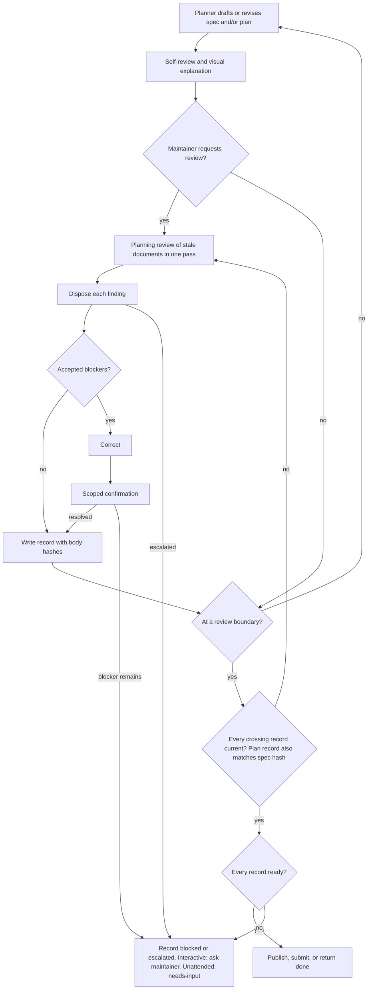

# Adversarial review of specifications and plans

Issue: [#177](https://github.com/rochecompaan/patchmill/issues/177)

## Intent

Problems that a review finds in a pull request are expensive to fix. The agent
must rewrite code and tests, and reviewers must read the change again. The same
problems are cheap to fix while they are still in a specification or a plan.
Patchmill plans contain code blocks, so a plan review is a code review before
the code exists.

Patchmill planning must run an adversarial, fresh-context review of the
specification and the plan before implementation starts. The planner must act on
each finding. The review must serve interactive and unattended runs. It must not
make an unattended run wait for a human.

## Maintainer decisions

These decisions come from the planning conversation for this issue:

1. **One flexible review.** One review procedure can examine the specification,
   the plan, or both. The maintainer can request it at any time in an
   interactive session. Examples: after brainstorming the specification, or
   after the specification and the plan both exist.
2. **Review at each review boundary.** Patchmill reviews the documents that are
   about to cross a boundary. A boundary is a human approval point or the start
   of implementation. The gates that apply to the issue select the boundaries.
   This keeps the design compatible with per-issue approval decisions from
   [#336](https://github.com/rochecompaan/patchmill/issues/336), with no
   dependency on that issue.
3. **Ungated runs use one combined pass.** When no gate applies, one review
   examines the specification and the plan together before implementation.
4. **Planning review replaces the builder check.** Patchmill planning does not
   dispatch the upstream brainstorming builder check. The Planning review brief
   includes the builder's question.
5. **No human waits in unattended runs.** The planner disposes of every finding.
   A question that only a human can answer becomes an open assumption: the most
   conservative choice that the issue supports. The run returns `needs-input`
   only when a blocker remains after confirmation, or when a finding conflicts
   with the issue, the Parent spec, or an ADR. Interactive runs ask the
   maintainer in the chat.

## Goals

- Every new or revised specification and plan gets a fresh, adversarial Planning
  review before it crosses a review boundary.
- The maintainer can request a Planning review of a chosen scope at any time in
  an interactive session.
- A review that the maintainer requested counts at the next boundary. The
  planner does not repeat it when the documents did not change.
- Each finding gets a recorded disposition: accepted with a revision, rejected
  with counter-evidence, recorded as an open assumption, or escalated.
- Plan review examines the plan's code blocks, commands, and named symbols as
  code, against the inspected base.
- Unattended runs finish the review loop without human input.

## Non-goals

- No kernel, configuration, or result-schema change. The kernel does not trigger
  or verify reviews.
- No per-issue review setting, such as "skip review" or "two passes". If one
  becomes necessary, it belongs to the per-issue decision mechanism of #336.
- No change to the vendored upstream `brainstorming` or `writing-plans` skills.
- No change to gates, approval, or merge authority. Reviewer readiness is never
  human approval.
- No retroactive review of approved, unchanged documents.

## Approaches

| Approach                                                 | Trade-off                                                                                                                                                                              | Decision |
| -------------------------------------------------------- | -------------------------------------------------------------------------------------------------------------------------------------------------------------------------------------- | -------- |
| Separate Spec review and Plan review at fixed points     | Simple rules. A spec review always runs before the plan exists. It costs one more pass in ungated runs, and it cannot follow a maintainer who wants to review both documents together. | Rejected |
| One combined review at the end of planning               | Cheapest. A Spec gate cannot use it, because the plan does not exist at that gate.                                                                                                     | Rejected |
| One review with a flexible scope at each review boundary | Follows the gates that apply to the issue. Supports on-request reviews of any scope. Needs a review record so that the planner can see which documents are current.                    | Chosen   |

## Existing architecture and evidence

- `skills/patchmill-planning/SKILL.md`, section "Fresh Plan review", requires
  one fresh canonical `reviewer` after planner self-review for every new or
  revised plan. It allows one initial review and one scoped confirmation. The
  planner records findings, dispositions, and a body hash in the plan.
- `skills/patchmill-planning/plan-review.md` is the reviewer brief. Its rubric
  is architectural: depth, seams, adapters, locality, and leverage. One line
  covers spec coverage, interface consistency, and buildability. It does not ask
  the reviewer to verify the plan's code blocks or to trace acceptance criteria.
- No specification review exists in Patchmill planning. Upstream
  `brainstorming/SKILL.md` describes a builder check through
  `builder-check-prompt.md`. The builder check only collects questions. Its
  "theirs" pile goes to a human, which blocks an unattended run. The wrapper
  does not tell the planner to run it. Some earlier plans recorded it inside the
  plan review receipt, for example the #179 plan.
- The reviewer prompt files named in the triage notes,
  `spec-document-reviewer-prompt.md` and `plan-document-reviewer-prompt.md`, do
  not exist in Superpowers 7.0.2.
- `src/cli/commands/init/agent-dir.ts` provisions the canonical `reviewer` agent
  as a read-only, fresh-context adversarial reviewer. This design reuses it.
- `src/kernel` has no reference to plan review. Kernel verification checks only
  stage and publication facts. The review is a skill obligation.
- `src/cli/commands/skills/main.ts` removes managed files that leave the pack. A
  renamed brief therefore replaces the old file in installed packs.
- `skills/patchmill-plan/SKILL.md` and
  `site/src/content/docs/guides/skills-configuration.md` describe the current
  Plan review and name `plan-review.md`.

## Domain and module ownership

This change alters a workflow contract and its terminology. Domain modeling
applies to the terms. The only new code is one small helper script that computes
a document's body hash. It has no seam or adapter. Its interface is one function
and one command, and it hides Markdown fence parsing from planners. No runtime
module changes, so the wider `codebase-design` analysis does not apply.

Resolved terms, captured in `GLOSSARY.md`:

- **Planning review**: a fresh reviewer's adversarial assessment of the planning
  documents in its scope, against the issue, the codebase, and each other. It
  supplies evidence, not human approval.
- **Review boundary**: a point where planning documents leave the planner: a
  Spec gate, a Plan gate, an interactive submission, or the start of
  implementation.
- **Plan review** becomes a Planning review whose scope includes a plan. The
  term stays valid for existing documents.

No ADR is necessary. The skill text can change again at low cost.

Ownership:

| Owner                                             | Responsibility                                                                  |
| ------------------------------------------------- | ------------------------------------------------------------------------------- |
| `skills/patchmill-planning/SKILL.md`              | Triggers, scope, boundaries, bounds, dispositions, record format, and outcomes. |
| `skills/patchmill-planning/planning-review.md`    | The reviewer brief: adversarial checks for specs, plans, and combined scopes.   |
| `skills/patchmill-plan/SKILL.md`                  | The interactive helper follows the same contract without publication authority. |
| `skills/patchmill-planning/scripts/body-hash.mjs` | Fence-aware body extraction and SHA-256 for review records.                     |
| Canonical `reviewer` agent                        | Read-only, fresh-context review. Unchanged.                                     |

## Design

### Review boundaries and scope

At a review boundary, the scope is every new or revised document that crosses
the boundary without a current review record. Approved, unchanged documents and
a Parent spec are inputs, not scope.

| Gates that apply to the issue | Boundaries and scope                                                                   |
| ----------------------------- | -------------------------------------------------------------------------------------- |
| Spec gate only                | Spec at the Spec gate. Plan at the start of implementation, against the approved spec. |
| Plan gate only                | Spec and plan together at the Plan gate.                                               |
| Spec gate and Plan gate       | Spec at the Spec gate. Plan at the Plan gate, against the approved spec.               |
| No gate                       | Spec and plan together at the start of implementation.                                 |

In Patchmill stage terms: at stage `spec`, the boundary is the spec pull request
or interactive submission. At stage `plan`, it is the plan pull request or
interactive submission. At stage `implementation`, it is the planner's `done`
result or interactive submission. The planner reviews before it publishes,
submits, or returns `done`. Today, `specApproval` and `planApproval` select the
gates. After #336, the per-issue decision selects them. The rule does not
change.

### Triggers

1. **On request.** In an interactive Issue run or the `patchmill-plan` helper,
   the maintainer can ask for a Planning review at any time. The scope is the
   documents that the maintainer names. If the maintainer names none, the scope
   is every new or revised document without a current review record. A request
   is not approval and does not change a gate.
2. **Boundary check.** Before each boundary, the planner checks the review
   record of each document that crosses it. The planner reviews every document
   without a current record, in one pass. A document with a current record can
   cross only when that record is also ready. "Review record" below defines both
   terms. Unattended runs use only this trigger.

### Reviewer brief

`plan-review.md` becomes `planning-review.md`. It keeps the current authority,
input, visualization, architecture-survey, and rubric sections. It adds
adversarial checks for each document type in scope.

The planner supplies the scope, the issue requirements and acceptance criteria,
each document in scope, the input documents, project instructions, the inspected
base revision, and installed guidance paths. It does not supply its conversation
history. The reviewer independently inspects source and tests.

Specification checks:

- Each issue requirement and acceptance criterion is addressed or explicitly out
  of scope.
- No contradiction exists within the spec, or with the issue, the Parent spec,
  the glossary, or an ADR.
- Claims about current behavior match the source: names, call flows,
  configuration, and tests.
- Risky choices are explicit: irreversible actions, security boundaries, data
  loss, compatibility, and unattended runs that wait for a human.
- **Builder question:** where a builder must guess, and where a wrong guess
  would matter.
- Each acceptance criterion has a verification method.

Plan checks:

- Each acceptance criterion and spec decision maps to a task.
- Each path, symbol, signature, command, and configuration key exists in the
  inspected base, or an earlier task creates it.
- Code blocks get a code review: correct logic, types, and imports. Each test
  must fail before the change and assert meaningful behavior.
- Commands can run, and the expected output is plausible.
- Task order respects dependencies. The Testing Value Gate holds.
- The existing architecture rubric still applies.

Combined checks, when the spec and the plan are both in scope:

- The plan does not contradict or silently extend the spec.
- Each spec decision that needs work has a task.

The reviewer returns the architecture survey, findings, inspection limits, and a
readiness conclusion. Each finding has an identifier, the document, the severity
(blocker or suggestion), the violated requirement, the evidence, the impact, and
the smallest correction. Hypothetical concerns and style preferences do not
block.

### Dispositions

The planner gives each finding exactly one disposition:

- **Accepted:** the planner revises the document and names the revision.
- **Rejected:** the planner gives concrete counter-evidence.
- **Open assumption:** only a human can answer the question. In an interactive
  run, the planner asks the maintainer and records the answer. In an unattended
  run, the planner chooses the most conservative option that the issue supports.
  It records the question, the choice, and the reason in an
  `## Open assumptions` section of the document that owns the decision. An
  approved spec is read-only, so a plan-stage assumption goes in the plan.
- **Escalated:** the finding conflicts with the issue, the Parent spec, or an
  ADR. A correction can also need a change to approved scope. Interactive runs
  ask the maintainer. Unattended runs return `needs-input`.

### Bounds and outcomes

Each Planning review allows one initial pass and one fresh, scoped confirmation
after the planner corrects accepted blockers. The confirmation examines the
corrections and their effects. It does not reopen unrelated preferences. If a
blocker remains after confirmation, the planner records the outcome `blocked`.
Interactive runs ask the maintainer and unattended runs return `needs-input`. An
escalated finding records the outcome `escalated` in the same way. A maintainer
request starts a new Planning review with its own bound.

A later session can resume from `blocked` or `escalated` in two ways. If the
planner edits the document, the record is no longer current and a new review
runs. If maintainer guidance settles the finding with no document edit, the
planner records that ruling as the finding's disposition. Then the outcome
becomes `ready`. Planner judgement alone never changes `blocked` to `ready`.

Missing reviewer capability keeps the current rule. Interactive runs ask the
maintainer. Unattended runs return `needs-input`. Self-review never replaces
Planning review.

### Review record

Each reviewed document ends with one `## Planning review` section. Each review
pass adds an entry with:

- The scope and, for a combined pass, the other document in the scope.
- The reviewer agent, model, thinking level, and base revision.
- The reviewed body SHA-256 of each document in scope.
- A short survey, the findings with their dispositions, and inspection limits.
- For a plan, the body SHA-256 of the spec that the review compared it with,
  whether the spec was in scope or only an input.
- The confirmation result, the final body SHA-256, and the outcome: `ready`,
  `blocked`, or `escalated`.

The body is the document text before its `## Planning review` heading. That
heading must be a real level-two heading outside fenced code. It must occur
once, and it must start the last section. The helper
`node <skill-dir>/scripts/body-hash.mjs <document>` prints the body SHA-256. It
fails with a clear message if the record section is duplicated or not last. It
ignores headings inside fenced code blocks. Receipt-only edits do not change the
hash.

A spec record is **current** when its final body hash matches the spec. A plan
record is current when its final body hash matches the plan and its recorded
spec hash matches the current spec. A spec edit therefore makes the plan's
record stale too, and the next boundary reviews both documents together with the
combined checks. A record is **ready** when its latest entry has the outcome
`ready` and every finding has a disposition. A document crosses a boundary only
when its record is current and ready.

### Builder check

The wrapper's required-siblings text states that Patchmill planning does not
dispatch the upstream builder check. The Planning review covers the builder
question. The upstream answered, minor, and "theirs" piles become dispositions:
the spec answers the first, the planner decides the second, and the third
becomes an open assumption or a maintainer question.

## Frontend applicability

Frontend design does not apply. This is skill and documentation work with no
browser-visible change.

## Verification and acceptance

| Acceptance criterion                                     | Verification                                                                                  |
| -------------------------------------------------------- | --------------------------------------------------------------------------------------------- |
| Planning reviews the spec and plan before implementation | Walk through each gate combination in the boundary table against the updated skill text.      |
| Findings are recorded and acted on                       | Inspect the record, disposition, and ready rules. Automated tests cover the body-hash helper. |
| Fits the workflow without blocking unattended runs       | Walk through unattended open-assumption, escalation, and missing-reviewer scenarios.          |

Run `patchmill skills update` through the source command. Confirm that the
installed pack drops `plan-review.md` and adds `planning-review.md`. Run
`npm run lint` and `npm test`. No npm dependency changes, so the Nix build does
not need to run again. Record the evidence in
`docs/verification/issue-177-planning-review.md`.

## Visual explanation

The gates that apply to the issue decide where the boundaries are. The review
loop is the same at each boundary.

## Companion artifacts

- `GLOSSARY.md`: [Planning review and Review boundary terms](../../GLOSSARY.md)

## Planning review

Combined Planning review of this spec and its plan, before the start of
implementation (no gate applies). The planning envelope still named the existing
"Fresh Plan review" contract, so this review applied that brief to both
documents and added the adversarial checks from this spec. The plan's record
holds the full findings.

- Reviewer: canonical `reviewer`, `openai-codex/gpt-6.1-sol:xhigh`, base
  `8f363d0802381662fb739ed5bcd7e24875529ceb`.
- Initial spec body SHA-256:
  `4c3ef6d387f06e815d27fff14654756d8672fb7cb86fe6c3c30c07d4b5b11f37`.
- Spec findings: B1 (hash command not fence-aware), B2 (a blocked record could
  cross a boundary), and B3 (a spec edit did not make the plan stale). All three
  were accepted. "Review record", "Bounds and outcomes", and "Triggers" now
  define the body-hash helper, the outcomes, current and ready records, and the
  plan's reviewed spec hash.
- Builder question: the review found no other place where a builder must guess.
- Limits: no helper, updater, or suites ran. Planning documents only.
- Confirmation 1 resolved B2 and B3. Its two new helper findings (C1 and C2)
  concerned only the plan. Confirmation 2, authorized by the maintainer,
  resolved them with no new blockers.
- Final spec body SHA-256:
  `bcbba04022ea69323e9c650e3a8b60c2383b971d22d4049771447b76bfbb3887`. The hash
  covers the text before this section's heading.
- Outcome: `ready`. This is not human approval.
