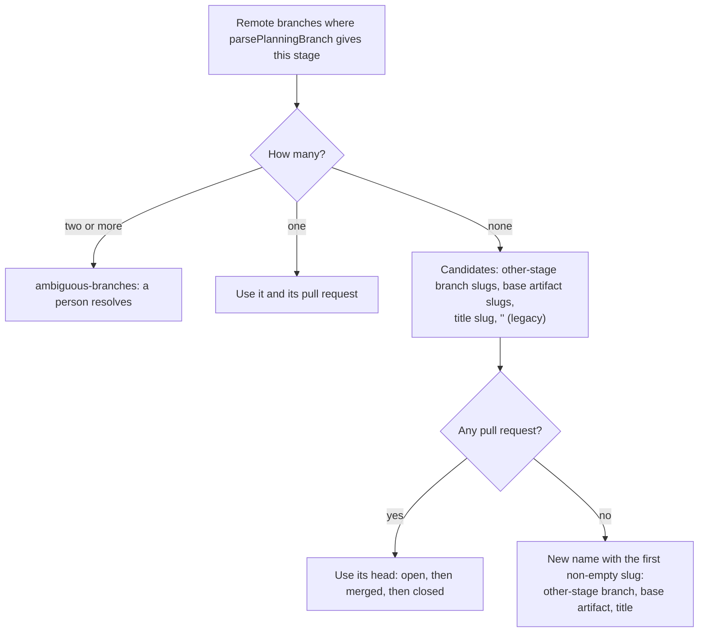

# Include the issue slug in spec and plan branch names

Issue: [#377](https://github.com/rochecompaan/patchmill/issues/377)

## Intent

Implementation branches have the issue slug, for example
`agent/issue-42-add-export-button`. Planning branches do not:
`agent/issue-42--spec` and `agent/issue-42--plan`. Their worktrees have the same
problem, for example `.worktrees/agent-issue-42--spec`. In `git branch`,
`git worktree list`, and the host's branch and pull request lists, a person sees
only a number. Manual cleanup and review are slower and easier to get wrong.

This change adds the slug to planning branch names:

- `agent/issue-42-add-export-button--spec`
- `agent/issue-42-add-export-button--plan`

## Goals

- New spec and plan branches, and their worktrees, include the issue slug.
- The slug is fixed when the first planning branch of an issue is created. A
  later title edit does not rename it, and the plan branch reuses it.
- Existing `agent/issue-N--spec` and `agent/issue-N--plan` branches, worktrees,
  and pull requests continue to work without migration.
- A title edit after a merged planning pull request, whose branch the host
  deleted, does not open its gate again.
- Every part of Patchmill that tells a planning branch from an implementation
  branch recognises both forms.

## Non-goals

- Implementation branch names do not change. `branchName(issue, title)` still
  uses the current title when no implementation branch exists.
- Patchmill does not rename existing branches or pull requests.
- No host adapter changes. The maintainer chose approach A below.

## Anti-goals

- A title edit must never make a merged gate look unmerged while the merged
  artifact is on the base branch. The single exception is under Known limits.
- A planning branch must never be treated as a competing implementation branch,
  in workspace selection or in cleanup.

## Approaches

- **A: candidate names with exact lookups (chosen).** Build a short list of
  possible planning branch names and look up each with the existing
  `findPullRequest`. The list comes from remote branches, the slugs of the
  issue's artifacts on the base branch, the current title, and the legacy name.
  The host interface stays the same.
- **B: host query by branch pattern.** Add a host method that lists an issue's
  pull requests by head pattern: a GitHub `head:` search and a full scan on
  Forgejo. It finds pull requests directly, but GitHub search results can lag
  behind and its matching rules are not documented. It also changes both
  adapters.
- **C: store the slug locally.** A local record is not shared between machines
  or clones, so a second machine can open the gate again. Rejected.

The maintainer picked A in the planning chat.

## Design

### Names

A planning branch name is:

```text
agent/issue-<N>[-<slug>]--<stage>      stage = spec | plan
```

`<slug>` is a `slugify` result: lowercase ASCII letters and digits in groups
that single hyphens join, at most 48 characters. A slug never contains `--` and
never ends with `-`. So the `--spec` or `--plan` suffix cannot be part of a
slug, and an implementation branch such as `agent/issue-42-write-the-spec` never
looks like a planning branch. An empty slug produces the legacy form
`agent/issue-42--spec`. A legacy branch is the empty-slug case of the same rule,
not a special case.

`src/kernel/names.ts` owns these rules:

- `planningBranchName(issue: number, stage: ArtifactKind, slug: string): string`
  builds a name. The caller supplies a valid slug, or `""`.
- `parsePlanningBranch(issue: number, branch: string): { stage: ArtifactKind; slug: string } | undefined`
  recognises a planning branch of that issue, in the legacy or slugged form. It
  returns `undefined` for implementation branches, other issues, and invalid
  slugs.
- `artifactSlug(kind: ArtifactKind, issue: number, fileName: string): string | undefined`
  returns the slug in an artifact file name that `isArtifactFile` accepts. It
  returns `""` for a name without a slug, and `undefined` when the name does not
  match or its slug is not a valid slug.

`isIssueBranch` does not change. It already matches both forms.

### Fixed slug

A planning branch gets its slug when Patchmill first creates it. Patchmill then
finds it again through remote branches and base artifacts, not through the
current title. For a new planning branch, Patchmill uses the first non-empty
slug in this order:

1. The slug of an existing remote planning branch of the other stage.
2. The slug of the issue's newest spec artifact on the base branch, then of its
   newest plan artifact.
3. `slugify(issue.title)`.

An empty slug, for example from a legacy branch, does not count. If all three
are empty, the new name has the legacy form. This is the only way a new branch
gets a legacy name, and it occurs only for a title without ASCII letters or
digits.

The spec stage writes its artifact at the expected path from the same title that
names the spec branch. A merged spec therefore leaves its slug on the base
branch. The plan branch reuses it, even after a title edit and after the host
deletes the merged spec branch. The rule that the merged artifact must be on the
base branch already exists: `observe` in `src/kernel/facts.ts` stops when it is
missing. A normal merged gate therefore has an artifact slug to find. The case
where the artifact is missing is a known limit, below.

### Gate lookup

`planningWorkspace` in `src/kernel/planning-workspace.ts` owns gate selection.
Its new input `baseSlugs: string[]` holds the valid slugs of the issue's newest
spec and plan artifacts on the base branch, spec first, without duplicates. For
each required stage, it does the steps below:

1. Find the remote branches for which `parsePlanningBranch` returns this stage.
2. If there are two or more, return `ambiguous-branches` with those branches. A
   person must resolve this. Patchmill never creates a second branch for a stage
   while one exists, so this occurs only after manual changes.
3. If there is exactly one, use that branch and its pull request, as today.
4. If there is none, build the candidate names from the slugs of the remote
   planning branches of the other stage, then `baseSlugs`, then
   `slugify(issue.title)`, then `""`, without duplicates. Look up each one with
   `findPullRequest`. Select an open pull request first, then a merged one, then
   a closed one. Within one state, the first candidate wins. The stage branch is
   the head of the selected pull request. If no candidate has a pull request,
   the stage branch is a new name with the fixed slug.

The merged, chat-approved, and wrong-target rules after this selection do not
change. Branches for which `parsePlanningBranch` returns `undefined` are the
implementation candidates. The `selected` path for post-session verification
does not change.

`selectWorkspace` in `src/kernel/facts.ts` computes `baseSlugs` with
`refArtifacts` on `origin/<base>` and `artifactSlug`. It filters the
implementation branches with `parsePlanningBranch` instead of name equality.

Usually the candidate list has two names: the slugged name and the legacy name.
So a stage without a remote branch needs about one more host lookup than today.
On GitHub, a lookup is one `gh pr list --head` call. On Forgejo, each lookup
scans all pull requests of the repository, as today. The extra cost is accepted,
because it occurs only when no remote branch exists for that stage. A shared
pull request list per call is not part of this change.

### Callers that classify branches

Each caller replaces the equality test with `parsePlanningBranch`:

| Module                                | New test                                                          |
| ------------------------------------- | ----------------------------------------------------------------- |
| `src/kernel/envelope.ts` (two places) | `parsePlanningBranch(issue, facts.branch)?.stage === facts.stage` |
| `src/kernel/chat-approval.ts`         | same                                                              |
| `src/kernel/interactive-loop.ts`      | same, for `earlierStage` and `planningGate.pullRequest`           |
| `src/kernel/cleanup-state.ts`         | a receipt branch must not be a planning branch                    |
| `src/kernel/merged-cleanup.ts`        | a cleanup candidate must not be a planning branch                 |
| `src/kernel/merged-cleanup-sweep.ts`  | grouping and the implementation filter accept both forms          |
| `src/kernel/cleanup-workspaces.ts`    | planning targets come from discovered branches, not fixed names   |
| `src/web/board-projection.ts`         | the pull request kind comes from `parsePlanningBranch`            |

`merged-cleanup-sweep.ts` today drops a branch whose slug is `foo--spec`,
because its slug check rejects `--`. The sweep must accept a branch when
`parsePlanningBranch` recognises it, and keep its current slug check for
implementation branches.

`cleanupWorkspaces` today builds planning targets from the two fixed names. It
must instead use the issue branch, then each local branch or registered worktree
branch for which `parsePlanningBranch` returns a stage, in sorted order. It
still derives each worktree path from `worktreeDirName(branch)` under the
configured worktree directory. Its safety checks do not change.

### Migration

No migration step is necessary. A legacy branch is a remote planning branch with
an empty slug, so step 3 of the gate lookup reuses it. A merged legacy pull
request is found through the `""` candidate. Cleanup and the board recognise
legacy names through `parsePlanningBranch`. New planning branches get a slug.
This includes a new plan branch next to a merged legacy spec branch, because an
empty slug does not count in the fixed-slug order.

### Known limits

- If a title changes before a new planning branch is first pushed, the next run
  does not see the local branch. It creates a branch with the new slug. The old
  local worktree stays for manual cleanup. Implementation branches have the same
  limit today.
- Suppose a planning pull request merged, but its artifact is not on the base
  branch, the host deleted its branch, and the title then changed. No candidate
  finds the merged pull request, so Patchmill starts that stage again on a new
  branch. Today the same case stops with `needs-info`, because the fixed name
  finds the merge. The case needs an unusual manual merge, a deleted branch, and
  a title edit together. Approach B would close it, and the maintainer chose
  approach A.

## Module design

This change does not add modules or seams. It moves branch classification into
one function, `parsePlanningBranch`, in `src/kernel/names.ts`. Callers stop
building names to compare with. This improves locality: the planning-name
grammar exists in one place. It also improves leverage: eight callers use one
interface.

`planningWorkspace` stays the deep module for gate selection. Callers give it
the observed remote branches and base slugs. It hides the candidate order, the
pull request preference, and the fixed-slug rule. Its only new caller-visible
facts are the `baseSlugs` input and an `ambiguous-branches` result for duplicate
planning branches of one stage. It uses the existing host interface through
`findPullRequest`. The real host adapters and the fake host in
`test-support/run-once-fixture.ts` cover it, so no new adapter is necessary.

## Domain and frontend decisions

- **Domain modeling applies lightly.** The change names an existing concept, the
  branch of a planning pull request. `GLOSSARY.md` gets a **Planning branch**
  entry. No ADR is needed. The choice is cheap to reverse, and this spec records
  it.
- **Frontend design does not apply.** The board only classifies pull requests.
  No layout or interaction changes.

## Documentation

Update the text that describes planning branches as `agent/issue-N--spec` or
`agent/issue-N--plan`:

- `skills/patchmill-plan/SKILL.md` and `skills/patchmill-cleanup/SKILL.md`. Then
  refresh the installed copies in `.patchmill/skills` and their manifest with
  `patchmill skills update`. The plan skill lets an agent in a human session
  create a planning workspace. It must give the full name rule and the
  fixed-slug order, so that a branch created by hand is found again.
- `site/src/content/docs/using-patchmill/run-once.md`, in the names table.

## Testing

- Unit tests in `src/kernel/names.test.ts` for `planningBranchName`,
  `parsePlanningBranch`, and `artifactSlug`. Include legacy names, slugged
  names, neighbouring issue numbers, implementation branches that end in
  `-spec`, and invalid slugs.
- Run-once tests in `src/kernel/planning-gates.test.ts`:
  - New gates create slugged spec and plan branches.
  - The plan branch keeps the spec slug after a title edit and after deletion of
    the merged spec branch. The spec gate does not open again.
  - An in-flight legacy spec branch continues at its gate, and its merged pull
    request passes the gate after the branch is deleted.
- Cleanup tests: the sweep and `cleanupWorkspaces` find slugged and legacy
  planning workspaces. A slugged planning branch is never an implementation
  candidate. The sweep finds a slugged planning-only leftover through the
  cleanup receipt.
- Cleanup safety tests: `cleanupMergedIssue` skips a slugged planning branch,
  and `cleanup-state.ts` rejects a receipt for one.
- Board test: a slugged planning pull request gets the `spec` or `plan` kind.

## Companion artifacts

- `GLOSSARY.md`: [Planning branch entry](../../GLOSSARY.md)

## Visual explanation

How Patchmill selects the branch for one required planning stage:



Name grammar, legacy and new:

```diff
-agent/issue-42--spec
+agent/issue-42-add-export-button--spec
 agent/issue-42--spec                     # still recognised: empty slug
 agent/issue-42-add-export-button         # implementation: unchanged
```

## Planning review

### Pass 1: specification and plan together

- **Scope:** this specification, combined with the implementation plan
  `docs/plans/2026-11-20-issue-377-include-the-issue-slug-in-spec-and-plan-branch-n-plan.md`.
- **Reviewer:** canonical `reviewer` agent, model `claude-opus-5-5`, thinking
  `high`, base revision `19d588e9033995a53c0f2b22da0b28da6076532b`.
- **Reviewed body SHA-256:** the planner did not record it before the initial
  pass. The confirmation reviewed the body below.
- **Survey:** the reviewer confirmed the naming rules in `src/kernel/names.ts`,
  the gate flow `selectWorkspace` → `planningWorkspace` → `findPullRequest`, the
  `observe` base-artifact check, the real host seam with GitHub, Forgejo, and
  fake adapters, and all ten equality call sites. No ADRs exist.
- **Findings and dispositions:**
  - S1 (circular claim that a merged gate always has an artifact slug):
    accepted. Known limits now describe the missing-artifact case, and the
    anti-goal names that exception.
  - S2 (Approach A and step 4 disagreed on remote branches): accepted. Step 4
    candidates now start with other-stage remote branch slugs.
  - S3 (a legacy other-stage slug would give a new legacy plan name): accepted.
    The fixed-slug order uses the first non-empty slug.
  - S4 (cost claim wrong for Forgejo): accepted. The cost paragraph now says
    that each Forgejo lookup scans all pull requests.
  - S7 (plan skill needs the slug order): accepted. The Documentation section
    requires the full rule and order.
  - S8 (glossary had the pattern, and "head of PR" was wrong for chat approval):
    accepted. The entry was rewritten.
  - B1, S5, S6: plan findings. See the plan's record.
- **Limits:** the reviewer ran no tests. It checked the Mermaid and diff visuals
  as text.
- **Confirmation:** all specification findings resolved. No new blockers.
- **Final body SHA-256:**
  `9d2133b9aa0123b3b1295808da225cd6e54aeec229ff020dae6d19ebd586877d`. The
  reviewed text is the same. The hash includes the blank line before this
  record.
- **Outcome:** `ready`
