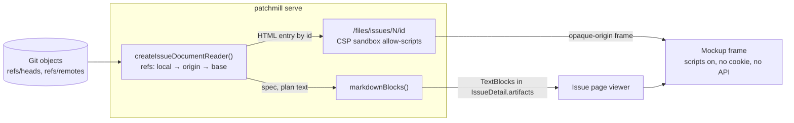

# Show an issue's spec, plan and mockups on the live web issue page

- Issue: [#384](https://github.com/rochecompaan/patchmill/issues/384)
- Parent: [#300](https://github.com/rochecompaan/patchmill/issues/300). It has
  no Parent spec on the base branch.
- Inspected base: `19d588e` (`main`).
- Status: Proposed for the Interactive Issue run approval dialog.

## Intent

A maintainer opens the spec, the plan, the mockups and the diagrams of a live
issue from its web issue page. Today only `patchmill serve --sample` shows them.
The live page must also show documents that are only on a local Issue branch. An
Interactive Issue run without required gates does not push its spec and plan
until the implementation pull request. A host link for these documents gives
a 404.

## Current state

- `readIssueDetail()` in `src/web/file-issue-detail.ts` always returns
  `artifacts: []`.
- `web/artifacts.js` already has the viewer. It renders a spec or plan from
  `TextBlock`s with `textContent`. It shows an HTML page in an `iframe`. The
  viewer accepts only `/samples/` URLs (`safePreviewUrl()` in `web/links.js`).
- The sample frame uses `sandbox="allow-same-origin"`. The sample asset response
  uses CSP `script-src 'none'; sandbox allow-same-origin`
  (`setResponseHeaders(res, true)` in `src/web/response-headers.ts`). A live
  mockup must not get these values.
- `createDocumentLinkReader()` in `src/web/document-links.ts` finds the newest
  spec and plan on `origin/<branch>` and `origin/<base>`, and links to the host.
  It does not read local branches. The board and the issue header show these
  links (`IssueSummary.documentLinks`).
- `worktreeArtifacts()` and `refArtifacts()` in `src/kernel/artifact-source.ts`
  find the newest `isArtifactFile()` match in `paths.specsDir` and
  `paths.plansDir`. `linkedMockup()` in `src/console/planning-dialog-facts.ts`
  finds a relative `.html` link in the spec.
- `patchmill serve` serves only the fixed `publicFiles` set from `web/`. It has
  no route for repository files.
- Patchmill has no runtime Markdown library. `marked` and `markdown-it` are
  development dependencies of `markdownlint-cli2` only.

## Goals

- A live issue page lists the issue's spec, plan, mockups and diagrams as chips.
  Each chip opens in the existing viewer.
- Documents come from the local Issue branch, the pushed Issue branch, or the
  base branch.
- A file route serves the HTML mockups and diagrams of the issue, read-only.
- The browser never names a path. The server serves only the files that its own
  discovery lists for that issue.
- A mockup's scripts run, but the mockup cannot read the page, the token cookie
  or the API.
- Markdown shows as text-safe content.

## Non-goals

- Uncommitted worktree changes. The page shows committed documents only.
- Screenshots (`shots`), images that documents link to, and Parent spec links.
- Artifact cards in the Issue thread (`ThreadEvent` kind `artifact`).
- Changes to sample mode, to the board, or to `IssueSummary.documentLinks`.
- Mermaid rendering. A Mermaid block shows as a code block.
- Document history or a diff between branches.

## Anti-goals

- A route where the browser sends a repository path, even a checked one.
- An HTML renderer for Markdown on the server, or `innerHTML` in the browser.
- A mockup frame or a new tab with same-origin access.
- A Git fetch, a checkout, or a worktree read by the server.

## Constraints

- Add no npm dependency, browser framework or browser build step.
- Keep authentication, Host and Origin checks, and `no-store` on every response.
- Honor `paths.specsDir` and `paths.plansDir` and the configured base branch.
- Read Git objects only. Never follow a symbolic link. Never write a ref.
- Read document content only for the requested issue, never for a board request.
- A failure to read documents must not fail the issue page. The page shows no
  document chips and the server logs a warning.

## Approaches

The maintainer picked approach 1.

| Approach                                                                                                | Benefit                                                             | Cost                                                                   | Decision |
| ------------------------------------------------------------------------------------------------------- | ------------------------------------------------------------------- | ---------------------------------------------------------------------- | -------- |
| 1. Parse each spec and plan into `TextBlock`s in `IssueDetail.artifacts`. Serve only HTML from a route. | Same shape as sample data. The viewer stays the same for documents. | The issue response and header updates are larger, about 20–60 KB.      | Selected |
| 2. Send metadata only. The viewer fetches each document when it opens.                                  | Small payloads.                                                     | New `Artifact` shape, load and error states, and a split from samples. | Rejected |
| 3. Render Markdown to HTML on the server and show every file in the sandboxed frame.                    | One route for all files.                                            | An HTML renderer on the server. It gives up the text-safe viewer.      | Rejected |

For isolation, an opaque-origin sandbox is better than a second origin. A second
origin needs a second port, its own authentication, and more Host checks. The
issue permits both.

## Decided by the maintainer

- Approach 1.
- Mockup scripts run. Code in the repository is trusted. Isolation is still
  necessary: a mockup must not read the cookie or call the API.
- Patchmill does not write documents to the host issue. The `IssueDetail` object
  of `GET /api/issues/N` carries them.

## Design

### Terms

An **Issue document** is a spec, plan, mockup or Planning visualization of one
issue. The server finds it on a Git ref of the issue. The web API calls its
entry an `Artifact`. See [GLOSSARY.md](../../GLOSSARY.md).

### Discovery

The server finds Issue documents in the same way that the run-once workflow
finds them. For each kind, the server takes the newest `isArtifactFile()` name
in the configured directory, on the first ref that has one.

Candidate branches are the Issue run's `branch` from `progress.json` and the
branches of associated pull requests. This is the list that
`createDocumentLinkReader()` receives now. The server reads refs in this order:

1. `refs/heads/<branch>` for each candidate branch where `isIssueBranch()` is
   true.
2. `refs/remotes/origin/<branch>` for each candidate branch.
3. `refs/remotes/origin/<base>`.

The server rejects a branch name that `document-links.ts` rejects now. It reads
only refs that exist. It does not fetch.

The local branch comes first because the run commits there first. If a person
pushed a newer commit from a different clone, the page shows the local version.
This is acceptable for one maintainer's server.

For each spec and plan that it finds, the server finds the linked HTML files:

- It reads inline Markdown links `[text](target)` where the target ends in
  `.html` or `.htm`, after it removes a `#fragment`.
- It ignores a target with a scheme, a leading `/`, a `?`, a `\`, or a `%`.
- It resolves the target with POSIX rules against the document's directory. The
  result must stay inside the repository.
- The target must be a regular blob (mode `100644` or `100755`) in the tree of
  the same commit. A symbolic link (`120000`) does not count.
- A name that ends in `-show-me.html` is a `diagram`. Other names are a
  `mockup`.
- The title is the link text. If the link text is empty, the title is the file
  name.
- The server removes duplicate paths. It keeps at most 20 HTML files for each
  issue.

The kernel paths in `progress.json` (`facts.specPath` and `facts.planPath`) are
evidence of what the run used, but the server does not use them as paths. A path
in a run file must not choose a file.

### Artifact fields

Each Issue document becomes one `Artifact` in `IssueDetail.artifacts`. The
`Artifact` type stays the same.

| Field                | Value                                                                                                                                     |
| -------------------- | ----------------------------------------------------------------------------------------------------------------------------------------- |
| `id`                 | `spec`, `plan`, or `<kind>-<first 12 hex of SHA-256 of the path>`, for example `mockup-3f9a0c1b2d4e`.                                     |
| `title`              | Spec and plan: the text of the first level-one heading, otherwise the file name. HTML: as above.                                          |
| `path`               | The repository path, with `/` separators.                                                                                                 |
| `commit`             | The first 7 hex characters of the remote commit that `sourceUrl` names. Without a remote match: of the local commit.                      |
| `draft`              | `true` when the blob is not on any remote ref that the server read. Otherwise `false`.                                                    |
| `location`           | The first remote ref with the same blob decides: `On branch <branch>`, then `On <base>`. Else `On local branch <branch>. Not pushed yet.` |
| `sourceUrl`          | When the same blob is on a remote ref: the host URL at that remote commit, in the `document-links.ts` format. Otherwise `null`.           |
| `preview` (document) | `{ kind: "document", blocks }` from `markdownBlocks()`.                                                                                   |
| `preview` (page)     | `{ kind: "page", url: "/files/issues/<number>/<id>" }`.                                                                                   |

To find `draft`, the server compares the blob ID at `<ref>:<path>` with the blob
ID at the same path on `origin/<branch>`, then on `origin/<base>`. The first
match gives `location`, `commit` and `sourceUrl`, so "at abc1234" and "View on
GitHub" always name the same commit. Example: a spec merged into the base and
carried on an unpushed Issue branch shows `On main` and `draft: false`.

A spec or plan larger than 1 MiB, or an HTML file larger than 5 MiB, is not
listed. The server does not try the next ref for that kind, and it does not
search the links of a skipped document. It calls the reader's `warn` callback.
Git output is UTF-8 text through `CommandRunner`, so the route serves HTML as
UTF-8.

### Markdown to text blocks

`markdownBlocks(source: string): readonly TextBlock[]` is a small, pure parser.
Its output is data. `renderBlocks()` in `web/dom.js` already renders it with
`textContent`, so no Markdown text can become HTML.

| Markdown                                           | Block                                                                                 |
| -------------------------------------------------- | ------------------------------------------------------------------------------------- |
| ATX heading, any level                             | `heading`                                                                             |
| Fenced code (backticks or tildes), any info string | `code`, with the raw text                                                             |
| `-`, `*`, `+` or `1.` list item, with nesting      | `list`. Nested items become items of the same list. Continuation lines join the item. |
| GFM pipe table                                     | `table`. Cells are plain text without inline markers.                                 |
| Blockquote, raw HTML line, other text              | `paragraph`. Lines join with one space. Raw HTML shows as text.                       |
| Blank line, thematic break                         | Block separator                                                                       |

Inline content: `` `code` ``, `**strong**`, `*emphasis*` and `_emphasis_`, and
`[text](href)`. A link with an absolute `http:` or `https:` URL becomes a
`link`. Other links and images become `text` with the link text or the image alt
text. Unclosed markers stay as text. The client `externalLink()` checks every
link again.

Heading levels are lost because `TextBlock` has no level. This is acceptable for
this issue.

### File route

`GET` and `HEAD` `/files/issues/<number>/<id>` serve one HTML Issue document.
The route runs after the authentication and Origin checks, the same as every
other route. Other methods get `405`.

The handler calls a new optional `RunDataSource` operation:

```typescript
documentFile?(issue: number, id: string): Promise<IssueFile | null>;
type IssueFile = { readonly body: Buffer; readonly contentType: string };
```

The live adapter runs the same discovery as the issue detail. It returns the
blob of the `mockup` or `diagram` entry with that exact `id`. The `id` must
match `^(mockup|diagram)-[0-9a-f]{12}$` before discovery starts. Spec and plan
IDs are not served, because their content is in the issue response. The sample
adapter has no `documentFile`, so the route returns `404` in sample mode.

The route returns `404 Not found.` for an invalid number, an ineligible issue,
an unknown ID, or an absent operation. The body never repeats the ID.

### Isolation of mockups

A mockup is trusted repository code, but it runs in the browser of a maintainer
who has the token cookie. Three layers keep it away from that cookie:

1. **The response.** `setResponseHeaders()` takes a profile:
   `"app" | "sample" | "document"`. The `document` profile sends:

   ```text
   default-src 'none'; script-src 'unsafe-inline'; style-src 'unsafe-inline';
   img-src data: blob:; font-src data:; media-src data: blob:;
   connect-src 'none'; worker-src 'none'; frame-src 'none'; object-src 'none';
   base-uri 'none'; form-action 'none'; frame-ancestors 'self';
   sandbox allow-scripts
   ```

   The `sandbox` directive has no `allow-same-origin`. The document has an
   opaque origin, also when it opens as a top-level tab. The `app` and `sample`
   profiles keep their current values.

2. **The frame.** The viewer gives a `/files/` frame `sandbox="allow-scripts"`.
   It has no `allow-same-origin`, `allow-top-navigation`, `allow-forms` or
   `allow-popups`. Sample frames keep `sandbox="allow-same-origin"` and the note
   that scripts are off. The live note is: "Repository file. Scripts run in an
   isolated frame. The file cannot read this page or act as you."

3. **The cookie and the API.** The cookie is `HttpOnly; SameSite=Strict`. The
   opaque origin cannot read `parent.document`, cannot send a same-origin
   request, and cannot use `fetch` because of `connect-src 'none'`. The Origin
   check refuses non-GET requests from origin `null`.

"Open in new tab" opens the same `/files/` URL. The response CSP keeps it
sandboxed. `safePreviewUrl()` accepts `/files/issues/<number>/<id>` only when
the ID matches the pattern above. It still accepts `/samples/` URLs.

### Freshness

The issue feed reprojects when its fingerprint changes. The live adapter appends
a ref fingerprint to the `issueFingerprint()` value. The ref fingerprint is one
`git for-each-ref --format=%(refname) %(objectname)` call for
`refs/heads/agent/issue-<number>`, `refs/heads/agent/issue-<number>-*`, the same
patterns under `refs/remotes/origin/`, and `refs/remotes/origin/<base>`. The
issue-ref prefix match is exact, so issue 38 does not match issue 384. A new
commit on the Issue branch then updates the header within the feed's 1-second
cycle. During an active run the feed reprojects about every second, because
session logs change. The live adapter therefore keeps one content cache for its
whole life. The cache key is the blob ID, which never changes for given content.
It holds parsed blocks and HTML bytes, with at most 64 entries, oldest out
first. Only ref resolution and `ls-tree` run again on each projection.

`issueRefsFingerprint()` never throws. If `git` fails, it returns the constant
`refs-unavailable`, so the feed keeps working. A pull request head branch that
is not an `agent/issue-N` branch is not in the ref fingerprint. Its changes show
at the feed's 60-second full reprojection.

### Issue page

`renderArtifactChips()` already groups Planning chips. It does not change. The
header shows the `documentLinks` row only for a kind that is not in
`detail.artifacts`. A pure helper `remainingDocumentLinks(links, artifacts)` in
`web/links.js` makes this rule testable. This prevents two Spec chips. A host
link stays available as "View on GitHub" in the viewer when `sourceUrl` is set.

### Module design

Domain modeling applies, because this change adds the Issue document term and a
new seam on `RunDataSource`. Codebase design applies, because it adds a module
and a route. It does not change an ADR. The repository has no ADRs. The choice
between a sandbox and a second origin is easy to reverse, so it does not need an
ADR.

- **`src/web/issue-documents.ts` (new, deep).** Interface:
  `createIssueDocumentReader(input) => (issue, branches) => Promise<IssueDocuments>`,
  where `IssueDocuments` is
  `{ artifacts: readonly Artifact[]; file(id: string): Promise<IssueFile | null> }`.
  The input is the `RepositoryInput` of `document-links.ts`, plus `warn` and an
  optional shared content cache. It hides ref order, branch validation,
  `ls-tree` and `cat-file` calls, link discovery, size limits, IDs, draft and
  location rules, and caching. Callers know that a Git failure throws, that a
  skipped document calls `warn`, and that ref results are bound to one call.
- **`src/web/markdown-blocks.ts` (new, pure).** `markdownBlocks(source)`.
- **`src/web/file-run-data.ts`.** It creates one reader for each snapshot, next
  to `documents()`. It passes the same branch list to both. It puts `artifacts`
  on the detail and implements `documentFile()`. One helper finds the eligible
  issue and its branch list for both the page and `documentFile()`. It applies
  the page's rules: open, not `unsuitable`, and a board summary. A failure logs
  `Could not read documents for issue #N.` and keeps `artifacts: []`.
- **`src/web/file-issue-detail.ts`.** It takes `artifacts` as an input and does
  not compute them.
- **`src/web/request.ts` and new `src/web/issue-file-route.ts`.** The route
  parsing, method check, headers and the call to `documentFile()`.
- **`src/web/response-headers.ts`.** The profile parameter.
- **`web/links.js`, `web/artifacts.js`, `web/issue.js`.** URL check, frame
  sandbox and note, and the `documentLinks` filter.

The seam is `RunDataSource`. Its two real adapters are the file adapter and the
sample adapter. The command runner stays injected, so tests use a real temporary
Git repository through `runCommand`, as `document-links.test.ts` does now.
`createDocumentLinkReader()` stays for the board. The two readers share the
branch validation helper and the host URL helper, which move out of
`document-links.ts` into the new module and are exported from there.

### Tests

- `markdown-blocks.test.ts`: each row of the table above, unclosed markers, raw
  HTML as text, `javascript:` and relative links as text.
- `issue-documents.test.ts`, in a temporary Git repository:
  - A spec, a plan and a linked mockup and show-me diagram on a local-only
    branch. All four are listed with `draft: true`, the local location text and
    `sourceUrl: null`.
  - The same files pushed to `origin/<branch>`. They have `draft: false` and a
    host URL.
  - Only the base has a spec. It is found on the base.
  - Refused links: absolute URL, `../` outside the repository, a symbolic link,
    a missing file, a `.md` target. They are not listed.
  - `file(id)` returns the bytes of a listed mockup. It returns `null` for an
    unknown ID, for `spec`, and for an ID of a different issue.
- `server-security.test.ts` or a new route test: an authenticated
  `GET /files/issues/N/<id>` returns the HTML with the `document` CSP. An
  unknown ID, a path-like ID such as `..%2fpackage.json`, a sample server, and
  an unauthenticated request are refused.
- `response-headers.test.ts`: the `document` profile has
  `sandbox allow-scripts`, has no `allow-same-origin`, and has
  `connect-src 'none'`. The other profiles are unchanged.
- `browser-links.test.ts`: `safePreviewUrl()` accepts a valid `/files/` URL and
  refuses other `/files/` shapes.
- A viewer test: a `/files/` frame gets `sandbox="allow-scripts"` exactly. A
  `/samples/` frame keeps `allow-same-origin`.
- `issue-documents.test.ts`: a new commit on the Issue branch changes the ref
  fingerprint that the issue feed adds to `issueFingerprint()`. A failed `git`
  call gives `refs-unavailable`.
- `browser-links.test.ts`: `remainingDocumentLinks()` drops a host link whose
  kind has an artifact.
- A real-browser check in `scripts/check-serve-layout.mjs` style, run by
  `npm run test:web`: a mockup script in the frame reads `document.cookie`,
  calls `fetch("/api/board")` and reads `parent.document`. Each one throws or
  gives nothing. The frame's `sandbox` attribute is exactly `allow-scripts`.

## Left to the builder

- Internal names inside the new modules.
- Where to put the viewer test, if no current test renders `web/artifacts.js`.
- Exact warning text other than the text above.

The README "Web board" section gets a short paragraph: the live issue page shows
Issue documents from local and pushed branches, and mockup scripts run in an
isolated frame.

## Frontend design

Frontend design applies. The issue page shows new chips, and the viewer shows a
live frame with a new note. The existing design system of `web/styles/` wins
over generic guidance. The mockup uses its colors, chips and viewer layout, and
adds no new visual elements.

## Visual explanation



The diagram shows the two paths. The spec and plan travel as data in the issue
response. HTML travels only through the ID route, into an opaque-origin frame.

## Companion artifacts

- `docs/mockups/2026-11-20-issue-384-live-issue-documents.html`:
  [Full-page mockup](../mockups/2026-11-20-issue-384-live-issue-documents.html)
- `GLOSSARY.md`: [Issue document](../../GLOSSARY.md)
