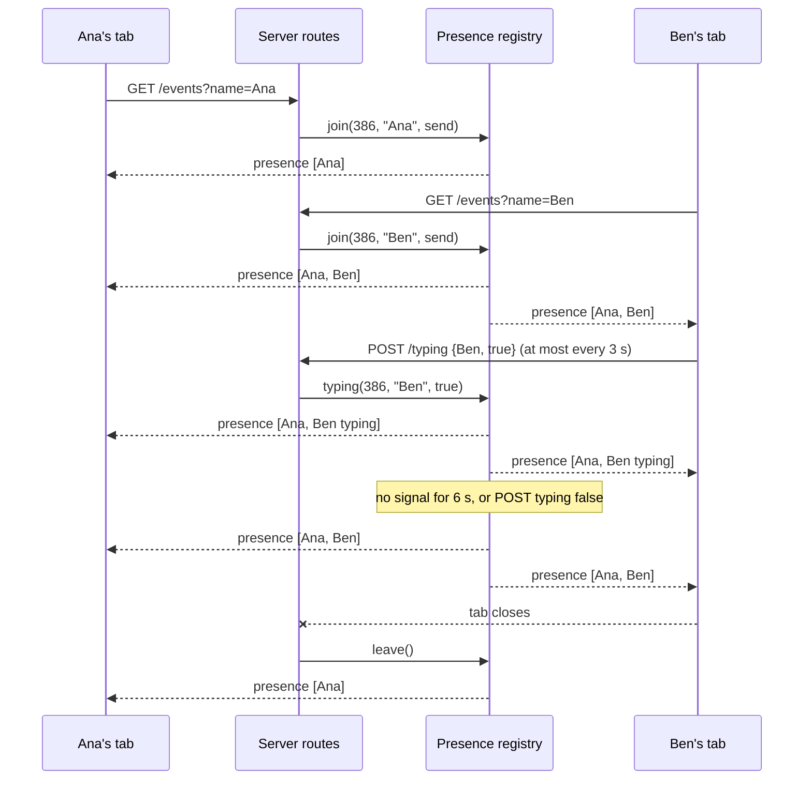

# Presence and typing on the web issue page

Issue #386, part of #300. Follow-up to #379 (PR #380). The #379 design put
presence and typing indicators out of scope
([non-goals](2026-11-19-issue-379-web-interactive-sessions-design.md#non-goals)).
This design adds them.

## Intent

Several people can share one Web session on an issue page. Today nobody can see
who else has the page open. A person cannot tell if a teammate reads along, is
about to answer a question, or types a message. Two people can answer or write
at the same time and not know it.

Success: Ana and Ben open the same issue page in two browsers. Within a few
seconds each sees the other's name in the header. When Ben types in the
composer, Ana sees "Ben is typing". When Ben sends the message or stops, the
line goes away. When Ben closes the tab, their name goes away.

## Goals

- Show who else has an issue page open, by the name that each person enters on
  the page.
- Show who types in the composer.
- Work on every live issue page, also when no Web session is live.
- Announce changes to the presence list politely to screen readers.
- Keep the thread still: presence and typing changes never move the thread.

## Non-goals

- Notifications, per-person permissions and accounts.
- Real identity. A name is a label. Anyone with the token can use any name.
- Presence on the board page. Presence belongs to one issue page.
- Read markers or "last seen" times.
- Presence across server restarts or across two `patchmill serve` processes.
- Presence or typing in `patchmill serve --sample`. Sample data stays view only.

## Anti-goals

These make the feature a failure even if it technically works:

- Presence or typing written to run files or to any other file.
- A presence or typing change that moves the thread, steals focus, or moves the
  caret in the composer.
- A screen reader that reads every typing signal aloud.
- Stale presence after a reconnect, for example a replayed "Ben is here" after
  Ben left.

## Constraints

- No persistence. A server restart loses presence. Nothing goes to the run
  files.
- Presence comes from the open event streams of an issue
  (`GET /api/issues/:number/events`, `src/web/event-stream.ts`). The same name
  in two tabs counts once.
- A typing signal is short-lived. The browser sends it at most every 3 seconds
  while the composer has text. The server clears it 6 seconds after the last
  signal, when the message is sent, or when the person leaves.
- New state-changing routes need the cookie and a matching `Origin`, as the
  session routes do. `createRequestHandler` in `src/web/request.ts` already does
  these checks for every request before it routes the request.
- Use the existing design system and the existing "here now" avatar stack
  (`renderMeta` in `web/issue.js`, `.presence` in `web/styles/issue.css`).

## Approaches considered

1. **Name on the stream URL, presence as an event without an ID (chosen).** The
   browser opens `/api/issues/:number/events?name=<name>`. A presence registry
   in the server tracks the open streams of each issue. It sends a `presence`
   event to every stream of the issue when the list changes. The event has no
   SSE `id`, so it stays out of the Issue update replay log. Presence follows
   the stream lifetime exactly, and the issue asks for that.
2. **A heartbeat route with a time-out.** Each tab posts "I am here" every few
   seconds, and the server forgets names after a time-out. Rejected: the issue
   says presence comes from the streams. Heartbeats add traffic and a slower
   leave, and the stream already gives an exact close.
3. **Presence as a logged Issue update in the issue feed.** Rejected: the feed
   (`src/web/issue-feed.ts`) keeps a replay log of 1,000 updates for
   `Last-Event-ID`. Short-lived presence and typing changes fill that log, and a
   reconnect replays old presence. Presence also does not belong to the
   projection of run files that the feed owns.

The maintainer approved approach 1.

## Domain and architecture

This change adds a module and two terms, so domain modeling and codebase design
apply. The repository has one context (`docs/agents/domain.md`) and no ADRs.

New terms, added to `GLOSSARY.md`:

- **Presence**: the names of the people who have an issue page open in one
  `patchmill serve` process. They come from the open event streams of that
  issue.
- **Typing signal**: a short-lived note from a browser that a named person types
  in the issue page composer.

A presence update is not an **Issue update**. An Issue update is ordered, has an
ID and can be replayed. A presence update has no ID and always carries the full
list.

### Modules

- **Presence registry** (`src/web/presence.ts`, new). It owns presence and
  typing for every issue. Its interface:

  ```ts
  // In src/web/api-types.ts, so the browser JSDoc can import them:
  export type PresencePerson = {
    readonly name: string;
    readonly typing: boolean;
  };
  export type PresenceUpdate = {
    readonly kind: "presence";
    readonly people: readonly PresencePerson[];
  };
  // In src/web/presence.ts:
  export type Presence = {
    /** Adds one open stream. `name: null` watches but is not listed. */
    join(
      issue: number,
      name: string | null,
      send: (people: readonly PresencePerson[]) => void,
    ): () => void;
    /** False when no open stream of that issue has this name. */
    typing(issue: number, name: string, typing: boolean): boolean;
  };
  export function createPresence(input: {
    clock: { after(ms: number, fn: () => void): () => void };
    typingMs?: number; // default 6000
  }): Presence;
  ```

  Callers must know these rules:
  - `join` calls `send` once at once with the current list. After that, it calls
    `send` for every stream of the issue each time the list changes.
  - The list has each name once, in the order of the first join. A name stays in
    the list while at least one stream has it.
  - The returned leave function is idempotent. The last leave of a name removes
    it and its typing flag.
  - `typing(true)` sets the flag and restarts the 6-second timer. The registry
    sends a list only when a flag changes, not on each signal. `typing(false)`
    clears the flag at once.
  - A `send` that throws does not stop the other streams.
  - A leave can happen while the registry sends a list, for example when a write
    cuts a slow stream. The registry must allow this.
  - State for an issue goes away when its last stream leaves.

  It hides the per-issue maps, the stream count per name, the timers and the
  change detection. The clock enters as a dependency. Production passes real
  timers. Tests pass the existing `feedClock()` from
  `test-support/feed-clock.ts`. The registry does not know HTTP.

- **Name rule** (`src/web/person-name.ts`, new).
  `parsePersonName(value: unknown): string | null` trims the value and accepts 1
  to 80 characters with no control characters and no leading `/`. This is the
  rule that `sessionInput` in `src/web/session/routes.ts` uses today. The
  session routes and the new code share it, so a name that can send a message
  can also be present. Names compare after trim and Unicode NFC. Case counts:
  "Ana" and "ana" are two names. The function returns the NFC form, so from now
  on the session routes also record authors in NFC. For names typed on a normal
  keyboard, that changes nothing.

- **JSON request helpers** (`src/web/json-request.ts`, new). `readBody`, `json`
  and `BadRequest` move here from `src/web/session/routes.ts`, without a change
  in behavior, so the typing route uses the same body limits and errors.

- **Event stream** (`src/web/event-stream.ts`, changed). `serveIssueEvents`
  takes an optional `presence` and the raw query string of the request
  (`query`). It reads the `name` query parameter. If the parameter is absent or
  empty, the stream watches but is not listed. If there are two `name`
  parameters, or the name fails the name rule, the route answers 400
  `invalid_author` before it opens the stream. After `source.subscribe`
  succeeds, it calls `presence.join` and writes each list as
  `event: presence\ndata: {"kind":"presence","people":[...]}\n\n`, with no `id:`
  line. The stream cleanup calls the leave function. If cleanup runs before or
  during `join`, the stream leaves at once after `join` returns, as the existing
  `if (stopped) unsubscribe()` guard does for the source. Without `presence`,
  the stream does not send presence events. The issue updates and their IDs do
  not change.

- **Typing route** (`src/web/presence-routes.ts`, new).
  `POST /api/issues/:number/typing` with the JSON body
  `{"author": "<name>", "typing": true|false}`. The request handler checks the
  cookie and `Origin` first, as for every route.

  | Case                                     | Answer                            |
  | ---------------------------------------- | --------------------------------- |
  | Accepted                                 | 202 `{"accepted": true}`          |
  | Not POST                                 | 405, `Allow: POST`                |
  | Bad issue number                         | 400 `invalid_issue`               |
  | No presence registry (`--sample`)        | 404 `not_found`                   |
  | Not JSON, too large, bad fields          | 415, 413 or 400 `invalid_request` |
  | Bad author                               | 400 `invalid_author`              |
  | No open stream on the issue has the name | 409 `not_present`                 |

  The body limit is 4 KiB. `typing` must be a boolean. A 413 answer sets
  `Connection: close`, as the session routes do.

- **Server wiring.** `ServeOptions` in `src/web/server.ts` gets an optional
  `presence`. `createServeSource` in `src/cli/commands/serve/source.ts` returns
  `presence: createPresence({ clock })` only for live data, next to `sessions`,
  and `main.ts` passes it on. `--sample` gets no registry. The sample streams
  then send no presence events, and the typing route answers 404.

Locality: presence rules live in one module, the HTTP code in two small route
modules, and the browser code in its own modules (below). The issue feed and the
Session hub do not change.

### Browser

- **One saved name.** `app.js` keeps one `savedName` variable. It is
  `readName(storage)` at start and the result of `saveName` after the name
  dialog. It stays set when storage is off. The stream name, the person's own
  name in the presence view (`me`) and the typing author all come from it.
  Without a saved name, the page watches only and sends no typing signals.
- **Browser name rule** (`web/preferences.js`). `validName` also applies the
  server rule: 1 to 32 characters, no leading `/`, no control characters, NFC
  form. Without this, a name that the browser accepts and the server refuses
  makes every stream answer 400, and the controller reloads the page without
  end. A saved name from before this change that breaks the rule reads as no
  name, and the name dialog opens.

- **Controller** (`web/controller.js`). `createPageController` gets two new
  options: `name: () => string | null` and
  `onPresence: (people: PresencePerson[] | null) => void`. `connect` adds
  `?name=` with the URL-encoded name when one is saved. A `presence` event calls
  `onPresence` with the list. Presence is not part of `PageState`, so a presence
  change does not render the page again. When the stream closes, the controller
  calls `onPresence(null)`. A new `rename()` method closes the stream and
  connects it again, so a newly saved name shows. `app.js` also makes a new
  typing sender on rename, so the first key press under the new name is not held
  back. A new EventSource sends no `Last-Event-ID`, so the page gets a reset.
  That is acceptable because a rename is rare.

- **Typing sender** (`web/typing.js`, new).
  `createTypingSignal({ send, clock, intervalMs = 3000 })` returns
  `{ input(hasText: boolean), sent(), dispose() }`:
  - `input(true)` sends `true` if the last `true` was 3 seconds ago or more.
  - `input(false)` after a `true` sends `false` once (the composer is empty).
  - `sent()` sends `false` once if the last send was `true`.
  - `dispose()` stops it and sends nothing.

  `send` is best effort: a failure does not show an error. `app.js` keeps one
  sender for the issue number on screen. It makes the sender on any page state
  of a live issue on a server with Web sessions, not only on the first load,
  because the composer becomes enabled only when a Web session starts. It
  disposes the sender when the page goes to another issue or the board. Input
  comes only from an enabled composer, and only with a saved name. `web/api.js`
  gets `typing(issue, author, typing)`, which posts to the typing route.

- **Presence view** (`web/presence-view.js`, new). These three are pure
  functions, so Node tests can check them:
  - `presenceNames(me, people)`: `me` first, then the others in order, each name
    once.
  - `typingText(me, people)`: `""` for no one, `"Ana is typing"`,
    `"Ana and Ben are typing"`, `"3 people are typing"`. It leaves out `me`.
  - `presenceChanges(previous, next, me)`: the lines to announce, for example
    `["Ana joined the page.", "Ben left the page."]`. It leaves out `me`. It
    returns no lines for the first list after a connect (`previous === null`).

  A fourth function, `paintPresence(root, me, people)`, fills the two slots in
  `root` (the `.presence` avatars with their hidden text, and the `.typing`
  line). It does nothing for a slot that is not in the page.

- **Rendering** (`web/issue.js`, `web/app.js`). `renderMeta` keeps the "here
  now" item. On live pages it renders the `.presence` slot with only the
  person's own name. Sample pages keep `detail.participants`, as today.
  `renderComposer` renders an empty `.typing` slot in the hint line. A terminal
  or finished composer has no hint line, so it has no typing slot. Nobody can
  type there. `app.js` keeps the last list. On each presence change it calls
  `paintPresence(mount, …)` and does not call `render()`. After each `render()`
  it calls `paintPresence` again, so a full render shows the same state.

### Page layout and accessibility

Frontend design applies, because the change adds visible state to the issue
header and the composer. The repository design system and the existing avatar
stack come before generic frontend-design guidance, so the design keeps them.
See the [mockup](../mockups/2026-11-20-issue-386-presence.html).

- **Here now.** The avatars stay in the meta row of the sticky header. The stack
  shows at most 5 avatars, then a `+N` chip. The chip's `title` lists the hidden
  names. The stack has a fixed width of 5 overlapped avatars plus the chip and a
  fixed height of one small avatar. A join or a leave therefore never changes
  how the meta row wraps or how tall the header is. Each avatar keeps
  `title=<name>`. The stack has one visually hidden text, for example "Here now:
  you, Ana and Ben". The visible "here now" label and the avatars have
  `aria-hidden="true"`, so a screen reader reads the list once. While the stream
  reconnects, the page keeps the last list until the new list comes.
- **Typing line.** A `.typing` slot is always present in the composer hint line,
  between the status text and the keyboard hint. It has a fixed height and holds
  `typingText` or nothing. Three small dots pulse next to the text. With
  `prefers-reduced-motion: reduce`, the dots do not move. On narrow screens the
  keyboard hint is already hidden, and the typing text takes its place. Long
  names end with an ellipsis. The typing line has `aria-hidden="true"`, so a
  screen reader does not read each change.
- **Announcements.** One persistent `role="status"` element with polite
  announcements sits outside `#app`, next to the existing `announcement`
  element. Each full render replaces `#app`, so a live region inside it does not
  work. The element receives the `presenceChanges` lines. Screen readers do not
  hear typing.
- **Thread.** In-place updates do not touch the thread, the composer textarea,
  focus or the caret.

### Flow

1. Ana opens issue 386. `GET /api/issues/386/events?name=Ana` opens. The
   registry lists Ana and sends `[Ana]` to Ana's stream.
2. Ben opens the page. The registry sends `[Ana, Ben]` to both streams. Ana's
   status element says "Ben joined the page."
3. Ben types. Ben's browser posts `typing: true` at most every 3 seconds. The
   registry sends `[Ana, Ben typing]` once. Ana sees "Ben is typing".
4. Ben sends the message. Ben's browser posts `typing: false`. Ana's line
   clears. If Ben stops typing and sends nothing, the flag clears 6 seconds
   after their last signal, which is 3 to 6 seconds after their last key press.
5. Ben closes the tab. The stream closes, the registry removes Ben, and Ana's
   page says "Ben left the page." If the network drops without a close, the
   keep-alive write finds the dead connection. Node then closes the stream.

## Decided by the maintainer

- Approach 1: the name goes on the stream URL, and presence is a separate event
  without an ID.
- A browser with no saved name watches but is not listed until it saves a name.
- Typing is not announced to screen readers.
- Presence and typing come only with live data. `--sample` gets neither.

## Open assumptions

- **A bad `?name=` on the stream.** The question: answer 400, or treat the name
  as absent and let the stream watch? The choice: answer 400 `invalid_author`.
  The reason: the browser now applies the same rule before it saves a name, so
  only a hand-made request gets the 400, and a clear error is better than a
  silent fallback. The planner made this call. The maintainer can change it.

## Left to the builder

- The exact CSS of the dots and of the `+N` chip, within the design system.
- The internal data structures of the registry.
- Whether to clear the typing sender's state when the page goes to another
  issue, as long as `dispose()` runs.

## Verification

| Acceptance criterion                          | Verification                                                                  |
| --------------------------------------------- | ----------------------------------------------------------------------------- |
| Each browser sees the other within seconds    | Registry tests; server stream test; two-tab browser check                     |
| Closing a tab removes the name within seconds | Registry leave test; stream close test; browser check closes one tab          |
| Duplicate tabs count once                     | Registry test with two joins of one name; one leave keeps it                  |
| "`<name>` is typing", cleared on send or idle | Registry expiry test; typing sender tests; browser check                      |
| Polite announcement, thread does not move     | `presenceChanges` tests; browser check of the status text and thread offset   |
| Access rules of the new route                 | Server tests: no cookie 401, bad or missing `Origin` 403, GET 405, sample 404 |

## Visual explanation

The sequence shows how a stream, a typing signal and a tab close move through
the registry. Presence events go past the issue feed and carry no ID.



```text
GET /api/issues/:n/events?name=Ben
  serveIssueEvents
    source.subscribe      -> issue updates with id: (replayable)
    presence.join         -> event: presence, no id (never replayed)
    on close: leave()

browser
  controller  -> onPresence(list)    (no PageState change, no render)
  app.js      -> update .presence and .typing in place
              -> status element: "Ben joined the page."
  typing.js   -> POST /typing at most every 3 s; false on send or empty
```

## Companion artifacts

- `docs/mockups/2026-11-20-issue-386-presence.html`:
  [Full-page mockup](../mockups/2026-11-20-issue-386-presence.html)
- `GLOSSARY.md`: [Presence and Typing signal](../../GLOSSARY.md)

## Planning review

### Pass 1: combined review (spec and plan)

- Scope: this spec, together with the plan
  `docs/plans/2026-11-20-issue-386-show-who-is-on-a-web-issue-page-and-who-is-typin-plan.md`.
  No gate applies, so both documents cross the boundary together at the start of
  implementation.
- Reviewer: canonical `reviewer` agent, model `claude-bridge/claude-opus-5-5`,
  thinking `high`, base revision `19d588e9033995a53c0f2b22da0b28da6076532b`.
- Reviewed body SHA-256: spec
  `e39a075689d4e479152eccca199201ed4edebbba00d25ebdec245c0abefb64cf`; plan
  `584ed03980cf15c839155925ecac06d7ba931c05987994e67e9fdc00aadc635d`.
- Survey: the reviewer confirmed the request order in `src/web/request.ts`
  (host, `Origin` for non-GET, cookie, then routing) and the single `cleanup` in
  `src/web/event-stream.ts`. It also confirmed the 1,000-entry replay log in
  `src/web/issue-feed.ts`, the full re-render in `web/app.js`, and the existing
  "here now" stack in `web/issue.js`. The registry is a deep module, and its
  clock has two real adapters.
- Findings and dispositions:
  - B1 (blocker), a name the browser accepts but the server refuses makes the
    page reload without end. Accepted: added the "Browser name rule" bullet.
  - B2 (blocker), the stream name, own name and typing author come from
    different places. Accepted: added the "One saved name" bullet.
  - S1, the typing sender only at first load. Accepted: the sender is made on
    any live page state.
  - S2, a leave skipped when cleanup runs during `join`. Accepted: the guard and
    the registry rule are added.
  - S7, NFC in the session routes and a typing sender reset on rename. Accepted:
    both are added.
  - S8, the visible label is read twice. Accepted: the label is `aria-hidden`.
  - S9, `Connection: close` on a 413. Accepted: added to the typing route.
  - S10, the sequence diagram skipped the route, and the mockup title did not
    name the spec. Accepted: both are fixed.
  - S11, clear the list while the stream reconnects. Rejected: the next list
    replaces it on reconnect, and `onPresence(null)` runs on close. The spec now
    states this.
  - Human-only question, 400 or ignore for a bad `?name=`: recorded in
    `## Open assumptions` as 400.
  - S3 to S6 concern only the plan. See the plan's record.
- Inspection limits: the reviewer read the files only and ran no tests and no
  browser.
- Confirmation: a fresh scoped confirmation checked all the corrections and
  found no new blocker.
- Final body SHA-256:
  `f2d48413db2b7a645978e2aad505f84295564a7ba259fdd621401d01f26fabb4`. The record
  helper hashes the body with the blank line before this heading, so this value
  differs from the reviewed hash only by that line.
- Outcome: `ready`.
