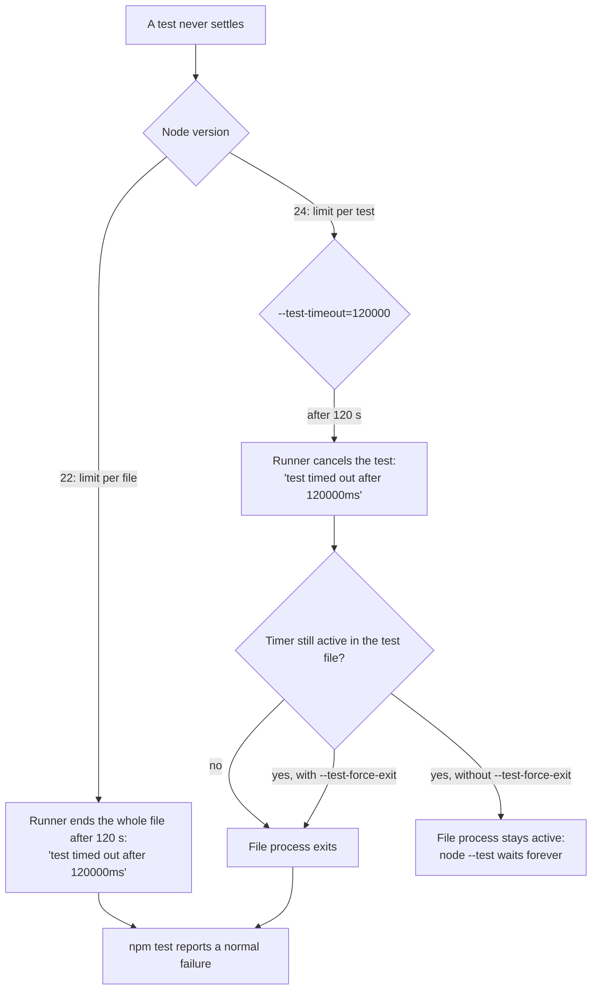

# Issue #316: Fail hung Patchmill tests instead of waiting forever

- **Issue:** [#316](https://github.com/rochecompaan/patchmill/issues/316)
- **Size:** A small change. One task.
- **Base revision:** `b9421ec` (`main`)

## Intent

In the #268 run, one hung Patchmill test kept `npm run test:run-once` running
from 11:01 to 19:35 UTC. Nothing failed or warned until the operator killed the
test process by hand.

This change makes a hung test in Patchmill's own suite fail after a fixed time,
with a clear message. The agent, a developer, or CI then sees a normal test
failure and can fix it. The change applies only to Patchmill's own test scripts.
It does not apply to the tests of a project that uses Patchmill.

## What changed since the issue was filed

The issue was filed before the skills-first kernel rewrite and the RPC mode
change (#305). The maintainer reduced its scope in the planning chat. The table
gives each proposed change and its status.

| Proposed change       | Status       | Reason                                                                                                                                                                                                                                                                                                                                                                                                            |
| --------------------- | ------------ | ----------------------------------------------------------------------------------------------------------------------------------------------------------------------------------------------------------------------------------------------------------------------------------------------------------------------------------------------------------------------------------------------------------------- |
| 1. Fail-fast fakes    | Not required | `pi.ts`, `pipeline-progress-scenarios.test.ts`, and the `finishRun` fakes no longer exist. The scripted fake Pi (`test-support/fake-pi.mjs`) throws `No fake Pi step for invocation N` on an extra call. No current run-once fake gives a pending promise that a repeated call leaves unresolved.                                                                                                                 |
| 2. Test timeout       | In scope     | `package.json` sets no test timeout. Node has no default timeout.                                                                                                                                                                                                                                                                                                                                                 |
| 3. Inactivity warning | Dropped      | The kernel now stops each Pi session after `pi.timeoutMinutes` (90 minutes by default). #322 adds a default timeout to agent `bash` calls. #319 stops and recovers sessions that show no activity. #319 must track activity in the session and in its subagent sessions, and a warning needs the same tracking. #371 removes the wall-clock cap only after #319. A warning belongs in #319 if it is still wanted. |

The skills-first kernel spec says that there is no stall detection other than
`pi.timeoutMinutes`. This change does not add stall detection, so it agrees with
that spec.

## Goals

- `npm test` and `npm run test:cli` fail a hung test after the configured
  timeout.
- The test process exits after its tests finish, even when a timer or a handle
  keeps the event loop active.
- The failure message names the timeout and the test (Node 24) or the test file
  (Node 22).

## Non-goals

- Timeouts for the tests of projects that use Patchmill.
- Stall warnings or stall stops in run-once sessions (#319).
- Timeouts for agent `bash` calls (#322).
- Changes to `pi.timeoutMinutes` (#371).
- Changes to the GitHub workflows that run one test file directly with
  `node --test`. Those jobs have their own job limits.
- Removal of the stale `patchmill:test:triage` and `patchmill:test:run-once`
  tasks in `devenv.nix`. The scripts that they call no longer exist. A separate
  change can remove them.

## Anti-goals

- A timeout so short that a slow machine, the Nix build sandbox, or the
  file-level limit of Node 22 fails a healthy test.
- A timeout that cancels the hung test but leaves `node --test` waiting.

## Approaches

1. **`--test-timeout` only.** This is the change that the issue proposes. A
   measurement on Node 24.21.0 shows that it is not sufficient. The runner
   cancels the hung test after the timeout. But if a timer stays active in the
   test file, the file process does not exit, and `node --test` waits forever.
   The old 10 ms progress heartbeat was that type of timer. (Node 22 applies the
   limit to the whole file and ends the file, so it does not wait there. But
   Node 24 is the version that CI, Nix, and devenv use.)
2. **`--test-timeout` and `--test-force-exit` (selected).** `--test-force-exit`
   ends the test file process after all of its known tests finish. In the same
   measurement, the run ended in 2.3 seconds with the hung tests reported as
   `test timed out after 1000ms`.
3. **A `timeout` option on each test.** This puts the same value in more than
   1,500 tests and is easy to forget in a new test. It also does not end a test
   file process that stays active.

## Design

Add `--test-timeout=120000 --test-force-exit` to the `node --test` command in
these `package.json` scripts:

- `test`
- `test:cli`

### Timeout value

The timeout is 120,000 ms. The scope of the limit depends on the Node version:

- **Node 24:** the limit applies to each test. CI (`.github/workflows/ci.yml`),
  the Nix build (`nix/package.nix`), and devenv use Node 24.
- **Node 22:** `package.json` `engines` permits `>=22.19.0`. On Node 22 (tested
  with 22.20.0 and 22.22.3), the limit applies to each whole test file. A test
  file that takes longer than the limit fails, even when each of its tests is
  fast. A per-test `timeout` option cannot extend the file limit.

The value must therefore be safe for the slowest whole file, not only the
slowest test. Measurements on `b9421ec` with Node 24.21.0:

- The full suite ran 1,545 tests in about 24 seconds.
- The slowest test took 7.2 seconds under full parallel load:
  `registered init rejects invalid flags before provisioning and serves help`.
- With 8 files in parallel, the slowest file took 12.4 seconds:
  `src/kernel/merged-cleanup-hook.test.ts`.

120 seconds is more than nine times the slowest file and 16 times the slowest
test. This margin is for slow machines and the Nix build sandbox, which runs
`npm test`. A hung test still fails in about two minutes.

The file durations were not measured on Node 22. This checkout cannot run on
Node 22, because the `fs-ext` native module is built for Node 24
(`ERR_DLOPEN_FAILED`). The Node 24 file durations are the best available
estimate.

On Node 24, Node reports a timed-out test as `cancelled`, not `fail`, with the
message `test timed out after 120000ms`. The run exits with code 1, so
`npm test` fails. A dry run of `npm run test:cli` with a hung test and a 60,000
ms limit showed this result after 60 seconds. On Node 22, the message names the
test file instead of the test.

On Node 24, tests that set their own `timeout` option keep their value. For
example, some console lifecycle tests use 15,000 ms. No test option is more than
120,000 ms.

### Current results with the flags

With both flags, the suite gives the same result as without them: 1,539 pass and
6 fail. The 6 failures occur only because the issue worktree has no
`node_modules` directory of its own (for example,
`ENOENT ... node_modules/superpowers`). They are not related to this change.

### Documentation

`docs/quality-checks.md` describes `npm test`. Add one sentence to its
behavioral-tests row: a test that runs longer than 120 seconds fails.

## Frontend design

Not applicable. This change affects only test scripts and documentation.

## Domain and architecture

Not applicable. This change does not define or change modules, interfaces,
seams, adapters, or domain terms. It changes only the command line of two
`package.json` scripts.

## Acceptance criteria and verification

| Criterion                                                                  | Verification                                                                                                                                                                                                                                         |
| -------------------------------------------------------------------------- | ---------------------------------------------------------------------------------------------------------------------------------------------------------------------------------------------------------------------------------------------------- |
| A hung test fails after the timeout, and `npm test` does not wait forever. | Do a dry run with a temporary test file outside the repository. The file holds a test that never settles and keeps an interval active. On Node 24, run it with the script flags. The run ends, and the output shows `test timed out after 120000ms`. |
| `npm run test:cli` uses the same flags.                                    | Inspect `package.json`.                                                                                                                                                                                                                              |
| Existing suites, `npm run lint`, and `npm run build` pass.                 | Run them. In an environment with complete dependencies, `npm test` passes.                                                                                                                                                                           |

The original acceptance criterion about the `"commits": []` fixture no longer
applies, because the fixture no longer exists. The inactivity warning criterion
is dropped (see "What changed since the issue was filed").

No new automated test is added. A test of a static script flag does not prove
product behavior (Testing Value Gate). The dry run proves the behavior once.

## Left to the builder

- The exact text of the sentence in `docs/quality-checks.md`.

## Visual explanation

## Planning review

### Pass 1: initial review

- **Scope:** spec and plan together (no gate; boundary: start of
  implementation). Other document: the plan.
- **Reviewer:** `reviewer` agent, model `openai-codex/gpt-6.1-sol`, thinking
  `xhigh`, base revision `b9421ecac0a35f53032604dbfdd26fde0b2aa456`.
- **Reviewed body SHA-256:** spec
  `00b37df06a06f3d2a950075ffa7c7d08cdeee442e4ea20330d03e6c08286de91`, plan
  `60034da981111468795ea45e0717613bcb41b83d8c7407af7ed56655f031418f`. The plan
  was compared with the spec body
  `00b37df06a06f3d2a950075ffa7c7d08cdeee442e4ea20330d03e6c08286de91`.
- **Survey:** `package.json` owns the test commands. `test:run-once` no longer
  exists. `nix/package.nix` runs `npm test`. `test-support/fake-pi.mjs` rejects
  unexpected invocations, and Git history shows that the old hung fakes were
  removed. `docs/quality-checks.md` is the right document. No module, seam, or
  adapter changes. With both flags, the suite results did not change, and a copy
  with complete dependencies passed all 1,546 tests.
- **PR316-01 (blocker): accepted.** Node 22, which `engines` permits, applies
  `--test-timeout` to each whole test file. The 60-second value was sized from
  the slowest test only, and the dry-run expectations were not version-aware.
  Revision: the timeout is now 120,000 ms. The spec describes the Node 24 and
  Node 22 behavior and records the slowest file (12.4 seconds on Node 24). The
  plan labels the dry-run expectations "on Node 24", and the visuals and
  override claims are qualified.
- **Limits:** Node 22.19.0, Nix performance, and the full npm dry run were not
  tested.
- **Outcome:** `blocked`, pending confirmation.

### Pass 2: scoped confirmation

- **Reviewer:** `reviewer` agent, model `openai-codex/gpt-6.1-sol`, thinking
  `xhigh`, base revision `b9421ecac0a35f53032604dbfdd26fde0b2aa456`.
- **Reviewed body SHA-256:** spec
  `3780ff4f6be2865accec90f444be6d6b3b4524a4c5bdd5607bc87fb05d88ca51`, plan
  `8ddeef53ede11b999ba451f74a720cec645d5b183e0835c773ec476e11bc36c3`. The plan
  was compared with the spec body
  `3780ff4f6be2865accec90f444be6d6b3b4524a4c5bdd5607bc87fb05d88ca51`.
- **Result:** PR316-01 is resolved. Independent checks in `/tmp` confirmed the
  behavior for each version. CI, Nix, and devenv use Node 24. The plan commands
  can run. No new findings.
- **Limits:** the healthy file durations on Node 22 are not measured, because
  `fs-ext` fails to load there (`ERR_DLOPEN_FAILED`). The final 120-second npm
  dry run was not run.
- **Final body SHA-256:** spec
  `85dfdae1c3ecf3e0e18bba723a24ba74d263bd4f9baa2105eacfe89c40c8ca62`, plan
  `36dddfd5d64d519ae1f64266f5a5d857419254b1cdbbbe78e24cd9f6e1d4a562`. These
  hashes differ from the confirmed hashes only by the blank line before this
  record. Without that line, the bodies hash to the confirmed values.
- **Outcome:** `ready`.
