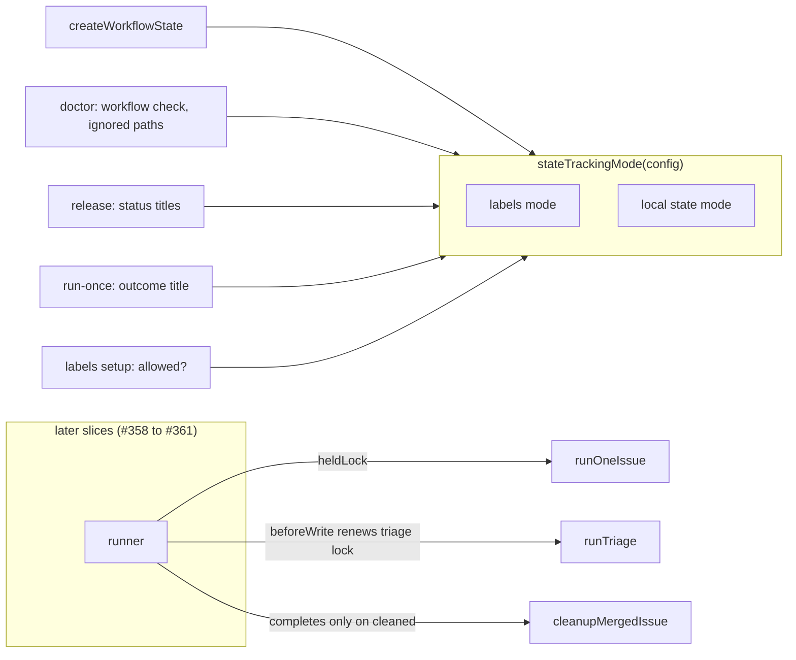

# Prepare the kernel for control-plane mode

Issue: [#357](https://github.com/rochecompaan/patchmill/issues/357), part of
[#356](https://github.com/rochecompaan/patchmill/issues/356).

Parent spec:
[Patchmill control-plane prototype design](2026-11-14-issue-356-patchmill-control-plane-prototype-design.md)
(`docs/specs/2026-11-14-issue-356-patchmill-control-plane-prototype-design.md`
on `origin/main`). The parent spec is the approved design. This document does
not change it.

## Parent sections delivered

This slice delivers these parts of the parent spec, as its Delivery table gives
for #357:

- **Architecture, item 7 (State-tracking modes):** the mode object, and the move
  of today's six `stateTracking === "local"` checks onto it. The control-plane
  mode itself is not in this slice.
- **Runner, Cleanup and completion:** `cleanupMergedIssue` returns `cleaned`
  when it confirms the merge and finds no worktree or branch left.
- **Runner, Starting a run, step 3:** `runOneIssue` can use a per-issue lock
  that its caller already holds.
- **Triage, Running triage:** `runTriage` accepts an optional check that it
  calls before each write.
- **Verification:** `engines.node` is `>=24`, and Node 22 references in docs and
  CI change to Node 24.

Label mode and local state mode keep their behaviour. The only visible change is
the new `cleaned` result. Its callers today ignore it.

## Analysis

**Domain modeling.** This slice adds no domain term. The parent spec owns the
terminology for #356, and its Terminology section does not add "state-tracking
mode" as a glossary term. The code name `StateTrackingMode` follows the existing
config key `workflow.stateTracking`. `GLOSSARY.md` does not change in this
slice. The Coordinator-to-Runner rename belongs to the slices that add the
runner.

**Codebase design.** The mode object is a new module with an interface, so the
codebase-design vocabulary applies. See Mode object.

**Frontend design.** It does not apply. No browser-visible part changes.

## Mode object

### Today

The mode-dependent decisions are string comparisons in each caller:

| File                                  | Question that the comparison answers                |
| ------------------------------------- | --------------------------------------------------- |
| `src/kernel/workflow-factory.ts`      | Which `WorkflowState` backend to create.            |
| `src/cli/commands/doctor/checks.ts` 1 | Whether doctor checks local state or labels.        |
| `src/cli/commands/doctor/checks.ts` 2 | Whether `.patchmill/state/` must be ignored by Git. |
| `src/cli/commands/release/main.ts`    | Which names to print for statuses.                  |
| `src/kernel/run-once.ts`              | Which name to print for the outcome status.         |
| `src/cli/commands/labels/main.ts`     | Whether `labels setup` is allowed.                  |

### Module

A new module `src/kernel/state-tracking-mode.ts` owns one object per mode. The
function `stateTrackingMode(config)` returns the object for
`config.workflow.stateTracking`. Each object answers these questions:

- `name`: the mode name, `"labels"` or `"local"`.
- `createWorkflowState(input)`: creates the backend. Labels mode creates
  `LabelWorkflowState`. Local state mode creates `LocalWorkflowState` with a
  `StateStore` in `stateDir(repoRoot)`. The input is the input of today's
  `createWorkflowState`.
- `statusTitles(config)`: the names to print for each `WorkflowStatus`. Labels
  mode returns `config.labels`. Local state mode returns
  `WORKFLOW_STATUS_TITLES`.
- `labelsSetup`: `{ allowed: true }` in labels mode. In local state mode it is
  `{ allowed: false, reason: "Local state mode does not use labels." }`.
- `doctorWorkflowCheck`: `"labels"` or `"state"`. Doctor runs the matching check
  and skips the other.
- `ignoredStatePaths`: the extra paths that doctor's excludes check probes.
  Labels mode has none. Local state mode has `` `${STATE_DIR}/` ``.

The answers are data and one factory method. The checks themselves stay in
doctor. The refusal text stays as it is today. Callers do not compare
`workflow.stateTracking` strings for these questions after this change.

`createWorkflowState` in `src/kernel/workflow-factory.ts` keeps its signature.
It calls `stateTrackingMode(config).createWorkflowState(input)`. Its three
callers (`triage`, `release`, and `run-once` deps) do not change.

### Why this shape

- **Locality.** A new mode adds one object, and the type checker finds each
  answer that the object must give. Doctor selects its check with an exhaustive
  `switch` on `doctorWorkflowCheck`, so a new tag also fails type checking
  there. This is the purpose that the parent spec gives for item 7. The type
  checker does not find the comparisons in decision 2. The slice that adds
  control-plane mode must review them.
- **Depth.** Callers learn one function and a few named answers. They do not
  learn which backend class each mode uses or where local state lives.
- **Seam.** The seam is the mode object. Two real adapters exist today, and a
  third comes with control-plane mode. No speculative answers are added.
- **Tests.** Tests call `stateTrackingMode` with each mode and assert its
  answers. The existing command tests stay as they are and prove the callers.

## Decisions this slice records

The parent spec leaves these points open. This slice decides them.

1. **Answers that have no caller yet wait.** The parent spec says the mode
   object answers whether `release`, plain `run-once`, and `run` are allowed.
   Both current modes allow `release` and `run-once`, and `run` does not exist.
   So this slice adds no answer for them. The slices that add control-plane mode
   and `patchmill run` add these answers with their first refusal.
2. **Other mode comparisons stay.** These comparisons are outside the six that
   the parent spec names, and do not change in this slice:
   `src/cli/commands/status/main.ts`, `src/kernel/triage.ts` (the `commentKind`
   of a progress event), `src/web/file-run-data.ts`,
   `src/web/file-run-observations.ts`, and config parsing in
   `src/config/config.ts`.
3. **`createWorkflowState` stays** as the entry point that callers use, so their
   tests stay unchanged.

## Cleanup result `cleaned`

`cleanupMergedIssue` in `src/kernel/merged-cleanup.ts` returns `skipped` today
in two cases: the merge is not confirmed, and the merge is confirmed but no
worktree or branch is left. After this change, the second case returns
`cleaned`.

The rules are:

- An abort before or during the merge check returns `skipped`, as today.
- If the merge is not confirmed, the result is `skipped`, as today.
- If the merge is confirmed and `cleanupWorkspaces` finds no registered worktree
  and no local branch, the result is `cleaned`. Nothing is written to the
  cleanup log, as today. The cleanup hook does not run, as today.

`sweepMergedIssues` and the call after a `done` stop in `runOneIssue` ignore the
result. Their handling of the result does not change. The sweep gets one new
input for the caller-held lock, as the next section describes.

## Caller-held lock in `runOneIssue`

`RunOnceOptions` gets a new optional field `heldLock: IssueLock`. When it is
set:

- `options.issue` must be set. The lock path must resolve to the lock path of
  that issue: `<runsDir>/issue-<N>/lock` under `repoRoot`. Otherwise
  `runOneIssue` throws an `Error` before it does any work. It does not sweep,
  sync, select, or write.
- `runOneIssue` does not call `acquireLock`. It uses `heldLock` for the run and
  for the cleanup after a `done` stop.
- `runOneIssue` never releases `heldLock`. The caller releases it, on every
  outcome and on a throw.
- The merged-issue sweep at the start does not try to lock the held issue and
  does not report it. Today the sweep would find the lock held and report
  "cleanup skipped (active issue lock)" for the issue that the caller is about
  to run. The caller owns decisions about that issue. `sweepMergedIssues` gets
  an optional input `skipIssue` for this. The sweep still cleans the other
  merged issues.

When `heldLock` is not set, `runOneIssue` takes and releases its own lock, as
today.

## Pre-write check in `runTriage`

`TriageOptions` gets a new optional field `beforeWrite: () => Promise<void>`.

- `runTriage` calls it before each `host.addIssueDependency` call and before
  each `workflow.setStatus` call. `setStatus` posts the question and records the
  status, so one check covers both writes, as the parent spec's Workflow state
  backend section says.
- In a dry run, `runTriage` makes no writes and does not call the check.
- If the check throws, `runTriage` makes no more writes and starts no more Pi
  sessions. It rejects with the same error. This is different from other
  per-issue errors, which make triage warn and continue with the next issue.
  Writes made before the throw stay.
- When the option is not set, triage behaves as today.

## Node 24

- `package.json` sets `engines.node` to `>=24`. The root package entry in
  `package-lock.json` and in `npm-shrinkwrap.json` changes to match. The two
  lock files stay identical, and the published package ships
  `npm-shrinkwrap.json`.
- `README.md` changes "Node.js 22.19.0 or later" to "Node.js 24 or later".
- CI workflows, `devenv.nix`, and `nix/package.nix` already use Node 24, so they
  do not change.
- `site/package.json` is the separate documentation site package. It does not
  load Patchmill and does not use `node:sqlite`, so its `engines` field does not
  change.

## Verification

Acceptance from the issue:

- Existing tests pass unchanged, except tests that assert the old `skipped`
  result for the "nothing left" case. Today one assertion does this, in
  `src/kernel/merged-cleanup-hook.test.ts`.
- New tests cover the answers of each mode object, the new `cleaned` case, a
  caller-held lock, and a throwing pre-write check.
- These commands pass:

```sh
devenv shell -- npm test
devenv shell -- npm run lint
devenv shell -- npm run build
nix build
```

`package.json` changes, so the Nix build is part of verification.

## Visual explanation

The diagram shows which callers ask the mode object and which new options the
future runner uses.



```text
cleanupMergedIssue
  aborted?                       -> skipped
  merge not confirmed?           -> skipped
  no worktree and no branch?     -> cleaned   (was: skipped)
  removals with warnings         -> kept
  removals complete              -> cleaned
```

## Companion artifacts

None. This slice changes no glossary, ADR, or mockup.
