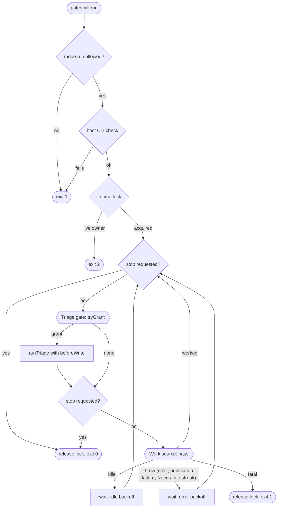

# Local `patchmill run` loop for one runner per clone

Issue: [#398](https://github.com/rochecompaan/patchmill/issues/398). Part of
issue #230. Related to #356, #236, #360, and #361.

## Intent

A maintainer starts `patchmill run` under a process supervisor and leaves it.
The process triages issues and runs them one at a time, in label mode or local
state mode. It needs no control plane.

This runner is the runner that #360 and #361 extend. It is not a second loop. So
the parts that change later sit behind two small seams: the triage gate and the
work source. The runner shell does not change when they change.

## Goals

- `patchmill run` loops until a stop signal or an unrecoverable fault.
- Triage runs on an interval, in sequence with work.
- Each work pass calls `runOneIssue`, which sweeps merged issues, resumes this
  clone's own work, and selects the next issue.
- One runner per clone, enforced by a lifetime lock.
- A stop signal aborts the active run or triage and keeps the run resumable.
- Jittered, capped backoff for no work and for errors.

## Non-goals

- No local assignments, runner capacity, completion records, or new local
  workflow state. `runOneIssue` derives each phase from git and the repository,
  as today.
- No `--runner` flag. Control-plane mode adds it (#360).
- No Event ledger, desired mode, budget, or host-retry policy (#233, #235, #236,
  #237).
- No triage lane in parallel with work (#361).
- No change to issue selection. See Known limitations.
- No amendment of the #356 spec in this slice. That is a listed follow-up.

## Anti-goals

- A loop that calls the host in a tight cycle when nothing can advance.
- A stop signal that publishes `needsInfo` on the active issue, so that a person
  must reset it before the next start.
- Two runners in the same clone or its worktrees.

## Dependencies on merged work

- #357 (merged in `f7de8e6`) added `StateTrackingMode` in
  `src/kernel/state-tracking-mode.ts`, the `heldLock` option of `runOneIssue`,
  and the `beforeWrite` option of `runTriage`. This design uses the mode object
  and `beforeWrite`.
- #316 (merged in `1f38d27`) added `--test-timeout=120000` to the test scripts.
  Its spec drops the inactivity warning and points to #319. The Pi session limit
  `pi.timeoutMinutes` (90 minutes by default) bounds each unattended session.
  This design adds no stall detection.

## Approaches

1. **Three parts behind two seams (chosen).** A runner shell owns the lifetime
   of the process. A triage gate and a work source are injected. The local work
   source normalizes `RunOnceOutcome` into a `PassResult`. #360 and #361 add
   adapters, not a new loop. The issue specifies this approach.
2. **A shell loop that reads `RunOnceOutcome` directly.** It is smaller now. But
   the control-plane source returns different outcomes, so #360 changes the
   shell. This breaks the issue's rule that the shell never reads
   `RunOnceOutcome`.
3. **A shell script that calls `patchmill run-once` in a loop.** It has no lock,
   no abort into the active session, and no backoff state. It gives #360 nothing
   to extend.

## Domain and architecture analysis

This change defines architecture: a new long-lived process role, two seams, and
a lock. Domain modeling and codebase design apply.

### Terms

- **Runner.** The #356 spec, section Terminology, says that Runner replaces
  Coordinator. `GLOSSARY.md` still defines **Coordinator** and lists Runner
  under _Avoid_. This slice introduces the first runner, so it makes the
  replacement in `GLOSSARY.md`. The other entries that say "coordinator" change
  to "runner". The meaning does not change.
- **Runner shell**, **Triage gate**, **Work source**, **Pass result**, and
  **Lifetime lock** are new terms. See Companion artifacts.
- **Pass result** is not the **Normalized run outcome** of #236. A Pass result
  tells the shell only what to do next. A Normalized run outcome is a fact for
  the Event ledger. #236 can produce both from the same pass.
- **Lifetime lock** is not the per-issue lock in `src/kernel/lock.ts` (the
  "issue lock") and not the **Console session lock**. It covers the whole
  process, not one issue.

Single context: all terms go in the root `GLOSSARY.md`. No ADR is needed. The
decisions follow the approved #356 spec and the issue, and they are easy to
reverse.

### Modules and ownership

```text
src/kernel/runner/
├── shell.ts               # Runner shell: loop, triage order, backoff, stop
├── backoff.ts             # jittered capped delays (internal to the shell)
├── local-work-source.ts   # Work source: runOneIssue -> PassResult
├── local-triage-gate.ts   # Triage gate: interval
└── lifetime-lock.ts       # Lifetime lock: one runner per clone
src/cli/commands/run/main.ts  # CLI: config, mode, lock, signals, exit codes
src/kernel/state-tracking-mode.ts  # gains the `run` answer
src/kernel/run-once.ts     # an aborted unattended run pauses
src/config/config.ts       # gains the `run` section
```

### Runner shell

The shell is a deep module. Its interface is one function. It hides the loop
order, the backoff state, abortable waits, and the triage-then-work order.

```ts
export type PassResult =
  | { kind: "worked" } // run the next pass now
  | { kind: "idle"; reason: string } // back off
  | { kind: "fatal"; reason: string }; // stop for operator action

export type WorkSource = {
  /** One pass of unattended work. A throw is an error pass. */
  pass(signal: AbortSignal): Promise<PassResult>;
};

export type TriageGrant = {
  /** Passed to runTriage as `beforeWrite`. #361 checks its lease here. */
  beforeWrite?: () => Promise<void>;
  release(): Promise<void>;
};

export type TriageGate = {
  /** Undefined when triage must not run now. */
  tryGrant(): Promise<TriageGrant | undefined>;
};

export type RunnerShellInput = {
  workSource: WorkSource;
  triageGate: TriageGate;
  triage(grant: TriageGrant, signal: AbortSignal): Promise<void>;
  backoff: RunBackoffConfig; // from config.run
  signal: AbortSignal;
  sleep(ms: number, signal: AbortSignal): Promise<void>; // resolves early on abort
  random(): number; // [0, 1)
  log(line: string): void;
};

export type RunnerShellResult =
  | { kind: "stopped" }
  | { kind: "fatal"; reason: string };

export function runRunnerShell(
  input: RunnerShellInput,
): Promise<RunnerShellResult>;
```

Callers must know these facts:

- The shell never reads `RunOnceOutcome`. Only `PassResult` crosses the seam.
- **Loop order.** Each cycle is: stop check, triage when granted, stop check,
  one work pass, then the next cycle or a wait.
- **Triage.** The shell calls `tryGrant()`. On a grant, it awaits
  `triage(grant, signal)`, then calls `grant.release()` in a `finally`. A throw
  from `triage` is logged as `triage failed: <message>`. It does not stop the
  loop and does not change backoff. A throw from `tryGrant` is handled the same
  way.
- **Work pass.** `worked` resets both backoff streaks and starts the next cycle
  at once. `idle` resets the error streak, adds one to the idle streak, logs the
  reason and the delay, and waits. A throw resets the idle streak, adds one to
  the error streak, logs the message and the delay, and waits. `fatal` returns
  `{ kind: "fatal", reason }` at once.
- **Stop.** When `signal` aborts, the shell starts no new triage and no new
  pass. A wait ends early. The shell returns `{ kind: "stopped" }` after the
  active triage or pass returns or throws. A pass that throws after the abort is
  not an error.
- The shell does not catch errors from `grant.release()` beyond a log line.

The `sleep` and `random` dependencies enter through the input. Tests use a fake
sleep that records delays and resolves at once, and a fixed random source. The
production adapters are `node:timers/promises` `setTimeout` with its `signal`
option, with the abort rejection caught, and `Math.random`.

### Backoff

Backoff is internal to the shell, with its own tests through a small pure
function:

```ts
export type BackoffDelay = { initialSeconds: number; maxSeconds: number };
export type RunBackoffConfig = { idle: BackoffDelay; error: BackoffDelay };

/** streak >= 1. Returns milliseconds. */
export function backoffDelay(
  delay: BackoffDelay,
  streak: number,
  random: number,
): number;
```

The base is `min(maxSeconds, initialSeconds * 2^(streak - 1))`. The delay is
`base * (0.5 + 0.5 * random)`, in milliseconds. So the delay never exceeds the
cap, and two runners do not stay in step. The idle streak and the error streak
are separate. A `worked` pass resets both.

### Triage gate (local)

```ts
export function localTriageGate(input: {
  intervalMs: number;
  now: () => Date;
}): TriageGate;
```

- The first `tryGrant()` grants at once, so triage runs at startup.
- Later calls grant when `intervalMs` has passed since the last grant. The gate
  records the time when it grants, not when triage ends.
- The local grant has no `beforeWrite`, and `release()` does nothing.

Issue #361 replaces this adapter with one that asks the control plane for the
triage lock and checks its lease in `beforeWrite`. The `beforeWrite` hook exists
in `runTriage` since #357, so the seam has a real second adapter planned against
an existing interface. The fake gate in shell tests is the test adapter.

The CLI binds `triage` to
`runTriage(config, deps, { signal, onProgress, beforeWrite })`. Progress goes to
stdout through the existing `createTriageProgressReporter` in
`src/cli/commands/triage/progress-output.ts`. `runTriage` already warns and
continues when one issue fails, including a failed blocker write. It throws only
when `workflow.sync` or the issue listing fails, or when `beforeWrite` throws.

### Work source (local)

```ts
export function localWorkSource(input: {
  config: PatchmillConfig;
  deps: RunOnceDeps;
  runOneIssue: typeof runOneIssue;
}): WorkSource;
```

Each `pass(signal)` calls `runOneIssue(config, deps, { signal })` with no other
option and maps the outcome. The first matching row wins:

| `runOneIssue` outcome                                | `PassResult`                                         |
| ---------------------------------------------------- | ---------------------------------------------------- |
| `completed` or `stopped` with `publicationErrors`    | throw: `publication failed for issue #N: <errors>`   |
| `completed`                                          | `worked`                                             |
| `stopped`, label `inProgress`                        | `idle`: `issue #N waits for a planning pull request` |
| `stopped`, label `needsInfo`, third in a row or more | throw: `<k> runs in a row stopped with Needs Info`   |
| `stopped`, other cases                               | `worked`                                             |
| `no-work`                                            | `idle`: `no eligible issue`                          |
| `claimed-elsewhere`                                  | `idle`: `issue #N is claimed elsewhere`              |
| `refused`                                            | `idle`: the refusal reason                           |
| `paused`, signal aborted                             | `idle`: `stopping`. The shell then sees the abort.   |
| `paused`, signal not aborted                         | `fatal`: `run paused without a stop request`         |
| `dry-run`                                            | `fatal`: `unexpected dry-run outcome`                |
| a throw                                              | the throw passes through to the shell                |

A throw from the source is an error pass, so the shell applies error backoff.

**Publication errors.** `publicationErrors` means that a label or comment write
failed. The issue then keeps a `ready` or `inProgress` status on the host, so
the next pass selects it again. Reads often still work in this case, for example
with a token that cannot write or under a rate limit on writes. As `worked`, the
runner would repeat the writes in a tight loop. As an error pass, it backs off.
`run-once` already exits 1 for this case. A publication failure also counts in
the Needs Info streak when its label is `needsInfo`.

**Gate wait.** The `stopped`/`inProgress` row differs from the issue's table on
purpose. Such a stop means that a planning gate waits for a human merge. The
issue stays `inProgress`, and `selectRunIssue` in
`src/kernel/issue-selection.ts` selects the oldest `ready` or `inProgress`
issue. So the next pass selects the same issue again. As `worked`, the runner
would call the host in a tight loop until the merge. As `idle`, it backs off.
The planner proposed this change during planning, and the maintainer did not
object. See also Unchanged gate waits publish once.

**Needs Info streak.** The source counts `stopped` outcomes with label
`needsInfo` in a row, in memory. A `completed` outcome or a `stopped` outcome
with another label resets the count. Other outcomes do not change it. From the
third in a row (`NEEDS_INFO_STREAK_LIMIT = 3`, not configurable), each such
outcome is an error pass. So a broken provider or Pi installation that fails
every session does not move each `ready` issue to `needsInfo` without a pause.
The maintainer chose this interim guard during planning. The host-retry and
budget policy of #236 and #237 replaces it.

`claimed-elsewhere` is `idle` because a terminal or another clone holds the
issue. `refused` is `idle` because the per-issue lock is held, for example by a
terminal `run-once` in the same clone.

### State-tracking mode answer

`StateTrackingMode` gains one answer. Commands do not add new
`workflow.stateTracking` string checks.

```ts
readonly run:
  | { allowed: true; createWorkSource(input: LocalWorkSourceInput): WorkSource }
  | { allowed: false; reason: string };
```

Labels mode and local mode both answer
`{ allowed: true, createWorkSource: localWorkSource }`.
`src/kernel/runner/local-work-source.ts` imports only types from `run-once.ts`
and receives `runOneIssue` as input. This avoids a runtime import cycle, because
`run-once.ts` imports `state-tracking-mode.ts`.

No control-plane mode exists yet: `workflow.stateTracking` accepts only
`"labels"` and `"local"`. The slice that adds control-plane mode must answer
`{ allowed: false, reason: "patchmill run does not support control-plane mode yet (#360)." }`
until #360 adds its work source. This slice proves the refusal path in the CLI
with an injected mode that answers `allowed: false`.

### Lifetime lock

```ts
export type LifetimeLockRecord = {
  instanceId: string; // randomUUID() per process
  pid: number;
  processStart: string | null; // start marker, null when unknown
  host: string; // os.hostname()
  repository: string; // canonical Git common directory
  startedAt: string; // ISO time
};

export class LifetimeLockHeldError extends Error {
  readonly record: LifetimeLockRecord | undefined;
  readonly path: string;
}

export function acquireLifetimeLock(input: {
  repoRoot: string;
  runner: CommandRunner;
  now: () => Date;
  log: (line: string) => void;
}): Promise<{
  path: string;
  record: LifetimeLockRecord;
  release(): Promise<void>;
}>;
```

- **Path.** `<common>/patchmill/run.lock`. `<common>` is the real path of
  `git rev-parse --path-format=absolute --git-common-dir`, run in `repoRoot`.
  All worktrees of a clone share it. A second clone has a different common
  directory, so the lock does not stop a runner there.
- **Atomic ownership.** The lock reuses the method of `acquireLock` in
  `src/kernel/lock.ts`: a permanent file and a non-blocking exclusive `flock`.
  The kernel frees a `flock` when the process exits for any reason. So the
  `flock` alone decides ownership. The record is diagnostic data and the input
  for the stale check.
- **Live owner.** If the `flock` is held, the call throws
  `LifetimeLockHeldError` with the record.
- **Stale check.** When the `flock` is free and the file holds a record, the
  previous owner did not release it (an unclean exit). The call keeps the
  `flock` and checks the record:
  - Same host, and the PID is not alive: stale, whatever the start marker is.
    Replace the record and log `replaced a stale run lock (pid N, started T)`.
  - Same host, and the PID is alive with a different start marker (PID reuse):
    stale. Replace the record and log the same line.
  - Same host, and the PID is alive with the same start marker, or the PID is
    alive and either marker is unknown: not demonstrably stale. Release the
    `flock` and throw `LifetimeLockHeldError`.
  - Another host: not demonstrably stale, because `flock` across a network file
    system is not reliable. Release the `flock` and throw
    `LifetimeLockHeldError`. The message tells the operator to remove the file
    when that runner is gone.
  - An empty or unreadable record: a clean release or a crash during the write.
    Write the new record.
- **Start marker.** On Linux, field 22 (`starttime`) of `/proc/<pid>/stat`. On
  other platforms it is `null`. The PID liveness check is
  `process.kill(pid, 0)`, where `EPERM` counts as alive.
- **Release.** Truncate the file and close the handle, as `acquireLock` does.
  The file and its inode stay.

The lock covers one clone. In local state mode, workflow state is in the clone,
so one runner per repository is a documented rule, not an enforced one. In label
mode, the existing narrow claim race between clones stays.

### Signals and exit codes

The CLI `src/cli/commands/run/main.ts` owns the process. Its order is:

1. Parse arguments. Only `--help` is accepted. Other arguments exit 1.
2. Load the configuration once.
3. Ask `stateTrackingMode(config).run`. On `allowed: false`, print the reason
   and exit 1.
4. Check the host CLI with `host.checkCli()`. On failure, exit 1.
5. Take the lifetime lock. On `LifetimeLockHeldError`, print the owner and
   exit 2.
6. Install signal handlers, run the shell, and release the lock in a `finally`.

Signals:

- The first `SIGINT` or `SIGTERM` logs
  `stopping; send the signal again to force an exit` and aborts the shared
  `AbortController`. `runOneIssue` and `runTriage` already pass this signal to
  their Pi sessions, which stop their process groups.
- A second signal logs `forced exit` and calls the injected `exit(1)` at once.
  The lock file keeps its record, and the `flock` ends with the process. The
  next start replaces the record as stale.
- A forced exit also ends the 5-second `SIGKILL` timer in `supervisePi`
  (`src/kernel/pi-supervisor.ts`). A detached Pi process group that ignores
  `SIGTERM` can then live on. The README tells operators to run the runner under
  a supervisor that kills the whole control group. The systemd example keeps the
  default `KillMode=control-group` and sets `TimeoutStopSec=30`.
- The handlers are removed in the `finally`.

Exit codes:

| Code | Meaning                                                                                                                |
| ---- | ---------------------------------------------------------------------------------------------------------------------- |
| 0    | A clean stop after a signal.                                                                                           |
| 1    | Invalid arguments, configuration, or mode, a failed host check, a `fatal` pass, a forced exit, or an unexpected throw. |
| 2    | The lifetime lock has a live or not demonstrably stale owner.                                                          |

### An aborted unattended run pauses

Today `runOneIssue` returns `paused` only when a human channel is present.
Without one, an abort ends the session, verification fails with "The session was
aborted.", and the run publishes `needsInfo`. Tests in
`src/kernel/run-once-failures.test.ts` assert this ("aborted signal stops the
claimed attempt without starting Pi" and "workflow question policy: abort"). For
a supervised runner, a restart would then leave the issue for a person.

This slice changes `runOneIssue`, for `run` and plain `run-once` alike:

- If `options.signal` is aborted before the claim, `runOneIssue` returns
  `{ status: "no-work" }` without a claim and without output.
- After the claim, if `options.signal` is aborted when the run would publish a
  stop whose label is not `done`, and nothing was published yet in this attempt,
  the run sets `paused`. It replaces the stop with
  `{ label: "inProgress", summary: "Run paused.", warnings: [] }`, as the
  interactive pause does. It publishes nothing, and returns
  `{ status: "paused", issue, summary: "Run paused." }`. This covers an aborted
  session and a throw that the abort caused. Because the label is replaced, the
  run result, progress, and console line show the pause, not Needs Info.
- The issue keeps `inProgress`, so the next pass or the next `run-once` resumes
  it. `result.json` and the run history still record the attempt.

A `done` stop still publishes, because its work is complete and verified.

### Unchanged gate waits publish once

Without a change, each idle pass on a gate-waiting issue would publish the same
stop again. In label mode, `LabelWorkflowState.setStatus` posts a comment for
each status with a summary. So the issue would get the same "Waiting for it to
be merged" comment on each pass, about 96 times per day at the 15-minute idle
cap. The maintainer chose to publish an unchanged gate wait only once.

`runOneIssue` changes as follows, in every mode:

- The rule applies only to an unattended run (no `deps.human`) whose stop came
  from `derivedStop` before any session started in this attempt, with label
  `inProgress`.
- Before it publishes, the run reads the newest earlier `result.json` in the
  issue's run directory (`<runsDir>/issue-N/*/result.json`, newest by
  `finishedAt`, other than its own).
- If that result has `outcome.status === "stopped"`,
  `outcome.label === "inProgress"`, and `outcome.summary` equal to the new
  summary, the run does not publish. It still writes its own `result.json`, with
  the same outcome and `"republished": false`. It prints
  `Unchanged planning gate wait; not republished.` to stderr.
- A missing or unreadable earlier result means that the run publishes as today.
- The outcome is unchanged: `{ status: "stopped", label: "inProgress", ... }`,
  so the work source maps it to `idle`.

The comparison uses the run history that already exists. It adds no new local
state. The summary from `planningGateComment` includes the pull request state
and URL, so a change in the gate, for example a closed pull request, publishes
again. The planning session that opens the pull request publishes its own
summary, which differs from the gate summary. So a gate wait gives two comments:
the planning result and the first gate wait.

The claim still sets `inProgress` on each pass, without a summary. In label mode
this is a label write with no comment. In local mode it appends a status record.
This is the behavior of `run-once` today.

### Configuration

`patchmill.config.json` gains an optional `run` section. The configuration loads
once at startup.

```json
{
  "run": {
    "triageIntervalMinutes": 5,
    "idleBackoff": { "initialSeconds": 60, "maxSeconds": 900 },
    "errorBackoff": { "initialSeconds": 30, "maxSeconds": 1800 }
  }
}
```

Each value must be a positive number, and each `maxSeconds` must be at least its
`initialSeconds`. Otherwise `parseConfig` throws `ConfigError` with the key
name. Other commands ignore this section.

### Logging

The shell and the CLI write one line per event to stderr, with the prefix
`patchmill run:`. Events are: start (with instance ID and lock path), triage
start and end, pass result, wait (reason and seconds), errors, stop, and exit.
`runOneIssue` and `runTriage` keep their own output.

## Visual explanation

The diagram shows one cycle of the shell and where each seam sits.



The seams and their adapters, now and later:

```text
Runner shell (unchanged by #360 and #361)
├── Triage gate
│   ├── localTriageGate        (this slice: interval)
│   ├── fake gate              (shell tests)
│   └── control-plane lock     (#361: lease checked in beforeWrite)
└── Work source
    ├── localWorkSource        (this slice: runOneIssue -> PassResult)
    ├── fake source            (shell tests)
    └── control-plane source   (#360: assignments)
```

## Known limitations

- **Head-of-line wait.** Selection takes the oldest `ready` or `inProgress`
  issue. An older issue that waits for a planning pull request merge therefore
  holds the runner, and younger `ready` issues wait too. This is the behavior of
  `run-once` today. A change belongs to issue selection, not to this slice.
- **Triage and work in sequence.** A long triage delays work, and a long run
  delays triage. #361 moves triage to its own lane.
- **Second clone.** The lock does not cover a second clone of the repository.
- **Triage timing.** The shell asks the gate only between waits. So triage runs
  every `max(triageIntervalMinutes, current wait)`, which can be up to 30
  minutes during error backoff.
- **Run directories.** Each idle pass on a gate-waiting issue still writes a
  small run directory under `<runsDir>/issue-N/`. Cleanup of old run directories
  is out of scope.
- **Needs Info guard.** The guard backs off after three `needsInfo` stops in a
  row, but those three issues still move to `needsInfo`. #236 and #237 replace
  the guard with a real host-retry and budget policy.

## Verification

| Acceptance criterion                                                                                                                                 | Verification                                                                                                                                     |
| ---------------------------------------------------------------------------------------------------------------------------------------------------- | ------------------------------------------------------------------------------------------------------------------------------------------------ |
| Shell tests with a fake work source and fake triage gate cover each `PassResult`, backoff and its reset, and a signal during a run and during triage | `src/kernel/runner/shell.test.ts`                                                                                                                |
| Local work source tests cover each `runOneIssue` outcome in the table                                                                                | `src/kernel/runner/local-work-source.test.ts` with a fake `runOneIssue`                                                                          |
| Lock tests cover a live owner, stale replacement, and recovery after an unclean exit                                                                 | `src/kernel/runner/lifetime-lock.test.ts`, with a forked child process for the live owner and a killed child for the unclean exit                |
| `patchmill run` refuses in control-plane mode until #360                                                                                             | `src/cli/commands/run/main.test.ts` with an injected mode answer `allowed: false`, and `state-tracking-mode.test.ts` for the two current answers |
| `npm test`, `npm run lint`, `npm run build`, `nix build` pass                                                                                        | Run each command                                                                                                                                 |

Other tests: the aborted unattended run returns `paused` and keeps `inProgress`
(`run-once-failures.test.ts`), an unchanged gate wait publishes once
(`run-once.test.ts`), the publication-error and Needs Info streak rows
(`local-work-source.test.ts`), the `run` config validation
(`src/config/config.test.ts`), and the CLI exit codes 0, 1, and 2
(`src/cli/commands/run/main.test.ts`).

`nix build` is required because the CLI command list and `README.md` change. No
npm dependency changes.

## Frontend design

Frontend design does not apply. This change adds a CLI command and kernel code.
It changes no browser-visible surface.

## Documentation

- `README.md`: add `patchmill run` to the Commands table, a short "Run
  unattended" section with an example supervisor unit, the exit codes, the
  one-runner-per-repository rule in local state mode, and the `run`
  configuration keys. State that Ctrl-C in `run-once` now pauses the run.
- `site/src/content/docs/using-patchmill/run.md`: a new "Run unattended" page
  with the same content in more detail, linked from the sidebar in
  `site/astro.config.mjs` after Run-once.
- `site/src/content/docs/using-patchmill/run-once.md`: Ctrl-C pauses an
  unattended run, and the next start resumes it.
- `site/src/content/docs/getting-started/configuration.md` and
  `site/src/content/docs/reference/configuration-example.md`: the `run` keys and
  their defaults.
- `src/cli/main.ts`: add `run` to `HELP_TEXT` and `COMMANDS`.

## Left to the builder

- The exact wording of log lines, other than those quoted above.
- How the CLI test injects the mode answer, for example an optional
  `stateTrackingMode` function in the CLI's `Options`, as other commands inject
  `runOneIssue`.

## Follow-up after merge

- Rescope #236 to add the Event ledger, desired mode, and budget gate to this
  runner.
- Rescope #360 to add the control-plane work source and assignments.
- Rescope #361 to replace the triage gate and run triage in its own lane.
- Amend the #356 spec, which says that `run` requires control-plane mode.

## Companion artifacts

- `GLOSSARY.md`: [Glossary](../../GLOSSARY.md). Replaces **Coordinator** with
  **Runner**, and adds **Runner shell**, **Triage gate**, **Work source**,
  **Pass result**, and **Lifetime lock**.
