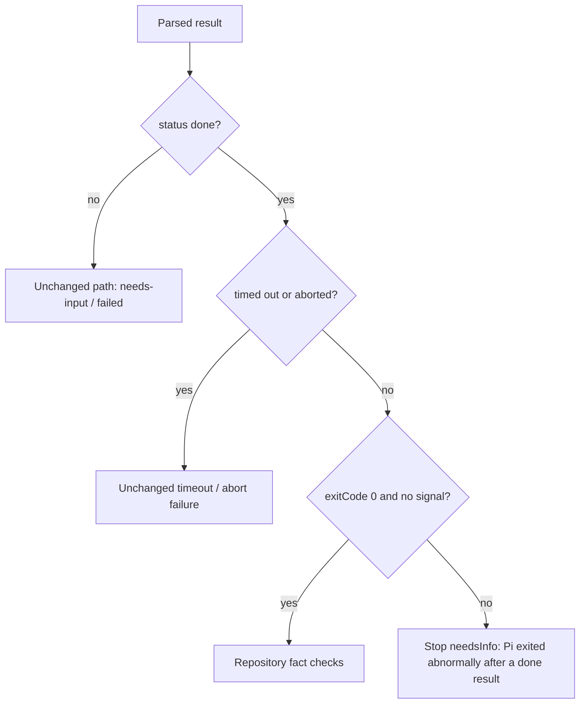

# Fail a phase when Pi exits abnormally after a done result

Issue: [#374](https://github.com/rochecompaan/patchmill/issues/374). Follow-up
from #305 (PR #373), review finding I1. Related: #407.

## Problem

`verifyOutcome` in `src/kernel/verify.ts` fails a phase only for three causes:
the session timed out, the session was aborted, or the result did not parse. It
does not read the exit code or the signal of the Pi process.

Thus Pi can crash after the agent writes a `done` result block. If the
repository facts look correct, Patchmill accepts the phase as successful. Causes
include a non-zero exit, an out-of-memory kill, or an external `SIGKILL`.

- RPC mode (`src/kernel/pi-rpc.ts`) is the only kernel launcher. When Pi exits
  before it settles, `runPiRpc` keeps the text of the last assistant message as
  `stdout`. Example: the agent writes `done`, starts a background reviewer, and
  Pi dies before the review result arrives.
- Print mode (`src/kernel/pi-supervisor.ts`) has the same gap. Real Pi writes
  stdout only at the end, but the fake Pi writes it before it exits.

The current unit test `verified PR succeeds with exit code ${exitCode}` in
`src/kernel/verify.test.ts` asserts this gap: a `done` result with exit code `1`
or `null` gives the label `done`.

## Decisions

### Clean exit

A **clean exit** is a session with `exitCode === 0` and no `signal`. Each other
exit is abnormal. This includes `exitCode: null` without a signal. This
definition is the same as the "clean exit (code 0)" that #407 uses for its
re-prompt. Thus #407 cannot hide an abnormal exit that this change fails.

Reason for the strict rule: Node gives `code: null` only together with a signal.
Only synthetic sessions give `null` without a signal, and those synthetic
sessions do not carry a `done` result. An unknown exit is not proof of success.

### New verification failure

In `verifyOutcome`, add one failure cause. All of these conditions must be true:

1. The result parsed (`result.ok`).
2. The result status is `done`.
3. The session did not time out and was not aborted.
4. The session did not have a clean exit.

The failure joins the existing `failures` list. Thus the phase stops with the
label `needsInfo`, and the comment has the reason, the log path, the agent
summary, and the exit code line. The repository fact checks do not run. This is
the same as for a timeout.

The reason text is one of these:

| Session                       | Reason                                                  |
| ----------------------------- | ------------------------------------------------------- |
| `signal` set (e.g. `SIGKILL`) | `Pi was stopped by signal SIGKILL after a done result.` |
| `exitCode` non-zero (e.g. 7)  | `Pi exited with code 7 after a done result.`            |
| `exitCode: null`, no signal   | `Pi exited without an exit code after a done result.`   |

The signal row comes first, because a signal exit has `exitCode: null`.

When the session has a signal, the last comment line becomes
`Exit code: null (signal SIGKILL)`. Without a signal, the line stays
`Exit code: <code>`. Existing tests match `exit code: <code>`, and they stay
valid.

### Unchanged behavior

- A timeout or an abort keeps its current reasons. The new cause does not add a
  second reason to them (condition 3).
- A `needs-input` or `failed` result keeps its current path for each exit code.
  The "nonzero question" test in `src/kernel/run-once-failures.test.ts` passes
  without change. `workerQuestion` and `workerGuidance` in
  `src/kernel/interactive-loop.ts` do not change.
- A parse failure keeps its current reason.
- Triage (`src/kernel/triage.ts`) already rejects `exitCode !== 0`. It does not
  change.

### Session type

`PiSession` already records `signal`. `VerifyInput.session` in
`src/kernel/verify.ts` and `PhaseRun.session` in `src/kernel/launch.ts` pick
only `exitCode`, `timedOut`, and `aborted`. Add `signal` to both as an optional
field:

```ts
session: Pick<PiSession, "exitCode" | "timedOut" | "aborted"> &
  Partial<Pick<PiSession, "signal">>;
```

Reason for optional: four producers make synthetic sessions with no Pi process.
They are `src/console/worker-launcher.ts`, `src/console/controller.ts`,
`src/console/planning-conversation.ts`, and `test-support/fake-human.ts`. A
required field adds churn to them and to many tests, but adds no safety. A
signal exit always has `exitCode: null`, and the clean-exit rule fails `null`.
Thus a producer that omits `signal` still fails. Only the reason text is less
exact. `rpcModeLauncher` returns the full `PiSession`, so real sessions supply
the signal.

### Effect on other producers

- `src/console/worker-launcher.ts` maps a pi-subagents completion that is not
  `complete` to `exitCode: 1`. A `done` result from such a completion now fails.
  This is the intended behavior.
- `runPiRpc` sets `exitCode: 1` when Pi exits 0 after a failed prompt or a final
  message that stopped for length (`src/kernel/pi-rpc.ts`). A `done` result in
  such a session now fails with `Pi exited with code 1 after a done result.`
  This matches print mode. The Pi session log gives the cause.
- `src/console/planning-conversation.ts` returns `exitCode: 0`. Interactive
  planning approval does not change.

## Tests

The Testing Value Gate applies. Each test proves production behavior of a bug
fix.

- `src/kernel/verify.test.ts`:
  - A `done` result with `exitCode: 7` stops with `needsInfo`. The comment has
    `Pi exited with code 7 after a done result.`, the log path, and the summary.
  - A `done` result with `exitCode: null, signal: "SIGKILL"` stops with
    `needsInfo`. The comment has the signal reason and
    `Exit code: null (signal SIGKILL)`.
  - A `done` result with `exitCode: null` and no signal stops with `needsInfo`.
  - Change `verified PR succeeds with exit code ${exitCode}` to run only for
    `exitCode: 0`. Its `1` and `null` cases contradict the new contract.
  - Change the `implementation rejects ${name}` cases to `exitCode: 0`, so that
    they still test the fact diagnostics. Their exit-code assertion becomes
    `exit code: 0`.
  - The timeout and abort cases stay. Add an assertion that their comment does
    not contain `after a done result`.
- `src/kernel/run-once-failures.test.ts`: one new test with the fake Pi in RPC
  mode. The step opens a valid pull request that closes the issue, writes the
  `done` result, and then exits with code 7 (`exitCode: 7`). The run stops with
  `needsInfo`. The comment has `Pi exited with code 7 after a done result.` The
  label is not `agent-done`. Before the change, this run completes.
- A second case of the same test uses a new fake Pi step field `killSignal`.
  `test-support/fake-pi-rpc.mjs` sends that signal to its own process after the
  result message. This proves that the real signal reaches `verifyOutcome`
  through `rpcModeLauncher`.

Verification: `npm test`, `npm run check:types`, and `npm run lint` pass.

## Acceptance criteria map

| Criterion                                   | Proof                                               |
| ------------------------------------------- | --------------------------------------------------- |
| `done` with `exitCode` 7 fails              | `verify.test.ts` and the run-once test              |
| `done` with `signal: "SIGKILL"` fails       | `verify.test.ts` and the run-once `killSignal` case |
| `needs-input` with exit 1 keeps `needsInfo` | Existing "nonzero question" test, unchanged         |
| Timeout and abort do not change             | Existing cases plus the new negative assertion      |
| Run-once test with the fake Pi crash        | New `run-once-failures.test.ts` test                |
| `npm test`, `check:types`, `lint` pass      | Final verification step                             |

## Out of scope

- The #407 re-prompt for a clean exit without a result block.
- Changes to triage, print mode, or the RPC client.
- A retry after an abnormal exit.

## Domain and architecture assessment

This change does not define or change architecture. It adds one failure cause
inside the existing `verifyOutcome` module and widens one session type by an
optional field. No module, seam, or adapter changes. Thus domain modeling and
codebase design do not apply. No glossary term changes. "Clean exit" is local to
this rule and to #407; it does not need a glossary entry now.

Frontend design does not apply. The change is kernel behavior with no
browser-visible output.

## Visual explanation

The decision order in `verifyOutcome` after the change:

```diff
 verifyOutcome(input)
   failures = []
   if session.timedOut  -> "The session timed out."
   if session.aborted   -> "The session was aborted."
   if !result.ok        -> result.reason
+  if result is done
+     and not timedOut and not aborted
+     and not (exitCode === 0 and no signal)
+                       -> abnormalExitReason(session)
   if failures           -> stop needsInfo (reason, log, summary, exit line)
   else if status != done -> stop needsInfo "The agent reported ..."
   else                   -> repository fact checks (unchanged)
```



## Planning review

Combined pass with the plan
(`docs/plans/2026-11-22-issue-374-fail-a-phase-when-pi-exits-abnormally-after-a-do-plan.md`).

- Reviewer: canonical `reviewer` agent, model `claude-bridge/claude-opus-5-5`,
  thinking `high`. Base revision `12f871afd84725007a81cd629cae8e5ac6182444`.
- Survey: the reviewer read `verifyOutcome`, its callers through
  `verifyPlanningApproval` and `run-once.ts`, `rpcModeLauncher`, `runPiRpc`
  close handling, the synthetic session producers, and the fake Pi. It confirmed
  the gap and the clean-exit rule.
- Findings (no blockers):
  - S1 (suggestion): the spec did not say that the `exitCode: 1` that `runPiRpc`
    sets for a failed prompt or a truncated message now fails a `done` result.
    Accepted: added a bullet under "Effect on other producers".
  - S2 (suggestion): the spec said the run-once step commits and pushes; the
    plan did not. Accepted: removed "commits, pushes" from the spec.
- Inspection limits: no tests ran. The reviewer did not confirm that real Pi in
  RPC mode always exits 0 after a good run, or the full set of pi-subagents
  completion states.
- Confirmation: a fresh scoped confirmation confirmed S1 and S2 with no new
  problem.
- Final body SHA-256:
  `e38d428f5aa3dd8b9aeba35f5bbe67105644a959ff6f0095142dadb7534ae10f`.
- Outcome: `ready`.
