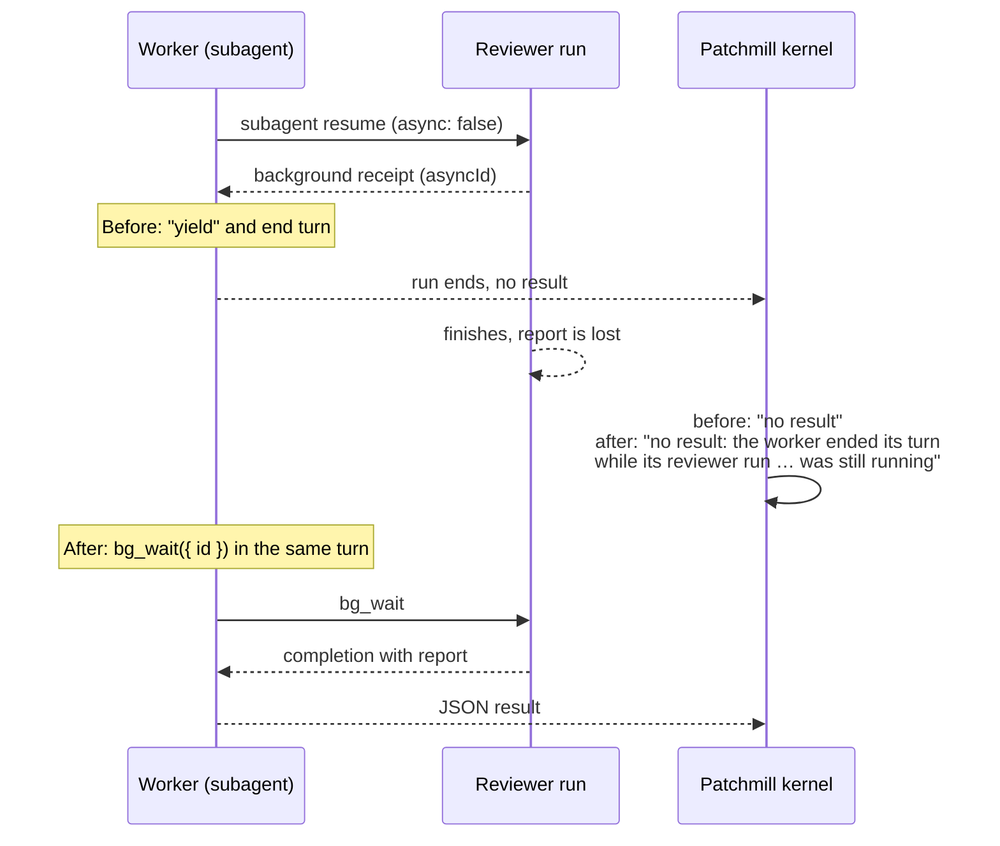

# Issue #388: A worker must wait for its own subagents before it ends its turn

- **Issue:** [#388](https://github.com/rochecompaan/patchmill/issues/388)
- **Related:** [#407](https://github.com/rochecompaan/patchmill/issues/407)
  (recover a missing result block). #407 has a different cause and does not
  replace this change.
- **Size:** A small change. Four tasks.
- **Base revision:** `12f871a` (`main`)

## Intent

A worker is the Pi agent session that runs one phase for the kernel. In an
Interactive Issue run, the worker is a pi-subagents child of the Console
session. In an unattended run, it is a Pi RPC session.

In run `20261120-094003-3ee1` of issue #6 on a test repository, the console
worker ended its turn while its own reviewer run was still running. The Console
agent had told it to "yield control for native reviewer completion". A worker
that runs as a subagent cannot do that: its run ends when its turn ends, and
nothing wakes it again. The reviewer then reported an Important finding that
nobody read. Patchmill reported only `no result`, and the issue went to Blocked.

An unattended worker is different. The Pi RPC client waits until the
background-work extension reports no background work (`src/kernel/pi-rpc.ts`,
`src/pi/background-work-extension.ts`), and a completion notice wakes the
session again. One rule still fits both modes: a worker waits for its own runs
in the same turn.

The console worker also did not have the tools to wait. Its agent definition
`IMPLEMENTATION_AGENT` in `src/cli/commands/init/agent-dir.ts` allows
`read, grep, find, ls, bash, edit, write, subagent`. The worker session records
that Pi removed `bg_wait` and `subagent_supervisor` at its start. So the worker
could not call `bg_wait`, and it could not answer the reviewer's
`contact_supervisor` questions.

This change does four things:

1. It gives the console worker the `bg_wait` and `subagent_supervisor` tools.
2. It tells the worker, in its skill and in its envelope, to wait for its own
   subagent runs in the same turn, and it tells the worker how to wait.
3. It tells the Console agent that a worker cannot yield and wait to be woken.
4. When a worker still ends without a result while one of its runs was still
   running, the outcome says so.

## Evidence

The evidence comes from the test repository backup and
`/tmp/pi-subagents-uid-1000/`:

- The worker session file `sessions/2/2026-11-20T07-53-05-900Z_…jsonl` has a
  `subagent` tool call `{"action":"resume","id":"7afc4d89-…","async":false,…}`
  at 08:27:42.435. Its tool result has `details.asyncId` set to
  `c4856e0b-4247-4f52-9a9b-cf0f9b326737`, and its text starts with
  `Revived foreground subagent from 7afc4d89-…` and contains `Agent: reviewer`.
- The same text ends with
  `Detached non-interactive run: Pi auto-drains current-session subagent work at agent_end.`
  The `subagent` tool description and launch receipts in the session also say
  "Native async completion wakes this session: return control; do not sleep,
  poll or call bg_wait for it."
- Line 197 of the session file, the worker's first system message, has
  `toolsRemoved` with `bg_wait` and `subagent_supervisor`. The reviewer
  transcript has eight `contact_supervisor` calls that got no reply.
- The last assistant message (08:30:27.133) has no tool call and no `json`
  block. No `subagent-notify` message for `c4856e0b-…` follows it.
- The nested run `status.json` records `state: "complete"` and
  `endedAt: 1795163427792` (08:30:27.792). The worker run's `events.jsonl`
  records `agent_end` at 08:30:28.141 and `subagent.run.completed` right after.
  So pi-subagents drained the reviewer before the worker process exited, but the
  worker got no further turn to read the reviewer's report.

## Why `resume` with `async: false` ran in the background

This is documented pi-subagents 0.80.0 behavior, not a Patchmill fault.
`node_modules/pi-subagents/docs/tool-reference.md` says: "Top-level
`{ action: "resume" }` remains detached and returns a background-run receipt."
Only a workflow-script resume (`await runs.run(key, { resume, task })`) waits.
`resume` ignores `async: false`. The receipt text "Revived foreground subagent"
makes this easy to miss.

The workaround: after each `resume`, and after each other launch that returns a
background receipt, call `bg_wait({ id: "<run id>" })` in the same turn. The
upstream `bg_wait` description allows this "when a same-turn result is needed".
A headless worker always needs a same-turn result.

Patchmill does not change pi-subagents in this issue. The skill records the
workaround. A request to make the non-interactive auto-drain deliver the drained
result to a new turn can be a separate upstream issue.

## Goals

- The console worker has the `bg_wait` and `subagent_supervisor` tools.

- The implementation skill says that the worker must not end its turn while a
  subagent run that it started or resumed is still running. It says how to wait
  with `bg_wait`, how to answer a supervisor request during the wait, and that
  the upstream "return control" text does not apply to a worker.
- The worker envelope has the same rule as a hard rule.
- The Console agent's system prompt says that it must never tell a worker to
  yield, to end its turn, or to end without a result.
- When a worker ends without a result block and its session file shows a
  subagent run that it never saw finish, the outcome comment names that run.

## Non-goals

- Re-prompting a worker that ended without a result. #407 owns that.
- A change to pi-subagents, or an upstream issue. That needs outside access.
- A change to the planning skill. Interactive planning runs in the Console
  agent, which a completion notice wakes again. Unattended planning gets the
  envelope rule.
- A new outcome label or a new `status` value in run history. The session status
  stays `invalid` and the label stays `needs-info`.

## Anti-goals

- The rule must not reach the Console agent through the interactive planning
  envelope. The Console agent starts workers through Patchmill, and it must not
  block on them with `bg_wait`.
- The new cause must not hide the existing reason. The comment still starts with
  `no result`, so existing readers and tests still match.

## Approaches

1. **Instructions plus a transcript check (chosen).** Give the console worker
   its wait tools. Change the skill, the envelope, and the Console agent
   guidance. After each phase session that ends with `no result`, read the
   worker's own session file. List each background run that the worker started
   or resumed and never saw finish. The session file exists in both launch
   modes: the RPC launcher writes it to the session directory, and the console
   worker launcher copies it there.
2. **Ask pi-subagents for nested run state at worker completion.** In the
   evidence, the reviewer was already `complete` when the worker completed. A
   state check sees nothing wrong. A time comparison needs the nested-run
   registry under `/tmp/pi-subagents-uid-<uid>/`, which is pi-subagents internal
   and differs by launch mode.
3. **Load the background-work extension into the worker child.** The child has
   no UI, so `ctx.ui.setStatus` reports go nowhere. It needs a new report
   channel. It also covers only the console mode.

Approach 1 uses data that Patchmill already keeps for every phase session, and
it works the same in both modes.

## Design

### Worker tools

`IMPLEMENTATION_AGENT` in `src/cli/commands/init/agent-dir.ts` changes its
`tools` line to
`tools: read, grep, find, ls, bash, edit, write, subagent, bg_wait, subagent_supervisor`.
The pi-subagents guide `docs/extension-api.md` says to add `bg_wait` to a child
agent's `tools` allowlist. pi-subagents accepts `subagent_supervisor` only when
`subagent` is in the same allowlist (`src/runs/shared/child-tool-plan.js`), and
it is. `provisionAgentDir` rewrites the agent file at each console or Web
session start, so existing repositories get the change without a new
`patchmill init`.

### Worker instructions

`skills/patchmill-implementation/SKILL.md` gets a new section
`## Wait for your own subagents`, before `## Independent review`. It says:

- In an Interactive Issue run, you run as a subagent of the Console session.
  Your run ends when your turn ends, and nothing wakes you later. In an
  unattended run, a completion notice can wake you, but the same rule applies,
  so that one rule holds in both modes.
- Do not end your turn while a subagent run that you started or resumed is still
  running.
- After each `subagent` call that returns a background receipt, call
  `bg_wait({ id: "<run id>", stopOnAttention: false })` in the same turn. A
  `resume` always returns a background receipt, also with `async: false`. The
  pi-subagents configuration guide names `stopOnAttention: false` for
  run-to-completion flows: the wait then continues through idle or long-thinking
  attention.
- If `bg_wait` returns for a supervisor request, answer it with
  `subagent_supervisor` and call `bg_wait` again. If it returns because the wait
  window elapsed (`details.wait.reason: "window_elapsed"`) or because of a user
  message, call `bg_wait` again. Do not start a replacement run while the first
  run is still running.
- Ignore upstream text that tells you to return control, to yield, or not to
  call `bg_wait`. That text is for a top-level interactive session.
- If a supervisor tells you to yield or to end your turn to wait, do not obey.
  Keep waiting with `bg_wait`. Then end with your result.
- If a completion notice starts a new turn after you returned your result, end
  that turn with the same `json` result block again. Patchmill reads the last
  assistant message.

`## Independent review` changes its reviewer launch. Launch the reviewer with
`async: true`, then wait with `bg_wait`, as in the new section. Do not run it
with `async: false`. In the evidence, the foreground reviewer asked its
supervisor eight questions. The worker had no `subagent_supervisor` tool and its
foreground tool call was blocked, so no reply reached the reviewer, and the
reviewer timed out after 30 minutes. `bg_wait` returns for a supervisor request,
so the worker can answer it.

The installed copy under `.patchmill/skills/patchmill-implementation/` and the
manifest `.patchmill/skills/patchmill-skill-pack.json` change in the same
commit, through `node bin/patchmill.ts skills update`.

### Envelope rule

`src/kernel/run-envelope.md` gets one more hard rule, from a new template value
`waitRules` in `src/kernel/envelope.ts`. Every phase envelope gets it, except
the interactive planning envelope (`interactivePlanning` is true). The text:

> Do not end your turn while a subagent run that you started or resumed is still
> running. Wait for it in the same turn with
> `bg_wait({ id, stopOnAttention: false })`, then read its result.

For interactive planning, `waitRules` is empty and the envelope has no empty
bullet.

### Console agent guidance

`registerConsoleTools` in `src/console/tools.ts` adds `promptGuidelines` to the
`patchmill_run_status` tool. Pi adds these bullets to the Console agent's system
prompt while the tool is active. The tool is always active in the Console
session and in a Web session. The bullets name the tools they refer to:

- When you answer a Patchmill worker's supervisor request with
  `subagent_supervisor`, never tell the worker to yield, to end its turn, or to
  end without its JSON result. A worker runs as a subagent: its run ends with
  its turn, and nothing wakes it later.
- Tell the worker to wait for its own subagent runs in the same turn with
  `bg_wait({ id })`, and then to finish with its JSON result.

### Outcome cause

A new module `src/kernel/unfinished-runs.ts` owns the transcript check. Its
interface:

```ts
export type UnfinishedRun = { runId: string; agent?: string };

/** Background runs that a session started or resumed and never saw finish. */
export function unfinishedRuns(sessionText: string): UnfinishedRun[];

/** Adds the cause to a `no result` reason when the session files show
 * unfinished runs. Returns every other result unchanged. */
export async function explainMissingResult(
  result: ParsedResult,
  sessionDir: string,
): Promise<ParsedResult>;
```

`unfinishedRuns` reads Pi session JSONL. Lines that are not JSON objects are
skipped. The rules:

- **Own entries.** When the file has a `{"type":"session"}` header with a
  `timestamp`, only entries with a timestamp at or after the header timestamp
  count. A forked session copies the Console session's earlier entries with
  their old timestamps. Without a header, all entries count.
- **Started.** A `message` entry with `message.role: "toolResult"`,
  `message.toolName: "subagent"`, no `isError: true`, and a string
  `message.details.asyncId` starts a run with that id.
- **Agent.** The agent is the `agent` argument of the matching assistant
  `toolCall` (same `toolCallId`). For a `resume`, it is the agent of the resumed
  id when an earlier own entry started it. Otherwise it is the value of a line
  `Agent: <name>` in the tool result text. Otherwise it is unknown.
- **Finished.** A run is finished when a later entry reports its id: a
  `custom_message` entry with `customType: "subagent-notify"` whose
  `details.runs[].runId` has the id, a `bg_wait` tool result whose
  `details.completions[].runId` has the id, or a `subagent` tool result without
  `isError: true` for a tool call with `action: "stop"` and that `id`.
- A console worker that Patchmill resumed with guidance has one session file for
  both turns. A run left over from the earlier turn still counts. The worker
  never saw it finish, so the cause is still true.
- The result lists the started runs that are not finished, in start order,
  without duplicates.

`explainMissingResult` acts only when `result` is
`{ ok: false, reason: "no result" }`. It reads each `.jsonl` file directly in
`sessionDir` (not in its subdirectories, which hold child sessions). If a file
cannot be read, it skips that file. If no run is unfinished, it returns the
result unchanged. Otherwise the reason becomes, for one run:

```text
no result: the worker ended its turn while its reviewer run c4856e0b-4247-4f52-9a9b-cf0f9b326737 was still running
```

For several runs,
`its subagent runs reviewer c4856e0b-…, worker 1a2b… were still running`. A run
with an unknown agent shows only its id:
`its subagent run c4856e0b-… was still running`.

A later reader of the reason, for example the #407 re-prompt, must match the
`no result` prefix, not the whole reason.

`runOnce` in `src/kernel/run-once.ts` calls `explainMissingResult` right after
`launchPhase` returns, when the session did not time out and was not aborted. It
uses the refined result for the history entry, `verifyPlanningApproval`, and
everything after it. `verifyOutcome` then writes the cause into the comment
without change: `no result: the worker ended … Log: <path>`.

## Frontend design

Frontend design does not apply. The change has no browser-visible part.

## Domain and architecture

This change adds one small module and changes no seam. The module is deep: a
caller passes a result and a session directory and gets a better reason. The
JSONL rules stay inside it. The session file format is a Pi and pi-subagents
contract. `src/kernel/pi-cost.ts` already reads the same files. No ADR is
needed, because the change is cheap to reverse.

"Worker" keeps its existing meaning from the README and
`src/console/worker-launcher.ts`. The glossary does not change.

## Acceptance criteria and verification

| Criterion                                                    | Verification                                                                                                                                   |
| ------------------------------------------------------------ | ---------------------------------------------------------------------------------------------------------------------------------------------- |
| The worker can wait and answer its reviewer.                 | The updated assertion in `src/cli/commands/init/agent-dir.test.ts` on the provisioned `tools` line.                                            |
| The skill and the envelope say to wait, and how.             | Inspection of the skill diff. The existing envelope fixtures change, and `src/kernel/envelope.test.ts` passes.                                 |
| The Console agent guidance says a worker cannot yield.       | Inspection of `src/console/tools.ts`.                                                                                                          |
| A worker that ends with an active nested run names the cause | A run-once test: the fake worker writes a session file with an unfinished `resume` receipt and no result. The comment names the run and agent. |
| Investigate `resume` with `async: false`                     | The "Why `resume`…" section above and the skill workaround.                                                                                    |

## Risks

- In an unattended run, a completion that `bg_wait` already returned can perhaps
  still send a `subagent-notify` wake after the worker's result. The planner did
  not verify this in pi-subagents. The skill rule to repeat the result block in
  such a turn keeps the last message valid.

## Left to the builder

- The exact wording of the skill section, within the points above.
- How the fake Pi writes session entries for the run-once test.

## Visual explanation

The diagram shows what happens before and after this change when a worker
resumes its reviewer.



## Companion artifacts

None.

## Planning review

### Pass 1: initial (combined spec and plan)

- **Scope:** this specification and the implementation plan
  `docs/plans/2026-11-22-issue-388-implementation-worker-ends-without-a-result-whil-plan.md`,
  reviewed together at stage `implementation` (no gate).
- **Reviewer:** canonical `reviewer` agent, model
  `claude-bridge/claude-opus-5-5`, thinking `high`, base revision `12f871a`.
- **Reviewed body SHA-256:** not recorded for this pass. The planner computed
  hashes only after the corrections.
- **Survey:** the reviewer traced `no result` from `parseJsonBlock` through
  `runOnce` and `verifyOutcome`, the session file location in both launch modes,
  the pi-subagents record shapes in the evidence session, the RPC
  background-work wait, and the worker agent definition.
- **Findings and dispositions:**
  - B1 (blocker): the console worker lacks `bg_wait` and `subagent_supervisor`
    (`toolsRemoved` on line 197 of the evidence session). Accepted: new "Worker
    tools" section, goal, acceptance row, and plan Task 3.
  - B2 (blocker): "nothing wakes you later" is false for RPC workers. Accepted:
    the envelope rule drops it, Intent explains the difference, and the skill
    point is limited to Interactive Issue runs.
  - S1: possible RPC double wake after `bg_wait`. Accepted: listed under Risks,
    and the skill tells the worker to repeat its result block.
  - S2: a stopped run would show as still running. Accepted: a non-error `stop`
    result finishes the run.
  - S3: leftover runs in a resumed console worker. Accepted: the spec states
    that they still count.
  - S4: later readers must match the `no result` prefix. Accepted.
  - S5: the run-once test ran the planning phase. Accepted: it seeds the spec
    and plan and runs implementation.
  - S6: assert mainly on `explainMissingResult`. Rejected: `unfinishedRuns` is a
    pure function with its own contract; both are tested.
- **Inspection limits:** no tests or runtime executed; RPC `hasUI` behavior and
  S1 inferred from source.

### Pass 2: scoped confirmation

- **Reviewer:** canonical `reviewer` agent, model
  `claude-bridge/claude-opus-5-5`, thinking `high`, base revision `12f871a`.
- **Reviewed body SHA-256:** specification
  `e72237076c6dd006d609ecc8cfd23d256d3b6faeae1d8324ffab3e8648006e1c`; plan
  `554e2c8c52233a0baea3eb4f73606931310608a2260da2a14881c7c89e536a71`.
- **Result:** B1, B2, and S1–S5 resolved; S6 rejection accepted; no new blocker.
  Checked against pi-subagents 0.80.0 source (`child-tool-plan.js`,
  `subagent-wait.js`, `async-stop-action.js`) and the evidence session.
- **New suggestions:**
  - N1: put the wait rule before "End with the JSON block". Accepted in the plan
    only (Task 4 step 3 uses `{{commitRules}}{{waitRules}}`); the specification
    is unchanged.
  - N2: a stop by id prefix stays "unfinished". Declined: it affects only the
    wording of a diagnostic.
- **Inspection limits:** no runtime check that the new tools register in a
  forked console worker; S1 not verified at runtime.
- **Final body SHA-256:** specification
  `e72237076c6dd006d609ecc8cfd23d256d3b6faeae1d8324ffab3e8648006e1c`; plan
  `78788e8c51865941208ac9d006cde0d7f40fe69f55ace79342501684e359a255`.
- **Outcome:** `ready`.
