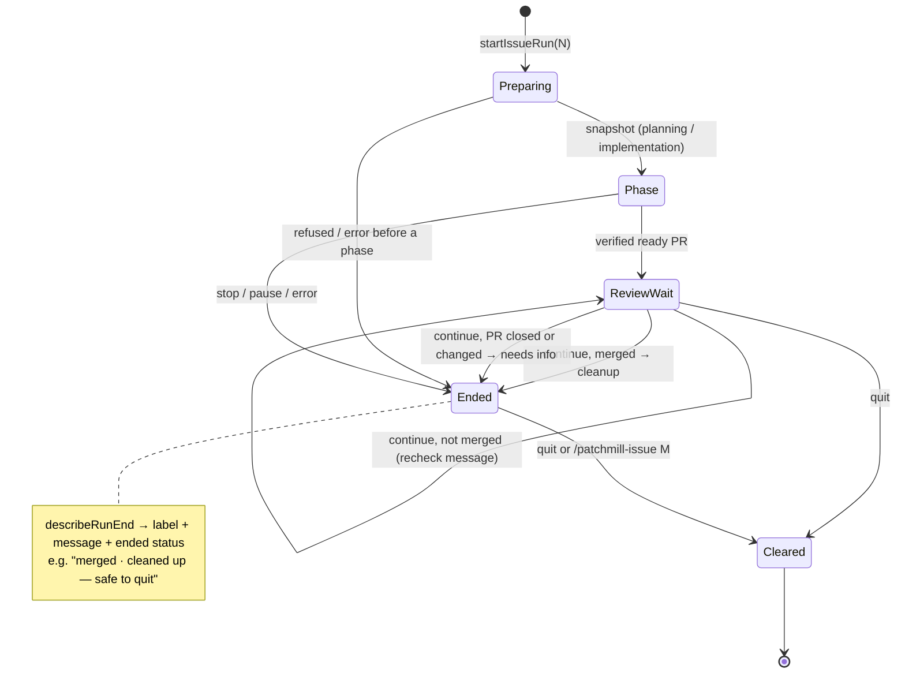

# Issue #406: Keep the issue visible and say what to do next while an Interactive Issue run waits for review

Issue: <https://github.com/rochecompaan/patchmill/issues/406>

## Intent

At the end of an Interactive Issue run, the maintainer does not know what to do.
The review-wait message is one line. When the run ends, the status bar goes
blank. The maintainer cannot see which issue the session was for, whether
cleanup ran, or whether it is safe to quit.

This change makes the console say, at each point, who acts next and how. The
status bar keeps the issue and a state label from the start of the run until the
maintainer quits or switches issues. The review wait becomes a working session:
the maintainer can ask the Console agent for pull request changes, and the agent
makes them. The run stays in the review wait until the maintainer says that the
pull request is merged or quits.

## Decisions from the maintainer

- The maintainer merges the pull request. Patchmill does not poll for the merge.
  The maintainer tells the Console agent to continue, and Patchmill checks the
  pull request again. Merge polling is out of scope (triage comment).
- During the review wait, the Console agent makes requested pull request changes
  itself. The guidance must not tell the maintainer to make the changes by hand.
- The run stays in the review wait until the maintainer says that the pull
  request is merged or quits the session.

## Current behavior

- `reviewWait` (`src/kernel/review-wait.ts`) calls `human.awaitContinue` with
  `${url}: waiting for the merge.`. A recheck of an open, unmerged pull request
  sends the same text again.
- `ConsoleController.awaitContinue` (`src/console/controller.ts`) posts the wait
  message with `triggerTurn: true`, so the Console agent sees it. It also
  resolves a pending `continueRun` with the same text.
- `ConsoleController.startIssueRun` calls `runStatus.clear()` in `finally`, so
  the status bar goes blank when the run ends for any reason. It shows nothing
  until the first `RunSnapshot`. That snapshot comes only after the merged-issue
  sweep, issue sync, selection, and claim.
- After the run settles, the controller only resolves a pending `continueRun`
  with the summary. It posts no end-of-run message of its own. `formatRunResult`
  output goes to the chat through `human.notify`. It shows the summary and
  fields, but no next step.
- `runOneIssue` (`src/kernel/run-once.ts`) calls `cleanupMergedIssue` and
  discards its `CleanupResult` (`cleaned`, `kept`, or `skipped`). The console
  cannot report whether cleanup finished.
- `ConsoleController.status()` returns `{}` after a settled run, except the
  stale snapshot. `patchmill_run_status` cannot report the outcome.
- An issue switch (`/patchmill-issue N`) replaces the Pi session. The old
  session gets `session_shutdown`, and the extension clears the status there
  (`src/console/extension.ts`). So "clear only on shutdown or switch" means:
  remove the clear at run end.
- A web session shows the same `patchmill` status text in the issue page header
  (`src/web/session/web-session.ts`). The new labels also show there.

## Goals

- The status bar shows the issue from the start of the run until shutdown or an
  issue switch. Only those two events clear it.
- The status bar label always says the current state, including after the run
  ends.
- The review-wait message names the pull request, says that the maintainer
  merges it, says how to continue, says what Patchmill does after the merge, and
  says how to ask for changes or stop the wait.
- A recheck of an unmerged pull request says that it is not merged yet.
- During the review wait, the Console agent makes requested pull request changes
  on the issue branch.
- At the end of the run, the console posts a short message. The message gives
  the outcome, the cleanup result, and the next step.
- `patchmill_run_status` reports the ended state and outcome after the run ends.
- After a stopped or failed run, or a cleanup that did not finish, the Console
  agent explains the problem from the summary and offers to resolve it, within
  safe limits.
- The Console agent gets the same model in its tool guidance. It can then answer
  "what now?" correctly.

## Non-goals

- Automatic merge polling.
- A kernel path that starts an implementation worker to revise a ready pull
  request in an Interactive Issue run.
- The offer to start the next issue after a merged run (#352).
- Changes to unattended runs, issue comments, labels, or persisted run progress.

## Anti-goals

- Guidance that tells the maintainer to edit code by hand.
- Guidance that suggests a step that does nothing. Examples: "Patchmill will
  notice the merge", or "continue" after the run has ended.
- A blank status bar while the session belongs to an issue.
- A status or message failure that changes a run decision or blocks shutdown.

## Approaches

1. **The Console agent makes changes in the issue worktree (chosen).** The agent
   already has the conversation, the repository, the tools, and the installed
   implementation skill. `patchmill_run_status` already returns the worktree,
   the branch, and the pull request. This needs only guidance, not a new kernel
   path. The maintainer picked this approach.
2. **Start an implementation worker for each requested change.** This needs a
   new kernel path that revises a ready pull request in an Interactive Issue
   run. Today a restart on a ready pull request goes into the review wait. Each
   fix also adds a worker round-trip. Rejected as too large for this issue. It
   can be a follow-up issue.
3. **Tell the maintainer to make the changes.** Rejected by the maintainer.

## Design

### Review wait (kernel)

`src/kernel/review-wait.ts` owns the wait text, because it owns the review wait.
Add
`reviewWaitMessage(input: { url: string; issue: number; recheck: boolean }): string`.
`reviewWait` passes `recheck: false` to the first `awaitContinue` call and
`recheck: true` to each later call. It also passes `recheck: false` on a restart
into the review wait, because the maintainer has not seen the message in this
attempt.

First message (exact copy, with values filled in):

```text
Pull request ready for review: <url>

- You review and merge the pull request. Patchmill does not check for the merge by itself.
- After the merge, tell me to continue. Patchmill then confirms the merge and removes the worktrees and branches of issue #<N>.
- If the pull request needs changes, tell me what to change. I make the changes on the issue branch and push them. The wait continues.
- To stop the wait, quit or pause the session. The next start of issue #<N> continues the wait.
```

Recheck message, when the pull request is still open and ready:

```text
Pull request <url> is not merged yet. The wait continues.

- Merge the pull request, then tell me to continue.
- If the pull request needs changes, tell me what to change.
- To stop the wait, quit or pause the session.
```

The loop logic, the labels, and the comments do not change. The issue already
has the done status when the wait starts, so the message does not promise to set
it.

The kernel text uses the Console agent's voice ("tell me", "I make the
changes"). This is acceptable because `ConsoleController` is the only production
adapter of `HumanChannel.awaitContinue`. The terminal console and the Web
session share it. "Quit or pause" covers both.

### Console agent guidance

The Console agent reads tool `promptGuidelines` in its system prompt. Add these
rules to `patchmill_continue_issue_run` in `src/console/tools.ts`. Change the
wording if necessary, but keep each rule:

- In a review wait, the maintainer reviews and merges the pull request.
  Patchmill does not detect the merge by itself. Call
  `patchmill_continue_issue_run` when the maintainer says that the pull request
  is merged or asks you to check again.
- When the maintainer asks for pull request changes during a review wait, make
  them yourself. Never tell the maintainer to edit the code. Get the worktree,
  branch, and pull request from `patchmill_run_status` (`snapshot.facts`). Work
  only in that worktree.
- Follow the rules of the patchmill-implementation skill for a revision of a
  ready pull request. Run the repository checks, commit, and push to the issue
  branch. Never force-push. Keep the pull request ready, and keep its closing
  reference. Never merge the pull request.
- After you push, tell the maintainer what changed. Then tell them to merge the
  pull request and tell you to continue.
- After the run ends, use `ended` from `patchmill_run_status` to say what to do
  next. Do not call `patchmill_continue_issue_run` for a run that has ended.
- When an end-of-run message says that you explain the problem, do it at once.
  Read the summary and the messages before it. Say in plain words what went
  wrong and how you can resolve it, and offer to do it. Do not only tell the
  maintainer to read the summary.
- Resolve a problem after the run only when the maintainer agrees. Work only in
  the issue worktree. Never discard uncommitted changes, and never remove a
  worktree or branch that Patchmill kept, unless the maintainer has seen exactly
  what would be lost. Never merge, force-push, or push the base branch. Never
  change issue labels: the kernel owns the run state.
- After the fix, tell the maintainer the next step. For a stopped or failed run:
  quit, and run `patchmill run-once --interactive --issue <N>`. For a cleanup
  that did not finish: Patchmill tries cleanup again at its next run start.

Change the `patchmill_run_status` description to "Show the current or ended
Issue run, worker, wait and estimated cost."

The Console agent also sees the review-wait and end-of-run messages, because
custom messages join the LLM context.

### Cleanup result (kernel)

- `RunSnapshot` (`src/kernel/run-snapshot.ts`) gets
  `cleanup?: CleanupResult["status"]`. The field is on the snapshot, not in
  `ObservedRunOutcome`, so `projectRunProgress` and the persisted progress
  schema do not change.
- `runSnapshot(...).ended` gets an optional third parameter `cleanup`.
- `runOneIssue` keeps the result of `cleanupMergedIssue` and passes its status
  to `snapshot.ended`. When cleanup does not run, the field is absent.

### Run end (new console module)

Add `src/console/run-end.ts`. This module owns the decision of what an ended run
means to the maintainer: one status label, one message, and one status report.
The controller and run-status stay free of outcome rules.

```ts
export type RunEndInput = {
  issue?: number; // the started issue, when known
  snapshot?: RunSnapshot; // the last snapshot, when any arrived
  settled: { outcome: RunOnceOutcome } | { error: string };
};
export type EndedRun = {
  issue: number;
  title?: string;
  outcome:
    | "merged"
    | "pr-ready"
    | "stopped"
    | "paused"
    | "failed"
    | "not-started";
  label: string; // status bar label
  summary: string;
  cleanup?: "cleaned" | "kept" | "skipped";
  message: string; // end-of-run chat message
  explain: boolean; // the Console agent explains the problem at once
};
export function describeRunEnd(input: RunEndInput): EndedRun | undefined;
```

It returns `undefined` only when no issue number is known: a run without a start
issue that returns `no-work` or throws before its first snapshot.

Rules:

- The issue number is from the snapshot, else the outcome, else the input. The
  title is from the snapshot.
- For `failed`, the summary is the error message. A run can throw after its
  ended snapshot, so the error must win.
- Otherwise the summary is from `snapshot.summary` for an ended snapshot, else
  the outcome's `summary` or `reason`, else `Issue run <status>.`.
- `merged` means `completed` and
  `snapshot.facts.pullRequest.state === "merged"`. `pr-ready` means `completed`
  otherwise. `stopped` and `paused` come from the outcome status. `failed` means
  a thrown error. `not-started` means `refused`, `claimed-elsewhere`, `no-work`,
  or `dry-run`.

Labels (exact):

| Case                                | Status bar label                                |
| ----------------------------------- | ----------------------------------------------- |
| merged, cleanup `cleaned`           | `merged · cleaned up — safe to quit`            |
| merged, cleanup `kept`              | `merged · cleanup incomplete — see the summary` |
| merged, cleanup `skipped` or absent | `merged · cleanup on next run — safe to quit`   |
| pr-ready                            | `PR ready · not merged — see the summary`       |
| stopped, label `needsInfo`          | `stopped: needs info — see the summary`         |
| stopped, label `inProgress`         | `stopped: in progress — see the summary`        |
| paused                              | `paused — start the issue again to continue`    |
| failed                              | `failed — see the error`                        |
| not-started                         | `not started — see the summary`                 |

Message shape (exact lines; leave out the `Cleanup:` line when the run did not
reach cleanup):

```text
Issue #<N> run ended: <outcome sentence>
Summary: <summary>
Cleanup: <cleanup sentence>
Next: <next step>
```

| Case              | Outcome sentence                                    | Cleanup sentence                                                                                                   | Next step                                                                                                                                          |
| ----------------- | --------------------------------------------------- | ------------------------------------------------------------------------------------------------------------------ | -------------------------------------------------------------------------------------------------------------------------------------------------- |
| merged, `cleaned` | the pull request is merged.                         | finished. The worktrees and branches are removed.                                                                  | You can quit the session now. To work on another issue, run `/patchmill-issue <number>`.                                                           |
| merged, `kept`    | the pull request is merged.                         | did not finish. The cleanup messages above say what was kept and why. Patchmill tries again at its next run start. | I explain the problem below and say how I can resolve it. After that, you can quit, or run `/patchmill-issue <number>` for another issue.          |
| merged, `skipped` | the pull request is merged.                         | did not run, because the host did not confirm the merge yet. Patchmill cleans up at its next run start.            | You can quit the session now. To work on another issue, run `/patchmill-issue <number>`.                                                           |
| pr-ready          | the pull request is ready but not merged.           | (none)                                                                                                             | Merge the pull request. Then quit, and run `patchmill run-once --interactive --issue <N>` to finish the issue.                                     |
| stopped           | `stopped (needs info).` or `stopped (in progress).` | (none)                                                                                                             | I explain the problem below and say how I can resolve it. After that, quit, and run `patchmill run-once --interactive --issue <N>` to start again. |
| paused            | paused.                                             | (none)                                                                                                             | Quit, and run `patchmill run-once --interactive --issue <N>` to continue.                                                                          |
| failed            | failed.                                             | (none)                                                                                                             | I explain the problem below and say how I can resolve it. After that, quit, and run `patchmill run-once --interactive --issue <N>` to start again. |
| not-started       | the run did not start.                              | (none)                                                                                                             | Read the summary. You can quit, or run `/patchmill-issue <number>` for another issue.                                                              |

`skipped` and an absent field use the same row. A `merged` outcome always went
through `cleanupMergedIssue`. `<N>` is the issue number. `<number>` stays
literal: the maintainer types another issue number there.

**The Console agent explains problems.** The maintainer must not have to read
the summary and work out the problem. For the `stopped`, `failed`, and merged
`kept` cases, `EndedRun.explain` is `true`. The controller then posts the
message with `triggerTurn: true`, so the Console agent responds at once. While
the agent is in a tool call, Pi steers the message into the current turn. The
agent says, in plain words, what went wrong according to the summary (or the
cleanup messages). It then says how it can resolve the problem, and offers to do
it. For all other cases, `explain` is `false`, and the message is posted with
`triggerTurn: false`.

### Run status (console)

`src/console/run-status.ts` keeps one job: fit one issue line into the terminal
width, and keep the line through resizes.

- Add
  `export type StatusLine = { issue: number; title?: string; label: string }`.
- `formatRunStatus(line: StatusLine, width: number)` keeps the current
  shortening rules. Only the title gets shorter.
- Add `progressLabel(snapshot: RunSnapshot): string` with the current state map.
  Change `review-wait` to
  `awaiting review — merge the PR, then tell me to continue`.
- `RunStatus.show(line: StatusLine)`, `refresh()`, and `clear()`. The error
  handling stays the same.

### Controller (console)

`ConsoleController` (`src/console/controller.ts`):

- `startIssueRun(issue)`: forget the previous `EndedRun`. When `issue` is known,
  show `{ issue, label: "preparing" }` at once.
- On each snapshot, when the console is not closing: keep it, and show
  `{ issue, title, label: progressLabel(snapshot) }`. While the console closes,
  a late snapshot (for example the ended snapshot after a quit) shows nothing.
- When the run settles and the console is not closing: `describeRunEnd(...)`,
  keep the result as `ended`, and show its line (`EndedRun` has the `StatusLine`
  fields). Post its message with `display: true` and
  `triggerTurn: ended.explain`. Resolve a pending `continueRun` with the same
  message, in a `finally` block, so that a failed post cannot leave that tool
  call waiting. This replaces the current thrown-error `notify`, so the error
  shows once.
- When `describeRunEnd` returns `undefined` and the run threw, post the error
  text as the controller does now, with `triggerTurn: false`. A thrown error is
  always visible. This case occurs only in tests: production always starts a run
  with an issue number.
- When the console is closing, do not show, keep, or post anything. Shutdown
  already cleared the status. `close()` resolves a pending `continueRun` with
  `The console is shutting down.`, so that tool call does not hang.
- `finally` sets `active` to `undefined` and does not clear the status.
- `status()` adds `ended` (the `EndedRun`) after a settled run. The last
  `snapshot` stays as it is now.
- `close()` still clears the status first.
- The settle step never rejects `active`. It catches and ignores a failure of
  `describeRunEnd`, `show`, or `sendMessage`, so a message failure cannot make
  `shutdown()` reject.

### Web session

A Web session ends its Pi process when the run ends
(`src/console/web-session-extension.ts`). It already posts its own closing line,
and the web page shows the last line as the ended text. Terminal next steps,
such as quit or `/patchmill-issue`, do nothing there. So the Web session keeps
its current end behavior. This is a planner decision, not a maintainer decision.

- `createPatchmillExtension` and `ConsoleController` get an option
  `announceRunEnd?: boolean`. The default is `true`.
- `createWebSessionExtension` passes `announceRunEnd: false`.
- With `false`, the controller does not post the end message. It still posts a
  thrown error, as it does now, because the web wrapper relies on that. The
  status line and `status().ended` still update. It still resolves a pending
  `continueRun`, with `ended.summary` instead of the end message, because the
  Web session exits at once and a terminal next step or an offer to resolve a
  problem does nothing there. Otherwise the Console agent stays in that tool
  call, Pi does not become idle, and the Web session does not exit.
- The review-wait text and the Console agent guidance apply to the Web session
  too.

### README

Update the Console agent tool list in `README.md`. The
`patchmill_continue_issue_run` entry says that the maintainer merges, then tells
the agent to continue. The `patchmill_run_status` entry says that it also
reports an ended run. Add one sentence that says the Console agent makes
requested pull request changes during the review wait.

## Frontend design

Frontend design does not apply. The change is text in a terminal status bar and
in chat messages. A web session shows the same status text in the issue page
header, but the layout, styles, and interaction do not change. No mockup is
necessary.

## Domain and architecture

This is a small change in the existing console modules and one kernel field. It
adds one console module, `run-end.ts`. It does not add a domain term or an ADR.
It widens one glossary entry: the Console agent now makes requested pull request
changes during a Review wait. `GLOSSARY.md` records that change. The change uses
the existing glossary terms: Interactive Issue run, Review wait, Console
session, and Console agent. The Console agent still never chooses a phase. Pull
request changes during a Review wait are not a phase. The kernel still decides
when the wait ends.

Module ownership:

- `review-wait.ts` owns the review-wait text, with the loop that uses it.
- `run-end.ts` owns outcome-to-label and outcome-to-message rules. Callers give
  it the last snapshot and the settled result. It hides the outcome cases,
  cleanup states, and copy. A deletion test passes: without it, the controller,
  status, and tool would each repeat the same case analysis.
- `run-status.ts` owns width fitting and the progress labels. It no longer needs
  to know about outcomes.
- `ConsoleController` owns order: show, settle, post, and clear on shutdown.

No new seam or adapter is necessary. `run-end.ts` is in-process computation, and
tests call it directly. The existing `runStatus` dependency of the controller
and the fake Pi API remain the test seams.

## Acceptance criteria and verification

| Criterion                                                                                         | Verification                                                                             |
| ------------------------------------------------------------------------------------------------- | ---------------------------------------------------------------------------------------- |
| After a run ends, the status keeps the issue and title with an end label until shutdown or switch | Controller tests for merged, stopped, and thrown runs; the status stays after settle     |
| Only shutdown or an issue switch clears the status                                                | Controller test: shutdown clears; an issue switch goes through the same shutdown         |
| The review-wait message names the pull request, says the maintainer merges, says how to continue  | `reviewWaitMessage` test, and a run-once test that checks the first and recheck messages |
| The end-of-run message gives the outcome, the cleanup result, and the next step                   | `describeRunEnd` table test, and a controller test that checks the posted message        |
| `patchmill_run_status` reports the ended state and outcome                                        | Controller `status()` test after settle                                                  |
| After a stopped or failed run, or a kept cleanup, the Console agent explains the problem at once  | Controller test: those end messages post with `triggerTurn: true`                        |
| The Web session keeps its closing line and shows a thrown error once                              | `web-session-extension.test.ts` stays green with `announceRunEnd: false`                 |
| The Console agent gets the same guidance                                                          | Direct inspection of `promptGuidelines` (no test for static text)                        |
| Cleanup result reaches the console                                                                | Run-once test: a merged review wait ends with `cleanup: "cleaned"` in the ended snapshot |

## Risks

- **The Console agent pushes a bad change.** The agent follows the
  implementation skill rules and runs the checks. A later continue still
  rechecks the pull request. If the agent removes the closing reference, the
  existing check stops the run with needs-info.
- **Long labels in a narrow terminal.** Only the title gets shorter. The longest
  label has 56 columns, so it fits in an 80-column terminal with the issue
  number. In a narrower terminal, the title goes first, as it does now.
- **The Console agent resolves a problem after the run.** An offer to resolve a
  problem can lead to data loss, for example when cleanup kept a worktree with
  uncommitted changes. The guidance lets the agent act only after the maintainer
  agrees, keeps it in the issue worktree, and forbids discarding work that the
  maintainer has not seen. It also forbids label changes, merges, and
  force-pushes.
- **The run settles during shutdown.** The controller does not show or post
  anything while it closes. Shutdown stays the only clear.

## Left to the builder

- Internal helper names in `run-end.ts`.
- The exact wording of the tool guidelines, if each rule stays.
- Test fixture details.

## Visual explanation

The diagram shows where the status bar label comes from during and after the
run.



## Companion artifacts

- `GLOSSARY.md`: [Console agent entry](../../GLOSSARY.md) widened for pull
  request changes during a Review wait.

## Planning review

All passes are combined passes: the scope is this specification and the
implementation plan
(`docs/plans/2026-11-22-issue-406-keep-the-issue-visible-and-say-what-to-do-next-w-plan.md`).
Reviewer: canonical `reviewer` agent, model `claude-bridge/claude-opus-5-5`,
thinking `high`. Base revision: `f88c16b1a9fed98b2a99fe51d384b806ace6985d`. The
planner did not record body hashes for the intermediate passes. Only the final
hashes are recorded.

### Review 1, pass 1: initial

- **Survey:** the reviewer checked `review-wait.ts`, `run-once.ts`,
  `merged-cleanup.ts`, `run-progress.ts`, `controller.ts`, `run-status.ts`,
  `extension.ts`, `tools.ts`, `web-session-extension.ts`, `web-session.ts`, and
  their tests.
- **Findings and dispositions:**
  - B1 (the Web session end path was not designed): accepted. Added the
    `announceRunEnd` option and the Web session section.
  - B2 (the cleanup test merged without closing the issue): accepted. The plan
    now uses `closeIssue: true`.
  - B3 (an old regex breaks on the new text): accepted. Task 2 replaces it.
  - B4 (broken controller tests, and an error lost when no issue is known):
    accepted. Added the error fallback, the corrected undefined cases, and the
    test updates.
  - S1 to S11: accepted. Pending continue on close, copy fixes, the error wins
    the failed summary, Task 3 adapts the controller, `endedStatusLine` dropped,
    README step, glossary entry, diagram paths, test env prefix,
    shutdown-after-end test, note on the kernel copy voice.
- **Limits:** no tests run. The reviewer simulated the promise order and the
  regex with node.

### Review 1, pass 2: scoped confirmation

- R1 (blocker: a test expected 2 messages, but shutdown closed before the second
  run settled): accepted. The test waits one tick.
- Suggestions accepted: a pending continue resolves in the Web session, exact
  stopped sentences, the web test is verify-only, the `setup()` type.
- **Outcome:** `blocked` (a blocker remained after the confirmation). The
  maintainer asked for a new Planning review.

### Review 2, pass 1: initial (maintainer request)

- **Findings:** no blockers. Eight suggestions.
- **Dispositions:**
  - S1 (no show after closing), S2 (shutdown test copy), S4 ("Quit, and"), S5
    (constraint wording), S7 (`<number>` literal), and S8 (the settle step never
    rejects): accepted.
  - S3 ("fix the cause" wording): settled by the maintainer. The Console agent
    explains the problem from the summary at once (`triggerTurn: true`) and
    offers to resolve it.
  - S6 (Web continue text): rejected at first as low impact, then adopted
    through review 2 pass 2, S-a.
- **Outcome:** `ready`.

### Review 2, pass 2: scoped confirmation

- B1 (blocker: the offer to resolve a problem after the run had no safety
  limits, so data loss or label changes were possible): accepted. The Console
  agent guidance now has a safety rule, and the Risks section and the glossary
  are updated.
- Suggestions accepted: S-a (the Web continue resolves with the summary), S-b
  (the settle step uses `finally`, with a test for a failed post), S-c (the goal
  and the test cover a kept cleanup), and S-d (the no-issue error case is
  test-only).
- **Maintainer ruling:** the maintainer reviewed the B1 correction in the chat
  and declined a further reviewer pass ("no reviewer pass needed, proceed"). The
  ruling settles B1.
- **Final body SHA-256:**
  - specification:
    `db8d61c18d53227fabf601f8c1213d0bd097d76c78ff89eec776e7d0bf1215fc`
  - plan: `018a16c63c109e6d829eb333605e9cc2bd6ca7fe4fd49021c1db11773315746a`
  - the plan was compared with specification
    `db8d61c18d53227fabf601f8c1213d0bd097d76c78ff89eec776e7d0bf1215fc`
- **Outcome:** `ready`.
