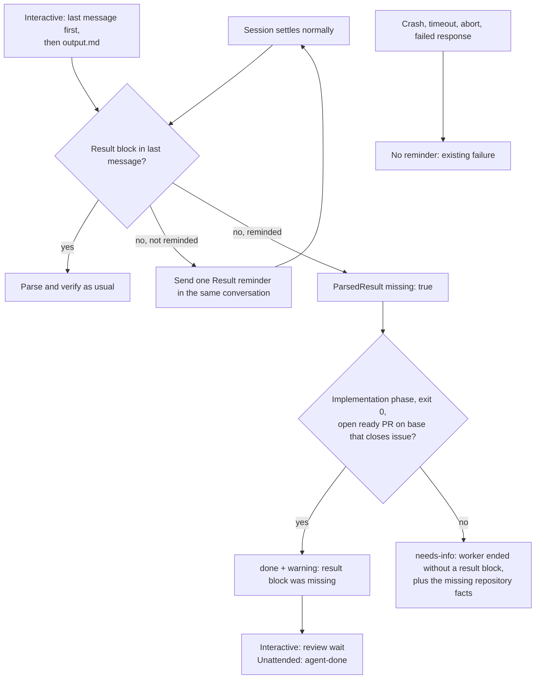

# Issue #407: Recover when a phase worker ends without its result block

- **Issue:** [#407](https://github.com/rochecompaan/patchmill/issues/407)
- **Size:** A project. Four plan tasks.
- **Base revision:** `12f871a` (`main`)

## Intent

A phase worker can finish its work and end its turn normally without the final
fenced `json` block. Patchmill then reads the phase as invalid. The run stops as
`needs-info` with the comment `no result Log: …`, although the pull request is
ready and closes the issue. Five interactive runs on this repository ended this
way (#357, #398, #384, #386, #377). In each run, `session-2.log` ends with a
prose summary and a link to a ready pull request.

The Planning review found the cause of those five runs. Each worker did end with
a valid result block in its last chat message. Patchmill read a different text,
the `output.md` report that the worker wrote on the instruction of pi-subagents.
See "Interactive runs" below.

This change makes the interactive launcher read the worker's last message first.
It also gives the worker one more chance to write the block, in the same
conversation. If the worker still writes no block, the repository facts decide
an implementation phase. If neither works, the stop reason says plainly that the
worker ended without a result block.

## Current behavior

- **Unattended runs** use `rpcModeLauncher` (`src/kernel/launch.ts`). It calls
  `runPiRpc` (`src/kernel/pi-rpc.ts`). In `startPiRpc`, `finish()` runs when the
  agent settles and the background-work report gives 0. `finish()` takes the
  text of the last assistant message and ends Pi's input. Pi then exits with
  code 0. The launcher parses the text with `parseAgentResult`
  (`src/kernel/result.ts`).
- **Interactive runs** start implementation through the human channel. The
  Console controller (`src/console/controller.ts`) calls
  `createWorkerLauncher(...).run` (`src/console/worker-launcher.ts`). The worker
  is a pi-subagents child. The launcher spawns it with
  `output: <sessionDir>/output.md`. pi-subagents then adds this instruction to
  the task:
  `Write your findings to exactly this path: …/output.md. This path is authoritative for this run.`
  (`injectSingleOutputInstruction` in
  `pi-subagents/src/runs/shared/single-output.js`). If the worker writes that
  file, pi-subagents uses the file as the run output. Otherwise it saves the
  last message there. After `client.waitForCompletion`, the launcher reads
  `output.md` (or `completion.output`) and parses it with `parseAgentResult`. A
  `complete` state gives exit code 0.
- **Evidence from the five runs.** In each run, the last assistant message in
  `sessions/2/*.jsonl` ends with a valid `done` block and `stopReason: "stop"`.
  Before that message, the worker wrote a prose report,
  `# Issue #N implementation result`, to `output.md` with the `write` tool. The
  launcher parsed the report, so it found no block. A `needs-input` or `failed`
  block in the last message is lost in the same way. The five failed runs used
  this spawn path. `client.resume(id, message)` continues a finished worker's
  conversation. `resumeImplementation` already uses it for maintainer guidance.
- `parseAgentResult` returns `{ ok: false, reason: "no result" }` when the text
  has no fenced `json` block.
- `verifyOutcome` (`src/kernel/verify.ts`) puts each `!result.ok` reason in its
  failure list. Any failure gives `needsInfo` with the reason, the log path and
  the exit code. It does not look at the pull request.
- `run-once.ts` enters the review wait after a verified implementation stop with
  label `done` in an interactive run:
  `if (deps.human && phase === "implementation" && stop.label === "done") await review(after.facts, false)`.
  An unattended `done` stop publishes `agent-done`.
- `isReviewWait` (`src/kernel/review-wait.ts`) is true for an open, ready pull
  request on the right base that closes the issue, in the implementation stage.
  The implementation branch of `verifyOutcome` checks the same four conditions
  and gives a diagnostic for each one that fails.
- Interactive planning ends through the `patchmill_submit_planning_result` tool,
  not a result block. `PlanningConversation` owns it. This change does not
  affect it.

## Goals

- The interactive launcher takes the result from the worker's last assistant
  message when that message has a result block. It uses the output text only
  when the last message has none.
- When a phase session settles normally and its last message has no result
  block, Patchmill sends one Result reminder in the same conversation. Patchmill
  then parses and verifies the answer as usual.
- If there is still no result block in an implementation phase, the repository
  facts decide. An open, ready pull request on the right base that closes the
  issue counts as `done`, with a warning that the result block was missing. An
  interactive run then enters the review wait. An unattended run publishes
  `agent-done`.
- If neither works, the stop reason says that the worker ended without a result
  block, and says which repository fact is missing.
- The implementation skill and the run envelope make the result block the last,
  required step.

## Non-goals

- A fix for #388 (the worker ends while its own reviewer runs). The reminder
  makes that case less harmful, but it does not prevent it.
- A fix for #374 (fail a phase when Pi exits abnormally after a `done` result).
- Review-wait visibility and next steps (#406).
- A Result reminder for interactive planning. Its submit tool replaces the
  result block.
- A repository-facts fallback for the planning phase. The issue scopes the
  fallback to implementation. A planning phase without a block stops with the
  clear reason.
- A reminder for a block that exists but is invalid (bad JSON or wrong fields).
  The worker wrote a result. The existing validation reason is clear.

## Anti-goals

- A reminder or a fallback after an abnormal end: a non-zero exit, a timeout, an
  abort, a failed or truncated model response, or a Pi crash. A reminder must
  not hide the failures that #374 makes visible.
- More than one reminder per session. The worker must not loop.
- A fallback that accepts less proof than a normal `done` claim.

## Approaches

1. **Remind inside each launcher (chosen).** The launcher owns the session. At
   the point where the session settles normally, it checks the last message for
   a block. It sends the reminder over the open RPC session, or resumes the
   finished pi-subagents worker. The caller sees one `PhaseRun` as before. The
   reminder works only while the conversation can continue, which is the
   requirement of the issue.
2. **Remind from `run-once.ts` after the session.** By then the RPC process has
   exited, so Patchmill would start a new process on the old session file. That
   needs new launcher arguments and a second session number. It also counts
   against the session limit. Rejected.
3. **Fallback only.** Simpler, but it loses the worker's summary for the stop
   comment and the review wait. The issue requires the reminder. Rejected.

## Design

### Result block and result reminder

`src/kernel/result.ts` owns the result block contract and adds:

- `RESULT_REMINDER: string`, the reminder text. Exact copy:

  ```text
  Your last message has no final result block. Do not do more work. Reply with only the final fenced `json` block, with the fields `status` and `summary`, as the run envelope describes.
  ```

- `hasResultBlock(text: string): boolean`. It is true when `lastJsonBlock(text)`
  finds a closed fenced `json` block.
- `MISSING_RESULT_REASON = "The worker ended without a result block."` and
  `REMINDED_RESULT_REASON = "The worker ended without a result block, also after a reminder."`.
- The failure arm of `ParsedResult` gets an optional `missing?: true`.
  `parseAgentResult` returns
  `{ ok: false, reason: MISSING_RESULT_REASON, missing: true }` when the text
  has no block. All other failures keep their reasons and have no `missing`
  field.

`parseJsonBlock` keeps `no result` for triage, which uses it separately.

### Unattended adapter: `startPiRpc`

`PiRpcOptions` gets `remind?: (stdout: string) => string | undefined`. The
module calls it at most once per session.

The module calls `remind` only from the settle path in `evaluate()`, where a
settle has a 0 background-work report. It never calls `remind` from the two
other `finish()` calls, which handle a failed or `handled` first `prompt`. At
the settle, it reads `printModeResult(lastMessage)`. It calls `remind` only when
all of these are true:

- the first `prompt` did not fail (`failedPrompt` is false);
- the result is not `failed` (no error, abort or `length` stop reason);
- the session is not interrupted (no timeout, no abort);
- no reminder was sent before.

If `remind` returns a message, the module records the current settle number and
sends a `prompt` command with the message. It does not end the input. After a
reminder, `evaluate()` finishes only at a settle with a higher number, so a late
or duplicate report for the old settle cannot end the session early. If the
reminder `prompt` fails, is rejected or is `handled`, the module finishes with
the text that it already has. A failed reminder `prompt` does not set
`failedPrompt`. The existing session timeout covers the reminder turn. A later
settle finishes as before, and the last assistant message gives `stdout`. A
crash before a settle never reaches this point, so it is not reminded.

`rpcModeLauncher` passes a `remind` callback. The callback returns
`RESULT_REMINDER` when `hasResultBlock(stdout)` is false, and records that it
reminded. The callback writes no log line: the reminder turn shows in the
session log. After the session, if the launcher reminded and the parse gives
`missing`, the launcher replaces the reason with `REMINDED_RESULT_REASON`. The
callback records the reminder before the `prompt` is sent. If that `prompt`
fails, the reason still says "also after a reminder". This small mismatch is
accepted: the session log shows the failed `prompt`, and it keeps the
`startPiRpc` interface to one option.

### Interactive adapter: `createWorkerLauncher`

**Result text.** After each completion, the launcher reads two texts:

- the **last message**: only when `completion.state === "complete"`, the text of
  the last assistant message in `completion.sessionFile`, with `assistantText`
  from `src/kernel/pi-rpc-protocol.ts`. Entries have the shape
  `{ "type": "message", "message": { "role": "assistant", … } }`. A missing or
  unreadable session file gives no last message.
- the **output text**: `output.md`, or `completion.output` when the file is
  missing, as today.

The result text is the last message when it has a result block. Otherwise it is
the output text. The launcher parses the result text with `parseAgentResult`.
The session log contains the output text. When the last message differs from the
output text, the log also contains the last message, after a blank line.

**Reminder.** The launcher reminds when all of these are true:

- `completion.state === "complete"`;
- `completion.timedOut` and `completion.stopped` are false, the launcher
  deadline did not fire, and `launch.signal` is not aborted;
- the launcher is not closing;
- `hasResultBlock(resultText)` is false;
- this execution has not reminded before.

To remind, it first writes the session log and copies the session file of the
first completion. Then it removes the old `output.md` and calls
`client.resume(id, RESULT_REMINDER)`. When the resume returns the new id, the
launcher at once binds `previousId`, `active`, `stop` and the abort check to the
new id. Then it applies the same check as after a spawn: if the launcher is
closing or the deadline fired, it awaits `stop()` for the new id and returns the
aborted or timed-out run. So a resumed worker is never left running without a
proven exit. It keeps the same deadline. Then it waits for completion again and
reads the result text in the same way. The session log then contains the first
texts, a blank line, and the reminder texts. The `PhaseRun` comes from the
reminder answer and the final completion state.

Only a failed `client.resume` request returns the first result, with
`MISSING_RESULT_REASON` and exit code 0. This applies when the request gives a
`SubagentsRpcError`, the launcher is not closing, the deadline did not fire, and
`launch.signal` is not aborted. An error from the wait for the reminder answer
uses the existing error handling, so an abort or a failed stop never gives exit
code 0. A reminded run without a block uses `REMINDED_RESULT_REASON`.

A guidance resume (`resumeImplementation`) gets the same single reminder. This
is the same rule, because the resumed worker also must end with a block.

### Repository-facts fallback: `verifyOutcome`

`verifyOutcome` owns the fallback, because it already decides what the
repository proves. A result counts as a **missing result block** when
`!result.ok && result.missing`, `session.exitCode === 0`, and the session did
not time out or abort.

For a missing result block in the implementation phase, `verifyOutcome` does not
add the parse reason to its failure list. It runs the existing pull request
checks instead:

- **All checks pass:** label `done`, reason `The pull request was verified.`,
  and the added warning
  `the worker ended without a result block, so Patchmill verified the ready pull request`.
  The existing uncommitted and unpushed warnings still apply.
- **A check fails:** label `needsInfo`, with this comment:
  `<result.reason> The repository does not prove completion. <diagnostics> Log: <logPath>`
  and the exit code line. `<diagnostics>` are the existing pull request
  diagnostics, such as `The pull request is a draft.`.

For every other case, `verifyOutcome` keeps its behavior. A missing block in the
planning phase is a failure with the clear reason. A missing block with a
non-zero or `null` exit code, a timeout or an abort is a failure with all
reasons. These cases get no fallback.

These checks are the same four conditions as `isReviewWait`. `verifyOutcome`
keeps its own checks, because it must name each missing condition. `run-once.ts`
does not change: its existing `done` path enters the review wait in an
interactive run and publishes `agent-done` in an unattended run. The warning
goes into the stop comment and the console result through `stop.warnings`. The
session record in `result.json` keeps `status: "invalid"` for a fallback `done`,
because no valid result block exists. This is intended: the record shows that
the block was missing.

### Envelope and skill

- `renderRunEnvelope` (`src/kernel/envelope.ts`) changes the result rule for all
  phases except interactive planning. It says that the block is the required
  last step, and that Patchmill reads the result only from this block. It also
  says to end the last message with the block when the runtime asks for a
  findings file. The `humanRules` line
  `End with the JSON block. Do not put text after it.` stays.
  `src/kernel/fixtures/envelope-implementation.txt` and `envelope-planning.txt`
  change with it.
- `skills/patchmill-implementation/SKILL.md`, "Final result" section, says that
  the block is the last required step, also after the ready pull request
  handoff. It also says that the worker writes the block after every subagent
  has finished, and that it ends its last message with the block also when the
  runtime asks it to write its findings to a file. The installed copy
  `.patchmill/skills/patchmill-implementation/SKILL.md` and its `sha256` in
  `.patchmill/skills/patchmill-skill-pack.json` change with it.

### Module ownership

| Module                     | Owns                                                                  |
| -------------------------- | --------------------------------------------------------------------- |
| `result.ts`                | The result block contract: detection, reminder text, failure reasons. |
| `startPiRpc`               | When an RPC session can take a reminder, and the reminder turn.       |
| `rpcModeLauncher`          | The decision to remind an unattended session.                         |
| `createWorkerLauncher`     | The interactive result text, the decision to remind, and the resume.  |
| `verifyOutcome`            | What the repository proves when the block is missing.                 |
| `run-once.ts` (no changes) | Review wait and publication after a `done` stop.                      |

The launcher seam has two real adapters, the RPC launcher and the pi-subagents
worker launcher. Each adapter detects the reminder point in its own transport.
Both adapters use `result.ts`, so the rule and the text stay in one place.
`PhaseRun` and `HumanChannel` do not change. `remind` is the only new option on
`startPiRpc`, and it hides no transport detail from the caller. Tests use the
existing scripted fake Pi (`test-support/fake-pi.mjs`), the fake subagents bus
(`test-support/fake-subagents.ts`), and the run-once fixture.

### Domain and architecture

This change adds a behavior to the launcher seam and to verification. It does
not add a module or change a seam. It adds two terms to `GLOSSARY.md`: **Result
block** and **Result reminder**. No ADR is necessary. The choice is easy to
reverse and the spec records it.

### Frontend design

Not applicable. The change is kernel behavior, prompt text and skill text. It
changes no browser-visible layout or interaction.

## Acceptance criteria and verification

| Criterion                                                                                    | Verification                                                                                                                                                                                                       |
| -------------------------------------------------------------------------------------------- | ------------------------------------------------------------------------------------------------------------------------------------------------------------------------------------------------------------------ |
| The interactive launcher reads the block from the worker's last message                      | `worker-launcher.test.ts`: prose `output.md` and a session file whose last assistant message has a block give the block's result and no resume.                                                                    |
| Exit code 0, no block, then a valid block on the reminder: the phase verifies from the block | `pi-rpc.test.ts`: one reminder `prompt`, `stdout` from the reminder turn. `worker-launcher.test.ts`: resume with `RESULT_REMINDER`, result from the answer. A run-once test completes without the missing warning. |
| No block after the reminder, ready closing PR: `done` with a warning, review wait            | `verify.test.ts` fallback cases. An interactive run-once test with `fakeHuman` enters `wait:review` and the comment has the warning. An unattended run-once test completes.                                        |
| No block, no qualifying PR: `needs-info` with a clear reason                                 | A run-once test with a draft PR stops as `needsInfo`. The summary says "without a result block, also after a reminder" and "The pull request is a draft.".                                                         |
| Abnormal exits are not reminded                                                              | `pi-rpc.test.ts`: crash, timeout, abort and error stop reason send no second `prompt`. `worker-launcher.test.ts`: failed, timed-out and stopped completions send no resume. `verify.test.ts`: no fallback.         |
| Envelope and skill make the block the last required step                                     | Direct inspection. The envelope fixtures change. A `cmp` and a `sha256sum` check compare the skill copies and the manifest.                                                                                        |

Run-once tests with `fakeHuman` use `rpcModeLauncher`, so they cover the
unattended adapter inside an interactive run. `worker-launcher.test.ts` covers
the pi-subagents adapter.

## Open assumptions

- **Question:** Is the fix of the interactive result source in the scope of
  #407? The issue assumes that the workers left out the block. The evidence
  shows that the launcher read `output.md` instead of the last message.
  **Choice:** Include it. **Reason:** Without it, almost every interactive run
  that writes a report gets a reminder. The fallback could then mark a run
  `done` with a false warning, or replace an explicit `needs-input` or `failed`
  block. Reading the last message first is the conservative option, because the
  worker's own result decides before any fallback.

## Visual explanation



## Companion artifacts

- `GLOSSARY.md`: [Result block and Result reminder](../../GLOSSARY.md)

## Planning review

### Entry 1: combined pass (spec and plan)

- **Scope:** this specification and the plan
  `docs/plans/2026-11-22-issue-407-recover-when-an-implementation-worker-finishes-w-plan.md`,
  with the `GLOSSARY.md` entries as companions.
- **Reviewer:** canonical `reviewer` agent, model
  `claude-bridge/claude-opus-5-5`, thinking `high`, base revision `12f871a`
  (`main`).
- **Reviewed body SHA-256:** spec
  `fc9c0480649092531b1cbdae515b2431b81b71e4172b0a3c8f46be35effb9530`, plan
  `646fe1176ed283ab588c5fcd9a4f1de067381994b9af9c40c6b5d1a2d87cfa91`.
- **Survey:** the reviewer read `result.ts`, `launch.ts`, `pi-rpc.ts`,
  `pi-rpc-protocol.ts`, `worker-launcher.ts`, `subagents-client.ts`,
  `verify.ts`, `review-wait.ts`, `run-once.ts`, the fakes and the tests. It also
  read the session files of the five failed runs and pi-subagents
  `single-output.js`.
- **Findings:**
  - B1 (blocker): the five runs did end with a valid block in the last message.
    The launcher read the prose `output.md` that pi-subagents asked for.
    **Accepted.** "Current behavior", Goals, the interactive adapter (last
    message first), the envelope and skill text, and "Open assumptions" are
    revised.
  - B2 (blocker): a reminder from `finish()` also fires after a failed or
    `handled` first prompt. **Accepted.** The reminder is now only on the settle
    path of `evaluate()`, guarded by `failedPrompt`.
  - B3 (blocker, plan): existing tests that break are not listed. **Accepted**
    in the plan.
  - S1–S4 (plan): fake timing, issue number in verify tests, abort rebinding,
    log before the reminder. **Accepted** in the plan and the spec.
  - S5: glossary wording, `result.json` status, `fakeHuman` coverage.
    **Accepted.** Glossary, "Repository-facts fallback" and the verification
    notes are revised.
- **Limits:** no tests were run (no `node_modules` in the worktree).

### Entry 2: scoped confirmation

- **Scope:** the corrections of Entry 1 and their effects, both documents.
- **Reviewer:** canonical `reviewer` agent, model
  `claude-bridge/claude-opus-5-5`, thinking `high`, base revision `12f871a`
  (`main`).
- **Reviewed body SHA-256:** not recorded before the pass. The bodies were the
  Entry 1 corrections, before the R1–R5 edits below.
- **Result:** B1, B2, B3 and S1–S5 are confirmed against the source and the run
  files.
- **Findings:**
  - R1 (blocker): during a reminder resume, a shutdown or the deadline can leave
    the resumed worker running without a proven exit. A wait error could give
    exit code 0 after an abort. **Accepted.** "Interactive adapter" now binds
    `stop` to the new id at once, applies the spawn check for closing and
    timeout, and limits the exit-0 return to a failed `client.resume` request.
    This correction is not confirmed.
  - R2 (suggestion): a stale last message after a failed resume. **Accepted.**
    The last message is used only for a `complete` state.
  - R3 (suggestion): "also after a reminder" when the reminder `prompt` fails.
    **Accepted** as a documented mismatch in "Unattended adapter".
  - R4 (suggestion): the sentence about the five runs reads as a resume path.
    **Accepted.** Reworded.
  - R5 (suggestion): copy the first session file before the reminder.
    **Accepted.**
- **Limits:** no tests were run. The reviewer did not inspect how pi-subagents
  writes revived session files.
- **Final body SHA-256:**
  `6f6ab4d3162ffa3dd4c0e3e86b897795102ed88b5ebafd0deb048b10caf3b4a7`
- **Outcome:** `blocked`. R1 is a blocker found in the confirmation pass. Its
  correction is in the document but no fresh confirmation has checked it. A
  maintainer must start a new Planning review or rule on R1.
