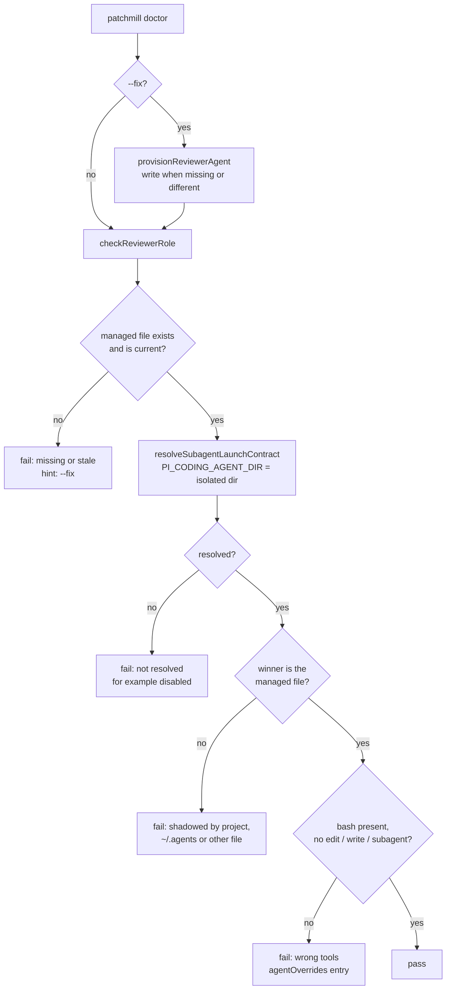

# Issue #229: Make sure that the isolated reviewer can run validation commands

- **Issue:** [#229](https://github.com/rochecompaan/patchmill/issues/229)
- **Size:** Small. Three plan tasks.
- **Base revision:** `360c592` (`main`)

## Intent

Patchmill runs Pi with an isolated agent directory,
`PI_CODING_AGENT_DIR=<repository>/.patchmill/pi-agent`. Patchmill review steps
dispatch the canonical `reviewer` role of pi-subagents. The bundled pi-subagents
`reviewer` has no `bash` tool, and its prompt forbids shell commands. A review
step that needs command output then fails closed or accepts indirect evidence,
depending on model behavior.

This change makes the managed Patchmill `reviewer` the role that always resolves
in the isolated runtime. The role can run validation commands with `bash`.
`patchmill doctor` fails when this is not true, and `patchmill doctor --fix`
repairs the managed definition.

## Current behavior

The issue was written before the skills-first kernel (#329). Part of its scope
is already in `main`:

- `src/cli/commands/init/agent-dir.ts` exports `REVIEWER_AGENT`, a short
  Patchmill-owned definition with `tools: read, grep, find, ls, bash`.
  `provisionAgentDir` writes it to `<agentDir>/agents/reviewer.md` with the
  `patchmill-implementation` worker. It writes a file only when the content is
  different.
- `patchmill init` (`src/cli/commands/init/main.ts`), the Console start
  (`src/console/start.ts`, `openConsole`) and `serve`
  (`src/cli/commands/serve/session-launcher.ts`) call `provisionAgentDir`.
- The prompt says: "Use read-only commands. Do not edit files, install packages,
  authenticate, or mutate Git or hosting state." This text does not say if
  `npm test` or a build is permitted. These commands write caches and build
  output.
- In the isolated runtime, pi-subagents resolves `reviewer` from
  `<agentDir>/agents/reviewer.md` (source `user`). The bundled reviewer is
  shadowed. The public `pi-subagents/preflight` function
  `resolveSubagentLaunchContract` shows this. It returns the effective tools
  `read, grep, find, ls, bash, contact_supervisor`.
- Other definitions can shadow the managed file. A test on the base revision
  showed two: a project file `<repository>/.pi/agents/reviewer.md` (source
  `project`), and `~/.agents/reviewer.md` (source `user`, higher priority than
  the agent directory). A pi-subagents `agentOverrides` entry for `reviewer` in
  the agent-directory `settings.json` or the project `.pi/settings.json` can
  also change the tools or disable the role.
- `patchmill doctor` (`src/cli/commands/doctor/checks.ts`) has a `reviewer`
  check. It only makes sure that the file exists, and its severity is `warn`. It
  does not look at the resolved role or its tools.
- `patchmill doctor` accepts no arguments. Its help text says that it does not
  repair configuration.
- The review skills (`skills/patchmill-implementation/SKILL.md`, "Independent
  review"; `skills/patchmill-frontend-review/SKILL.md`, "Reviewer") give the
  reviewer the validation commands and their results. The reviewer "may ask for
  command output". The parent runs file-writing commands in a disposable copy.
  The shared appendix (`skills/patchmill-implementation/review-appendix.md`)
  tells the reviewer to list each required command with its result and to mark
  unrun commands as unknown.

## Goals

1. The managed `reviewer` prompt permits validation commands and read-only Git
   inspection. It forbids fixers, installs, authentication, edits, and Git or
   hosting changes.
2. `patchmill doctor` fails when the resolved `reviewer` in the isolated runtime
   is not the managed, current definition with `bash`.
3. `patchmill doctor --fix` writes a missing or stale managed `reviewer.md`. It
   then runs the normal checks.
4. Tests cover provisioning, resolution under the isolated
   `PI_CODING_AGENT_DIR`, and the doctor checks.

## Non-goals

- No change to the review skills or to the review appendix. The parent continues
  to run the project validation commands and to give the results to the
  reviewer. The reviewer can now also run commands itself. This is the
  maintainer decision for Q1 in the planning session.
- The skills still call the reviewer "read-only" and tell the parent to run
  file-writing commands in a disposable copy. After this change, "read-only"
  means: no edits to tracked files and no Git or hosting changes. Ignored build
  output and caches from validation commands are permitted. A later review must
  not report this wording as a contradiction.
- No copy of the bundled pi-subagents reviewer prompt. Patchmill keeps its short
  canonical prompt. This is the maintainer decision for Q2.
- No proxy, broker or runner for commands. No receipts, session-log inspection
  or evidence gates.
- No change to pi-subagents, landing policy, run state, public JSON result
  shapes, or the `patchmill-implementation` agent definition.
- No new configuration keys.
- `doctor --fix` does not delete or edit a shadowing definition. A shadowing
  file belongs to the user.

## Anti-goals

- Doctor must not copy the pi-subagents discovery rules. Precedence, scan
  directories and builtin overrides change between versions. Doctor asks
  pi-subagents through its public `preflight` entry point.
- `doctor --fix` must not rewrite the `patchmill-implementation` agent. Its
  content depends on the skill paths that only the Console start knows.

## Approaches

1. **Static file check.** Read `reviewer.md` and parse its `tools` line. This
   misses the project and home shadows and settings overrides.
2. **Resolve through `pi-subagents/preflight` (chosen).**
   `resolveSubagentLaunchContract` is a public, typed entry point. It returns
   the winning definition (`agent.source`, `agent.filePath`), the shadowed
   candidates, and `tools.effectiveAllowlist`. Patchmill pins pi-subagents to an
   exact version, so the contract is stable for each release.
3. **Ask a live Pi session.** Start Pi with the extension and list agents. This
   needs a model call and is slow. Doctor already has one smoke call.

## Design

### Reviewer prompt

`REVIEWER_AGENT` keeps its name, description and `tools` line. Replace the line
that starts with "Use read-only commands." with this text:

```text
You may use bash to run the project's validation commands: tests, lint, format checks, type checks, and builds.
You may run read-only Git commands, such as git status, git diff, git log, and git show.
These commands can write ignored build output or caches. That is permitted.
Do not run commands that fix or rewrite files, such as --fix, --write, or a formatter in write mode.
Do not edit files, install packages, authenticate, or change Git or hosting state.
Run git status --short before and after your commands. Report each change that your commands caused.
```

The other lines do not change. The role stays review-only: no `edit`, no
`write`, no `subagent`. This is the maintainer decision for Q3.

A changed prompt makes existing installations stale. The next `patchmill init`,
Console start, `serve` start or `doctor --fix` writes the new content.

### Reviewer provisioning (`src/cli/commands/init/agent-dir.ts`)

Add one exported function:

```ts
export async function provisionReviewerAgent(
  repoRoot: string,
  agentDir: string,
): Promise<"written" | "unchanged">;
```

- It creates `resolve(repoRoot, agentDir, "agents")` when necessary. It uses
  `resolve`, as the runtime callers and the check do, so an absolute
  `pi.agentDir` also works.
- It writes `REVIEWER_AGENT` only when the file is missing or different. It
  returns `"written"` or `"unchanged"`.
- It touches no other file.

`provisionAgentDir` uses this function for the reviewer and the same
write-when-different helper for the worker. Its behavior does not change.
`patchmill init` prints `Agent directory: written|unchanged` from the return
value. It no longer reads the file before provisioning.

### Reviewer role check (`src/cli/commands/doctor/reviewer-role.ts`)

Add one module that owns the question "Does the isolated runtime resolve the
managed reviewer?"

```ts
export type ReviewerRoleCheck =
  | { ok: true }
  | { ok: false; repairable: boolean; message: string };

export async function checkReviewerRole(input: {
  repoRoot: string;
  agentDir: string; // as in config.pi.agentDir, relative to repoRoot
}): Promise<ReviewerRoleCheck>;
```

The checks run in this order. The first failure is the result.

1. **Missing.** The file `<agentDir>/agents/reviewer.md` does not exist.
   `repairable: true`. Message:
   `Missing reviewer: <path>. Run patchmill doctor --fix.`
2. **Stale.** The file content is not `REVIEWER_AGENT`. `repairable: true`.
   Message: `Stale reviewer: <path>. Run patchmill doctor --fix.`
3. **Not resolved.**
   `resolveSubagentLaunchContract({ agent: "reviewer", cwd: repoRoot })` returns
   `ok: false`. `repairable: false`. The message includes the pi-subagents code
   and message.
4. **Shadowed.** The resolved `agent.filePath` is not the managed path (compare
   with `realpath` on both sides). `repairable: false`. Message:
   `Reviewer resolves to <filePath> (<source>), not <managed path>. Remove or rename that definition.`
5. **Wrong tools.** `tools.effectiveAllowlist` does not include `bash`, or
   includes `edit`, `write` or `subagent`. `repairable: false`. The message
   lists the effective tools. An `agentOverrides` entry in a `settings.json` can
   cause this.

Caller obligations and invariants:

- pi-subagents reads `PI_CODING_AGENT_DIR` from `process.env` at call time.
  `checkReviewerRole` sets it to the resolved absolute agent directory for the
  call and restores the earlier value in `finally`. Callers must not run another
  pi-subagents discovery at the same time. Doctor runs its checks in sequence.
- The project is treated as trusted (`projectTrusted` default `true`). Project
  agent definitions then count, as they do in a kernel run.
- The check makes no model call and writes no file.
- When `resolveSubagentLaunchContract` throws (for example, on a malformed
  `settings.json`), the error propagates. The doctor `check()` wrapper reports
  it as `fail`. The environment is restored first.
- `HOME` affects the result through `~/.agents`. This is correct: the kernel
  runs Pi with the same `HOME`.

Hidden details: the discovery rules, the contract fields, the path
normalization, and the environment change.

### Doctor (`src/cli/commands/doctor/`)

- `checks.ts`: the `reviewer` check calls `checkReviewerRole`. Its severity
  changes from `warn` to `fail`. The order and the names of the checks do not
  change. A failed `reviewer` check makes `patchmill doctor` exit with 1.
- `main.ts`: accept one optional argument, `--fix`. Other arguments fail as
  before. With `--fix`, before the checks, call
  `provisionReviewerAgent(repoRoot, config.pi.agentDir)`. When it returns
  `"written"`, print `[fixed] reviewer: wrote <path>`. Then run the checks as
  usual. A shadow or tools failure remains after `--fix`, and the exit code
  is 1.
- Help text: `Usage: patchmill doctor [--fix]` and
  `Check readiness. --fix restores the managed reviewer agent definition.`
- `src/cli/main.ts`: the command summary becomes
  `Perform readiness checks (--fix restores the managed reviewer).`

### Documentation

Update the `doctor` rows and the read-only note in `README.md` and
`site/src/content/docs/reference/environment-and-config.md`. Add one sentence to
"Readiness" in `site/src/content/docs/guides/pi-and-subagents.md`. The sentence
says that doctor makes sure that the resolved `reviewer` is the managed
definition with `bash`, and that `--fix` restores it.

### Domain and architecture

This change adds one doctor check module and one provisioning function in the
existing init module. It does not change domain terms, contexts or ADRs. The
repository has no `docs/adr/`. `GLOSSARY.md` has no reviewer or doctor entry,
and this change adds no new domain term. The design uses the existing
pi-subagents seam (`pi-subagents/preflight`). It adds no adapter. Tests use the
real pi-subagents package with temporary directories.

### Frontend design

Frontend design does not apply. The change is CLI, agent-definition and
documentation work, with no browser-visible change.

## Acceptance criteria and verification

| Criterion                                                                                                        | Verification                                                                                                                                            |
| ---------------------------------------------------------------------------------------------------------------- | ------------------------------------------------------------------------------------------------------------------------------------------------------- |
| A fresh `patchmill init` installs `reviewer.md`. The resolved `reviewer` has `bash` and no `edit` or `write`.    | Init test: run `init`, then `checkReviewerRole` passes, and `resolveSubagentLaunchContract` under the isolated directory gives the managed path.        |
| The reviewer can run the required commands itself.                                                               | The resolved tools include `bash`, and the prompt permits validation commands. Direct inspection of `REVIEWER_AGENT` in review.                         |
| Doctor fails when the managed reviewer is missing, stale, shadowed, or lacks `bash`. `doctor --fix` restores it. | `reviewer-role.test.ts` cases for each failure. Doctor CLI test: missing gives exit 1; `--fix` writes the file and gives exit 0.                        |
| Provisioning is idempotent and keeps other local files.                                                          | `agent-dir.test.ts`: a second call returns `"unchanged"` and keeps the mtime. `--fix` does not change `patchmill-implementation.md` or `settings.json`. |
| Repository checks pass.                                                                                          | `npm run lint`, `npm test`, `npm run build`.                                                                                                            |

## Visual explanation

The flow below shows how doctor decides the `reviewer` result.



## Planning review

### Pass 1: combined with the plan

- **Scope:** specification and implementation plan
  (`docs/plans/2026-11-23-issue-229-final-validation-can-block-because-the-isolated-plan.md`).
- **Reviewer:** canonical `reviewer` (managed Patchmill definition), model
  `claude-bridge/claude-opus-5-5`, thinking `high`. Fresh context for each pass.
- **Base revision:** `360c592` (`main`).
- **Survey:** the reviewer read the agent-dir, init, doctor, console start and
  serve sources and tests, the review skills, and the pi-subagents discovery and
  preflight code. It ran probes with temporary `HOME` and repositories. They
  confirmed the project and home shadows, `agentOverrides` tools and `disabled`
  effects, and a throw on a malformed `settings.json`.
- **Findings and dispositions:**
  - B1 (blocker, plan): no tests for the not-resolved and wrong-tools checks.
    **Accepted.** Task 2 adds the `agentOverrides` tools and `disabled` cases.
  - S1 (plan, spec): the env-restore test did not reach the `finally` after a
    throw. **Accepted.** The test uses a malformed `settings.json`. The spec
    says that the throw propagates.
  - S2 (spec, plan): `join` versus `resolve` for an absolute `pi.agentDir`.
    **Accepted.** `provisionReviewerAgent` uses `resolve`.
  - S3 (plan): the symlink test does not prove `realpath` use on Linux.
    **Accepted.** It is now a smoke test. Review Focus 5 now names the
    `agentOverrides` case.
  - S4 (spec): the flow skipped "not resolved", and the override wording was not
    exact. **Accepted.** Mermaid and wording revised.
  - S5 (spec): "read-only" in the skills. **Accepted.** Non-goals define its
    meaning after this change.
  - Confirmation suggestion C1 (plan): "does not claim `bash`" was ambiguous.
    **Accepted** after the confirmation. The plan now fixes the tools message
    format and asserts `effective tools: read`. This edit changes only that test
    assertion and message text.
- **Inspection limits:** pi-subagents 0.80.0 only. No repository checks run (no
  implementation yet). Kernel project-trust setting and macOS `/tmp` symlinks
  not inspected.
- **Confirmation:** a fresh scoped confirmation verified B1 and S1 to S5 against
  the real package. No blockers remain.
- **Reviewed body SHA-256:**
  `994761f866d6607518e2ca324cb620ffdd1a4f1593d30ea4f9fedb6d2279a47a` (initial).
- **Final body SHA-256:**
  `bf505c36aac716d3aae77fb7e2e32ee1a299ec400ea1b7d46b5fa6014b153629`.
- **Outcome:** `ready`.
