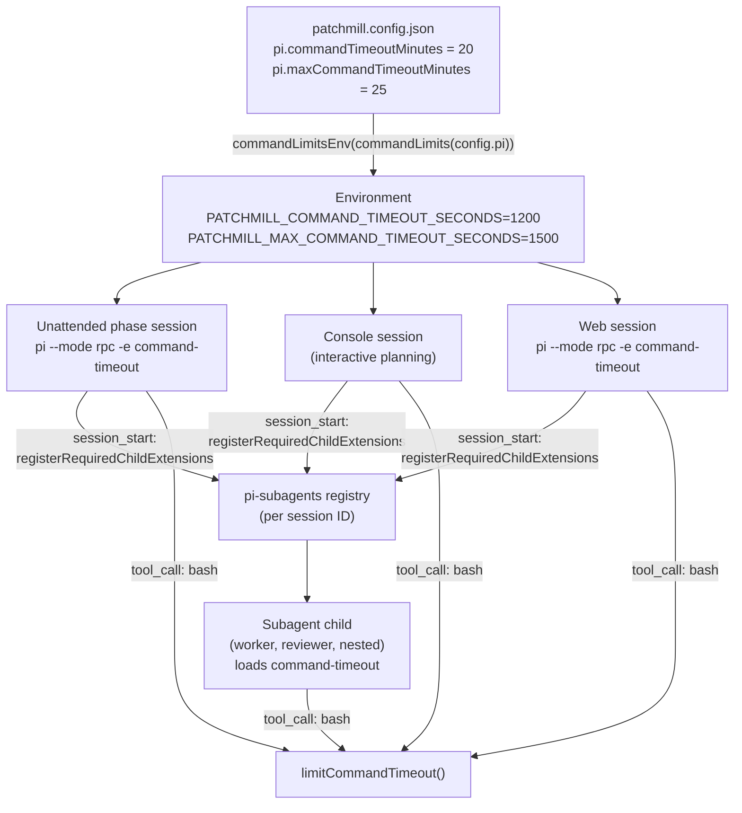

# Issue #322: Give agent bash commands in run-once sessions a default timeout

- **Issue:** [#322](https://github.com/rochecompaan/patchmill/issues/322)
- **Size:** A small project. Four tasks.
- **Base revision:** `9e93b60` (`main`)

## Intent

In the #268 run, one agent `bash` call ran `npm run test:run-once` without a
`timeout`. A hung test kept that call active for 8.5 hours. Only a person could
stop it. Pi can stop one tool call, but only when the call has a `timeout`. Code
outside Pi can stop only the whole session.

This change gives each agent `bash` call in an Issue run a **Command timeout**.
A Patchmill Pi extension sets a default when the call has no `timeout`, and it
reduces a `timeout` that is longer than a cap. When the timeout fires, Pi kills
the process group of the command. The agent then gets an error result and
continues. This is the first part of the stall policy of #319.

## What changed since the issue was filed

The issue was filed before the skills-first kernel rewrite (#329) and the RPC
mode change (#305). Some of its starting points no longer exist.

| Issue text                                                              | Current code                                                                                                                                                                                                                                                                                                                                                                                                                                                  |
| ----------------------------------------------------------------------- | ------------------------------------------------------------------------------------------------------------------------------------------------------------------------------------------------------------------------------------------------------------------------------------------------------------------------------------------------------------------------------------------------------------------------------------------------------------- |
| Planning, development-environment and implementation sessions           | The kernel has two phases: `planning` and `implementation` (`src/kernel/phase.ts`). There is no development-environment session.                                                                                                                                                                                                                                                                                                                              |
| One extension list in `src/pi/resource-profiles.ts`                     | The file is gone. Pi starts in three places. (1) An unattended phase session: `rpcModeLauncher()` in `src/kernel/launch.ts` starts `pi --mode rpc` with `BACKGROUND_WORK_EXTENSION_PATH` and `RunOnceDeps.extensionPaths`. (2) The terminal Console session: `openConsole()` in `src/console/start.ts` runs Pi in the Patchmill process. (3) A Web session: `createSessionLauncher()` in `src/cli/commands/serve/session-launcher.ts` starts `pi --mode rpc`. |
| Interactive planning and implementation                                 | Interactive planning runs in the Console session itself (`src/console/planning-conversation.ts`). The interactive implementation worker is a pi-subagents background child of the Console session (`SubagentsClient.spawnWorker()`, agent `patchmill-implementation`).                                                                                                                                                                                        |
| `buildImplementationPrompt()` in `src/cli/commands/run-once/prompts.ts` | The prompt is the run envelope: `src/kernel/run-envelope.md`, rendered by `renderRunEnvelope()` in `src/kernel/envelope.ts`. The interactive worker gets the same envelope as its task.                                                                                                                                                                                                                                                                       |
| "The same section as #316's stall warning"                              | The #316 spec dropped the stall warning. No such config section exists.                                                                                                                                                                                                                                                                                                                                                                                       |

The skills-first kernel spec lists "no per-command timeouts" as a non-goal of
that change and names #322 as the later issue. This change does not conflict
with it.

## Goals

- An agent `bash` call without `timeout` runs with the configured default.
- An agent `bash` call that asks for more than the cap runs with the cap. A call
  at or below the cap keeps its value.
- A limit of `0` is off.
- The limits apply in every Pi session of an Issue run, and in each subagent
  session that those sessions start, at any depth.
- The implementation envelope states the configured limits.

## Non-goals

- Stopping, restarting, or counting stalled sessions (#319).
- Test-runner timeouts (#316).
- Limits for `patchmill triage` sessions and `patchmill doctor` smoke tests.
  They are not Issue run sessions, and the issue does not name them.
- Limits for external CLI runners or remote machine placements of pi-subagents.
  Patchmill does not configure them. pi-subagents excludes them from required
  child extensions by default.
- A change to Pi's timeout message.
- Control over other extensions that set a `bash` timeout. For example,
  `pi-claude-bridge` sets `timeout = 120` on a `bash` call without one when its
  provider runs the session. Pi runs `tool_call` handlers in load order, and Pi
  loads CLI and SDK `additionalExtensionPaths` extensions before
  settings-discovered ones
  (`mergePaths(cliEnabledExtensions, enabledExtensions)` in
  `dist/core/resource-loader.js`). So in the three Pi starts, the Patchmill
  default comes first. Where another handler runs first, its default stays,
  because it is at or below the cap. The cap applies in every case, unless a
  later handler raises the value.

## Anti-goals

- A cap that is longer than #319's 30-minute session stop. The default cap is 25
  minutes.
- A limit that a subagent can avoid when its agent definition sets
  `extensions: []` or omits ambient extensions.
- A test that waits 20 real minutes.

## Approaches

1. **A Patchmill Pi extension that changes the `bash` arguments and registers
   itself for child sessions (selected).** A `tool_call` handler changes
   `event.input.timeout` before the call runs. Pi documents this: "Mutations to
   `event.input` affect the actual tool execution." On `session_start`, the
   extension calls `registerRequiredChildExtensions()` from
   `pi-subagents/required-child-extensions` with its own file. pi-subagents then
   loads the file in every native child of that session: foreground, background,
   nested, and recovered. This is true even when the agent sets `extensions: []`
   (`node_modules/pi-subagents/docs/agents.md`, "Required host extensions").
2. **List the extension in the `patchmill-implementation` agent file**
   (`extensions` or `subagentOnlyExtensions`). This covers only that agent. The
   `reviewer` agent and each other child would run without limits. It also does
   not cover the Console session, where interactive planning runs.
3. **Replace the `bash` tool with a wrapper tool.** This duplicates Pi's tool,
   and pi-subagents tool allowlists name `bash`. It is more code for the same
   result as approach 1.

Prompt guidance alone is not an approach: #268 shows that agents omit the
`timeout`.

### How the limits reach the extension

The extension loads from a file path in each session, so its configuration
cannot be a function argument. Patchmill puts the limits into two environment
variables of each Pi process that it starts. A background child of pi-subagents
runs in a runner process that inherits the parent environment
(`async-execution.js` copies `process.env`, without two unrelated variables). A
foreground child runs in the parent process. So every child sees the same
values.

Other options are worse. A config file read from the session's working directory
can differ from the repository config, because a worktree has its own copy of
`patchmill.config.json`. A generated extension file per run adds files and
cleanup for no gain.

## Design

### Configuration

Add two keys to the `pi` section of `PatchmillConfig` (`src/config/config.ts`),
next to `pi.timeoutMinutes`:

| Key                           | Default | Meaning                                                                  |
| ----------------------------- | ------- | ------------------------------------------------------------------------ |
| `pi.commandTimeoutMinutes`    | `20`    | The timeout that a `bash` call without `timeout` gets. `0` turns it off. |
| `pi.maxCommandTimeoutMinutes` | `25`    | The longest timeout that a `bash` call can get. `0` turns it off.        |

Rules for `parseConfig()`:

- Each value is a finite number, `0` or more. Fractions are accepted.
- Each value is at most `35791` minutes. Pi rejects a timeout above
  `2_147_483_647` ms, and `35791` minutes is below that.
- When both values are more than `0`, `commandTimeoutMinutes` must be at most
  `maxCommandTimeoutMinutes`. Otherwise `parseConfig()` throws a `ConfigError`
  that names both keys.

`patchmill init` writes `DEFAULT_CONFIG`, so new configs show both keys. Add
both keys with their defaults to this repository's `patchmill.config.json`.
Document them next to `pi.timeoutMinutes` in `README.md`,
`site/src/content/docs/getting-started/configuration.md`, and
`site/src/content/docs/reference/configuration-example.md`.

### The Command timeout extension

A new module `src/pi/command-timeout-extension.ts` owns the behavior. Its
interface:

```ts
/** Seconds. 0 means off. */
export type CommandLimits = { defaultSeconds: number; maxSeconds: number };

export const COMMAND_TIMEOUT_EXTENSION_PATH: string; // .ts from source, .js from dist
export const COMMAND_TIMEOUT_ENV = "PATCHMILL_COMMAND_TIMEOUT_SECONDS";
export const MAX_COMMAND_TIMEOUT_ENV = "PATCHMILL_MAX_COMMAND_TIMEOUT_SECONDS";

export function commandLimits(pi: PatchmillConfig["pi"]): CommandLimits;
export function commandLimitsEnv(limits: CommandLimits): Record<string, string>;
export function readCommandLimits(env: NodeJS.ProcessEnv): CommandLimits;
export function limitCommandTimeout(
  timeout: number | undefined,
  limits: CommandLimits,
): number | undefined;
export function createCommandTimeoutExtension(options: {
  limits: CommandLimits;
  register?: typeof registerRequiredChildExtensions;
}): ExtensionFactory;
// Reads the environment when Pi calls the factory, not on import.
export default ExtensionFactory; // (pi) => createCommandTimeoutExtension({ limits: readCommandLimits(process.env) })(pi)
```

`limitCommandTimeout()` is the whole policy:

| Requested `timeout`  | Default on, cap on | Default off, cap on | Default on, cap off | Both off  |
| -------------------- | ------------------ | ------------------- | ------------------- | --------- |
| none                 | default            | none                | default             | none      |
| `0 < t ≤ cap`        | `t`                | `t`                 | `t`                 | `t`       |
| `t > cap`            | cap                | cap                 | `t`                 | `t`       |
| not finite, or `≤ 0` | unchanged          | unchanged           | unchanged           | unchanged |

An invalid value stays unchanged, so Pi rejects it with its own message, as it
does today. When both limits are on and the default is above the cap, the
default is reduced to the cap. Config prevents this case, but the environment
can bypass config.

The module has no import-time side effects. Kernel, console and serve code
import it for the path and the helpers. A stray invalid variable in the
operator's shell must not break those imports. It fails only the Pi session that
loads the extension.

`readCommandLimits()` behavior:

- A missing variable gives the built-in default for that limit: 1200 seconds or
  1500 seconds. A Pi process that loads the file without the variables, for
  example after a future change strips them, still gets limits.
- A variable that is not a finite number from `0` to `2_147_483` (seconds)
  throws. Pi then fails to load the extension. A required child extension that
  fails to load rejects the child launch before its first prompt. An invalid
  value never runs without limits silently.

The extension factory:

- On `tool_call`, when `isToolCallEventType("bash", event)`, it sets
  `event.input.timeout` to `limitCommandTimeout(event.input.timeout, limits)`.
  When the result is `undefined`, it leaves the property absent.
- On `session_start`, it registers
  `{ id: "patchmill-command-timeout", path: COMMAND_TIMEOUT_EXTENSION_PATH }`
  for `ctx.sessionManager.getSessionId()`. It keeps the registration.
- On `session_shutdown`, it disposes the registration. A later `session_start`
  (for example after `/patchmill-issue` switches the Console session) registers
  again for the new session ID.
- pi-subagents allows one registration per session ID. If a registration for the
  same session already exists (the error message contains
  `are already registered for session`), the extension logs one line to stderr
  and continues. The existing registration still covers the children. Its
  `tool_call` handler still applies the limits, so a second load of the file in
  one session changes nothing. Any other registration error, for example a path
  that is not a file, is raised. Pi then reports the extension error, so
  children never run without limits silently.
- It does not pass `requireForAllRunners`. External runners stay excluded, as in
  the non-goals.

pi-subagents gives a nested child the required extensions that its parent launch
inherited (`child-launch.js`:
`input.requiredExtensions ?? input.inherited?.requiredExtensions ?? resolveRequiredChildExtensions(...)`).
So the registration in a child session is not necessary for nested children. It
is harmless, and it keeps one rule for every session.

### Where Patchmill loads the extension

| Pi start                 | Change                                                                                                                                                                                                                                                                                                                                                                                                        |
| ------------------------ | ------------------------------------------------------------------------------------------------------------------------------------------------------------------------------------------------------------------------------------------------------------------------------------------------------------------------------------------------------------------------------------------------------------- |
| Unattended phase session | `rpcModeLauncher()` adds `COMMAND_TIMEOUT_EXTENSION_PATH` after `BACKGROUND_WORK_EXTENSION_PATH`. It gets a new required option `env`, and passes it to `runPiRpc()`. `preparePhasePrompt()` passes `commandLimitsEnv(commandLimits(config.pi))`.                                                                                                                                                             |
| Terminal Console session | A new helper in `src/console/start.ts`, `prepareConsoleExtensions(config, env = process.env): string[]`, sets both variables on `env` and returns the `additionalExtensionPaths` list: pi-subagents, then `COMMAND_TIMEOUT_EXTENSION_PATH`. `openConsole()` calls it before it creates the runtime, next to the `PI_CODING_AGENT_DIR` line. Background runners that the session starts inherit the variables. |
| Web session              | `createSessionLauncher()` adds `COMMAND_TIMEOUT_EXTENSION_PATH` to `extensionPaths` and the two variables to `env`.                                                                                                                                                                                                                                                                                           |

The Console session gets the limits because interactive planning and review wait
revisions run in it. The maintainer's other `bash` calls in the Console session
get the same limits. The maintainer can still ask for up to 25 minutes.

The background-work extension stays first in the unattended list, because its
shutdown handler must run before pi-subagents removes its bridge.

### Implementation envelope

`renderRunEnvelope()` adds one line under `Facts:` after `Time limit`, only when
`phase` is `implementation`. `RunEnvelopeInput` gets a
`commandLimits: CommandLimits` field. The line uses minutes, with at most two
decimals and no trailing zeros:

| Default | Cap | Line                                                                                                                         |
| ------- | --- | ---------------------------------------------------------------------------------------------------------------------------- |
| on      | on  | `- Command timeout: bash calls get a 20-minute timeout by default. Full builds or test suites can ask for up to 25 minutes.` |
| off     | on  | `- Command timeout: bash calls have no default timeout. A call can ask for up to 25 minutes.`                                |
| on      | off | `- Command timeout: bash calls get a 20-minute timeout by default. A call can ask for a longer timeout.`                     |
| off     | off | No line.                                                                                                                     |

The numbers come from the config. The planning envelope does not change, as the
issue asks only for the implementation prompt.

### Timeout results

Pi already writes `Command timed out after N seconds` into the tool result, and
the session file records that result. #319 can recognize a timed-out command
from it. This change does not alter that text.

## Domain and architecture

This change adds a module and a seam, so codebase design applies. It does not
change the domain model beyond one new term. The repository has one context and
no ADRs. The change is easy to reverse, so it needs no ADR.

- **Module ownership.** `src/pi/command-timeout-extension.ts` owns the whole
  policy: the table above, the environment format, and child coverage. Config
  parsing owns validation. The launch sites only pass a path and variables.
- **Depth.** Callers know a path, two variable names, and
  `commandLimitsEnv(commandLimits(config.pi))`. The rules for `0`, the cap, the
  invalid values, and the pi-subagents registration stay inside the module.
- **Seams.** The `tool_call` event and `registerRequiredChildExtensions()` are
  Pi and pi-subagents seams. The `register` option is the one injected
  dependency. It has two real adapters: the pi-subagents function and a test
  recorder. The process environment is the seam between Patchmill and each Pi
  process.
- **Locality.** The pattern follows `src/pi/background-work-extension.ts`: a
  factory with options for tests, a default export for file loading, and a path
  constant next to its users.

Add one term to `GLOSSARY.md`: **Command timeout**. See the companion artifacts.

## Frontend design

Not applicable. The change has no browser-visible part.

## Acceptance criteria and verification

| Criterion                                                                                                    | Verification                                                                                                                                                                                                                                                                                                                                                                                                                                                                                                                |
| ------------------------------------------------------------------------------------------------------------ | --------------------------------------------------------------------------------------------------------------------------------------------------------------------------------------------------------------------------------------------------------------------------------------------------------------------------------------------------------------------------------------------------------------------------------------------------------------------------------------------------------------------------- |
| A call without `timeout` runs with the default.                                                              | Unit tests of `limitCommandTimeout()` and of the `tool_call` handler.                                                                                                                                                                                                                                                                                                                                                                                                                                                       |
| A call above the cap runs with the cap. A call at or below the cap keeps its value.                          | The same tests, with values at, below and above the cap.                                                                                                                                                                                                                                                                                                                                                                                                                                                                    |
| A limit of `0` is not applied.                                                                               | The same tests, for each column of the policy table.                                                                                                                                                                                                                                                                                                                                                                                                                                                                        |
| A command that never ends stops at the timeout, its children die, and the agent gets an error and continues. | A test runs a Pi agent session with the faux provider of `@earendil-works/pi-ai` and the extension, with a 1-second default. It runs in a child process, as `src/console/session-switch-lifecycle.test.ts` does. The command starts a background `sleep` and waits. The test checks the error text `Command timed out after 1 seconds`, that the `sleep` process no longer exists, and that the faux model gets the next turn.                                                                                              |
| Subagent sessions get the same limits.                                                                       | Unit tests with a recording `register` check the registration on `session_start`, its disposal, the duplicate case, and that other errors are raised. One test uses the real `registerRequiredChildExtensions`: after `session_start`, a second registration for the same session ID throws, which proves that the entry sits under the key that pi-subagents reads. A manual check in the plan confirms the limit in one real child when model access is available. Otherwise the pull request records why it did not run. |
| Config rejects a default longer than the cap.                                                                | `src/config/config.test.ts`.                                                                                                                                                                                                                                                                                                                                                                                                                                                                                                |
| The implementation envelope states the configured limits.                                                    | Envelope tests for the four rows, and the implementation fixture.                                                                                                                                                                                                                                                                                                                                                                                                                                                           |
| Each Pi start loads the extension with the configured variables.                                             | Existing launcher tests extended: `rpcModeLauncher` arguments and environment, the Web session launcher `start` input. A run-once test with non-default limits (`2` and `0` minutes) checks that the fake Pi process sees `120` and `0`. A unit test of `prepareConsoleExtensions()` checks the Console path. Non-default values make sure that the built-in fallback cannot hide a missing step.                                                                                                                           |
| Tests use short timeouts.                                                                                    | Review of the new tests: no test waits more than a few seconds.                                                                                                                                                                                                                                                                                                                                                                                                                                                             |

## Open assumptions

None. The maintainer did not ask for a change to the issue's values or scope.
The calls that this document makes are marked as such: the `pi` config section,
the key names, the environment transport, built-in defaults for a missing
variable, the Console session coverage, and the envelope copy.

## Left to the builder

- The exact SDK setup of the faux-provider test. `@earendil-works/pi-ai` is a
  dependency of the pinned `@earendil-works/pi-coding-agent`, not of Patchmill.
  The test can import it without a new dependency. If the import does not
  resolve, or the SDK cannot run Pi's real `bash` tool with extensions, the
  builder can run the `bash` tool definition from `createBashTool()` with the
  changed arguments and record why in the test.
- The stderr wording for a duplicate registration.

## Companion artifacts

- `GLOSSARY.md`: [Command timeout](../../GLOSSARY.md) (new term)

## Visual explanation

How the limits reach each session and its children:



What the `tool_call` handler does with one call:

```text
on tool_call(bash, input)
  t = input.timeout
  if t is a finite number > 0
    if cap is on and t > cap  -> input.timeout = cap
    else                      -> keep t
  else if t is absent
    if default is on          -> input.timeout = default
  else                        -> keep t (Pi rejects it)
```
