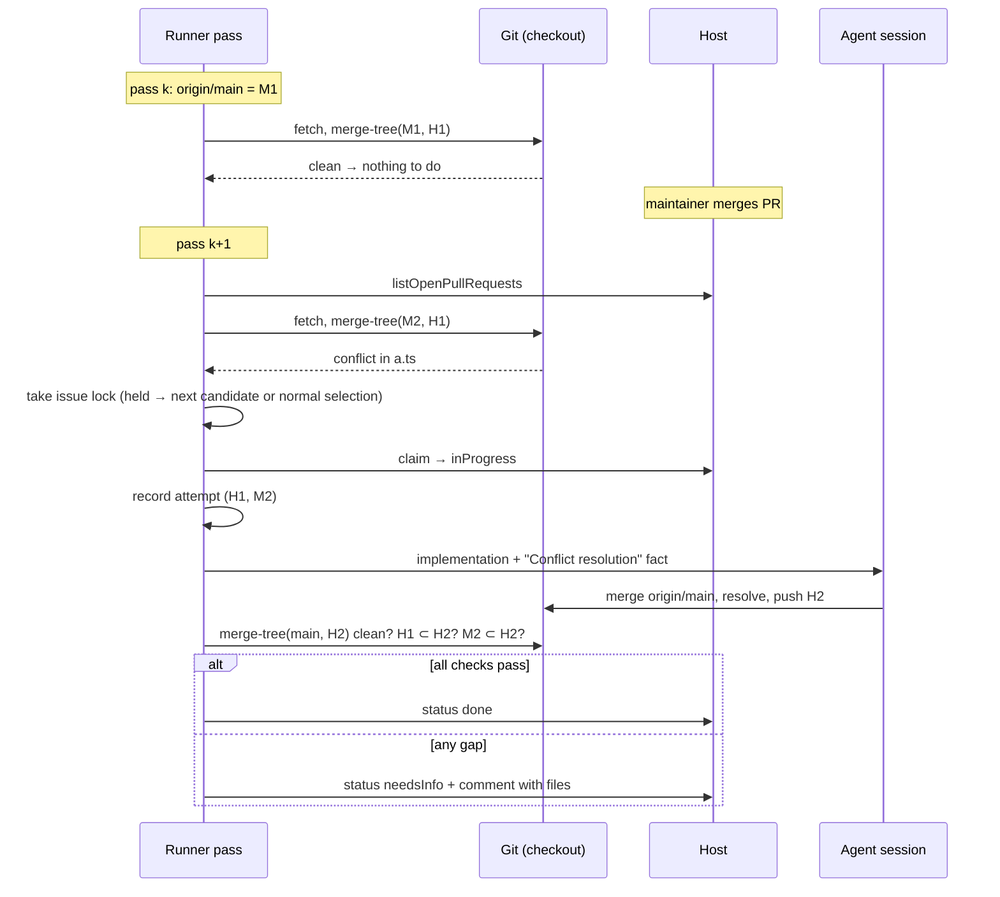

# Resolve merge conflicts on open Patchmill pull requests

Issue: [#405](https://github.com/rochecompaan/patchmill/issues/405). Follow-up
to #398 (PR #403). Part of #230. Related to #356 and #360.

## Intent

A maintainer runs `patchmill run` and merges the pull requests that it opens.
When one merge makes another open Patchmill pull request conflict with the base
branch, the runner must resolve that conflict and push the result. Then the
maintainer can merge the second pull request, and work continues.

Today the runner never looks at an issue again after it is `done`. In the
end-to-end test on `rochecompaan/patchmill-test`, the second pull request stayed
in conflict until a person resolved it.

## Goals

- Find each open Patchmill implementation pull request that conflicts with the
  base branch as it is now. This works in label mode and local state mode.
- Resolve such a conflict before new work starts, so that merged work keeps
  flowing.
- Resolve with a merge of the base branch into the Issue branch. Verify the
  result, then push without a force push.
- Stop with `needsInfo` and a clear comment when the resolution fails or is
  ambiguous. The runner then continues with other work.
- Do not retry a pull request on every pass when the resolution does not hold.

## Non-goals

- Planning pull requests. They add only files under `docs/`, so conflicts are
  very rare. The maintainer chose to leave them out.
- Host mergeability fields. Patchmill does not read GitHub `mergeable` or
  `mergeStateStatus`, or Forgejo `mergeable`. See Approaches.
- Control-plane mode (#360). This design gives #360 a candidate list seam, but
  it adds no control-plane code.
- Pull requests from forks, and pull requests that Patchmill does not own.
- Failed checks, review comments, or other reasons why a pull request cannot
  merge. Only Git merge conflicts are in scope.

## Anti-goals

- A force push, a rebase, or a reset that loses review history.
- A runner that starts a resolution session on every pass for the same pull
  request.
- A full implementation session on a `done` issue whose pull request no longer
  conflicts.
- A conflict search that stops normal work when it fails.

## Approaches

**Detection.**

1. **Local Git check (chosen).** Each runner checkout already fetches `origin`
   on every pass. The fetch updates the remote-tracking refs of all branches,
   which includes the branches that other runners push. The kernel runs
   `git merge-tree --write-tree --name-only` on `origin/<base>` and
   `origin/<branch>`. This is a tree-only merge in the object database. It
   touches no working tree, index, or ref. Exit 0 means clean, and exit 1 means
   conflict and lists the files. The answer is the same for GitHub and Forgejo
   and has no "unknown" state.
2. **Host mergeability.** The GitHub REST list endpoint behind
   `listOpenPullRequests` does not return `mergeable`. GraphQL does, but it can
   report `UNKNOWN` while GitHub computes it. Forgejo `mergeable: false` can
   mean conflict, still checking, work in progress, or an empty diff. A
   resolution needs a checkout anyway, so the host field adds no capability.

**Place in the loop.**

1. **A separate step in `runOneIssue` before selection (chosen).** A new kernel
   module finds a conflicting pull request from a candidate list that the caller
   supplies. `runOneIssue` calls it after the merged sweep and before
   `selectRunIssue`. Local modes supply open `done` issues. Under #356, a `done`
   issue with an open pull request is still its runner's own assignment, so #360
   supplies this runner's assignments. The module does not change.
2. **A rule in `selectRunIssue`.** It is smaller now. But #360 moves issue
   selection to the control plane, so the rule would have to move too.
3. **A step in the local work source.** It would copy the claim, the lock,
   publication, and verification of `runOneIssue`, and `run-once` would not get
   it.

**Resolution.** Merge the base into the Issue branch, not rebase. A merge keeps
the old head in the history, so the push is a fast-forward and review history
stays. An agent session always does the resolution. A conflict that `merge-tree`
reports cannot merge without edits.

## Design

```text
runOneIssue (unattended, no explicit issue)
  sweepMergedIssues                         # unchanged
  workflow.sync()
  findConflictingPullRequests(done issues)  # new: eligible conflicts, oldest first
    └─ first one whose issue lock is free → Conflict resolution
  otherwise selectRunIssue                  # unchanged
  claim → inProgress
  provisionWorkspace → Facts.mergeConflict  # new fact
  implementation session with a "Merge conflict" envelope fact
  verifyOutcome + conflict gaps             # new gaps
  publish → done | needsInfo
```

### Git requirement

Git 2.38 or later becomes a hard requirement, because `merge-tree --write-tree`
first appeared in 2.38. The maintainer chose a hard requirement over a degraded
mode.

- **Nix package.** `nix/package.nix` puts the nixpkgs Git on the wrapper's
  `PATH` with `--prefix PATH : ${lib.makeBinPath [ git ]}`. Patchmill and its
  child processes (Pi sessions, `gh`, `tea`) then use that Git. `--prefix` is
  required: with `--suffix`, an older system Git would come first. The user's
  Git configuration still applies. The install check greps the wrapper for
  `${git}/bin`, which proves that the wrapper puts that Git on `PATH`.
- **npm installs.** The README requirements list Git 2.38 or later. The README
  Nix section stops saying that users must provide Git.
- **Doctor.** `runDoctorChecks` gains a `git` check with severity `fail`. It
  runs `git --version` and parses `major.minor`. Below 2.38 it fails with
  `Git 2.38 or later is required; found <version>. Upgrade Git.` An output that
  it cannot parse fails with `Cannot read the Git version: <output>`.

### Git interface

`KernelGit` in `src/kernel/git.ts` gains two methods:

```ts
export type MergeConflict = {
  baseSha: string; // commit of origin/<base> at the check
  headSha: string; // commit of origin/<branch> at the check
  files: string[]; // conflicted paths, sorted, without duplicates
};

/** Undefined when head merges cleanly into base. Both refs must exist. */
mergeConflict(base: string, head: string): Promise<MergeConflict | undefined>;
/** True when `ancestor` is reachable from `descendant`. */
isAncestor(ancestor: string, descendant: string): Promise<boolean>;
```

- `mergeConflict` resolves both refs with `git rev-parse --verify` and runs
  `git merge-tree --write-tree --name-only --no-messages <baseSha> <headSha>` in
  the repository root. Exit 0 returns `undefined`. Exit 1 returns the conflict.
  The first output line is the tree OID, and the next lines up to the first
  empty line are file names. Any other exit code throws `CommandFailedError`.
  The existing `git()` helper drops stdout for an expected exit code, so this
  method calls `runner` directly.
- `isAncestor` runs `git merge-base --is-ancestor`. Exit 0 is true, exit 1 is
  false, and other codes throw.

### Merge conflict fact

`Facts` in `src/kernel/facts.ts` gains `mergeConflict?: MergeConflict`.
`observe` sets it only when all of these are true:

- `stage` is `implementation`;
- `pullRequest` is open and its `baseBranch` equals `facts.baseBranch`;
- `remoteBranchExists` is true.

It calls `git.mergeConflict("origin/<base>", "origin/<branch>")`. The fetch in
`selectWorkspace` comes first, so the refs are current. A thrown error
propagates, as other `observe` errors do.

The fact applies to every implementation session on an open pull request,
because a pull request that conflicts cannot merge. The envelope words it in two
ways. See Envelope fact.

`facts.ts` also exports the base-branch rule that `selectWorkspace` uses now, so
that `runOneIssue` can reuse it:

```ts
export async function resolveBaseBranch(
  deps: Pick<Deps, "git" | "host" | "config">,
): Promise<string>; // config.git.baseBranch ?? origin HEAD ?? host default
```

### Pull request ownership

`src/kernel/pull-request.ts` stays the one place for the ownership rule. It
exports the predicate that `findPullRequest` uses now:

```ts
/** The head is `branch` in the repository Patchmill pushes to. */
export function ownsPullRequest(
  pr: PullRequest,
  branch: string,
  pushRepository: string,
): boolean; // headBranch === branch && headRepository equal, case-insensitive
```

`findPullRequest` calls it. The behavior does not change.

### Conflict search

New module `src/kernel/merge-conflicts.ts` owns the conflict search, the attempt
record, and the post-session checks.

```ts
export type ConflictCandidate = {
  issue: TrackedIssue;
  pullRequest: PullRequest;
  conflict: MergeConflict;
};

export async function findConflictingPullRequests(input: {
  host: Pick<Host, "listOpenPullRequests" | "pushRepository">;
  git: Pick<KernelGit, "fetch" | "mergeConflict">;
  /** Issues the caller owns. Local modes: open issues with status `done`. */
  candidates: TrackedIssue[];
  baseBranch: string;
  /** `<runsDir>/issue-N`, where the attempt record lives. */
  issueDir: (issue: number) => string;
  retryMinutes: number;
  now: () => Date;
  report: (line: string) => void;
}): Promise<ConflictCandidate[]>;
```

Callers must know these rules:

- **No host call without candidates.** An empty `candidates` list returns `[]`
  at once.
- **Order.** The result lists eligible conflicts by issue `createdAt`, oldest
  first. The caller resolves at most one per pass.
- **Ownership.** It calls `git.fetch()`, `host.listOpenPullRequests()`, and
  `host.pushRepository()` once. A pull request belongs to candidate issue N when
  `ownsPullRequest(pr, pr.headBranch, pushRepository)` holds, its head is an
  Issue branch of N (`isIssueBranch`) and not a Planning branch
  (`parsePlanningBranch` returns `undefined`), and its `baseBranch` equals
  `baseBranch`. No match skips the candidate without a report. More than one
  match skips it with
  `Issue #N conflict check skipped: several open pull requests: #A, #B`.
- **Check.** `git.mergeConflict("origin/<base>", "origin/<head>")`. A clean
  result skips the candidate. A clean result is not stored: the next pass checks
  again against the base as it is then. So a pull request that was clean and
  conflicts after another merge is found on the next pass.
- **Backoff.** See Attempt record. A skip reports
  `Issue #N conflict resolution skipped: <reason>`.
- **Errors.** It never throws. A failure of the fetch or a listing reports
  `Merge conflict check failed: <message>` and returns `[]`. A failure of one
  candidate reports `Issue #N conflict check failed: <message>` and continues
  with the next candidate.

### Attempt record

The file `<runsDir>/issue-N/merge-conflict-attempt.json` records the last
Conflict resolution of issue N:

```json
{
  "runId": "…",
  "startedAt": "2026-11-23T10:00:00.000Z",
  "headSha": "…",
  "baseSha": "…"
}
```

```ts
export async function recordConflictAttempt(
  issueDir: string,
  attempt: { runId: string; startedAt: string; conflict: MergeConflict },
): Promise<void>;

/** True when the record names this conflict's head and base. */
export async function isRecordedAttempt(
  issueDir: string,
  conflict: MergeConflict,
  report: (line: string) => void,
): Promise<boolean>;
```

- `runOneIssue` writes the record when it starts a Conflict resolution session.
  It writes a temporary file and renames it.
- The search skips a candidate whose current `headSha` and `baseSha` equal the
  record. Nothing changed, so a new session would fail in the same way. Reason:
  `already attempted at head <short> and base <short>`.
- The search also skips a candidate whose record is younger than
  `run.conflictRetryMinutes`. Reason:
  `last attempt at <startedAt>; retry after <time>`. When other merges move the
  base again and again, a pull request is resolved at most once in each
  interval.
- A missing record means no earlier attempt. A record that cannot be read or
  parsed is reported as
  `Issue #N conflict attempt record is unreadable: <message>` and is treated as
  missing.
- The record is a local backoff hint, not workflow state. Loss of the record
  loses only the backoff. A failed attempt leaves the issue at `needsInfo`, and
  the search sees only `done` issues, so the issue does not come back by itself.

New config key `run.conflictRetryMinutes`, a number greater than 0, default
`30`. It joins the `run` section in `src/config/config.ts` and its validation.

### Conflict resolution or normal work

A session is a **Conflict resolution** when its facts have `mergeConflict` and
one of these is true:

- the conflict search selected the run; or
- `isRecordedAttempt` is true for the current conflict. This covers a resume
  after a stop signal, and a person who moves a failed attempt to `ready`
  without other changes.

Every other implementation session whose facts have `mergeConflict` is normal
work, for example a paused feature run with a draft pull request, or a revision
started with `run-once --issue N`. The agent merges the base first and then
continues its normal work. The post-session checks apply to both.

### Run integration

In `runOneIssue` (`src/kernel/run-once.ts`):

1. After `workflow.sync(options.issue)`, the run calls
   `findConflictingPullRequests` when `options.issue` is undefined and
   `deps.human` is undefined. The search is for unattended work only. The
   candidates are `workflow.openIssues()` filtered to `state === "open"` and
   `status === "done"`. A dry run also searches, because the search is
   read-only.
2. **Lock first.** A stop request that arrived before this step returns
   `no-work` before any candidate lock is taken. For each found candidate in
   order, a real run tries `acquireLock` on that issue. A `LockHeldError`
   reports `Issue #N conflict resolution skipped: another Run attempt is active`
   and tries the next candidate. An Interactive Issue run in its review wait
   holds the lock of a `done` issue, so this case is normal. The first candidate
   whose lock it gets becomes the selected issue, and the run uses that lock.
   When no candidate remains, `selectRunIssue` runs as today. A dry run takes no
   lock and uses the first candidate.
3. The run reports
   `Issue #N: pull request #P conflicts with origin/<base> in <files>; resolving it first.`
   to stderr. A dry run reports the same line without `; resolving it first`.
4. The claim is unchanged. `setStatus(inProgress)` moves the issue from `done`
   to `inProgress`.
5. **Nothing to resolve.** On the first derivation of a run that the search
   selected, `facts.mergeConflict` can be undefined. For example, a person
   resolved the conflict in the meantime. The run then stops without a session,
   with label `done` and summary
   `Pull request #P no longer conflicts with origin/<base>; nothing to resolve.`
   It never starts a full implementation session for this case.
6. Before a Conflict resolution session, the run writes the attempt record.
7. After any implementation session whose facts had `mergeConflict` before the
   session, the run calls `conflictResolutionGaps` and passes the result to
   verification.

```ts
/** Empty when the pushed branch resolved `before`. */
export async function conflictResolutionGaps(
  git: Pick<KernelGit, "isAncestor">,
  before: MergeConflict,
  after: Facts,
): Promise<string[]>;
```

When `after.remoteBranchExists` is false, it skips the two ancestry checks,
because `pullRequestGaps` already reports a pull request that is not open. It
returns one line for each failed check, in this order:

- `after.mergeConflict` is set with the same `baseSha`:
  `The pull request still conflicts with origin/<base> in: <files>.`
- `after.mergeConflict` is set with another `baseSha`:
  `The pull request conflicts with origin/<base> again at <short> in: <files>; the base moved during the session.`
- `before.headSha` is not an ancestor of `origin/<branch>`:
  `The pushed branch does not contain its previous head <short>; its history was rewritten.`
- `before.baseSha` is not an ancestor of `origin/<branch>`:
  `The pushed branch does not contain origin/<base> at <short>; merge the base branch.`

`VerifyInput` in `src/kernel/verify.ts` gains `conflictGaps?: string[]`. For the
implementation phase, `verifyOutcome` adds these lines to the pull request gaps.
Any gap makes the outcome `needsInfo` with the existing
`The claim was not verified. …` comment, followed by the agent's summary. An
agent result of `needs-input` gives `needsInfo` as today, with the agent's
summary in the comment. So a failed or ambiguous resolution always posts a
comment that explains it.

### Status and labels

| Moment                 | Status       | Comes from                        |
| ---------------------- | ------------ | --------------------------------- |
| Before                 | `done`       | earlier implementation            |
| While it runs          | `inProgress` | the normal claim                  |
| Resolved and verified  | `done`       | `verifyOutcome`, unchanged rule   |
| Failed or ambiguous    | `needsInfo`  | verification gaps or agent result |
| Stop signal during run | `inProgress` | existing pause; next pass resumes |

Label mode writes these as labels, and local state mode writes them to its
status log, through the existing `WorkflowState`. A paused Conflict resolution
resumes as an `inProgress` issue through `selectRunIssue`. Its facts compute
`mergeConflict` again. The head and base have not changed, so
`isRecordedAttempt` makes it a Conflict resolution again.

The local work source in `src/kernel/runner/local-work-source.ts` does not
change. A resolved conflict is `completed`, which maps to `worked`. A failed one
is `stopped`/`needsInfo`, which maps to `worked` and counts in the Needs Info
streak.

### Envelope fact

`src/kernel/run-envelope.md` gains a `{{mergeConflict}}` placeholder directly
after `{{pullRequest}}`. `RunEnvelopeInput` gains
`conflictResolution?: boolean`, which `preparePhasePrompt` passes on.
`renderRunEnvelope` renders an empty string when `facts.mergeConflict` is
undefined or the phase is not `implementation`. An implementation-stage branch
that lacks its spec or plan derives the planning phase, and that agent gets no
conflict line. Otherwise it renders one of two lines:

```text
- Merge conflict: the pull request conflicts with origin/<base> at <baseSha> in: <files>. This session is a Conflict resolution: resolve only this conflict, as the skill's Merge conflicts section says.
- Merge conflict: the pull request conflicts with origin/<base> at <baseSha> in: <files>. Merge the base branch first, as the skill's Merge conflicts section says, then continue your normal work.
```

Envelopes without a conflict stay byte-identical, so the existing envelope
fixtures do not change.

### Implementation skill

`skills/patchmill-implementation/SKILL.md` gains a `## Merge conflicts` section
before `## Commit and publish`. The installed copy under `.patchmill/skills`
gets the same change through `patchmill skills update`. When the envelope has a
`Merge conflict` fact:

1. Run `git fetch origin`. Then run `git merge --ff-only origin/<branch>`, so
   that the local branch has every pushed commit. Then run
   `git merge origin/<base>` in the worktree. Never rebase, reset the branch, or
   force-push. When the fast-forward fails because the local and pushed branches
   have diverged, stop with `needs-input` and say so in `summary`.
2. Resolve each conflicted file, so that the intent of both sides stays. Read
   the base commits that changed the file.
3. When a resolution needs a product decision, or the two sides cannot both
   hold, run `git merge --abort`. Then stop with `needs-input`, and name each
   file and the reason in `summary`.
4. Run the project validation commands.

For a **Conflict resolution** session:

- Work only on the conflict. Do not restart the feature, and do not make
  unrelated changes. Leave open review comments for a later revision.
- The independent review covers the resolution only. Supply
  `git show --remerge-diff <merge commit>` and the conflicted files, not the
  whole branch.
- Commit the merge, push, and wait for the checks, as in Commit and publish.
  Keep the pull request ready and keep its closing reference.

For other sessions, commit the merge, then continue the normal work of the
envelope. The normal review, checks, and ready rules apply.

## Frontend design

Does not apply. This is kernel, Git, configuration, packaging, and skill-text
work, with no browser-visible change.

## Domain and architecture

This change adds a module and seam methods, so domain modeling and codebase
design apply. It is a single-context repository with no ADRs. No ADR is needed:
the choices are easy to reverse and follow the issue and the #356 spec.

- **Terms.** **Conflict resolution** is new: an implementation session for a
  `done` issue whose open implementation pull request conflicts with the base
  branch, selected by the conflict search or resumed from its attempt record. It
  ends at `done` or `needsInfo`. It goes in `GLOSSARY.md`. It is not a new
  phase: the phase is still `implementation`. "Merge conflict" keeps its
  ordinary Git meaning.
- **#356 fit.** #356 says that an assignment stays with its runner until the
  pull request merges and the runner removes its worktree. So the owning runner
  resolves its own conflicts in its own checkout, and the control plane stays
  read-only. `candidates` is the parameter that varies: local modes pass `done`
  issues, and #360 passes this runner's assignments. It is a plain parameter,
  not an adapter.
- **Module ownership.** `merge-conflicts.ts` owns which pull requests are
  eligible, the backoff, and the post-session checks. It is a deep module: a few
  functions hide the host listing, the Git checks, and the record format.
  `pull-request.ts` keeps the ownership rule. `git.ts` owns the Git commands.
  `verify.ts` stays the one place that decides the outcome. `run-once.ts` only
  orders the calls and takes the lock.
- **Dependencies.** `host`, `git`, `now`, and `report` enter through the input.
  Tests use the real `createKernelGit` on a fixture repository and `FakeHost`,
  as the `run-once` tests do now. No new adapter is added.
- **Locality.** All conflict rules live in one module, so #360 changes only the
  candidate list that it passes.

## Acceptance criteria and verification

| Criterion                                                              | Verification                                                                                                                                   |
| ---------------------------------------------------------------------- | ---------------------------------------------------------------------------------------------------------------------------------------------- |
| A conflicting open Patchmill pull request is detected in label mode    | `run-once` test: a `done` issue whose pull request was clean conflicts after another commit lands on `main`; the run selects it                |
| The same in local state mode                                           | the same test with `LocalWorkflowState`                                                                                                        |
| Conflicts take priority over new work                                  | the same test has an older `ready` issue, and the `done` one is selected                                                                       |
| Resolution is verified and pushed, and the pull request is mergeable   | a fake agent merges `origin/main`, resolves, and pushes; the outcome is `completed`, the label is `done`, and `mergeConflict` is now undefined |
| A failed resolution stops with `needsInfo` and a clear comment         | a fake agent pushes without a merge; the comment names the conflicted files; a fake agent with `needs-input` also stops                        |
| History is not rewritten                                               | `conflictResolutionGaps` test with a branch that no longer contains the old head                                                               |
| No retry loop                                                          | search tests for the pair rule and the interval rule; a run test where a second pass starts no session                                         |
| A held lock does not stop other work                                   | `run-once` test: the conflicting issue's lock is held, and a `ready` issue is selected                                                         |
| Normal work keeps its scope                                            | `run-once` test: a resumed draft pull request that conflicts gets the "then continue your normal work" envelope line                           |
| Non-Patchmill, fork, planning, and clean pull requests are not touched | search tests for each case                                                                                                                     |
| The runner continues after a search failure                            | the search reports and returns `[]` on a listing failure; a `ready` issue is still selected                                                    |
| Git checks are correct                                                 | `git.test.ts` cases for clean, conflict with file names, and `isAncestor`                                                                      |
| Git version requirement                                                | doctor tests for 2.37 (fail), 2.38 (pass), and unparsable output; `nix build` and the install check                                            |

Skill, README, and envelope text are checked by inspection and the existing
envelope fixture test, not by new text tests.

## Risks

- `git merge-tree` and the host's merge can disagree in rare cases, for example
  rename detection. If Git says clean, Patchmill does nothing, which is the
  current behavior. If Git says conflict and the host says clean, an agent makes
  a merge commit that the pull request did not need. The merge is still a
  fast-forward and is safe.
- The search adds one fetch and one pull request listing per pass when `done`
  issues exist. The fetch is incremental.
- With the Nix package, the nixpkgs Git comes first on `PATH`. A credential
  helper that the user's Git configuration names by a short name, for example
  `libsecret` from `/usr/lib/git-core`, is then not found. The README Nix
  section says to name such a helper by its full path.
- npm users with Git older than 2.38 must upgrade. Before that, implementation
  runs on an open pull request fail, and `patchmill doctor` says why.
- A `done` issue in label mode whose label a person changed by hand is outside
  the candidate list. That is intended.

## Left to the builder

- Exact report wording beyond the strings that this spec fixes.
- The fixture helpers for conflicting branches and the fake agent's merge step.
- Where `resolveBaseBranch` sits inside `facts.ts`, and how `runOneIssue` hands
  the pre-acquired lock to its existing lock variable.

## Visual explanation

Two passes after a merge of another pull request:



The decision for one candidate:

```text
candidate conflicts
  record has same head and base      → skip (already attempted)
  record younger than retry interval → skip (retry later)
  issue lock held                    → skip (try next candidate)
  otherwise                          → Conflict resolution now
```

## Companion artifacts

- `GLOSSARY.md`: adds **Conflict resolution**. [Glossary](../../GLOSSARY.md)

## Planning review

### Pass 1: initial (combined spec and plan)

- **Scope:** this document, reviewed together with the plan
  `docs/plans/2026-11-23-issue-405-resolve-merge-conflicts-on-open-patchmill-pull-r-plan.md`,
  at stage `implementation` (no gate). The `GLOSSARY.md` entry was in scope as a
  companion.
- **Reviewer:** canonical `reviewer` agent, model
  `claude-bridge/claude-opus-5-5`, thinking `high`, base revision `360c592`.
- **Reviewed body SHA-256:** not recorded for this pass. The planner computed
  the hashes only after the corrections.
- **Survey:** the reviewer traced `runOneIssue` (sweep, sync, selection, lock,
  claim, phase loop, verification), `derivePhase` on a Done issue,
  `selectWorkspace`/`observe`, `findPullRequest`, `verifyOutcome`, the review
  wait lock in `review-wait.ts`, `local-work-source.ts`, the Nix wrapper,
  `doctor`, and the run-once test fixtures. It confirmed the #356 claim that an
  assignment stays with its runner until the merge.
- **Findings and dispositions:**
  - S1/P1 (blocker): a held issue lock on a conflicting Done issue, for example
    in a review wait, makes every pass idle. Accepted: the search returns an
    ordered list, and the run takes the first free lock or falls back to
    `selectRunIssue`. There is a new run test.
  - S2 (blocker): the Git 2.38 claim was false, and the requirement was not
    stated. Escalated to the maintainer, who chose a hard requirement and Git in
    the Nix wrapper. Accepted: section "Git requirement" and plan Task 1.
  - S3/P2 (blocker): the conflict-only instruction reached normal sessions.
    Accepted: section "Conflict resolution or normal work", two envelope lines,
    a split skill section, and a run test.
  - S4: one ownership predicate. Accepted (`ownsPullRequest`).
  - S5: search only in unattended runs. Accepted.
  - S6: fast-forward to `origin/<branch>` before the merge. Accepted.
  - S7: wording for a moved base. Accepted.
  - S8: diagram order. Accepted.
  - S9: `git-safety.md` docs. Accepted.
  - S10: the second-pass test isolates the pair rule. Accepted.
  - S11: dry-run wording. Accepted.
- **Inspection limits:** no tests or builds run; issue read from the supplied
  summary; old-Git behavior not checked empirically.

### Pass 2: scoped confirmation

- **Reviewer:** canonical `reviewer` agent, model
  `claude-bridge/claude-opus-5-5`, thinking `high`, base revision `360c592`.
- **Result:** S1 to S11 confirmed in both documents and against the source. No
  new blocker.
- **New suggestions, all accepted after the confirmation:**
  - N1: install-check wording aligned with the plan's grep.
  - N2: plan Task 1 names the doctor test assertions that shift.
  - N3: the abort check comes before candidate locks.
  - N4: a Risks line and a README note for credential helpers.
  - N5: no conflict line outside the implementation phase.
  - N6: a diverged fast-forward stops with `needs-input`.
  - N7: ancestry checks are skipped when the remote branch is gone.

  These are small text corrections, and no fresh reviewer read them. The
  maintainer can check them against this list.

- **Inspection limits:** no tests, `nix build`, or Git version checks run.
- **Final body SHA-256:** specification
  `ba4168635cbe4d9f849f8a7ef4c4962d5e271666562404b1b5124a8497acf68c`; plan
  `bde218868bc3312cb4e1febc093ba1bc1e36af33a9d4711d5c16ffc424599183`. The plan
  was compared with specification
  `ba4168635cbe4d9f849f8a7ef4c4962d5e271666562404b1b5124a8497acf68c`.
- **Outcome:** `ready`.
