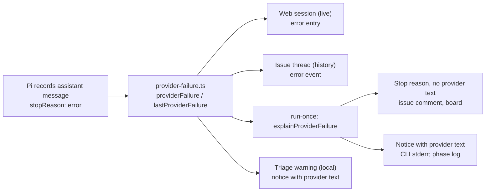

# Surface provider failures instead of leaving agents unresponsive

Issue: [#417](https://github.com/rochecompaan/patchmill/issues/417).

## Problem

A model provider can refuse a request. Example: the sign-in token of
`openai-codex` expired. Pi then records an assistant message with empty content,
`stopReason: "error"` and an `errorMessage`, for example
`Your authentication token has expired. Please try refreshing it.`

The terminal Pi interface shows this error. Patchmill does not:

- **Web session, live.** `onMessageEnd` in `src/web/session/web-session.ts`
  keeps only the text blocks of an assistant message. It drops the failed
  message. Then `agent_settled` sets the header state to `idle`. The maintainer
  sees nothing. Each new message fails the same way, without a reply.
- **Issue thread, history.** `projectPiThread` in `src/web/pi-thread.ts` drops
  the failed message in the same way.
- **Unattended phases (`run-once`, `run`).** `rpcModeLauncher` in
  `src/kernel/launch.ts` calls `runPiRpc` (`src/kernel/pi-rpc.ts`), which writes
  `errorMessage` only to the phase log. The phase then has no Result block.
  `verifyOutcome` in `src/kernel/verify.ts` stops the run with
  `The worker ended without a result block. Log: …` and `Exit code: 1`. The real
  cause is visible only in the log.
- **Workers in an Interactive Issue run.** The worker launcher
  (`src/console/worker-launcher.ts`) copies the worker's session file into the
  phase session directory, but the stop reason is the same "no result block"
  text.
- **Triage.** `runTriage` in `src/kernel/triage.ts` uses print mode
  (`supervisePi`). It logs only
  `Pi session failed, timed out, or was cancelled; skipping.`

A restart does not help when the saved sign-in is invalid. Because the failure
is silent, the maintainer cannot tell a sign-in failure from an agent that works
or is stuck.

## Intent

The maintainer agreed in the planning chat: "the web interface is not showing
errors like the interactive Pi interface does. Errors like this should be
surfaced in the web and non-interactive modes."

Success:

- Each request that the provider refuses appears in the Issue thread as an error
  entry with the provider's message. This applies to the live Web session and to
  the history of a finished run.
- An unattended phase that ends because of a Provider failure says so in its
  stop reason. The issue comment has a fixed text without the provider's
  message. The CLI output and the phase log have the full message.
- Triage that skips an issue because of a Provider failure says so in its
  warning, with the provider's message.
- When the message is about sign-in, Patchmill tells the maintainer how to fix
  it: run `patchmill auth`, then continue.

## Goals

- Show every **Provider failure** (definition below), not only sign-in failures.
  All of them disappear today in the same way.
- Add sign-in guidance when the failure is a sign-in failure.
- Keep one classification and one guidance text for all surfaces.

## Non-goals

- Automatic token refresh or a sign-in flow in the web page. `patchmill auth`
  stays the only sign-in path.
- A preflight request before each run to test the credentials. A test request
  costs money and time on each start, and it does not prevent an expiry later in
  the run.
- Changes to the terminal console. Pi's own interface already shows the error.
- Changes to Pi's retry policy. Pi still retries transient errors itself.
- A new header state or a banner in the web page. The existing error entry of
  the Issue thread is the visible surface.
- Stopping a `patchmill run` Runner after a sign-in failure. Until a maintainer
  signs in again, each queued issue fails in the same way and gets `needs-info`
  with the same comment. The maintainer accepted this for now. A Runner stop on
  a sign-in failure changes Runner control, so it is a separate follow-up issue.

## Anti-goals

- A failure that still looks like "the agent is working" or "idle" with no
  entry.
- A stop reason that hides a Provider failure behind "no result block".
- Provider text in a public issue comment. Provider messages can contain account
  or organization identifiers. The maintainer chose to keep them on local
  surfaces only.
- Different wording for the same failure on different surfaces.
- An aborted reply (**Stop reply**) shown as an error. It stays a divider.

## Terms

**Provider failure**: an assistant message that Pi recorded with
`stopReason: "error"`, because the model provider refused or failed the request.
Its text is `errorMessage`, or `The request failed.` when `errorMessage` is
empty. A message with `stopReason: "aborted"` is not a Provider failure.
_Avoid_: auth error (too narrow), Pi crash (the process still runs).

**Sign-in failure**: a Provider failure whose text shows that the provider
refused the credentials. See the classification rule below.

`GLOSSARY.md` gets the term **Provider failure**.

## Approaches

1. **Show every Provider failure, with sign-in guidance only for sign-in
   failures.** (Chosen.) One rule for all errors. The cost is the same as for
   sign-in only, and it fixes the same silent failure for overload, quota, and
   network errors.
2. **Show only sign-in failures.** Narrower, but it leaves other errors silent,
   and the classifier would then decide what the maintainer can see at all.
3. **Preflight sign-in check at start.** Rejected: see Non-goals.

The maintainer chose approach 1.

## Design

### One module owns the rule

A new module `src/kernel/provider-failure.ts` owns the definition, the
classification, the guidance text, and the read from session files. Callers do
not know the patterns.

```ts
export type ProviderFailure = {
  /** The provider's text, trimmed, at most 2000 characters. */
  readonly message: string;
  readonly signIn: boolean;
};

/** A Pi message object → a Provider failure, or undefined. */
export function providerFailure(message: unknown): ProviderFailure | undefined;

/** A Pi message object → the Issue thread error entry, or undefined. */
export function providerFailureEntry(
  message: unknown,
): { title: string; text: string } | undefined;

/** The newest session file in `sessionDir`: its last assistant message as a
 * Provider failure, or undefined. Never throws. */
export function lastProviderFailure(
  sessionDir: string,
): Promise<ProviderFailure | undefined>;

/** For a result that did not parse and a session that ended with a Provider
 * failure: the result with the public stop reason, and the failure.
 * Otherwise undefined. */
export function explainProviderFailure(
  result: ParsedResult,
  sessionDir: string,
  issue: number,
): Promise<{ result: ParsedResult; failure: ProviderFailure } | undefined>;

/** The local one-line text for the CLI and triage warnings. */
export function providerFailureNotice(failure: ProviderFailure): string;
```

The module is in the kernel, because the kernel uses it, and `src/web` already
imports from the kernel. It has no dependencies except `node:fs` and
`node:path`.

### Classification

A Provider failure is a sign-in failure when its text matches one of these
patterns, without regard to letter case:

- `authenticat` (authentication, unauthenticated)
- `unauthori[sz]ed`
- `\b401\b`, `\b403\b`
- `token (has )?expired`, `expired token`
- `invalid (api )?key`, `api key (is )?(invalid|missing)`
- `(log ?in|sign ?in|re-?authenticate)` together with `again|required|expired`

The list is a heuristic. A false match adds guidance that does no harm. A missed
match still shows the provider's message. Tests pin the issue's message and one
example for each pattern, and one non-match (`Overloaded`, a 429 rate limit).

### Text

`<message>` below is the Provider failure text. When it does not end with `.`,
`!` or `?`, Patchmill adds `.`.

**Issue thread** (live and history, local to the web page):

| Failure | Title                        | Text                                                                                                                                                                                     |
| ------- | ---------------------------- | ---------------------------------------------------------------------------------------------------------------------------------------------------------------------------------------- |
| Sign-in | `Sign-in failed`             | `<message>` + blank line + `The model provider refused the sign-in. Run patchmill auth in the repository, then send your message again. If it fails again, press Pause and then Resume.` |
| Other   | `The agent's request failed` | `<message>`                                                                                                                                                                              |

**Stop reason** (`result.reason`; it goes into the issue comment, so it never
holds `<message>`). `<N>` is the issue number:

| Failure | Text                                                                                                                                         |
| ------- | -------------------------------------------------------------------------------------------------------------------------------------------- |
| Sign-in | `The model request failed: the provider refused the sign-in. Run patchmill auth in the repository, then run patchmill run-once --issue <N>.` |
| Other   | `The model request failed. The CLI output and the log have the provider's message.`                                                          |

`patchmill run-once --issue <N>` continues the issue whatever its label is.
`patchmill run` and `run-once` without `--issue` skip a `needs-info` issue, so
"start the run again" would not work.

**Notice** (`providerFailureNotice`; local CLI and triage output only):

| Failure | Text                                                                        |
| ------- | --------------------------------------------------------------------------- |
| Sign-in | `The model request failed: <message> Run patchmill auth in the repository.` |
| Other   | `The model request failed: <message>`                                       |

A running Pi process reads `auth.json` again when the file changes. So after
`patchmill auth`, the next message in the same Web session can succeed. Pause
and Resume is the fallback. The thread text says both.

The history of a finished run uses the same thread text. "Send your message
again" also applies there, because Resume continues the same Console session.

### Web session (live)

In `onMessageEnd` of `src/web/session/web-session.ts`, after the existing text
blocks of an assistant message, call `providerFailureEntry(message)`. If it
returns an entry, add it as an `error` entry. Text blocks that came before the
error stay. Order: text first, then the error.

Nothing else changes: `agent_settled` still sets `idle`, so the maintainer can
type at once.

When Pi retries a transient error, it records a failed message first. The page
then shows an error entry followed by the retried reply. This is correct: the
terminal Pi interface also shows the failed attempt.

### Issue thread (history)

In `projectPiThread` of `src/web/pi-thread.ts`, for each assistant message, emit
the text and tool events as today. Then, if `providerFailureEntry(m)` returns an
entry, emit one `error` event with the id `${id}:error`. A message whose
`content` is not an array is still checked. The `seen` key logic stays.

The browser already renders `error` events (`web/thread.js`, `case "error"`).
There is no browser change.

### Unattended phases and worker phases

`run-once.ts` already calls `explainMissingResult(result, launch.sessionDir)`
for each phase run that did not time out and was not aborted. Before that call,
call `explainProviderFailure(result, launch.sessionDir, issueNumber)`:

- If it returns `undefined`, call `explainMissingResult` as today.
- Otherwise use its `result`, and write `providerFailureNotice(failure)` to
  `output.stderr`. `explainMissingResult` is not called: its "subagent runs were
  still running" note does not apply to a failed request.

The returned result has `reason` from the stop-reason table and keeps the
`missing` flag of the input. A parsed result is never changed: the agent could
have recovered after the error and finished. Because `missing` stays, the
existing rule still applies: an implementation that exited cleanly with a
verified pull request is done.

`verifyOutcome` does not change. It already puts `result.reason`, the log path
and the exit code line into the stop comment, with the label `needsInfo`. The
full provider message stays local: in the CLI notice, in the phase log of an
unattended phase (`runPiRpc` writes it there), and in the copied session file of
a worker phase.

This covers `run-once`, the `run` loop, and the worker phases of an Interactive
Issue run in the console and in a Web session. All of them go through
`run-once.ts`, and all of them write the session file to `launch.sessionDir`
(the worker launcher copies the worker's file there; the copy is the newest
file). The stop reason reaches the issue comment, the CLI output, the run files,
and the web board's blocked reason through the existing paths.

"Last assistant message" means: in the newest `.jsonl` file of the directory (by
modification time), the last record with `type: "message"` and
`message.role: "assistant"`. If that message is not a Provider failure, the
function returns `undefined`. An earlier failure that Pi retried with success is
therefore never reported.

### Triage

`runTriage` passes a `sessionDir` to `supervisePi`. When the session failed (not
timed out or cancelled), call `lastProviderFailure(sessionDir)`. If there is a
failure, the warning is `${providerFailureNotice(failure)} Skipping.` Triage
warnings go only to local stderr. Otherwise the current warning stays. Triage
retries an unclassified issue on its next pass, so it needs no other next step.

## Module design

- **Owner.** `src/kernel/provider-failure.ts` owns the Provider failure rule.
  Its interface is five functions and one type. The patterns, the session-file
  format, the newest-file rule, and all text stay hidden.
- **Callers must know:** a Provider failure is only `stopReason: "error"`;
  `lastProviderFailure` never throws and returns `undefined` when it cannot
  read; `message` is at most 2000 characters; the stop reason never holds the
  provider's message, and the notice does.
- **Seams.** No new seam. Tests use real temporary directories and real message
  objects, as `unfinished-runs.test.ts` does.
- **Locality.** Today each surface ignores the error in its own way. After this
  change, one module decides, and four short call sites use it.

## Frontend design

Not applicable. The change uses the existing `error` thread entry and its
styles. Only the text of the entry is new. There is no new layout, interaction,
or style, so there is no mockup.

## Domain analysis

This is not an architecture change. It adds one kernel module and four short
call sites. It does not change contexts, seams, or ADRs (the repository has no
`docs/adr/`). The single-context layout of `docs/agents/domain.md` holds. One
term, **Provider failure**, is new. It goes into `GLOSSARY.md`.

## Testing

- `provider-failure.test.ts`: the classification table; `aborted` is not a
  failure; empty `errorMessage`; truncation at 2000 characters; the added
  period; `lastProviderFailure` with no directory, an empty directory, a broken
  line, a failure followed by a successful retry, and two files where the newest
  has the failure.
- `web-session.test.ts`: a failed `message_end` adds one `error` entry with the
  sign-in title, and the state becomes `idle` after `agent_settled`; a second
  failed message adds a second entry; an `aborted` message adds no entry.
- `pi-thread` history test: a failed assistant record gives one `error` event;
  text before the error stays.
- `provider-failure.test.ts` also covers `explainProviderFailure`: a parsed
  result gives `undefined`; a missing result gets the stop reason, keeps
  `missing`, and its reason does not contain the provider's message.
- `run-once` test: a phase whose session file ends with a sign-in failure stops
  with the sign-in stop reason, the log path and the exit code in the comment;
  the comment does not contain the provider's message; stderr does.
- `triage.test.ts`: a failed session with a sign-in failure in its session file
  gives the notice warning with the provider's message.

## Visual explanation



```text
on assistant message end
  emit text blocks (as today)
  if stopReason == "error"
    failure = { message: errorMessage or "The request failed.", signIn: matches sign-in patterns }
    add error entry: title = signIn ? "Sign-in failed" : "The agent's request failed"
                     text  = message (+ "Run patchmill auth …" when signIn)
```

## Companion artifacts

- `GLOSSARY.md`: [Provider failure](../../GLOSSARY.md)

## Open assumptions

None. The maintainer answered both open questions in the planning chat:

- Provider text stays out of issue comments (local surfaces only).
- A Runner keeps going after a sign-in failure; a Runner stop is a follow-up.
