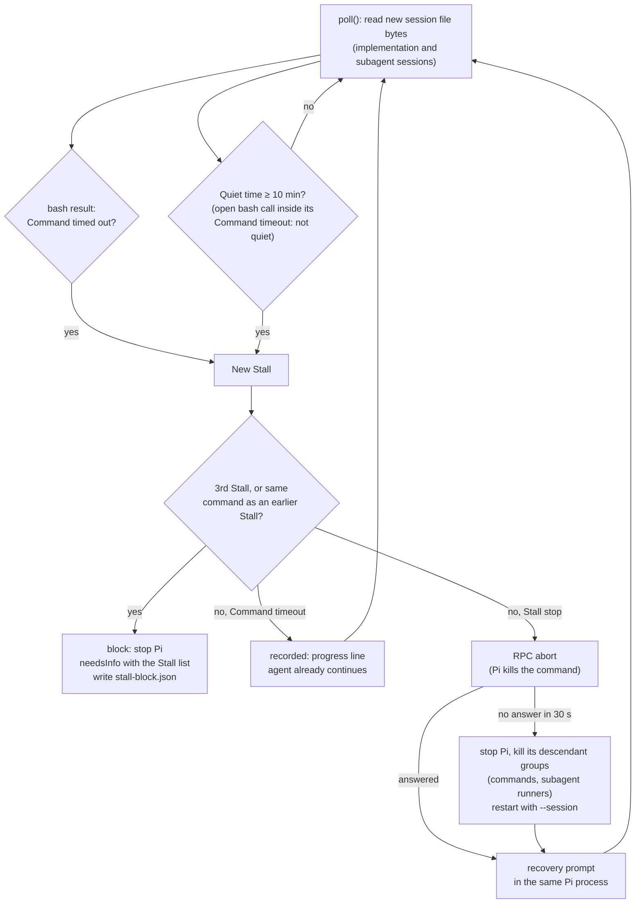

# Issue #319: Recover stalled run-once implementation sessions

- **Issue:** [#319](https://github.com/rochecompaan/patchmill/issues/319)
- **Size:** A medium project. Five tasks.
- **Base revision:** `e05fb6b` (`main`)
- **Depends on:** #322 (closed, merged in `1a8e71f`). #305 (closed) provides RPC
  `abort`.

## Intent

In the #268 run, a hung test kept one agent `bash` call active for 8.5 hours.
Now #322 gives each agent `bash` call a Command timeout. Other stalls still have
no limit: a stuck subagent, a frozen model reply, or a frozen Pi process.

This change adds a **Stall stop** to unattended implementation sessions. When
the session and its subagent sessions show no activity for 10 minutes, Patchmill
stops the stuck turn and tells the agent to continue another way, in the same
session. Command timeouts and Stall stops are both **Stalls**. After 3 Stalls in
one implementation session, or a second Stall of the same command, the Run
attempt stops as blocked (`needsInfo`). The worktree, branch, uncommitted
changes and any open pull request stay as they are.

## What changed since the issue was filed

| Issue text                                                           | Current code or decision                                                                                                                                                                                                                                                                                                     |
| -------------------------------------------------------------------- | ---------------------------------------------------------------------------------------------------------------------------------------------------------------------------------------------------------------------------------------------------------------------------------------------------------------------------- |
| "Restart Pi on the same session file, as `run-once/pi.ts` does"      | `pi.ts` is gone. Unattended phase sessions run `pi --mode rpc` through `startPiRpc()` in `src/kernel/pi-rpc.ts` (#305). RPC `abort` ends the turn and keeps Pi running, so the first recovery step needs no restart. A restart with `--session` is the fallback when Pi does not answer `abort`.                             |
| `recoverBlockedWorkspace` in `pipeline-recovery.ts`                  | Gone. A relabeled issue resumes through normal phase derivation (`derivePhase()` in `src/kernel/phase.ts`), which reuses the existing branch and worktree.                                                                                                                                                                   |
| Return `blocked`                                                     | The kernel has no `blocked` outcome. `OutcomeLabel` in `src/kernel/verify.ts` is `done`, `needsInfo` or `inProgress`. A Stall limit gives the `needsInfo` stop, as every other blocked implementation does.                                                                                                                  |
| `workflow.implementation.stall` with `warnAfterMinutes` (#316)       | #316 dropped the warning. #322 put its keys in the `pi` section. The new keys go next to them (maintainer decision).                                                                                                                                                                                                         |
| `stopAfterMinutes: 30`, worst case 90 minutes                        | The maintainer decided on 10 minutes. See "Why 10 minutes". A running `bash` call inside its Command timeout is not quiet, so the stop can be short.                                                                                                                                                                         |
| "Kills the stuck command" on a Stall stop                            | Commands of the implementation session and of foreground subagents die with the aborted turn. A stuck command inside a background subagent run keeps running after an in-process recovery: the prompt names the run and asks the agent to check it and stop it. A restart or the Stall limit stops it (maintainer decision). |
| "Reject a config where the command cap is not shorter than the stop" | Dropped (maintainer decision). The Command timeout bounds a running `bash` call, and the Stall stop bounds all other quiet time. The two limits do not overlap, so the check has no purpose.                                                                                                                                 |

The skills-first kernel spec says that `pi.timeoutMinutes` is the only stall
detection. This change adds the Stall stop and keeps `pi.timeoutMinutes` as it
is. #371 owns the change to that wall-clock limit.

## Goals

- An unattended implementation session with no activity for
  `pi.stallStopMinutes` gets a Stall stop: Patchmill stops the stuck turn, the
  commands of that turn die, and the agent continues in the same session with a
  recovery prompt. A stuck background subagent run is named in the prompt for
  the agent to stop. A restart or the Stall limit stops it.
- Command timeouts in the implementation session and in its subagent sessions
  count as Stalls.
- At `pi.maxStalls` Stalls, or at a second Stall of the same command, the Run
  attempt stops with `needsInfo`. The reason lists each Stall and what the agent
  tried.
- A Stall that the agent recovers from shows in the progress output and the run
  history, and it does not change the outcome.
- The next Run attempt after a Stall limit names the stalled commands in its
  envelope.

## Non-goals

- Interactive Issue runs. Their implementation worker is a pi-subagents child of
  the Console session, and a maintainer is present (maintainer decision).
- The planning phase, triage sessions and `patchmill doctor` (maintainer
  decision).
- A change to `pi.timeoutMinutes` (#371). A restart after a Stall stop gets the
  remaining time of the same deadline. It does not get a new deadline.
- The 30-minute wall-clock default of pi-subagents for each child run (#371).
- A stall warning (#316 dropped it).
- An automatic retry after the Stall limit. A person relabels the issue.
- An automatic commit of uncommitted work. A stalled agent can leave an edit
  half done.

## Anti-goals

- A Stall stop while a `bash` call runs inside its Command timeout. A full build
  or `gh pr checks --watch` can take up to the 25-minute cap.
- A Stall stop while a subagent session is active, even when the parent session
  file does not change (`bg_wait`, a foreground `subagent` call).
- A Stall stop after a laptop suspend. Quiet time uses the monotonic clock.
- A recovery that leaves a stuck command of the implementation session or of a
  foreground subagent running, or a restart or block that leaves any of its
  commands or subagent runs running.
- Tests that wait real minutes.

## Why 10 minutes

The maintainer asked for a cut-off based on evidence. An analysis of the session
files in `.patchmill/runs` (31 implementation sessions, about 6,000 model
replies, about 3,900 `bash` calls) gave these results. Waits for a person were
excluded (chat replies, submit dialogs, review waits).

| Quiet period                                                        | Longest healthy value | Over 5 minutes |
| ------------------------------------------------------------------- | --------------------- | -------------- |
| Model reply after a tool result                                     | 6.5 minutes           | 4 of 6,003     |
| `bash` call (wall time)                                             | 8.1 minutes           | 3 of 3,937     |
| All session files of one phase session, with visible child sessions | 6.3 minutes           | 1              |

- The only model reply longer than 10 minutes was a 33.6-minute Provider
  failure. That was a real stall.
- Foreground `subagent` calls showed parent gaps of up to 30 minutes. Those
  children wrote their sessions outside the phase session directory (interactive
  runs). In unattended runs, pi-subagents writes child sessions under the phase
  session directory, so their activity is visible.
- One `read` result took 9.8 minutes. A `read` takes milliseconds, so this was
  most likely a suspend.

10 minutes is about 1.5 times the longest healthy quiet period. A Provider
failure like the one above stops after 10 minutes, not 33. 5 minutes is too
close: 4 healthy replies took more than 5 minutes. `bash` calls are excluded by
rule, so their length does not set the value.

Worst case before the Run attempt blocks: 3 × 10 minutes for Stall stops. A hung
`bash` command costs its own Command timeout (20 minutes by default, 25 at the
cap), as #322 decided.

## Design

### Terms

- **Activity:** new bytes in any session file under the phase session directory,
  or an RPC `message_update` record from the implementation Pi process (model
  output, including thinking, while a reply streams). Other RPC records are not
  Activity. In RPC mode, pi-subagents sends an `extension_ui_request`
  (`setWidget`) every second while a background run exists, and a foreground
  `subagent` call sends `tool_execution_update` every second
  (`async-job-tracker.js`, `foreground/execution.js`). Those heartbeats continue
  when the child is stuck, so they must not count.
- **Open call:** a tool call in a session file with no tool result for it and no
  later user or assistant message in the same file. Pi writes tool results as
  `message` entries too, so a sibling's result does not close a call. A later
  user or assistant message closes the call, because Pi never writes a result
  for a call that a killed process left behind. After a restart, the recovery
  prompt is such a later message.
- **Stalled call:** an open call that a Stall lists. A call that an earlier
  Stall listed, identified by session file and tool-call ID, is not listed again
  and gives no key again. So a call that a killed subagent run left open forever
  cannot repeat the same command by itself. A call that stays stuck is still
  bounded by the Stall count.
- **Quiet time:** the monotonic time since the later of the last Activity and
  the end of the last exemption. An open `bash` call is exempt from the poll
  that first sees it until its effective Command timeout plus 60 seconds has
  passed. Example: a hung `bash` call with a 20-minute timeout in a frozen Pi
  gives a Stall stop after 20 + 1 + 10 minutes.
- **Stall:** a Command timeout or a Stall stop.
- **Stall stop:** Patchmill stops the turn after Quiet time reaches
  `pi.stallStopMinutes`.
- **Stall limit:** the `pi.maxStalls`-th Stall, or a second Stall with the same
  command key. It ends the Run attempt at Needs Info (`needsInfo`).

### Configuration

Add two keys to the `pi` section of `PatchmillConfig` (`src/config/config.ts`):

| Key                   | Default | Meaning                                                                                       |
| --------------------- | ------- | --------------------------------------------------------------------------------------------- |
| `pi.stallStopMinutes` | `10`    | Quiet time before a Stall stop. `0` turns off Stall stops. Command timeouts still count.      |
| `pi.maxStalls`        | `3`     | The Stall that ends the Run attempt. `0` turns off the count. The same-command rule stays on. |

Rules for `parseConfig()`:

- `pi.stallStopMinutes` is a finite number from `0` to `35791`. Fractions are
  accepted, which tests use.
- `pi.maxStalls` is an integer from `0` to `100`.
- No rule links these keys to `pi.maxCommandTimeoutMinutes` (maintainer
  decision).

Add both keys to `DEFAULT_CONFIG`, this repository's `patchmill.config.json`,
`README.md`, `site/src/content/docs/getting-started/configuration.md` and
`site/src/content/docs/reference/configuration-example.md`, next to the #322
keys.

### Where the Stall policy applies

Only in unattended implementation sessions: `preparePhasePrompt()` in
`src/kernel/interactive-loop.ts` passes a Stall policy to `rpcModeLauncher()`
when `phase === "implementation"` and `deps.human` is absent. It passes the
policy for all values of the two keys. With both keys at `0`, only the
same-command rule for Command timeouts stays on. The interactive path
(`launchPhase()` with a `HumanChannel`) does not change. A Conflict resolution
is an implementation session, so it gets the policy too.

### Module 1: the Stall watch (`src/kernel/stall-watch.ts`)

This module owns the Stall rules. It reads session files, keeps the open calls
and Quiet time, decides which RPC records are Activity, recognizes Command
timeouts, counts Stalls, applies the same-command rule, and writes the recovery
prompt and the blocked reason. It starts no processes and has no timers.

```ts
export type StallLimits = {
  stopAfterMs: number; // 0 = off
  maxStalls: number; // 0 = off
  command: CommandLimits; // from src/pi/command-timeout-extension.ts
};
export type StallCall = {
  session: string; // "implementation session" or the subagent session path relative to the session directory
  run?: string; // the pi-subagents run ID from that path, for a subagent session
  tool: string; // "bash", "bg_wait", "subagent", ...
  command?: string; // bash command text, whitespace collapsed
  startedAt: string; // ISO time of the tool call entry
  runningMs: number; // monotonic time since the watch first saw the call
};
export type Stall = {
  number: number;
  kind: "command-timeout" | "stall-stop";
  calls: StallCall[]; // command-timeout: the one call; stall-stop: the open calls, maybe none
  quietMs: number; // stall-stop: Quiet time; command-timeout: call duration
  tried: string[]; // tool calls of the implementation session after the previous recovery, at most 5
};
export type StallDecision =
  | { kind: "recorded"; stall: Stall } // a Command timeout below the limit
  | { kind: "recover"; stall: Stall; prompt: string }
  | { kind: "block"; stalls: Stall[]; reason: string };

export function createStallWatch(options: {
  sessionDir: string;
  limits: StallLimits;
  now: () => number; // monotonic milliseconds
}): {
  /** Each RPC record of the implementation Pi process. Only `message_update` is Activity. */
  record(record: { type: string }): void;
  /** Read new session file bytes and return the decisions since the last poll. */
  poll(): Promise<StallDecision[]>;
  /** After a recovery prompt: Quiet time restarts and later tool calls count as "tried". */
  recovered(): void;
  /** Turn the last Stall into the Stall limit, for example when Pi cannot restart. */
  fail(cause: string): Extract<StallDecision, { kind: "block" }>;
  stalls(): readonly Stall[];
  /** The top-level session file of the implementation session, when it exists. */
  sessionFile(): string | undefined;
};
```

Rules that callers must know:

- `poll()` finds `*.jsonl` files under `sessionDir` at any depth, except under
  `subagent-artifacts/`. It reads each file from its last byte offset as bytes,
  and keeps a partial last line, also a split UTF-8 character, for the next
  poll. An unreadable or broken line is skipped.
- The effective Command timeout of an open `bash` call is
  `limitCommandTimeout(args.timeout, limits.command)` (#322). When it is
  `undefined`, the call is not exempt and Quiet time increases.
- A Command timeout is a `bash` tool result with `isError: true` whose last
  paragraph starts with `Command timed out after N seconds`. Pi appends this
  status after the command output, sometimes with a sentence about background
  processes (`appendStatus()` in `dist/core/tools/bash.js`, Pi 1.5.2; the
  builder checks the pinned 1.6.0). It is a Stall in any session file under
  `sessionDir`.
- A Stall stop is due when `stopAfterMs > 0` and Quiet time reaches
  `stopAfterMs`. One Stall stop is returned for one quiet period.
- The command key of a `bash` call is its collapsed command text. The key of any
  other tool call is the tool name and its stable JSON arguments. A Stall stop
  with no new open call has no key. A Stall stop takes the keys of its open
  calls that no earlier Stall listed. A Command timeout takes the key of its
  call. A Stall whose key matches a key of an earlier Stall is the Stall limit.
- The `maxStalls`-th Stall is the Stall limit, when `maxStalls > 0`.
- The decision for the Stall limit is `block`, also when the Stall is a Command
  timeout.
- Command text in the prompt, the reason and the resume fact is cut to 200
  characters and shown as a code span, with backticks replaced by `'`. The agent
  wrote this text, and it goes into the envelope Facts and a public issue
  comment, so the length and the quoting are limited on purpose.

The recovery prompt (fixed text, with values):

```text
Patchmill stopped your turn: the session and its subagent sessions showed no
activity for 10 minutes. This is stall 1 of 3.

Stalled tool calls:
- implementation session: bg_wait, started 2026-11-24T10:02:11Z, ran 14 min
- subagent run 3f2a…: bash `npm test`, started 2026-11-24T10:03:40Z, ran 12 min

Patchmill stopped the turn and any command of this session. A call in a
background subagent run can still be running: check run 3f2a… and stop it if it
is stuck. Find out why the call made no progress. Then continue another way: for
example, run a narrower command or give the command a shorter timeout. Do not
run the same command again unchanged: a second stall of it stops the run. If
you cannot continue, end with `needs-input` and say why.
```

The background-run sentence is present only when a stalled call is in a subagent
session. When the stop has no open call, the "Stalled tool calls" list says
`none: the model reply made no progress`. After a restart (Module 3), the second
paragraph starts with
`Patchmill restarted Pi. It stopped all commands and subagent runs of this session.`
instead.

The blocked reason starts with one of these sentences:

- `The implementation stopped after N stalls.`
- `The implementation stopped: the same command stalled twice.`
- `The implementation stopped: Patchmill could not restart Pi after a stall (<cause>).`
  (from `fail()`)

It then lists each Stall: number, kind, calls with the command, start time and
duration in minutes, and the `tried` list.

### Module 2: stop and continue a Pi RPC session (`src/kernel/pi-rpc.ts`)

`startPiRpc()` gets these additions. `startPiRpc()` serves every unattended
phase session, so the interrupt-path kill below applies to planning sessions
too, on purpose. Only the Stall policy is limited to implementation.

- `PiRpcOptions.onRecord?: (record: RpcRecord) => void`. It is called for each
  parsed RPC record before the session handles it.
- `PiRpcOptions.sessionFile?: string`. When set, the args use `--session <file>`
  with `--session-dir`, so Pi continues that session.
- `PiRpcOptions.appendLogs?: boolean`. A restart opens `logPath` in append mode,
  not `"w"`.
- `PiRpcSession.recover(message: string, graceMs: number): Promise<"continued" | "unresponsive">`.
  - It sends RPC `abort` and waits up to `graceMs` for the response. Pi answers
    `abort` after the turn is idle (`AgentSession.abort()` waits for idle). Pi's
    `bash` tool kills the process group of the command on abort
    (`killProcessTree()`). A foreground subagent of the turn stops with the
    turn. A background subagent run does not stop.
  - From the `abort` until the `agent_start` of the recovery turn, a settle or a
    background-work report does not finish the session.
  - After the response, it sends `message` as a new `prompt` with
    `streamingBehavior: "steer"` and returns `"continued"`. Pi ignores the flag
    when it is idle. If a background run starts a turn before the prompt
    arrives, the message steers that turn instead of being rejected. When Pi
    rejects the prompt or reports it `handled`, the session finishes as for the
    first prompt.
  - When the `abort` response does not come in time, it returns
    `"unresponsive"`.
  - The Result reminder stays available for the end of the session.
- `PiRpcSession.stop(): Promise<void>`. It ends the session through the existing
  interrupt path, without setting `aborted` or `timedOut`. A Stall limit and a
  restart use it, so `run-once` does not treat the stop as a pause. On a normal
  shutdown, the background-work extension stops the background subagent runs
  (`session_shutdown` in `src/pi/background-work-extension.ts`).
- The interrupt paths (`stop()`, `abort()`, the timeout and an output failure)
  also kill stuck commands and subagent runners when Pi does not shut them down.
  At the start of the interrupt, they list the descendant processes of Pi and
  keep their process groups, except Pi's own. After Pi exits, they send
  `SIGKILL` to each kept group that still exists. Pi starts each command in its
  own process group, and pi-subagents starts each background runner detached, so
  a kill of Pi's group alone leaves them running. A normal exit without an
  interrupt takes no snapshot, so its final `escalate()` call does not change.
- The descendant list comes from a new helper
  `descendantGroups(pid: number): Promise<number[]>` in
  `src/kernel/pi-supervisor.ts`. On Linux it reads `/proc/<pid>/stat` (ppid and
  pgrp), as `src/kernel/runner/lifetime-lock.ts` already reads `/proc`. On other
  systems it runs `ps -A -o pid=,ppid=,pgid=`. The Nix build sandbox has no
  `ps`, and the Linux path does not need it. When neither source works, the
  helper returns `[]`, and the interrupt continues as now.

### Module 3: the Stall supervisor (`src/kernel/stall-supervisor.ts`)

This module joins the Stall watch to the Pi RPC session for one implementation
launch. `rpcModeLauncher()` calls it instead of `runPiRpc()` when
`options.stall` is set.

```ts
export type StallNotice = {
  stall: Stall;
  action: "recorded" | "recovering" | "restarted" | "blocked";
};
export function superviseStalls(options: {
  rpc: Omit<PiRpcOptions, "onRecord">;
  limits: StallLimits;
  pollMs?: number; // default: min(15_000, max(stopAfterMs / 4, 10)); 15_000 when stopAfterMs is 0
  recoveryGraceMs?: number; // default 30_000
  // Default: performance.now() and setInterval. Tests pass test-support/feed-clock.ts.
  clock?: { now(): number; every(ms: number, fn: () => void): () => void };
  start?: typeof startPiRpc; // injected for tests; the real function in production
  onStall: (notice: StallNotice) => Promise<void>;
}): Promise<{
  session: PiSession;
  stalls: Stall[];
  block?: { reason: string };
}>;
```

Behavior:

1. It starts Pi with `onRecord` wired to `watch.record()`, and it polls the
   watch every `pollMs`. A tick that comes while a poll or a recovery is still
   running is skipped.
2. `recorded`: it calls `onStall`. The agent already has the timeout error and
   continues.
3. `recover`: it calls `onStall` with `recovering`, then
   `session.recover(prompt, recoveryGraceMs)`, then `watch.recovered()`. When
   the result is `"unresponsive"`, it calls `session.stop()`, waits for `done`,
   and starts Pi again with `sessionFile: watch.sessionFile()`,
   `appendLogs: true`, the restart variant of the recovery prompt, and the
   remaining time of the original deadline. Then it calls `onStall` with
   `restarted`. When no session file exists or no time remains, it uses
   `watch.fail(cause)` and continues as for `block`.
4. `block`: it calls `onStall` with `blocked`, then `session.stop()`, and
   returns `block` with the reason.
5. It stops polling when the session ends, also on a timeout, an abort or an
   error.

### Kernel integration

- `rpcModeLauncher()` (`src/kernel/launch.ts`) gets an optional
  `stall?: { limits: StallLimits }`. With it, the launcher calls
  `superviseStalls()` with `onStall: launch.onStall`. `PhaseRun` gets
  `stalls?: Stall[]` and `stallBlock?: string`. On a block, `result` is the
  parsed output as now (usually missing), and `stallBlock` holds the reason. The
  Result reminder is not sent after a block.
- `PhaseLaunch` gets `onStall?: (notice: StallNotice) => Promise<void>`.
  `runOneIssue()` (`src/kernel/run-once.ts`) sets it on the launch that
  `preparePhasePrompt()` returns. It writes one progress line with
  `progressOutput("stderr", formatStall(notice, maxStalls))`, so the line goes
  to the terminal and to `history.jsonl`. Example:
  `Stall 1 of 3: no activity for 10 min (bg_wait; bash \`npm test\` in subagent
  run 3f2a…). Recovering in the same session.`
- `VerifyInput` (`src/kernel/verify.ts`) gets `stallBlock?: string`. When it is
  set, `verifyOutcome()` adds it as the first failure, so the stop is
  `needsInfo` with the Stall reason. The uncommitted-changes and
  unpushed-commits warnings stay. `explainResult()` does not run for a blocked
  session.
- `result.json` session entries get `stalls: number`.

### Resume after a Stall limit

A small module `src/kernel/stall-block.ts` owns the resume record, as
`src/kernel/merge-conflicts.ts` owns the conflict attempt record:

```ts
export const STALL_BLOCK_FILE = "stall-block.json";
export async function writeStallBlock(
  issueDir: string,
  record: { runId: string; stalls: Stall[] },
): Promise<void>;
/** The Stalls of the record, or undefined when it is missing or broken. */
export async function readStallBlock(
  issueDir: string,
): Promise<Stall[] | undefined>;
/** Moves the record to `<runDir>/stall-block-resumed.json`. A missing record is not an error. */
export async function consumeStallBlock(
  issueDir: string,
  runDir: string,
): Promise<void>;
```

On a Stall limit, `runOneIssue()` calls `consumeStallBlock()` for any earlier
record and then `writeStallBlock()`. A person relabels the issue. The next Run
attempt derives the implementation phase from the existing branch and worktree.
`preparePhasePrompt()` calls `readStallBlock()` for each implementation
envelope, interactive or not, and the envelope gets one more fact:

```text
- Previous stalls: the last Run attempt stopped after repeated stalls. Stalled
  commands: `npm test` (subagent run 3f2a…), `bg_wait` (implementation
  session). Do not run these commands again unchanged. Find out why they made
  no progress.
```

`runOneIssue()` calls `consumeStallBlock()` after the implementation session
ends, unless the Run attempt paused. A paused attempt keeps the record for the
attempt that continues it. So only one later Run attempt that runs to an end
gets the fact, and the record stays for diagnosis. An interactive run takes the
record too, because its worker gets the same envelope and the hint helps it.

### Implementation envelope

For an unattended implementation session with `pi.stallStopMinutes > 0`,
`renderRunEnvelope()` adds one fact after the Command timeout line:

```text
- Stall stop: when the session and its subagents show no activity for 10
  minutes, outside a running bash call, Patchmill stops the turn and asks you to
  continue another way. After 3 stalls, or a second stall of the same command,
  the run stops as blocked.
```

When `pi.maxStalls` is `0`, the second sentence says only "A second stall of the
same command stops the run as blocked."

When `pi.stallStopMinutes` is `0` but a Command timeout limit is on, Command
timeouts still count, so the envelope gets a shorter fact:

```text
- Stalls: a command that times out is a stall. After 3 stalls, or a second
  timeout of the same command, the run stops as blocked.
```

`RunEnvelopeInput` gets `stallStop?: { minutes: number; maxStalls: number }`
(unattended implementation only; `minutes` `0` selects the shorter fact) and
`previousStalls?: Stall[]`.

## Domain and architecture

This change adds modules and a seam, so codebase design applies. The repository
has one context and no ADRs. The design is easy to reverse, so it needs no ADR.

- **Module ownership.** The Stall watch owns the Stall rules: Activity, Quiet
  time, Command timeout recognition, the count, the same-command rule and the
  prompt text. The Stall supervisor owns the order of stop, continue, restart
  and block for one launch. `pi-rpc.ts` owns the RPC protocol and process
  control. `run-once.ts` owns the outcome and the progress line.
  `stall-block.ts` owns the resume record.
- **Depth.** The watch hides session file layout, incremental reading, partial
  lines, tool call matching, the Activity record rule, the Command timeout
  policy and the Stall count behind `poll()` and a few small methods. The
  supervisor hides the abort, restart and deadline rules behind one function.
- **Seams.** The session files are the seam between Pi and the watch. Their two
  adapters are real Pi and test files that a test writes. `start` is the seam
  between the supervisor and Pi. Its adapters are `startPiRpc()` and a scripted
  in-memory `PiRpcSession` in the supervisor tests. Behind `startPiRpc()`, the
  Pi process is a second seam, with real Pi and the fail-fast fake Pi
  (`test-support/fake-pi-rpc.mjs`) as adapters. The clock is injected, so tests
  use controlled time.
- **Locality.** The watch reuses `limitCommandTimeout()` from #322, so the
  Command timeout policy stays in one place.

Add two terms to `GLOSSARY.md`: **Stall** and **Stall stop**. See the companion
artifacts.

## Frontend design

Not applicable. The change has no browser-visible part.

## Acceptance criteria and verification

| Criterion                                                                                                                                                                                              | Verification                                                                                                                                                                                                                                                                                                                                                           |
| ------------------------------------------------------------------------------------------------------------------------------------------------------------------------------------------------------ | ---------------------------------------------------------------------------------------------------------------------------------------------------------------------------------------------------------------------------------------------------------------------------------------------------------------------------------------------------------------------- |
| No Activity for the stop limit gives a Stall stop. The stuck turn stops, its commands die, and the same session continues. A background run is named for the agent, and a restart or a block stops it. | Stall watch tests with a manual clock, including repeated `extension_ui_request` and `tool_execution_update` records that do not prevent the stop. A `pi-rpc` test with the fake Pi: `recover()` sends `abort` then `prompt`, and the session does not finish on the abort settle. A supervisor test checks the order of calls and the prompt text.                    |
| The recovery prompt names the stalled tool call and its duration.                                                                                                                                      | Stall watch test of the prompt text with a parent `bg_wait` and a child `bash` call.                                                                                                                                                                                                                                                                                   |
| A frozen Pi is killed with its command, and the session restarts with `--session`.                                                                                                                     | A `pi-rpc` test: a fake Pi that ignores `abort` and starts a command child in its own process group. After `stop()`, both processes are gone. A supervisor test checks the restart arguments and the remaining deadline. A watch test checks that the call that the killed Pi left open is closed by the next message, so it does not count as the same command again. |
| Command timeouts in the session and its subagents count as Stalls.                                                                                                                                     | Stall watch tests with the timeout text in the top-level file and in a nested file.                                                                                                                                                                                                                                                                                    |
| The Stall limit and a second Stall of the same command give `needsInfo` with each Stall and what the agent tried.                                                                                      | Stall watch tests for both rules and the reason text. A `run-once` test with the fake Pi and sub-second limits checks the `needs-info` label, the comment, `stall-block.json` and that the worktree changes stay.                                                                                                                                                      |
| A recovered Stall shows in the progress output and the run history, and it does not change the outcome.                                                                                                | A `run-once` test: one Stall, then a done result. The outcome is `completed`, and stderr and `history.jsonl` have the Stall line.                                                                                                                                                                                                                                      |
| After a relabel, the next Run attempt names the stalled command.                                                                                                                                       | A `run-once` test with a seeded `stall-block.json`: the prompt has the fact, and the file moves to the run directory.                                                                                                                                                                                                                                                  |
| A `bash` call inside its Command timeout, or an active subagent, gives no Stall stop.                                                                                                                  | Stall watch tests: an open `bash` call with a long timeout and no Activity, and a quiet parent with a growing child file. Also: a call without a timeout when the limits are off is not exempt.                                                                                                                                                                        |
| Config validation for the new keys.                                                                                                                                                                    | `src/config/config.test.ts`: defaults, `0`, bounds, a fraction for `pi.stallStopMinutes`, a fraction rejected for `pi.maxStalls`.                                                                                                                                                                                                                                      |
| Tests use controlled time and fail-fast fakes.                                                                                                                                                         | The watch and supervisor tests use a manual clock. Process tests use the fake Pi, which fails on an unexpected invocation, and limits below one second. No test waits more than a few seconds.                                                                                                                                                                         |

## Open assumptions

None. The maintainer decided the scope, the key location, the 10-minute value,
the `bash` exemption, that `pi.timeoutMinutes` stays, and that a stuck
background subagent run is left to the agent after an in-process recovery.

## Left to the builder

- The exact text of the progress line and the reason, inside the shape above.
- The poll interval formula, if a better one keeps production polls at most 15
  seconds apart and test polls at a quarter of the stop limit.
- How the fake Pi simulates a hung turn and an ignored `abort`.

## Companion artifacts

- `GLOSSARY.md`: [Stall and Stall stop](../../GLOSSARY.md) (new terms)

## Visual explanation

How a quiet period becomes a decision:



What changes in a launch:

```diff
 runOneIssue
   preparePhasePrompt
-    rpcModeLauncher({ command, agentDir, extensionPaths, env })
+    readStallBlock(issueDir) → envelope fact
+    rpcModeLauncher({ ..., stall: implementation && unattended ? { limits } : undefined })
+  launch.onStall = notice => progressOutput(formatStall(notice))
   launchPhase
-    runPiRpc(options)
+    superviseStalls({ rpc: options, limits, onStall: launch.onStall })
+      createStallWatch({ sessionDir, limits })
+      startPiRpc({ ...options, onRecord: watch.record })  // only message_update is Activity
+      every ≤15 s: watch.poll() → recorded | recover | block
+  unless paused: consumeStallBlock(issueDir, runDir)
+  on block: writeStallBlock(issueDir, { runId, stalls })
   verifyPlanningApproval
-    verifyOutcome({ ... })
+    verifyOutcome({ ..., stallBlock })                    // needsInfo with the Stall list
```

## Planning review

Reviewer for every pass: agent `reviewer`, model
`claude-bridge/claude-opus-5-5`, thinking `high`, base revision `e05fb6b`
(`main`). Scope of every pass: combined, the specification and the
implementation plan, with `GLOSSARY.md` (Stall, Stall stop) as a companion.

### Review 1, pass 1: initial review

- **Reviewed body SHA-256:** spec
  `056b161b1cfc67942c7f41694c2fa431d3ddae44d1d7a59549041483999299bf`, plan
  `16f37bad8540a7d25ddcfcd098eec9507ea2e39a30f34f2613ad5d92d9fd59ef` (compared
  with spec `056b161b…`).
- **Survey:** launch path through `preparePhasePrompt()`, `rpcModeLauncher()`
  and `startPiRpc()`; Pi 1.5.2 `abort`, `bash` timeout text and process-tree
  kill; pi-subagents child session layout and RPC heartbeats; #322 policy; the
  Nix sandbox tool set.
- **Findings, all accepted:**
  - B1 (blocker): RPC heartbeats counted as Activity. Revision: only session
    file bytes and `message_update`; `watch.record()` owns the rule.
  - B2 (blocker): a stuck command in a background run survives the abort.
    Revision: the prompt names the run; restart and block stop it.
  - B3 (blocker): a call left open by a killed process stayed open. Revision: a
    later message closes it.
  - B4 (blocker): poll timing made tests unbuildable. Revision: `pollMs` follows
    the stop limit; tests set the command limits to `0`.
  - B5 (blocker): `ps` is missing in the Nix sandbox. Revision: `/proc` on
    Linux; `nix build` in verification.
  - S1–S11: launcher option shape, policy for all key values, `fail()`, skipped
    overlapping ticks, `stall-block.ts`, quoting of command text, recovery flag
    until `agent_start`, dropped untestable test, glossary wording, byte
    buffers, per-call duration.
- **Limits:** Pi 1.5.2 inspected, not the pinned 1.6.0; no `nix build`.

### Review 1, pass 2: scoped confirmation

- **Reviewed body SHA-256:** spec
  `e47f84ce27249c6e535b66db6178329159f2f62d06232afd2d6395696d41e837`, plan
  `7693d4a1adcaa747f2741a1af918ac64e17596d34272c1075e730103a89f82f3`.
- **Result:** 13 of 15 corrections confirmed. N1 (rest of B3): a call left open
  by a killed subagent run could still repeat a command key. N2 (rest of B2):
  Goals, Anti-goals and acceptance row 1 still promised that every stuck command
  dies.
- **Outcome:** `blocked`. The maintainer decided N2 (a stuck background run is
  left to the agent after an in-process recovery; a restart or block stops it)
  and asked for a new Planning review.

### Review 2, pass 1: maintainer-requested review

- **Reviewed body SHA-256:** spec
  `c699132abab3c18589a89e47ace6decdf4633c380f7cef6558ccd4e2d915e9cb`, plan
  `ddc29b0900718a04f5b95347ecc8bf967a7e2fd94a88d498fd269d9911a00a4c` (compared
  with spec `c699132a…`).
- **Changes before this pass:** N1 fixed by the Stalled call rule (by tool-call
  ID); N2 recorded as a maintainer decision; only user or assistant messages
  close a call; descendant snapshot only on interrupt paths; short grace in the
  process test.
- **Findings:** no blockers. Suggestions, all accepted: S1 fake Pi sends
  `message_update` and run-once tests use a 1.2 s stop; S2 fake Pi fields for
  recovery turns and a new call ID for the repeat test; S3 seam adapters named
  correctly; S4 recovery prompt with `streamingBehavior: "steer"`; S5 shorter
  Stalls fact when Stall stops are off; S6 the resume record is consumed after
  the session unless paused; S7 glossary wording; S8 the interrupt-path kill
  applies to all RPC phase sessions on purpose.
- **Limits:** Pi 1.5.2 only; no `nix build`; Mermaid not rendered.

### Review 2, pass 2: scoped confirmation

- **Reviewed body SHA-256:** spec
  `04d3cda380557a9ec342eeca3d5ffb9919a51c7f597f5b0efa710c36fb5379b0`, plan
  `05cde710e75c1d58bb94888bb220dc019e490299ebf33b4800ca7ecad8cc6562`.
- **Compared specification SHA-256 for the plan:**
  `04d3cda380557a9ec342eeca3d5ffb9919a51c7f597f5b0efa710c36fb5379b0`.
- **Result:** all eight corrections confirmed, no new blocker. Optional notes,
  not applied, for the builder: N1 the `launch.test` stop limit can be 200–300
  ms instead of 50 ms under load; N2 the shorter Stalls fact needs a
  `maxStalls: 0` variant like the Stall stop fact; N3 a signal that arrives
  after a normal session end pauses the run after the record moved, which only
  loses a hint; N4 a `hang` turn starts after its second `message_update`.
- **Final body SHA-256:** spec
  `0249d7ad2c19c8bc7e14f37abbeb1cb4e92eff049ed7f2619ee6571ba103f336`, plan
  `bce87ab610a28e2f29e57c8a56581fed74c31a7154f8017f08e5fc1f0b5bd810`.
- **Hash note:** the helper includes the blank line before this record's
  heading. Without that line, the bodies hash to the confirmed values above. The
  reviewed text is unchanged.
- **Outcome:** `ready`.
