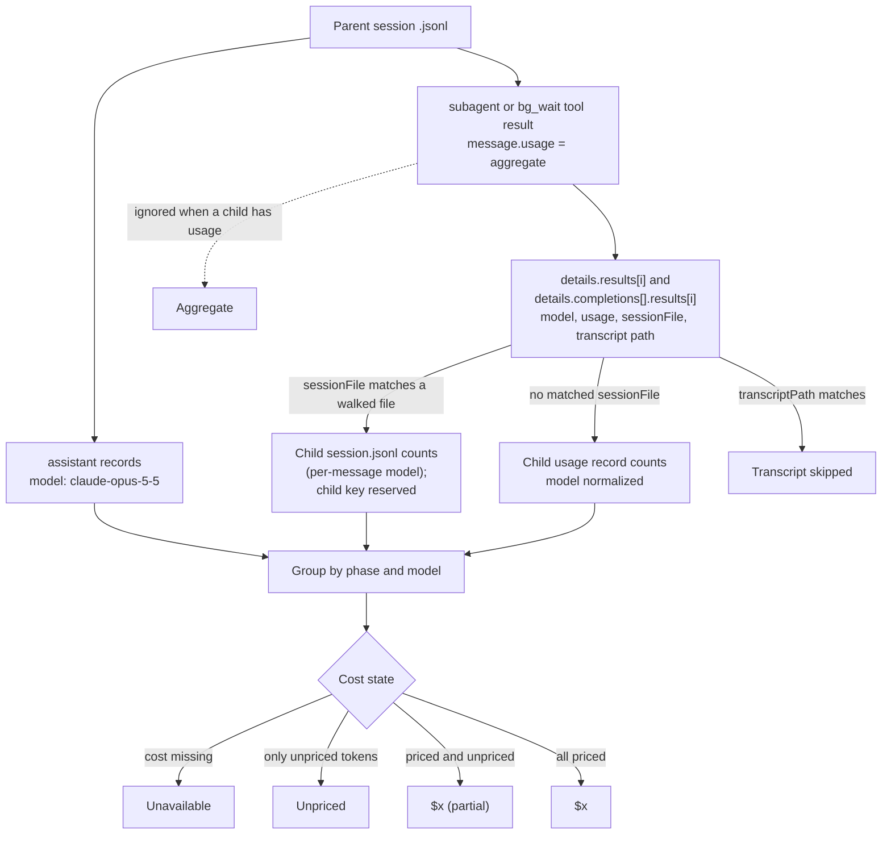

# Issue #376: Attribute subagent usage to models and flag unpriced usage

- **Issue:** [#376](https://github.com/rochecompaan/patchmill/issues/376)
- **Size:** A small project. Five tasks.
- **Base revision:** `e05fb6b` (`main`)

## Intent

The "Patchmill run cost" section of a pull request reads Pi session logs. It has
three faults:

1. It shows the usage of subagent children as "Unknown model".
2. It shows tokens that Pi recorded at a zero price as `$0.0000`. Then the total
   looks like the complete cost of the run.
3. It counts the usage of one subagent child up to four times in runs where Pi
   stores the child session under the run's `sessions/` directory.

This change counts each child once, under its real model. It shows zero-priced
usage as **Unpriced usage**, and it marks a dollar sum that leaves out Unpriced
usage as partial. The same rules apply to the three places that show the cost:
the PR table, the `Cost:` line, and the web issue page.

## What changed since the issue was filed

The issue says: "Child sessions are not stored under `sessions/`, so there is no
double counting today." That was true for the #305 run. It is not true for runs
after the RPC mode change. For example,
`.patchmill/runs/issue-407/20261122-162222-707b/sessions/1/` contains these
files for one reviewer child:

| File                                                                             | Child output tokens counted |
| -------------------------------------------------------------------------------- | --------------------------: |
| Parent session: `subagent` tool result `message.usage`                           |                      26,800 |
| Child session: `<parent>/<childRunId>/run-0/session.jsonl`                       |                      26,800 |
| `subagent-artifacts/<childRunId>_reviewer_0_transcript.jsonl`, top-level `usage` |                      26,800 |
| The same transcript, `message.usage`                                             |                      26,800 |

`readSessionUsage()` in `src/kernel/pi-cost.ts` walks every `.jsonl` file below
the session directory. It reads `usage` from the record and from
`record.message`. Transcript records have no `id`, so deduplication does not
remove them. The maintainer decided that #376 also fixes this: count each child
once.

The parent `subagent` tool result names both child files in
`message.details.results[].sessionFile` and `.transcriptPath` (absolute paths).
In all 123 retained `subagent` tool results that have `message.usage`, the
aggregate equals the sum of `details.results[].usage`.

Async children are reported differently. pi-subagents 0.80.0 builds a `bg_wait`
tool result (`completionUsage()` and `result()` in
`pi-subagents/src/runs/background/subagent-wait.js`). Its `message.usage` is the
sum of the finished async children. Its `details.results` is empty. Each child
is in `details.completions[].results[]`, with `model`, `usage`, `sessionFile`,
and `artifactPaths.transcriptPath`. Seven retained runs from 22 to 24 November
have such a tool result with usage (for example issue-229, issue-317, and
issue-322). In issue-388 the async child's session file and transcript are below
`sessions/`. In the other six, the child files are under
`<issue>/console/<session>/forks/`, outside the session directory.

## Goals

- Each subagent child's usage appears once, grouped under the child's model.
- "Unknown model" appears only for usage that has no recorded model.
- Usage with non-zero tokens and a recorded cost of exactly `0` shows as
  "Unpriced", not `$0.0000`.
- A dollar total or row that leaves out Unpriced usage says "(partial)".
- The PR table footnote, the `Cost:` line, and the web issue page follow the
  same rules.

## Non-goals

- API-equivalent dollar estimates for `claude-bridge` usage, through
  `provider.reportApiCost` (elidickinson/pi-claude-bridge#133) or Patchmill
  catalog prices. The issue defers this.
- Usage of async subagent children that no `bg_wait` tool result reports and no
  file below the session directory records.
- A change to the token columns, phase grouping, or row order.
- A change to Budget windows. They do not read these totals.

## Terms

**Unpriced usage**: Usage that Pi recorded with non-zero tokens and a cost of
exactly `0`. For example, `pi-claude-bridge` gives each model zero prices
because it bills a subscription. A cost that Pi did not record is not Unpriced
usage: the cost is unavailable. A record with zero tokens and zero cost is
priced at `$0`. pi-subagents writes a child's missing cost as `0`
(`u.cost?.total || 0`), so a Child usage record without a recorded cost shows as
Unpriced. This is accepted: both states avoid a complete dollar figure.

**Child usage record**: One entry of `message.details.results[]` in a parent
`subagent` tool result, or of `message.details.completions[].results[]` in a
parent `bg_wait` tool result. It has `model` (for example
`claude-bridge/claude-opus-5-5:high`) and `usage`
(`{ input, output, cacheRead, cacheWrite, cost, turns }`, where `cost` is a
number). It can also have `sessionFile`, and a transcript path in
`transcriptPath` or `artifactPaths.transcriptPath`.

This change adds **Unpriced usage** to `GLOSSARY.md`.

## Design

### Architecture assessment

The change stays inside the existing cost modules. It adds one field to the
`PiUsage` value, two fields to the web `finalUsage` API type, and an optional
caller-owned key set to `readSessionUsage()`. It adds no seam and no adapter.
The deep module is `readSessionUsage()`: callers give a session directory, and
optionally the keys already counted, and get usage records. Callers do not learn
about subagent tool results, child files, or transcripts. All the new rules stay
behind that interface. Domain modeling applies only to the new term above. No
ADR applies: `docs/adr/` does not exist, and the choice is cheap to reverse.

Frontend design does not apply. The web page change is copy only. It replaces
the text of one existing meta item and does not change layout or interaction.

### Module ownership

| Module                                                                 | Owns                                                                                                         |
| ---------------------------------------------------------------------- | ------------------------------------------------------------------------------------------------------------ |
| `src/kernel/pi-usage-records.ts` (new)                                 | Parsing one session record into usage records: containers, Child usage records, model names, Unpriced usage. |
| `src/kernel/pi-cost.ts`                                                | The walk, child file exclusion, deduplication, `totalUsage()`, and cost text.                                |
| `src/kernel/issue-cost.ts`                                             | Grouping by phase and model. No rule change.                                                                 |
| `src/kernel/pr-cost.ts`                                                | The PR table cells and footnote.                                                                             |
| `src/web/issue-final-usage.ts`, `src/web/api-types.ts`, `web/issue.js` | The web `finalUsage` value and its text.                                                                     |

The record parser moves out of `pi-cost.ts` because the walk and the parser both
grow. `pi-cost.ts` is 123 lines now. Callers keep importing from `pi-cost.ts`.
The new module is internal to the kernel cost code.

### The `PiUsage` value

```ts
export type PiUsage = {
  inputTokens: number;
  outputTokens: number;
  /** Sum of recorded prices. Undefined when any part has no recorded cost. */
  costUsd?: number;
  /** Present and true when some part is Unpriced usage. */
  unpriced?: true;
};
```

- A record sets `unpriced: true` when its recorded cost is exactly `0` and
  `inputTokens + outputTokens > 0`. It keeps `costUsd: 0`.
- `totalUsage()` keeps its `costUsd` rule: a sum only when every entry has
  `costUsd`. It sets `unpriced: true` when any entry has it.
- A value without Unpriced usage has no `unpriced` key. Existing `deepEqual`
  checks of priced usage stay valid.

### Cost text

One function in `pi-cost.ts` decides the cost state:

```ts
export function costText(
  usage: PiUsage,
  fractionDigits: number,
): string | undefined;
```

| `costUsd` | `unpriced` | Result                                    |
| --------- | ---------- | ----------------------------------------- |
| undefined | any        | `undefined` (the caller says unavailable) |
| `0`       | true       | `"Unpriced"`                              |
| `> 0`     | true       | `"$0.5522 (partial)"`                     |
| any       | absent     | `"$0.5522"`                               |

"Unavailable" wins over "Unpriced": a total with any unrecorded cost is
unavailable. `costUsd: 0` with `unpriced` means that every priced part had zero
tokens. Then no dollar amount exists to show.

The three places use `costText()` or the same states:

- **PR table** (`pr-cost.ts` `row()`): `costText(usage, 4) ?? "Unavailable"`.
  The total row uses the same function. So a total that includes Unpriced usage
  and some priced usage shows `**$0.5522 (partial)**`. A total of only Unpriced
  usage shows `**Unpriced**`.
- **`Cost:` line** (`costLine()`): tokens, then `, ${costText(usage, 2)}` when
  it is defined. Examples: `Cost: 1,000 in / 20 out tokens, Unpriced` and
  `Cost: 1,000 in / 20 out tokens, $0.55 (partial)`. Issue stop comments, the
  run-once stderr summary, and the console status use this line.
- **Web issue page**: `finalUsage.cost` gets `partial: boolean`, and
  `finalUsage` gets `unpriced: boolean`. The states follow `costText()`:
  - `costUsd` undefined: `cost: null`, `unpriced: false`. The page shows
    `not recorded`, as today. Unavailable wins here too.
  - `costUsd === 0` and `unpriced`: `cost: null`, `unpriced: true`. The page
    shows `Unpriced`.
  - `costUsd > 0` and `unpriced`: `cost` with `partial: true`, `unpriced: true`.
    The page appends "(partial)", after a space, to the formatted amount.
  - Otherwise: `cost` with `partial: false`, `unpriced: false`.

  The meta item keeps the text `Cost, all retained attempts: … · … tokens`. The
  replay helper `scripts/issue-run-replay.mjs` reports `cost: null` for the
  `Unpriced` state, so the optional replay check in
  `scripts/check-issue-thread-layout.mjs` does not look for `0.0000`.

The new PR footnote:

> _Includes all retained local runs for this issue, including specification and
> planning PRs. Prompt tokens include uncached input, cache reads, and cache
> writes. Estimated cost uses Pi's recorded model pricing and includes parent
> and subagent sessions. Unpriced means that Pi recorded tokens at a zero price,
> for example for a subscription-billed model. A partial cost leaves out
> unpriced usage. Unavailable means that Pi recorded no cost for some usage._

### Records in one session file

For each JSON record, the parser selects at most one usage container:
`record.message` when it has `usage`, else `record`. This removes the transcript
double count, where one record has the same usage in both places. Records with
usage in only one place keep their current result.

A **subagent tool result** is a record whose `message.toolName` is `"subagent"`
or `"bg_wait"`. Its Child usage records are the entries of
`message.details.results[]`, then the entries of each
`message.details.completions[].results[]`, in that order. The child index in the
key below counts across both lists. For it:

- Each Child usage record with valid `usage` gives one usage record. It uses the
  same token rules as other records. Its cost is `usage.cost` when that is a
  number, or `usage.cost.total` when that is an object.
- The model is the child's `model`, normalized (see below). When the child has
  no non-empty `model`, it is "Unknown model".
- The parser ignores `message.usage` (the aggregate), unless no child has valid
  usage. Then the aggregate counts as one "Unknown model" record, as today. So
  usage does not disappear when pi-subagents records no child usage.
- The deduplication key is `[record.id, "child", index, model, usage]` when the
  record has an `id`.

### Model names

Normalization applies only to Child usage record models. pi-subagents records
them as `provider/id[:thinking]`. Parent assistant records already have the bare
`id` in `message.model`, and an `id` can contain `/` (for example an OpenRouter
id `anthropic/claude-x`). So:

1. Remove the text up to and including the first `/`, when one exists.
2. Remove a final `:<level>` when `<level>` is a Pi thinking level: `off`,
   `minimal`, `low`, `medium`, `high`, `xhigh`, `max`. Keep other suffixes, such
   as `:free` or `llama3:8b`.

`claude-bridge/claude-opus-5-5:high` becomes `claude-opus-5-5`, which groups
with the parent row. `openai-codex/gpt-6.1-sol:xhigh` becomes `gpt-6.1-sol`.
Parent record models stay as recorded.

### Child files: count each child once

`readSessionUsage(sessionDir)` reads all `.jsonl` files first, then decides what
counts:

1. Collect the `sessionFile` and the transcript path (`transcriptPath`, else
   `artifactPaths.transcriptPath`) of every child entry in every walked file,
   also of entries without valid usage.
2. A walked file **matches** a recorded path when the recorded path equals the
   file's absolute path, or ends with `/` plus the file's path relative to
   `sessionDir`. The suffix rule keeps archived or moved run directories
   working, because recorded paths are absolute.
3. A walked file that matches a `transcriptPath` does not count. A transcript is
   a copy of the child session.
4. A walked file that matches a `sessionFile` counts as a normal session file.
   It has per-message models and ids, and it includes the child's own subagent
   tool results, so grandchildren follow the same rules.
5. A Child usage record whose `sessionFile` matches a walked file does not
   count. Its child session file counts instead.
6. A Child usage record without a matched `sessionFile` counts, as in the
   previous section. This is the case for #305, where child sessions are under
   `console/` and not below the session directory.

The current failure rule stays: a read or JSON parse failure makes the result
`undefined`. Deduplication by key across files and across sessions stays.

A forked session can copy a tool result from an earlier session of the same run.
The earlier session skips the Child usage record by rule 5. The copy in the
later session has no matched child file below its own session directory, so rule
6 would count it. To prevent this, a skipped Child usage record still reserves
its key. `readSessionUsage(sessionDir, seen?)` takes an optional caller-owned
set of keys. It adds the key of each counted and each skipped record, and it
drops records whose key is already in the set. `readIssueCostReport()` passes
its existing `seen` set, so the copy in a later session is dropped.

`readSessionUsage()` returns `[]` when it found usage records but dropped all of
them through `seen` or skipped them as covered child records. It returns
`undefined` only on a read or parse failure, or when the directory has no usage
record at all. So a forked session that repeats only earlier records counts as
zero usage, and `readIssueCostReport()` does not throw
`Session usage unavailable` for it.

Known limit: a transcript that no retained tool result names (for example after
the parent session stopped before the tool result) still counts with its child
session file. Its records now count once each, not twice.

Known limit: when one child has valid usage and another child has malformed
usage, the malformed child's tokens are not counted. pi-subagents always writes
numeric child usage, and no retained run has this.

Known limit: pi-subagents can also write `artifactPaths.jsonlPath`. If that file
is below the session directory, it counts with the child session file. No
retained run has such a file.

Known limit: `bg_wait id=<finished run>` can report the same completion again in
a new tool result with a different record `id`. When the child's `sessionFile`
is below the session directory, rule 5 still counts the child once. When it is
not, the child counts twice. No retained run has this.

Known limit: a child that starts in session N, with its files below
`sessions/N`, and that a `bg_wait` in session N+1 reports, counts twice. The
child record in N+1 has no matched file below `sessions/N+1`. No retained run
has this: every recorded `sessionFile` is below its own session directory or
outside `sessions/`.

### Callers

- The user guide section "Cost reporting" in
  `site/src/content/docs/using-patchmill/run-once.md` gets two sentences: each
  subagent child counts once under its own model, and Unpriced usage shows as
  "Unpriced" and makes a dollar total "(partial)".
- `issue-cost.ts` passes its `seen` set to `readSessionUsage()` and removes its
  own key check, because `readSessionUsage()` now owns deduplication against
  that set. Its grouping does not change, so the rows for #305 become
  `claude-opus-5-5` and `gpt-6.1-sol`.
- `sumSessionUsage()`, `run-snapshot.ts`, `run-once.ts`, `publish.ts`, and the
  console controller get the new totals and text through `PiUsage` and
  `costLine()`.
- The existing `run-once-cost.test.ts` "Unknown model" rows come from fixture
  records with no `model` and no subagent tool result. They encode correct
  behavior and stay unchanged. This corrects the triage note that expected to
  update them.

## Visual explanation

How one parent session with one reviewer child turns into rows:



The rule for one cell, as pseudocode:

```text
costText(usage)
  if costUsd is undefined      -> undefined ("Unavailable")
  if unpriced and costUsd == 0 -> "Unpriced"
  if unpriced                  -> "$x (partial)"
  else                         -> "$x"
```

## Acceptance and verification

| Requirement                                                                                  | Verification                                                                                                                          |
| -------------------------------------------------------------------------------------------- | ------------------------------------------------------------------------------------------------------------------------------------- |
| Two children on different models give one row per (phase, model), no "Unknown model"         | `issue-cost.test.ts`: a parent record plus a subagent tool result with two children (`claude-bridge/…:high`, `openai-codex/…:xhigh`). |
| Each child counts once when its session and transcript are stored below `sessions/`          | `pi-cost.test.ts`: a tool result whose `sessionFile` and `transcriptPath` name walked files under another absolute root.              |
| Async children in a `bg_wait` tool result count once, under their models                     | `pi-cost.test.ts`: a `bg_wait` tool result with `completions[].results[]` and `artifactPaths.transcriptPath`.                         |
| A tool result copied into a forked later session does not count again                        | `issue-cost.test.ts`: two planning sessions; the second repeats the tool result.                                                      |
| Zero-cost, non-zero-token usage shows as Unpriced; the total is not a complete dollar figure | `pr-cost.test.ts` (table rows, total, footnote) and `pi-cost.test.ts` (`totalUsage()`, `costLine()`).                                 |
| Web page does not show `$0.0000` for Unpriced usage                                          | `file-issue-detail.test.ts` (`finalUsage.unpriced`, `cost.partial`).                                                                  |
| Existing cost tests still pass                                                               | `npm test`, `npm run lint`.                                                                                                           |

## Companion artifacts

- `GLOSSARY.md`: adds **Unpriced usage**. [Glossary](../../GLOSSARY.md)

## Planning review

All passes were combined reviews of the spec
(`docs/specs/2026-11-24-issue-376-pr-run-cost-report-attribute-subagent-usage-to-m-design.md`)
and the plan
(`docs/plans/2026-11-24-issue-376-pr-run-cost-report-attribute-subagent-usage-to-m-plan.md`),
with `GLOSSARY.md` as a companion. Reviewer: canonical `reviewer` agent, model
`claude-bridge/claude-opus-5-5`, thinking `high`. Base revision: `e05fb6b`
(`main`). Each pass inspected source, tests, pi-subagents 0.80.0, and the usage,
model, path, id, and toolName fields of retained run logs. In each pass, the
plan was compared with the spec hash listed for that pass.

### Review 1, pass 1

- **Reviewed body SHA-256:** spec
  `0e71f68a3364040cc104a5c5f9151bbe338e048f38b06f1fa99449be977c0795`, plan
  `363a1f3e83c4c9aaed1f4a42c7368698dfe3c9150768bec9649f71e26fc52c59`.
- **Survey:** the cost flow, three display places, and the claims about retained
  logs were confirmed. The four-way count for issue-407 was reproduced.
- **Findings:**
  - B1 (blocker): `bg_wait` async children were not handled. Accepted: the spec
    and plan treat `details.completions[].results[]` and
    `artifactPaths.transcriptPath`, with tests in Tasks 2 and 3.
  - B2 (blocker): Task 5 web `unpriced` contradicted "Unavailable wins".
    Accepted: the spec has four web states, and the plan has a third fixture.
  - S1: the non-null web samples need the new keys. Accepted (Task 5).
  - S2: the replay helper would look for `0.0000`. Accepted (spec Cost text,
    Task 5).
  - S3: no executed check for `web/issue.js`. Accepted (Task 5 Step 4).
  - S4: a tool result copied into a forked session would count again. Accepted:
    a caller-owned `seen` set with reserved keys.
  - S5: a test imported the internal module. Accepted: tests go through
    `readSessionUsage()`.
- **Confirmation:** reviewed spec
  `02ec330c1ced271dc8d44f296834116a7a6a78c896f87feca66cea87ae2d4143`, plan
  `704a5dd9681079e80f542e4772a2440ea00b00feeed9d68e61b17d88bee77590`. It found
  C1 (blocker): a session of only duplicate records would throw. C2–C4
  (suggestions): a wrong sentence about async child file locations, a wrong
  expected failure count, and a repeated-`bg_wait` limit. All accepted:
  `readSessionUsage()` returns `[]`, the sentence and the count are corrected,
  and the limit is recorded.
- **Outcome:** `blocked`, because C1 came from the confirmation. The maintainer
  asked for a new Planning review.

### Review 2, pass 1: maintainer-requested review

- **Reviewed body SHA-256:** spec
  `7452ca3b22f9390089fa80c699d5908fae522009de905dc57c67fe34af22eee8`, plan
  `3e5606198b3b6a5bc9b3a3b26254dbcf3f2ea611ecff135ba2c5ca7ab88b0b9f`.
- **Findings:** no blockers. S1 (collect child files from every entry), S2
  (cross-session `bg_wait` limit), S3 (missing child cost written as `0`), S4
  (check on real logs), S5 (import cycle, Chromium condition). All accepted.
- **Confirmation:** reviewed spec
  `9a34d2730d0e2b1e2c63f19dbbdd9e862cb09213fdbd48e14964a8524198f89f`, plan
  `78ecae2ba006814909c8208d2d65211e6519fec0a486523810c4bf8e532a6cce`. It found
  B1 (blocker): the Step 4b check on issue-407 rejects on
  `Run metadata unavailable`. S-a to S-c (suggestions): the #305 replay cannot
  pass, the #305 rows were not exact, and S1 had no test. All accepted: Step 4b
  selects two run IDs and has exact rows, the replay is dropped, and Task 3 has
  a fourth case.
- **Outcome:** `blocked`, because B1 came from the confirmation. The maintainer
  asked for a new Planning review.

### Review 3, pass 1: maintainer-requested review

- **Reviewed body SHA-256:** spec
  `9a34d2730d0e2b1e2c63f19dbbdd9e862cb09213fdbd48e14964a8524198f89f`, plan
  `33d55c3e0e15d4eb152856a22941a674247591a70f183812c8738dea65499855`.
- **Survey:** a simulation of the planned rules on all 115 retained session
  directories gives the Step 4b rows exactly. It leaves no "Unknown model" rows
  and finds no false path matches.
- **Findings:** no blockers.
  - S1: the user guide "Cost reporting" section is not updated. Accepted (spec
    Callers, Task 4).
  - S2: browser checks and screenshots. Accepted (Task 5 Step 4).
  - S3: two Task 2 cases pass on base. Accepted: case 1 is a regression guard,
    and case 2 now fails on base.
  - S4: malformed child usage next to a valid child. Accepted as a known limit.
  - S5: `artifactPaths.jsonlPath`. Accepted as a known limit.
- **Confirmation:** reviewed spec
  `be25cde138681a535e9e4e7e159c5dee39270899c1b73ef6591177fbc3cc2496`, plan
  `2b54801ac3f16984b7a02dd067adc5c3f36095ebf44a71cec7bb70dd55ec9a9f`. It
  confirmed S1, S3, S4, and S5 and found no blockers. F1 (suggestion): the S2
  sentence claimed that the checks always write screenshots. They write them
  only with `LAYOUT_SCREENSHOTS` or `CAPTURE_ISSUE_THREADS`. Accepted: the plan
  now uses the reviewer's replacement sentence verbatim.
- **Inspection limits:** the planned code was not run. Browser checks were not
  run. The issue text came from the brief.
- **Final body SHA-256:** spec
  `ca18608910239d9a4401f01ad98347b46ca74494b0e3b5a864e94c2531c79b91`, plan
  `d87e618b8e531abd99765962f2c51af939268be28925ca5448f4c066d4865241`, compared
  with spec `ca18608910239d9a4401f01ad98347b46ca74494b0e3b5a864e94c2531c79b91`.
  These are the confirmed bodies after F1. They differ from the hashes above
  only by the blank line before this record's heading.
- **Outcome:** `ready`.
