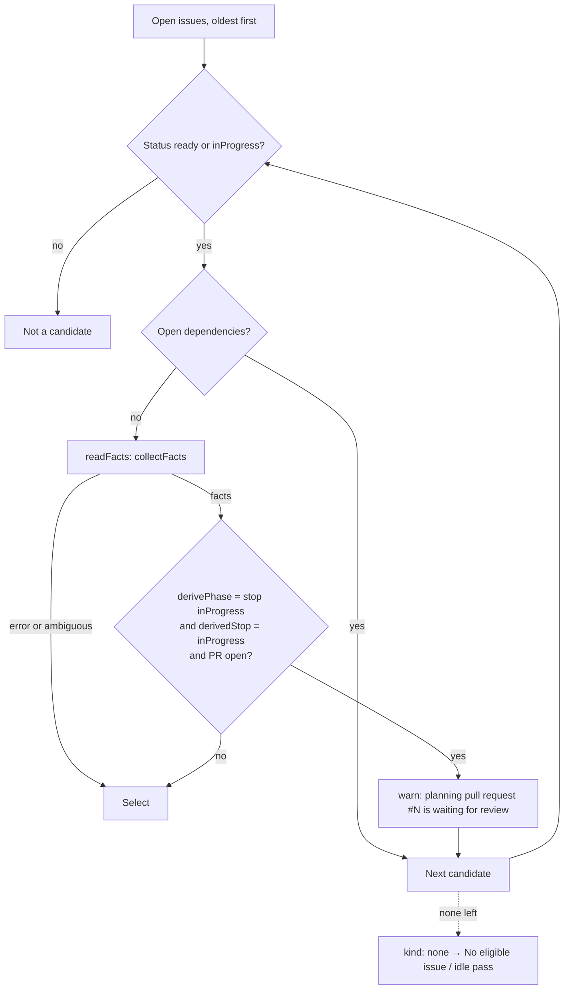

# Skip issues that wait on an open Planning pull request — design

Issue: [#250](https://github.com/rochecompaan/patchmill/issues/250)

## Problem

Automatic issue selection picks the oldest open issue with status `ready` or
`inProgress` that has no open dependency. It does not look at pull requests.

When a required gate's Planning pull request is open, the run can only stop and
wait for a human merge. The issue keeps status `inProgress`, so it stays
selectable. If that issue is older than every ready issue, each `run-once` pass
and each `patchmill run` pass claims it, stops at the gate, and goes idle. The
ready issues never run until a human merges the Planning pull request.

Current code path:

1. `selectRunIssue` (`src/kernel/issue-selection.ts`) filters on status and
   dependencies only.
2. `derivePhase` (`src/kernel/phase.ts`) returns
   `{ kind: "stop", label: "inProgress" }` for an open Planning pull request.
3. `derivedStop` (`src/kernel/interactive-loop.ts`) keeps `inProgress` unless
   the pull request has a closing reference.
4. `localWorkSource` (`src/kernel/runner/local-work-source.ts`) treats the
   `inProgress` stop as an idle pass.

Implementation pull requests do not cause this problem. `reviewWait` sets their
status to `done`, which removes them from selection.

## Goal

During automatic selection, skip a candidate that waits on an open Planning pull
request. Print why, then try the next candidate. Keep all other behavior, except
the publication retry in D8.

## Decisions

### D1. Definition of a waiting issue

A candidate **waits on a Planning pull request** when the run would stop with
the `inProgress` gate stop for an open pull request. Selection decides this with
the same functions that the run uses, so selection and the run cannot disagree:

1. `derivePhase(facts)` returns `{ kind: "stop", label: "inProgress" }`.
2. `derivedStop(facts, issue, repository, "inProgress").label` is
   `"inProgress"`.
3. `facts.pullRequest?.state` is `"open"`.

In practice, all of these are true: the stage is `spec` or `plan`, a pull
request exists for that stage, it is open, it targets the base branch, and its
body has no closing reference for the issue.

Condition 3 is a guard. It prevents a skip for a merged pull request, which
`derivePhase` also maps to `inProgress` at a planning stage.

| Planning pull request situation    | Run outcome                 | Selected? |
| ---------------------------------- | --------------------------- | --------- |
| Open, targets base, `Refs #N`      | Gate wait (`inProgress`)    | Skipped   |
| Merged                             | Continues to the next stage | Yes       |
| Closed without a merge             | `needsInfo`, reopen/replace | Yes       |
| Open, wrong target branch          | `needsInfo`, retarget       | Yes       |
| Open, with a closing reference     | `needsInfo`, replace it     | Yes       |
| No pull request                    | Runs planning               | Yes       |
| Facts cannot be read, or ambiguous | Run reports the problem     | Yes       |

### D2. Order of checks

Each candidate goes through these checks in this order:

```text
status is ready or inProgress?   no  → not a candidate (needsInfo, done, …)
open dependencies?               yes → skip (explicit: refuse "blocked by")
waits on a Planning PR?          yes → skip with warning (explicit: not checked)
otherwise                            → select
```

The status filter and the dependency check do not change. The new check runs
only after the dependency check passes. Selection stops at the first candidate
that can make progress, so it reads facts for no more candidates than needed.

Issues at `needsInfo` never reach the new check. A run that stops with
`needsInfo`, for example for a closed Planning pull request, removes the issue
from later selection until a human returns it to `ready`.

### D3. Explicit issue

With `--issue N`, selection does not run the new check. The run continues as
today: it claims the issue and reports the gate wait. The explicit path never
reads facts in selection.

### D4. Every automatic selection skips

The skip applies to every automatic selection:

- unattended `run-once` and `patchmill run`, through `runOneIssue`;
- `run-once --dry-run`, through the same `runOneIssue` selection;
- `run-once --interactive` without `--issue`, through `prepareInteractiveRun`
  (`src/kernel/interactive-start.ts`).

Web sessions also call `prepareInteractiveRun`, but they always pass an issue
number (`src/cli/commands/serve/session-launcher.ts`). They use the explicit
path, so they do not skip.

One rule for all callers keeps dry-run and the real run in agreement. To work on
a waiting issue interactively, the operator names it with `--issue N`. The
maintainer chose this option during planning.

### D5. Unreadable facts

If facts collection throws, or returns `ambiguous-branches`, selection selects
the candidate. The run then reports the problem. Selection does not print a
warning for this case, because the run reports the same problem.

If `host.repository()` throws while selection checks for a wait, selection also
selects the candidate.

### D6. Warning text

For each skipped candidate, selection calls its `warn` callback with:

```text
planning pull request #<pr> is waiting for review; skipping it.
```

The existing callers add the prefix `Warning: Issue #<n>: `. The full line is:

```text
Warning: Issue #229: planning pull request #248 is waiting for review; skipping it.
```

Dry-run prints the same line, because it uses the same selection and the same
`warn` callback (`output.stderr`).

### D7. No candidate left

When every candidate is skipped or blocked, automatic selection returns
`{ kind: "none" }`. `runOneIssue` then prints "No eligible issue" and returns
`no-work`. `localWorkSource` maps `no-work` to an idle pass. No Runner change is
necessary.

## Module design

`selectRunIssue` stays the one module that owns the question "which issue runs
next". It becomes deeper: callers still pass an issue number or nothing, and
they get the same `RunIssueSelection` result. The wait decision stays hidden in
the module.

New required input:

```ts
readFacts: (issue: TrackedIssue) => Promise<FactsResult>;
```

- Selection calls `readFacts` only in automatic selection, only after the
  dependency check passes, and at most once for each candidate.
- `readFacts` must be read-only. Production callers pass
  `collectFacts({ ...deps, config }, issue)` from `src/kernel/facts.ts`. That
  function fetches and reads refs. It does not create branches or worktrees.
- Selection reads `host.repository()` only when `derivePhase` returns the
  `inProgress` stop, to apply `derivedStop`.

The facts are a real seam. Production uses Git and the host. Unit tests pass
fixed `Facts`. Selection does not construct `collectFacts` itself, because
`selectRunIssue` has no `config`, `git`, `repoRoot` or `now` today, and the
caller already owns them.

Selection does not return the facts it read. `runOneIssue` reads facts again
after selection: `provisionWorkspace` for a run, and `collectFacts` for a
dry-run. A second fetch costs little. Reuse would couple selection to the
workspace lifecycle.

Callers to update:

- `runOneIssue` in `src/kernel/run-once.ts`. A conflict selection does not call
  `selectRunIssue`, so it does not change.
- `prepareInteractiveRun` in `src/kernel/interactive-start.ts`.

Performance: each skipped candidate costs one `git fetch` and some ref reads.
Only candidates up to the first selectable one pay this cost.

Test impact: some existing integration tests run `runOneIssue` twice without an
issue number to reach a gate wait for issue 9, for example in
`src/kernel/run-once-gate-wait.test.ts`. After this change, the second automatic
run skips issue 9 and returns `no-work`. Those tests check the gate stop, not
selection, so they must name the issue (`{ issue: 9 }`).

### D8. A failed gate-wait publication is not retried automatically

Today, when the gate-wait status or comment fails to publish, the next automatic
pass selects the issue again. `gateWaitPublished` then sees the
`publicationErrors` of the earlier result and publishes again. After this
change, the next automatic pass skips the waiting issue, so it does not retry.

The maintainer accepted this change. The failure stays visible on the host that
ran Patchmill:

- the run prints the publication error;
- the run's `result.json` records it in `publicationErrors`;
- in `patchmill run`, the pass is an error pass with
  `publication failed for issue #N: …`.

An explicit `--issue N` run still retries the publication, because
`gateWaitPublished` still applies to it. Selection does not read run results.

## Domain and architecture

This change adds one rule to an existing module. It does not add a module, a
context, or a trade-off that needs an ADR. The repository has no `docs/adr/`.

The glossary already defines **Planning pull request**, **Spec gate**, **Plan
gate** and **Run-once workflow**. This design uses those terms. It does not need
a new glossary term. "Waits on a Planning pull request" is a description, not a
new concept.

Frontend design does not apply. The change has no user interface.

## Acceptance criteria and verification

| Criterion                                                                                 | Verification                                                                 |
| ----------------------------------------------------------------------------------------- | ---------------------------------------------------------------------------- |
| An older waiting issue and a newer `ready` issue: the run takes the ready issue and warns | Unit test in `issue-selection.test.ts`; `run-once` integration test          |
| After the merge, the older issue is selected again first                                  | Integration dry-run after a real merge, while the newer issue is still ready |
| A closed-unmerged Planning pull request stays selectable                                  | Unit test                                                                    |
| `--issue <waiting>` runs that issue and reports the gate wait                             | Unit test (no `readFacts` call); existing gate-wait integration tests        |
| Only waiting candidates: "No eligible issue" and an idle Runner pass                      | Unit test; existing `no-work` mapping in `localWorkSource`                   |
| Dry-run names the same issue with the same warning                                        | `run-once` integration test with `dryRun: true`                              |

## Out of scope

- Automatic retry of a failed gate-wait publication (D8).
- An in-run retry with backoff for host publication errors.
- Implementation pull requests in Review wait. Status `done` already removes
  them.
- Changes to gate-wait comments (`gateWaitPublished`).
- Changes to the conflict search before selection.

## Visual explanation

The diagram shows where the new check sits in automatic selection.



An explicit `--issue N` never reaches the `readFacts` step. After the dependency
check passes, selection selects the issue.

## Companion artifacts

None. The visual explanation is inline.

## Planning review

### Review 1 — combined pass (spec and plan)

- Scope: this specification, with the implementation plan
  `docs/plans/2026-11-25-issue-250-selection-keeps-picking-issues-waiting-on-an-ope-plan.md`.
- Reviewer: `reviewer`, model `claude-bridge/claude-opus-5-5`, thinking `high`.
  Base revision `be9fa9517cac3e848e1b905acc18ae59b8898ad5`.
- Reviewed body SHA-256: spec
  `40c10615c00cb8b535387471a767a2cc18580faee4631fff71e4eebd8079f352`, plan
  `0eaba649c9684e8d158bfcbf742f133d38c1cfe52e9ba4d168a5a5a4e8acc3b2`.
- Survey: the reviewer read `selectRunIssue` and its callers, `derivePhase`,
  `derivedStop`, `collectFacts`, `planningWorkspace`, `gateWaitPublished`,
  `localWorkSource`, and the gate-wait tests. It ran a probe in `/tmp` to see
  what each run publishes. It confirmed that the wait rule matches the run's
  decision, that the `readFacts` seam is justified, and that the change adds no
  import cycle.
- Findings:
  - B1 (plan, blocker): `src/host/github-gh.test.ts` calls `selectRunIssue`.
    Accepted: the plan updates it in Task 1.
  - B2 (spec and plan, blocker): automatic passes no longer retry a failed
    gate-wait publication. Maintainer ruling: accept the change, because the
    failure is recorded locally. Accepted: added D8, the Goal exception, Out of
    scope entries, and a plan test.
  - S1 (spec): Web sessions always pass an issue number. Accepted: D4 corrected.
  - S2 (plan): no test of `prepareInteractiveRun`. Accepted: Task 2 test added.
  - S3 (plan, spec table): the merge test did not prove the order. Accepted: the
    merge test runs while issue 10 is still ready.
  - S4 (plan): Task 1 commit failed the type check. Accepted: callers wired in
    Task 1.
  - S5 (spec, plan): `observe` name collides. Accepted: renamed `readFacts`.
  - S6 (plan): wrong location of `gated`. Accepted: corrected.
- Inspection limits: the reviewer did not run `npm test` or lint on the plan.
- Confirmation: a fresh scoped confirmation verified B1, B2 and S1–S6 against
  the source and found no blocker. Its optional notes N1–N4 changed only the
  plan (see the plan's record).
- Final body SHA-256:
  `6a5c2224fea0cd36e61480fe2b03a210d1ce2f300772c6ccee5c40ec65c876e7`.
- Outcome: `ready`.
