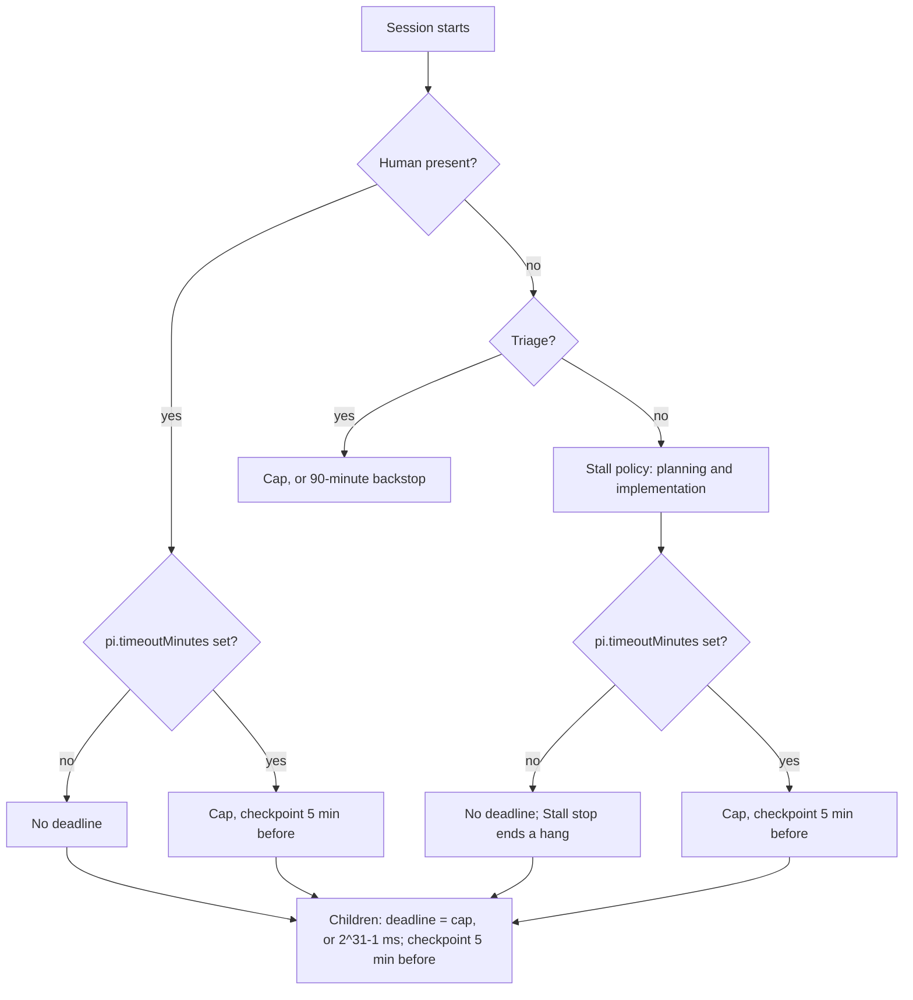

# Replace wall-clock session and subagent timeouts with progress-based limits

Issue: [#371](https://github.com/rochecompaan/patchmill/issues/371)

## Intent

Fixed wall-clock deadlines stop Patchmill sessions and their subagents when they
still make progress. An implementation worker can finish and push its work, and
then lose its hand-off while it waits for the last CI check. This change removes
the default wall-clock deadlines. The Stall policy of #319 becomes the main
safety net. An operator can still set an optional hard cap.

## Current behavior

| Limit                                          | Owner        | Default    | Where                                                                                                                        |
| ---------------------------------------------- | ------------ | ---------- | ---------------------------------------------------------------------------------------------------------------------------- |
| `pi.timeoutMinutes`                            | Patchmill    | 90 minutes | `preparePhasePrompt()` in `src/kernel/interactive-loop.ts`, `src/kernel/triage.ts`                                           |
| enforced by                                    | Patchmill    |            | `startPiRpc()` in `src/kernel/pi-rpc.ts`, `supervisePi()` in `src/kernel/pi-supervisor.ts`, `src/console/worker-launcher.ts` |
| run deadline of a subagent without `timeoutMs` | pi-subagents | 30 minutes | `DEFAULT_FOREGROUND_TIMEOUT_MS`, `DEFAULT_ASYNC_TIMEOUT_MS`                                                                  |

- `pi.timeoutMinutes` is only checked to be a number. `0`, a negative value, or
  a value above 35,791 minutes stops the session at once.
- `superviseStalls()` in `src/kernel/stall-supervisor.ts` gives a restarted
  session the time that remains of the same deadline.
- pi-subagents 0.80.0 reads `<agentDir>/extensions/subagent/config.json`.
  Patchmill does not write this file, so every child gets the 30-minute default.
  Its `timeoutMs` and `checkpointBeforeDeadlineMs` must be positive integers no
  larger than 2,147,483,647. A deadline cannot be turned off there.
- The Stall policy of #319 applies only to unattended implementation sessions
  (`stallPolicy` in `preparePhasePrompt()`).
- The run envelope says `Time limit: {{timeoutMinutes}} minutes`
  (`src/kernel/run-envelope.md`).

The issue says that pi-subagents `timeoutMs` also sets the end-of-turn wait for
background work in print mode. In 0.80.0 this is not true.
`drainOutstandingWork()` uses a fixed 30-minute `DEFAULT_AUTO_DRAIN_TIMEOUT_MS`,
and only when the session has no UI. Phase sessions run in RPC mode with the
background-work extension (`src/pi/background-work-extension.ts`), so the drain
does not apply to them. Triage runs in print mode, but it does not start
subagents. The Console worker is a headless pi-subagents child, so the fixed
drain does apply at the end of its turn, when its own children still run. This
change does not touch the drain.

pi-subagents applies `config.timeoutMs` only to foreground runs and to plain
async single-agent runs. Async chain and parallel steps, and a `resume`, use the
agent's frontmatter `timeoutMs`, else the 30-minute default
(`async-execution.js`, `resumeAsyncRun()` → `executeAsyncChain()`). Patchmill
resumes reviewers and the Console worker, so the config file alone is not
enough.

## Goals

- A healthy session that runs longer than 90 minutes is not stopped by default.
- Subagents started from Patchmill sessions are not stopped after 30 minutes by
  default.
- A stuck unattended session still ends: through the Stall policy, or through a
  backstop where no Stall policy applies.
- An operator can set an optional hard cap. Invalid values get a clear config
  error.
- A child never gets a shorter default deadline than its parent. When a cap
  applies, the parent gets a warning before the cap, so that it can wait for its
  children and hand off.
- The run envelope and the docs describe the actual limits.

## Non-goals

- A change to the drain wait of pi-subagents in print mode.
- A deadline for agents that Patchmill does not manage (for example built-in
  agents) in async chain or parallel steps or on resume. They keep the
  pi-subagents default. The docs say so.
- A migration of existing configs. A repository that `patchmill init` set up
  earlier has `"timeoutMinutes": 90` and keeps that cap until the operator sets
  `null`. The docs say how.
- A Stall policy for triage sessions, interactive sessions, or
  `patchmill doctor`.
- A new Stall policy for children of interactive sessions. A maintainer is
  present.
- A warning when an operator turns off both the cap and the Stall stop.

## Anti-goals

- A default that can stop healthy work only because time passed.
- A child that the default kills while its parent still waits for it.
- A Patchmill write that removes operator keys from the pi-subagents config.

## Approaches

The maintainer chose approach 1.

1. **Cap off by default. The Stall policy also covers unattended planning.
   Triage keeps a built-in backstop.** Planning sessions already use the same
   RPC launcher and Stall supervisor, so this costs little. Triage is short and
   is not the source of the problem.
2. **Cap off only where a Stall policy or a human is present.** Unattended
   planning and triage keep the 90-minute backstop. This is smaller, but a long
   Planning review can still be killed.
3. **One large backstop everywhere, for example 24 hours.** This is simplest,
   but a hang in planning or triage can waste a day.

## Design

### Does this need #319?

Yes. #319 has merged (`357220c`). The default is safe only because the Stall
policy ends stuck unattended phase sessions.

### Session cap

The **Session cap** is the optional wall-clock limit of one phase session or
triage session. `pi.timeoutMinutes` sets it.

- Type `number | null`. The default is `null`: no cap.
- A number must be finite, greater than 0, and at most 35,791 (the largest whole
  number of minutes that Node's timer accepts). Fractions are allowed, as for
  `pi.stallStopMinutes`.
- `0`, a negative value, or a value that is too large is a `ConfigError`:
  `Invalid value for pi.timeoutMinutes: use null for no cap, or a number greater than 0 and at most 35791`.
  Another type gets the existing type error of `parseConfig()`, which names
  `pi.timeoutMinutes`.
- `parseConfig()` gets a `number|null` schema kind. `checkPi()` checks the
  range.
- `patchmill.config.json` in this repository and the documented examples use
  `null`.

Where the cap applies:

| Session                                 | No cap (`null`)                        | Cap set           |
| --------------------------------------- | -------------------------------------- | ----------------- |
| Unattended implementation (RPC)         | no deadline; Stall policy              | cap; Stall policy |
| Unattended planning (RPC)               | no deadline; Stall policy (new)        | cap; Stall policy |
| Interactive planning and implementation | no deadline; the maintainer is present | cap               |
| Triage (print mode)                     | built-in backstop of 90 minutes        | cap               |

`PhaseLaunch.timeoutMs`, `PiRpcOptions.timeoutMs` and
`PiSessionOptions.timeoutMs` become optional. `undefined` means no deadline: no
timer starts. `preparePhasePrompt()` sets `timeoutMs` only when the cap is set.
`superviseStalls()` keeps one deadline only when `rpc.timeoutMs` is set. A
restart without a deadline starts with no deadline. A restart with a deadline
keeps the remaining-time rule.

Triage passes `triageTimeoutMs(config.pi.timeoutMinutes)`, which is
`(timeoutMinutes ?? TRIAGE_BACKSTOP_MINUTES) * 60_000` with
`TRIAGE_BACKSTOP_MINUTES = 90`, in `src/kernel/triage.ts`.

### Stall policy for unattended planning

`preparePhasePrompt()` gives the Stall policy to every unattended phase session:
`stallPolicy = !deps.human`. Today it is
`phase === "implementation" && !deps.human`. The same `pi.stallStopMinutes` and
`pi.maxStalls` apply. #319 chose 10 minutes from implementation sessions. Its
evidence includes the longest healthy model reply and child-session gaps, which
planning sessions share, so the value is reused (planner's call). The same rules
then hold for planning:

- The Stall stop, the recovery prompt, the restart, and the Stall limit.
- A Stall limit writes `stall-block.json`. The next Run attempt reads it and
  moves it to the run directory, in either phase. Today only implementation
  reads and moves it (`preparePhasePrompt()` and `runOneIssue()` in
  `src/kernel/run-once.ts`). The Previous stalls fact shows whenever the record
  exists, also in an interactive run. An interactive run still reads the record,
  as today.
- `verifyOutcome()` already puts `stallBlock` first for both phases.
- The envelope of an unattended planning session gets the Command timeout fact
  and the Stall fact. Today only implementation gets them. The command-timeout
  extension is already loaded in every RPC phase session.

The Stall texts name the implementation phase today: `TOP` in
`src/kernel/stall-watch.ts` is `"implementation session"`, and the block reasons
say `The implementation stopped…`. `callWhere()` in `src/kernel/stall-text.ts`
and `formatStall()` in `src/kernel/console.ts` recognise that label.
`superviseStalls()` gets the phase and passes it to `createStallWatch()`. The
top-level label becomes `"<phase> session"`, and the block reasons start
`The <phase> session stopped`. `callWhere()` and `formatStall()` recognise both
`planning session` and `implementation session`, so an old `stall-block.json`
still reads correctly.

### Subagent limits

Patchmill manages two keys of `<agentDir>/extensions/subagent/config.json`:

| Key                          | Value                                                                  |
| ---------------------------- | ---------------------------------------------------------------------- |
| `timeoutMs`                  | the Session cap in milliseconds, rounded, or 2,147,483,647 with no cap |
| `checkpointBeforeDeadlineMs` | 300,000 (5 minutes)                                                    |

- A new module `src/pi/subagent-limits.ts` owns this file. Its interface is
  `subagentLimits(timeoutMinutes: number | null)` and
  `provisionSubagentLimits(agentDir: string, timeoutMinutes: number | null): Promise<void>`.
- It reads the file when it exists, sets the two keys, keeps every other key,
  and writes the file only when the content changes. It writes a temporary file
  in the same folder and renames it, so a Pi that loads at the same time never
  reads a partial file. A missing file or folder is created. A file that is not
  a JSON object is an error that names the file. Patchmill does not overwrite
  it.
- `checkpointBeforeDeadlineMs` is a fail-closed key of pi-subagents. Once it is
  in the file, an invalid key elsewhere in the file stops pi-subagents from
  loading, instead of a logged fallback. The docs say so.
- Patchmill owns these two keys. An operator value for them is replaced. The
  docs say so.
- `preparePhasePrompt()` calls it before each phase session, so unattended runs
  get it. `provisionAgentDir()` in `src/cli/commands/init/agent-dir.ts` also
  calls it, so the Console and Web sessions get it before Pi loads pi-subagents.
  `provisionAgentDir()` gets the cap as a required parameter, so a caller cannot
  forget it.
- The managed agent definitions get the same deadline in their frontmatter:
  `timeoutMs: <subagentLimits(cap).timeoutMs>`. This covers a resume and async
  chain or parallel steps of `reviewer` and `patchmill-implementation`.
  `REVIEWER_AGENT` and `IMPLEMENTATION_AGENT` in
  `src/cli/commands/init/agent-dir.ts` become functions of the cap:
  `reviewerAgent(timeoutMinutes)` and `implementationAgent(timeoutMinutes)`.
  `provisionReviewerAgent()` and `checkReviewerRole()` get the cap, so
  `patchmill doctor` compares with the content for the configured cap.
  `preparePhasePrompt()` also calls `provisionReviewerAgent()`, so an unattended
  run gets a reviewer with the current deadline.
- A directory with only `config.json` is not a Pi extension, so Pi does not try
  to load it.

The explicit `timeoutMs` of a call or of agent frontmatter still wins.
pi-subagents applies `checkpointBeforeDeadlineMs` only to a spawn of a single
async agent. That child gets a "checkpoint and stop" message 5 minutes before
its deadline. A foreground child, a resumed run, and async chain or parallel
steps get no checkpoint. This matters only when an operator sets a cap. The docs
say so.

### Consistent deadlines

- A child's default deadline equals the parent's cap, from the child's start.
  The child starts after the parent, so the parent's cap is always the earlier
  deadline. With no cap, neither has a deadline in practice.
- With a cap longer than 5 minutes, an RPC phase session gets a **Cap
  checkpoint**: 5 minutes before its deadline, Patchmill sends this message as a
  steer:
  `Patchmill ends this session in 5 minutes. Start no new work. Wait for running subagents, commit and push your work, and end with the result.`
- `startPiRpc()` sends the Cap checkpoint at most once per process. It sends a
  `prompt` with `streamingBehavior: "steer"`, as `recover()` does, so it also
  reaches a session that waits for background work. Unlike `recover()`, it
  ignores the response, catches a rejected send, and never calls `finish()`.
- `PiRpcOptions` gets `checkpointBeforeMs` (default 300,000, so tests can use
  short values) and `checkpointNow?: boolean`. Without `checkpointNow`,
  `startPiRpc()` schedules the steer at `timeoutMs - checkpointBeforeMs` when
  `timeoutMs > checkpointBeforeMs`, and else sends none.
- `superviseStalls()` knows the original cap and the remaining time, so it
  decides for a restart. When the original cap is longer than the lead and the
  remaining time is at most the lead, it passes `checkpointNow: true`, and the
  restarted process sends the steer right after its prompt. A restart can
  therefore repeat the Cap checkpoint once.
- In interactive runs the Console worker is a pi-subagents child, not an RPC
  phase session. Its first spawn gets the pi-subagents checkpoint, from the
  managed config, instead of the Cap checkpoint. A resumed worker gets none; a
  maintainer is present.
- The Console worker (`src/console/worker-launcher.ts`) passes `maxRuntimeMs` =
  the cap, or 2,147,483,647 with no cap. Its own Patchmill deadline timer starts
  only with a cap.
- Triage has no subagents and no checkpoint.

### Run envelope

`RunEnvelopeInput.timeoutMinutes` becomes `number | null`. The `Time limit` line
becomes a `{{timeLimit}}` placeholder:

- No cap: the line is left out. An unattended session still gets the Stall fact.
- Cap of at most 5 minutes: `- Time limit: N minutes`.
- Cap longer than 5 minutes:
  `- Time limit: N minutes. About 5 minutes before the end, Patchmill asks you to stop new work and hand off.`

`{{timeLimit}}` starts with its own newline and bullet, so an envelope with no
cap has no empty bullet. The Command timeout fact stays on its own line. Today
it is appended to the `Time limit` line. The golden files
`src/kernel/fixtures/envelope-*.txt` change with it.

### Docs

- `README.md`: the `pi.timeoutMinutes` key line, the example, and Safety.
- `site/src/content/docs/using-patchmill/run-once.md`: Supervision and cleanup.
- `site/src/content/docs/getting-started/configuration.md` and
  `site/src/content/docs/reference/configuration-example.md`.
- The Stall stop text in README and the site now covers unattended planning too.
- Upgrades: an existing `"timeoutMinutes": 90` keeps the cap and now also caps
  subagents at 90 minutes; set `null` to turn it off.
- The managed pi-subagents keys, the fail-closed note, and the agents that keep
  the pi-subagents default.

## Architecture and domain

This change alters a supervision contract and adds one owned file, so domain
modeling and codebase design apply.

- Single context. `GLOSSARY.md` gets **Session cap** and **Cap checkpoint**.
  **Stall** and **Stall stop** change from "unattended implementation session"
  to "unattended planning or implementation session". No ADR: the default is
  cheap to reverse.
- Modules: `src/config/config.ts` owns validation. `src/pi/subagent-limits.ts`
  hides the file format, the merge, the atomic write, and the 2,147,483,647
  ceiling behind two functions. `agent-dir.ts` keeps ownership of the managed
  agent definitions and takes their deadline from `subagentLimits()`.
  `startPiRpc()` hides the checkpoint timer; `superviseStalls()` owns the
  restart decision. Callers know only "a cap in minutes, or `null`".
- Seams: none new. Tests use the existing fake Pi
  (`test-support/fake-pi-rpc.mjs`), a temporary agent dir, and the existing
  manual clock of `superviseStalls()`.

## Frontend design

Does not apply. No browser-visible change.

## Companion artifacts

- `GLOSSARY.md`: [Glossary](../../GLOSSARY.md) — Session cap, Cap checkpoint,
  and the wider Stall and Stall stop.
- `docs/specs/2026-11-25-issue-371-replace-wall-clock-session-and-subagent-timeouts-design-show-me.html`:
  [Limits at a glance](./2026-11-25-issue-371-replace-wall-clock-session-and-subagent-timeouts-design-show-me.html)

## Visual explanation

The diagram shows what stops each kind of session after this change. The HTML
companion shows the same as a table, with the deadline order of parent and
child:
[Limits at a glance](./2026-11-25-issue-371-replace-wall-clock-session-and-subagent-timeouts-design-show-me.html).



```text
time ─────────────────────────────────────────────────────────▶
parent  start ───────────────────── checkpoint ──── cap (end)
child         start ─────────────────────────────────────── child deadline (later)
```

## Acceptance

| Criterion                                        | Proof                                                                                                                                                                |
| ------------------------------------------------ | -------------------------------------------------------------------------------------------------------------------------------------------------------------------- |
| No default stop of a healthy long session        | `startPiRpc()` and `supervisePi()` tests: no timer without `timeoutMs`; `preparePhasePrompt()` leaves it unset                                                       |
| No 30-minute default for subagents               | `subagent-limits` tests: `timeoutMs` is 2,147,483,647 with no cap, and other keys stay; `agent-dir` tests: the managed agents carry the same `timeoutMs` frontmatter |
| Planning Stalls name the right phase             | `stall-watch` and `run-once-stalls` tests: a planning block reason says `The planning session stopped`                                                               |
| A stuck session still ends                       | `preparePhasePrompt()` gives unattended planning the Stall policy; triage gets 90 minutes                                                                            |
| Optional cap, invalid values rejected            | `config.test.ts`: `null`, a fraction, `0`, negative, 35,792, a string                                                                                                |
| Parent warned before the cap                     | `pi-rpc` test with a short cap: one steer before the stop; `stall-supervisor` test: a late restart gets `checkpointNow`                                              |
| Envelope and docs describe the limits            | `envelope.test.ts` for the three `Time limit` forms; doc inspection                                                                                                  |
| `npm test`, `npm run lint`, `npm run build` pass | Run them                                                                                                                                                             |

## Left to the builder

- The exact rounding of a fractional cap to milliseconds, inside 1 to
  2,147,483,647.
- Whether `provisionSubagentLimits()` takes a lock. Concurrent writers write the
  same content, and the rename keeps each read whole.
