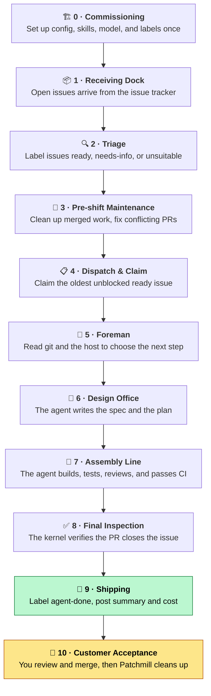
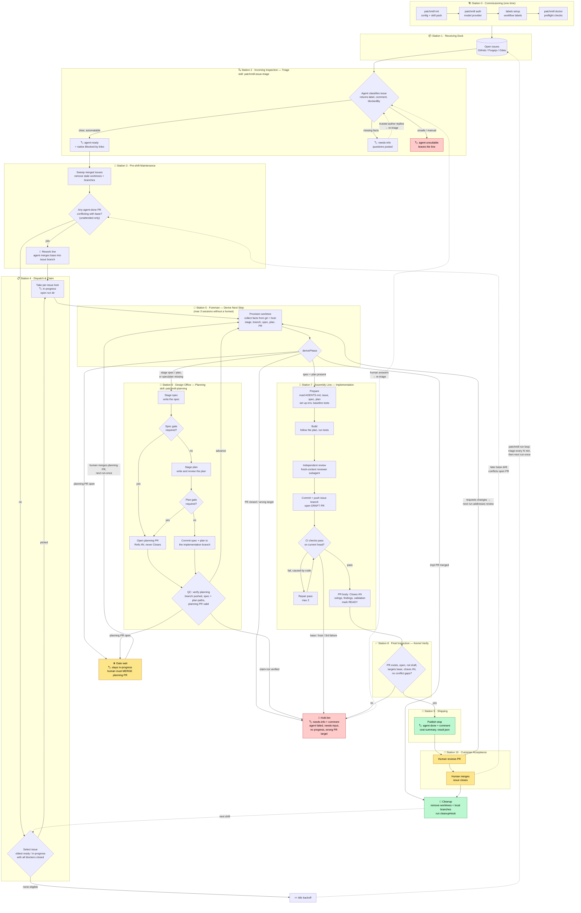

Patchmill works like a factory floor. An issue enters at the receiving dock and
leaves as a merged pull request. This page shows each station on the way and the
code or skill that runs it. Each station links to the page that describes it in
detail. For the skills that each phase loads, see
[Skills workflow](/reference/skills-workflow/).

## High-level view

## Stations

| #   | Station                                                                         | Code                                                       | What happens                                                                                                           |
| --- | ------------------------------------------------------------------------------- | ---------------------------------------------------------- | ---------------------------------------------------------------------------------------------------------------------- |
| 0   | [Commissioning](/getting-started/quickstart/)                                   | `init`, `auth`, `labels setup`, `doctor`                   | You set up the factory once.                                                                                           |
| 1   | [Receiving dock](/getting-started/configuration/#host-and-trust)                | host CLI (`gh` / `tea`)                                    | Open issues arrive as raw material.                                                                                    |
| 2   | [Triage](/using-patchmill/triage/)                                              | `src/kernel/triage.ts`, `patchmill-issue-triage`           | Each issue gets `agent-ready`, `needs-info`, or `agent-unsuitable`. Triage adds blocker links.                         |
| 3   | [Pre-shift maintenance](/using-patchmill/run/#merge-conflicts)                  | `src/kernel/merged-cleanup-sweep.ts`, `merge-conflicts.ts` | Patchmill cleans up merged issues. A `done` pull request that now conflicts with the base is fixed before new work.    |
| 4   | [Dispatch and claim](/using-patchmill/run-once/#claim-and-release)              | `src/kernel/issue-selection.ts`, `src/kernel/lock.ts`      | Patchmill picks the oldest ready issue with all blockers closed, locks it, and labels it `in-progress`.                |
| 5   | [Foreman](/using-patchmill/run-once/#phase-derivation)                          | `src/kernel/facts.ts`, `src/kernel/phase.ts`               | `derivePhase` reads git and the host to choose the next step. It keeps no remembered state.                            |
| 6   | [Design office](/reference/agent-workflow-lifecycle/#human-review-and-merge)    | `src/kernel/planning-workspace.ts`, `patchmill-planning`   | The agent writes the spec, then the plan. Each optional planning gate opens a planning pull request.                   |
| 7   | [Assembly line](/reference/skills-workflow/#implementation)                     | `patchmill-implementation`                                 | The agent prepares, builds, gets a reviewer subagent review, opens a draft pull request, and repairs CI at most twice. |
| 8   | [Final inspection](/using-patchmill/run-once/#outcome-checks)                   | `src/kernel/verify.ts`                                     | The kernel checks the pull request itself. The agent's "done" is not enough.                                           |
| 9   | [Shipping](/using-patchmill/run-once/#cost-reporting)                           | `src/kernel/publish.ts`                                    | Patchmill labels the issue `agent-done`, posts a comment with the cost, and writes `result.json`.                      |
| 10  | [Customer acceptance](/reference/agent-workflow-lifecycle/#cleanup-after-merge) | none                                                       | You review and merge. `src/kernel/merged-cleanup.ts` then removes the worktrees.                                       |

## Detailed view

Yellow nodes wait for a human. Red nodes stop the run. Green nodes are the
finished product. The planning and implementation boxes show only the kernel's
view. See [Skills workflow](/reference/skills-workflow/) for the skills inside
each box, and [Agent workflow lifecycle](/reference/agent-workflow-lifecycle/)
for the rules behind the gate wait, the hold bin, and cleanup.

## Two loops

- The inner loop runs inside one
  [`patchmill run-once`](/using-patchmill/run-once/). After each agent session,
  the foreman chooses the next phase again. It stops after three sessions
  without a human.
- The outer loop is [`patchmill run`](/using-patchmill/run/). It repeats
  `run-once`, runs triage every `run.triageIntervalMinutes`, and waits longer
  between passes when no issue is eligible.

The diagram leaves out two details. Interactive runs (`run-once --interactive`
and Web sessions) add a chat approval dialog at each gate and an "approve
without a PR" shortcut. A pause (Ctrl-C or `SIGTERM`) keeps the issue
`in-progress`, and the next run continues it.
