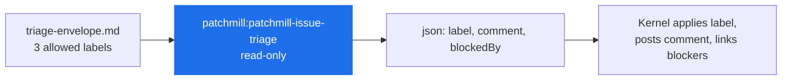
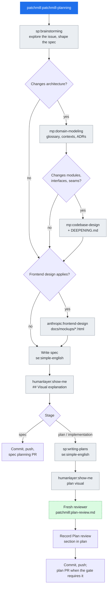
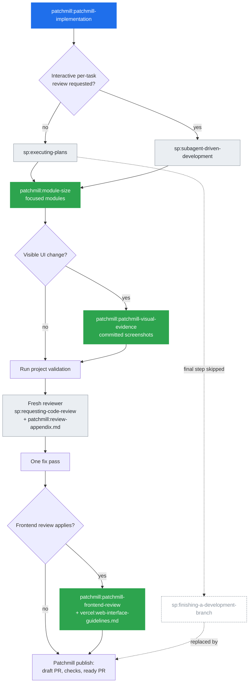

Each kernel phase loads one entry skill. The entry skill then reads its sibling
skills and supporting files from `.patchmill/skills/`. This page shows which
skills each phase uses and in what order. See
[Skills configuration](/guides/skills-configuration/) for how the pack is
installed, and [Agent workflow lifecycle](/reference/agent-workflow-lifecycle/)
for how merge gates connect the phases.

## Skill sources

| Prefix       | Source                                                      |
| ------------ | ----------------------------------------------------------- |
| `patchmill`  | Patchmill's own skills and supporting files                 |
| `sp`         | [Superpowers](https://github.com/obra/superpowers)          |
| `mp`         | [Matt Pocock skills](https://github.com/mattpocock/skills)  |
| `se`         | [SimpleEnglish](https://github.com/AminBlg/SimpleEnglish)   |
| `humanlayer` | [HumanLayer skills](https://github.com/humanlayer/skills)   |
| `anthropic`  | [Anthropic skills](https://github.com/anthropics/skills)    |
| `vercel`     | Vercel Web Interface Guidelines, pinned as a reference file |

## Overall workflow

```mermaid
flowchart TD
    classDef entry fill:#1f6feb,color:#fff,stroke:#1f6feb
    classDef pm fill:#2da44e,color:#fff,stroke:#2da44e
    classDef file fill:#dafbe1,color:#24292f,stroke:#2da44e,stroke-dasharray:4 2
    classDef up fill:#eaeef2,color:#24292f,stroke:#8c959f
    classDef skip fill:#fff,color:#8c959f,stroke:#8c959f,stroke-dasharray:4 2
    classDef gate fill:#fff8c5,color:#24292f,stroke:#d4a72c

    ISSUE(["New issue"]) --> TRIAGE

    subgraph TRIAGE["1. Triage · patchmill triage"]
        direction TB
        T1["patchmill:patchmill-issue-triage"]:::entry
        T2["Result: ready / needsInfo / unsuitable<br/>+ blockedBy"]
        T1 --> T2
    end

    TRIAGE -->|"ready, blockers closed"| PLANNING

    subgraph PLANNING["2. Planning · patchmill run-once"]
        direction TB
        P0["patchmill:patchmill-planning"]:::entry
        P1["sp:brainstorming"]:::up
        P2["mp:domain-modeling<br/><i>architecture changes</i>"]:::up
        P3["mp:codebase-design<br/><i>module, interface, seam changes</i>"]:::up
        P4["anthropic:frontend-design<br/><i>UI changes · HTML mockup</i>"]:::up
        P5["se:simple-english<br/><i>document prose</i>"]:::up
        P6["humanlayer:show-me<br/><i>Visual explanation</i>"]:::up
        P7["sp:writing-plans"]:::up
        P8["patchmill:plan-review.md<br/><i>fresh reviewer brief</i>"]:::file
        P0 --> P1 --> P2 --> P3 --> P4 --> P5 --> P6 --> P7 --> P8
    end

    PLANNING --> SG{"Spec / plan gate<br/>required?"}:::gate
    SG -->|"yes: human merges<br/>planning PR"| IMPLEMENTATION
    SG -->|"no: same branch"| IMPLEMENTATION

    subgraph IMPLEMENTATION["3. Implementation · patchmill run-once"]
        direction TB
        I0["patchmill:patchmill-implementation"]:::entry
        I1["sp:executing-plans<br/><i>kernel default</i>"]:::up
        I2["sp:subagent-driven-development<br/><i>interactive per-task review</i>"]:::up
        I3["patchmill:module-size<br/><i>advice</i>"]:::pm
        I4["patchmill:patchmill-visual-evidence<br/><i>UI changes · screenshots</i>"]:::pm
        I5["sp:requesting-code-review<br/><i>code-reviewer.md template</i>"]:::up
        I6["patchmill:review-appendix.md"]:::file
        I7["patchmill:patchmill-frontend-review<br/><i>UI changes</i>"]:::pm
        I8["vercel:web-interface-guidelines.md"]:::file
        I9["sp:finishing-a-development-branch<br/><i>skipped: Patchmill publish +<br/>PR checks replace it</i>"]:::skip
        I0 --> I1
        I0 -.-> I2
        I1 --> I3
        I2 --> I3
        I3 --> I4 --> I5
        I5 --- I6
        I5 --> I7
        I7 --- I8
        I1 -.-x I9
    end

    IMPLEMENTATION --> PR(["Ready PR · Closes #N"])
    PR -->|"human merges"| DONE(["Done · merged-cleanup sweep"])
```

Legend: blue = kernel entry skill, green = Patchmill sibling skill, light green
dashed = supporting file inside a skill directory, grey = upstream skill, white
dashed = upstream step that Patchmill skips. Italic text marks when a skill
applies.

## Triage

Triage reads no sibling skills.

## Planning

The order below follows `patchmill-planning`. Stage `spec` stops after the spec
and its planning PR. Stage `plan` and stage `implementation` continue to the
plan.

## Implementation

## Human-only skills

`patchmill-plan`, `patchmill-label`, and `patchmill-cleanup` run only in a
human-controlled session. The kernel never loads them. See
[Interactive skills](/using-patchmill/interactive-skills/).
